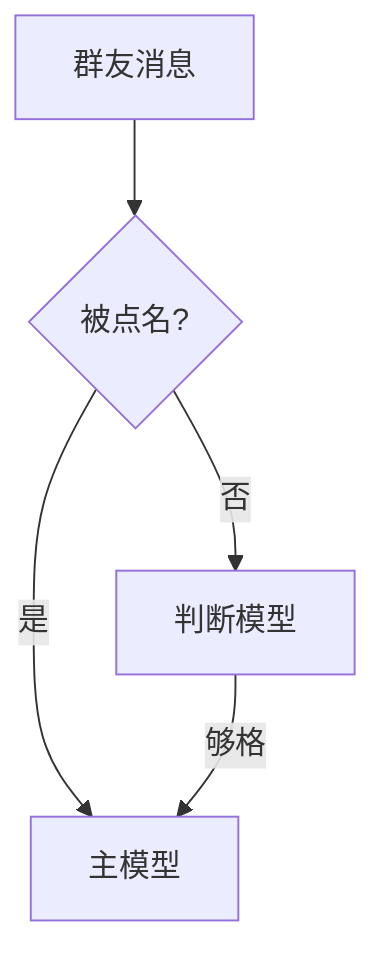

# 文章组件

文章是 `content/posts/<slug>.md`（英文版 `content/posts/en/<slug>.md`，同名即互为翻译）。下面每个组件写错时构建都会失败并指出文件和原因。

## 元数据

文件第一部分是 JSON，随后单独一行 `---`，再接 Markdown 正文。

```markdown
{"title":"标题","description":"一句话摘要","date":"2026-10-24","tag":"折腾","tags":["Linux","Laptop"]}
---
正文。
```

| 字段 | 必填 | 说明 |
| --- | --- | --- |
| `title` | 是 | 页面 h1；正文里不要再写 `# 标题` |
| `description` | 是 | 首页列表、RSS 和 meta description 里的摘要 |
| `date` | 是 | 发布日期 `YYYY-MM-DD` |
| `updated` | 否 | 实质修改日期，不早于 `date` |
| `tag` | 否 | 分类，只有一个，生成 `/categories/<名字>/` |
| `tags` | 否 | 标签列表，生成 `/tags/<名字>/` |
| `draft` | 否 | `true` 时正式构建跳过，`-drafts` 才构建 |
| `aliases` | 否 | 旧地址列表，如 `["/zh/折腾/x/"]`；生成 301 跳转，第一项也是 RSS guid |

其他字段会让构建失败。slug（文件名）只能用小写字母、数字和单个连字符。

## 标题与目录

正文从 `##` 开始。`##` 和 `###` 自动进入目录并得到锚点，中文保留原文：`## 问题一：屏幕花屏` → `#问题一屏幕花屏`。

## Markdown

GFM：段落、列表、引用、链接、表格（`---:` 右对齐）、删除线、任务列表。原始 HTML 和 `javascript:` 链接会被丢弃。不支持脚注、提示块（`[!NOTE]`）、MDX/JSX 和 Obsidian 嵌入。

## 图片

```markdown

```

- 路径相对于 Markdown 文件，原图放在 `content/images/`；也可以写 `/static/…`。
- JPEG、PNG、WebP、静态 GIF、AVIF 在构建时转成更小的 WebP（最宽 1600 px，宽图另有 720 px 版本给手机），自动补上宽高。SVG 和动图原样发布。
- 第一张图优先加载，其余懒加载。`http(s)://` 远程图片原样引用。

## 公式

行内 `$E = mc^2$`；独立公式把 `$$` 各放一行：

```markdown
$$
\frac{a}{b}
$$
```

构建时转成 MathML。`$` 后是空格、结束的 `$` 前是空格或后面紧跟数字时不算公式，所以 `$5 和 $10` 保持原样；需要字面 `$` 时写 `\$`。不支持的命令会让构建失败，例如 `\arg` 要写成 `\mathrm{arg}`。

## 代码

````markdown
```go
func main() {}
```
````

标明语言时构建时高亮，角落显示语言名和复制按钮；不标或语言未知时为纯文本。

引用 GitHub 源码时加 `src`（必须是带 commit 哈希的 blob 永久链接），可选 `title`；显示文件路径、真实行号和提交：

````markdown
```go src="https://github.com/owner/repo/blob/ad8012c1a0926822307f56454bd26be9ef9dd2dc/main.go#L76-L103" title="入口"
…
```
````

## 数据表格 `data`

````markdown
```data title="12 档 delta 的 Sharpe 对比" bars="BTC,ETH" mark="Δ0.35" note="周频收益 × √52 年化。"
Delta | BTC  | ETH
Δ0.05 | 4.40 | 1.18
Δ0.35 | 3.43 | 2.19
```
````

| 属性 | 说明 |
| --- | --- |
| `title` | 表格标题 |
| `note` | 表下注释 |
| `bars` | 画横条的列名，逗号分隔；横条从 0 开始，负值另一种颜色 |
| `scale` | `shared`（默认，所有横条共用比例）或 `column`（每列各自缩放） |
| `mark` | 强调的行，按第一列的值匹配，逗号分隔 |

第一行是表头，`|` 分隔，首尾 `|` 和 `---` 分隔行可有可无。单元格是纯文本；单元格里的第一个数字决定横条长度（`+1.2 BTC`、`−3.4%`、`$64,395` 都能识别）。全是数字的列自动右对齐。

## 图表 `chart`

和 `data` 一样的表格写法：第一列是 x（`YYYY-MM-DD` 日期、数字或分类），其余每列是一条序列。构建时画成静态 SVG，悬停显示数值。

````markdown
```chart line title="累计 PnL" note="每周五入场。"
周五 | BTC | ETH
2022-09-02 | -0.001 | -0.006
2022-09-09 | 0.004 | 0.002
```
````

| 类型 | 说明 |
| --- | --- |
| `line` | 折线；x 是日期时末端标出数值 |
| `area` | 面积 |
| `bar` | 柱状；单序列正负两色，多序列并排 |
| `scatter` | 散点，三列：标签 \| x \| y |

| 属性 | 说明 |
| --- | --- |
| `title`、`note` | 标题、图下注释 |
| `panels="true"` | 每条序列一格，各自 y 轴，共用 x 轴 |
| `mirror="true"` | 两条柱状序列背对背，第二条向下 |
| `diag="true"` | 散点加 y = x 参考线 |
| `mark` | 要标注的散点标签，逗号分隔 |
| `ref` | 竖直参考线的 x 值，逗号分隔 |
| `xfmt`、`yfmt` | printf 格式，如 `yfmt="%.0f%%"` |
| `xscale` | x 先乘以它再按 `xfmt` 格式化，如 `xfmt="$%.0fk" xscale="0.001"` |

## 动态图表 `echarts`

需要动画、悬停、图例开关，或者 `chart` 画不了的类型时用。主题已经配好颜色的类型：折线、柱状、散点、饼/环、热力图（含日历热力图）、桑基、树图、漏斗、雷达、箱线、K 线、仪表盘。其他类型或组件（如旭日图、`dataZoom`）还没有配色，构建会报“colors not from a var(--token)”，要先在 `templates/js/chart-theme.js` 里给它们设好 token 颜色。正文是一个 [ECharts 6](https://echarts.apache.org/zh/option.html) 的 option，必须是合法 JSON：

````markdown
```echarts title="每周模型调用，按模型" note="截至 11 月 1 日。" height="320"
{
  "tooltip": {"trigger": "axis"},
  "legend": {},
  "xAxis": {"type": "category", "data": ["08-07", "08-14", "08-21"]},
  "yAxis": {"type": "value"},
  "series": [
    {"name": "DeepSeek", "type": "bar", "stack": "all", "data": [3154, 7664, 6590]},
    {"name": "Gemini", "type": "bar", "stack": "all", "data": [0, 0, 3223]}
  ]
}
```
````

| 属性 | 说明 |
| --- | --- |
| `title` | 必填，图上方的标题，也是读屏文字；图号 FIGURE n 自动编 |
| `note` | 图下的注释：数据来源、时间范围、口径 |
| `height` | 像素，160–720，默认 360；宽度跟随正文 |

- 构建时在无头 Chrome 里画成静态 SVG，没有 JS 时也看得到（按正文宽度画好再缩放，手机上字会很小；RSS 阅读器不认 `var(--…)`，颜色会丢）。页面上图滚进视口时 ECharts 接管，图表动画画出，可悬停、可点图例。
- 只能写 JSON，不能写函数：`formatter` 用字符串模板，如 `"{value}%"`、`"{b}: {c}"`；`tooltip.valueFormatter` 也写成模板 `"{value}%"`，页面会把它变成函数。其他只接受函数的选项不能用。
- 系列类型写错（如 `"barz"`）、`series` 为空、或者某个系列画不出来，构建都会失败。
- **颜色只能写 `var(--名字)`**：写 `#hex`、`rgb()`、`red` 这样的颜色名会构建失败，这样深浅色都对。颜色键（`color`、`borderColor`、`inRange.color` …）里还可以写 `transparent`、`none`、`auto`、`gradient` 等关键字。可用：`clay`（强调）、`stone`（对照的中性色）、`sky`、`olive`、`kraft`、`fig`，以及 `ink`、`body`、`muted`、`faint`、`line`、`grid`、`card`、`paper`、`wash`、`clay-wash`。
- 主题（`templates/js/chart-theme.js`）已经设好字体、坐标轴、网格、提示框、动画和系列配色，option 里不要再写这些样式。
- 不要写 ECharts 的 `title` 组件，标题用 `title` 属性。`grid`、`legend` 位置一般不用改。

## 示意图 `mermaid`

流程、时序、状态、结构关系用 [Mermaid](https://mermaid.js.org/)，不要画 ASCII 图：

````markdown

````

属性只有 `title`（必填）和 `note`。构建时画成 SVG，配色跟随深浅色，页面上不加载任何脚本，节点一般不需要单独上色；要强调某个节点时，`style`/`classDef` 只能写 token，如 `style A fill:var(--clay-wash),stroke:var(--clay)`。语法错误会让构建失败并给出 Mermaid 的报错。正文栏约 700 px 宽，手机上约 324 px：比 520 px 宽的图在手机上横向滚动。流程图优先 `TD`（从上到下），一行写不下的节点文字会自动换行，节点控制在十个左右。

## 手绘示意图 `sketch`

Mermaid 自动排版不够用时（要并排对比、按比例画、画容器的层层嵌套、在一条色带上标位置），直接写 SVG。什么时候该画、怎么画得好，见 `post-diagrams` skill。样子学 Anthropic 工程博客的示意图：暖灰底板、细描边的节点、按角色上色的标签、细灰线加开口箭头、大量留白。

````markdown
```sketch title="前缀只追加，缓存才接得上" note="上：正确的投影；下：错误做法。"
<svg viewBox="0 0 704 180">
  <rect class="panel" x="0" y="0" width="704" height="180" rx="12"/>
  <text class="caps" x="24" y="30">只追加</text>
  <g class="node blue"><rect x="112" y="52" width="72" height="34" rx="4"/><text class="mid" x="148" y="69">system</text></g>
  <g class="node plain"><rect x="188" y="52" width="236" height="34" rx="4"/><text class="mid" x="306" y="69">历史消息</text></g>
  <path class="edge" d="M424 69 H470" marker-end="url(#arrow)"/>
</svg>
```
````

属性只有 `title`（必填）和 `note`。构建时只检查、不渲染，不需要 Chrome。

- **画布**：`viewBox="0 0 宽 高"`，宽一般就是 704（正文栏），高按内容定；`<svg>` 上不写 `width`/`height`/`class`/颜色，页面会自适应。
- **手机版**：手机正文栏只有约 324 px，704 宽的图会整体缩小到一半，小字看不清，并排的对比也挤成一团。所以稍复杂的图都在同一个代码块里再写第二个 `<svg>`：宽不超过 400（一般 340），把并排的东西改成上下排、把长标签换行。页面在 640 px 以下显示第二个，以上显示第一个。只有一个 `<svg>` 时，手机上整体缩小显示。
- **只能用画图元素**：`g rect circle ellipse line path polyline polygon text tspan defs marker use symbol clipPath title desc`。`script`、`style` 属性、`foreignObject`、渐变、事件属性、外部链接都会让构建失败。
- **颜色用 class**，需要时 `fill`/`stroke` 写 `var(--token)`（同 echarts 的 token 表，另有 `panel node node-line edge` 和 `blue teal orange violet` 及其 `-wash`、`-ink`、`clay-ink`），写死的颜色会构建失败。
- **id 会自动加上图的前缀**，`url(#id)` 和 `href="#id"` 跟着改；`marker-end="url(#arrow)"` 是现成的开口箭头，不用自己定义。

| class | 用在 | 样子 |
| --- | --- | --- |
| `panel` | 背景 `rect` | 暖灰底板，不描边；左右对比就画两块 |
| `window` | `rect` | 虚线圆角框：上下文窗口、沙箱、一组东西的边界 |
| `node` | 包住 `rect`+`text` 的 `g` | 暖灰填充、深灰细描边的节点 |
| `node plain` / `blue` / `teal` / `orange` / `violet` / `clay` | 同上 | 白底；或按角色上色：blue=system prompt/指令，teal=文档/产出/好的结果，orange=工具，violet=记忆/附注，clay=输入输出（配 `rx` 画成胶囊） |
| `edge`、`edge dash`、`edge hot` | `path`/`line` | 1.25px 灰线；虚线=可选/并行；clay=出问题的地方 |
| `caps` | `text` | 等宽小号、自动转大写，板块标题，如“preprocessing” → PREPROCESSING |
| `small`、`b`、`mid`、`end`、`accent` | `text` | 11px 灰色说明、加粗、居中、右对齐、clay 强调色 |
| `glyph` | `circle` | 模型图标的小圆点（几个点排成网格） |

画法：
- 先定网格：行高 34、节点间距 4–24、板块内边距 24；同一行的节点底边对齐，文字 `y` 取节点中线（`text` 已经垂直居中）。
- 中文 13px 一个字约 13px 宽，英文和数字约 8px；先算好文字宽度再定节点宽度，留 12px 以上左右余量。
- 连线用直角折线 `M x y H x2 V y2`，箭头指向节点边缘外 2–4px。
- 一张图讲一件事：对比就并排两块 `panel`，流程就一条主线，层级就嵌套 `window`。
- 写完一定在浏览器里看：深浅两种配色、1280 和 390 两种宽度（390 时看到的是手机版），文字不出框、不压线。

## 图表风格

图的样子参考 Anthropic 博客的图：安静、只强调一件事、数字直接写在图上。

- **一张图只说一个结论**，标题写成那个结论或者它回答的问题，`note` 写来源、时间范围和口径。数据必须是真实的，换算或假设要在 `note` 里说明。
- **只强调一个系列**：要读者看的那个用 `var(--clay)`，对照组用 `var(--stone)`；多个系列地位相同时才用默认配色。柱子突出单根时，在那根数据上写 `{"value": 25, "itemStyle": {"color": "var(--clay)"}}`，其余设为 `stone`。
- **直接标注，少用图例**：柱状图加 `"label": {"show": true, "position": "top"}`（横向用 `"right"`）；折线加 `"endLabel": {"show": true, "formatter": "{a}"}`，并把 `grid.right` 调大到能放下名字。只有两三个系列且没有直接标注时才用 `legend`。
- 阈值、事件用 `markLine` / `markArea` 标在图上，标签写清是什么（如“压缩阈值 110K”）。
- 坐标轴带单位（`"axisLabel": {"formatter": "{value}K"}`、`"name"`），大数换成千或百万。
- 手机上正文栏只有约 324 px：分类标签要短（“命中 85%”而不是“缓存命中率 85%（实测）”），细节放进 `note`；横向柱状图的分类名尤其要短，不然柱子会被挤得很窄。
- 数据来自某个快照或时间段时，`note` 写明截止时间；同一篇里和别的表口径不同时，说清差在哪里。
- 不要 3D、渐变、阴影、圆角大柱子，不要双 y 轴硬凑两个无关的量（两组量纲不同的数据用两个 `grid` 上下排）。

选组件：要读精确数值、或者行数多 → `data`；几个关键数字 → `stats`；要动画、交互或其他图形 → `echarts`；简单的静态线/柱且不想加载脚本 → `chart`；普通的关系和流程 → `mermaid`；要讲清一个结构（对比、比例、嵌套、色带上的位置）→ `sketch`。

## 指标卡 `stats`

````markdown
```stats title="周末卖方策略" meta="Deribit · 208 周" note="单利，币本位。"
## BTC 单利币本位
总收益 | +1.166 | +116.6%
胜率 | 81.25% | 169 / 39 周
```
````

`## ` 开始一组，第一个词加粗。其余每行是 `标签 | 数值 | 说明`（说明可省略）；以 `+` 开头的数值用强调色。属性：`title`、`meta`（标题右侧的小字）、`note`。

## 行情卡

单独一段写：

```markdown
::tv BINANCE:BTCUSDT 比特币 interval=W height=480
```

或只写 `$BTC`、`$NASDAQ:AAPL`。常见币种（BTC、ETH、SOL……）自动对应 Binance 的 USDT 交易对。生成一张带 TradingView 链接的卡片，读者点击按钮后才加载实时图表。`interval` 默认 `D`，`height` 默认 420。
