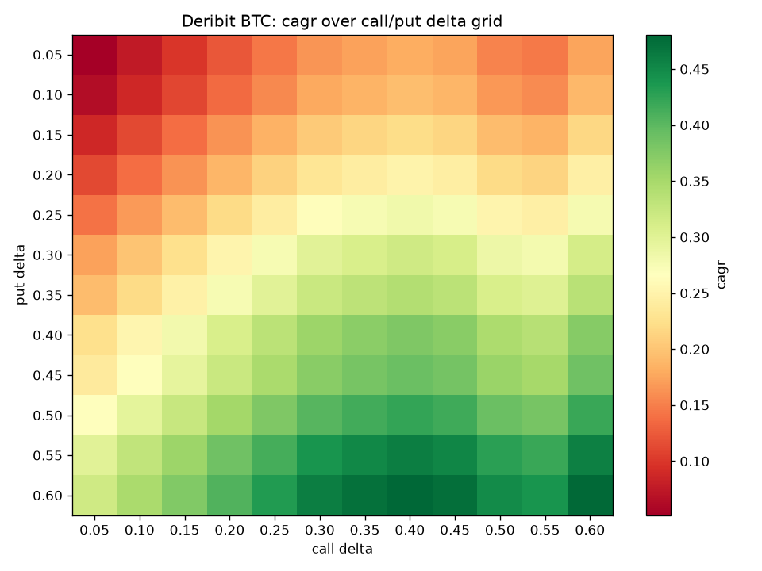
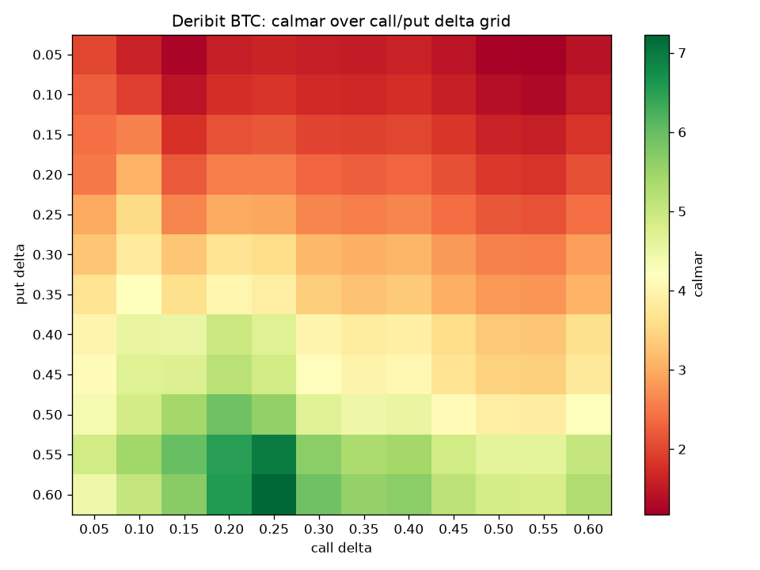

{"title":"一个利用加密周末低波动盈利的策略","description":"用 Deribit 公开数据回测一个加密货币期权周末卖方策略：2022-09 至 2026-08 共 208 个周末，BTC 35Δ 档总收益 +1.166 BTC、胜率 81.3%，也出现过单周亏掉十几周平均盈利的尾部事件。","date":"2026-08-27","tag":"交易","tags":["期权","回测","加密货币","Deribit","backtest-0001"],"image":"../images/weekend-strangle-options.webp","aliases":["/zh/Trading/crypto-options-weekend-strangle-backtest/"]}
---
加密货币周末的行情如今已经和尊贵的美股市场接轨，绝大部分时候是两天的划水。

那么，有没有策略可以在周末这两天获利？

答案是有的，就是期权做空波动率策略。在持有现货的基础上，每周五卖出周日到期的虚值宽跨式组合（Short Strangle），硬吃 40 小时的权利金与 Theta 时间价值衰减。

我把这个策略在 Deribit 的官方公开数据上完整回测了 4 年共 208 个周末（2022-09 至 2026-08），BTC 和 ETH 各跑一遍。这篇文章既讲收益，也讲手把手的实操细节、数学定价底座，以及每一次让卖方痛彻心扉的尾部代价。

## 策略是什么

简单说，就是**卖波动率保险**。

期权隐含波动率（IV）在多数时候系统性高于随后实际实现的波动率（RV）——买方为了防范极端行情愿意多付溢价，卖方就赚取二者之差。而周末由于传统金融市场休市、宏观重磅数据真空，加密市场的实际波动通常显著低于工作日，但期权仍按连续时间定价，为短周期做空波动率提供了天然温床。

但必须先把定性摆在桌面上：**这绝对不是无风险套利**。

卖方收益有顶（最多收满当周全部权利金），亏损却没有硬顶。当周末突发地缘冲突、监管利空或流动性抽干时，加密市场是全球唯一 7×24 小时开盘承接抛压的资产，单次跳空足以抹去数周乃至数月的积累。

> 此策略需谨慎尝试，因为它会让你的周末过得很慢。别涨了……别跌了……拜托别动了……

## 怎么操作：保姆级实操推演

如果你手里持有 1 个 BTC 现货，想要在实盘执行这个策略，流程非常机械：

::tv BINANCE:BTCUSDT 比特币 / USDT 现货

### 1. 进场时机

每周五 16:00 UTC（即**北京时间周五夜里 24:00**），登录 Deribit 网页或 API。

### 2. 挑选合约

进入期权行情看板，筛选**当周周日 08:00 UTC（北京时间周日下午 16:00）到期**的日度合约，持仓周期正好约 40 小时。
在合约列表中寻找 BS Delta 绝对值最接近目标档位（基准取 0.35）的两条腿：

- **Call 腿**：寻找 Delta 最接近 `+0.35` 的虚值看涨期权（例如当前 BTC 现价 64,000 美元，选取行权价 65,500 美元的 Call）。
- **Put 腿**：寻找 Delta 最接近 `-0.35` 的虚值看跌期权（例如选取行权价 62,500 美元的 Put）。

### 3. 下单卖出

- 卖出 1 张选定的 Call 合约；
- 卖出 1 张选定的 Put 合约；
- 此时账户立即收到两腿权利金（假设合计约 `0.011 BTC`，即名义资产的 1.1% 左右）。

### 4. 仓位与保证金角色

- **Call 腿**：手中持有的 1 BTC 现货天然充当了备兑抵押品（Covered Call），即使行情大涨，现货升值也会覆盖大部分交割赔付。
- **Put 腿**：属于裸卖看跌期权（Naked Short Put），必须在账户内预留足够的可用保证金，防范极端暴跌行情下的强平风控。

### 5. 周日到期自动结算

周日 08:00 UTC，Deribit 系统会采集 **07:30 ~ 08:00 UTC 的 Deribit Index 时间加权平均价（TWAP）** 作为官方交割价，进行现金交割：

- **情景 A（完美划水）**：周末交割价落在 62,500 ~ 65,500 美元之间。两张期权均为虚值作废，净赚全部 `0.011 BTC` 权利金，下周继续！
- **情景 B（单边突破）**：周末交割价冲至 66,000 美元或跌至 61,000 美元。系统自动扣除实值部分的币本位赔付，当赔付小于收到的保费时依然微利，超出平衡点后产生净亏损。

## 数学与定价底座

回测代码中的每一笔损益，背后都有严格的定价方程。这一节把它们完整列出。

### 1. Black-Scholes 定价模型 (r = 0)

40 小时的持仓窗口极短，贴现与远期定价的影响在万分之一以下（Deribit 逆向期权采用远期隐含利率 $R = \frac{\ln(F/X)}{T}$，短周期下可作为无风险利率 $r = 0$ 的极佳近似）：

$$
C = S\,N(d_1) - K\,N(d_2), \qquad P = K\,N(-d_2) - S\,N(-d_1)
$$

$$
d_1 = \frac{\ln(S/K) + \frac{1}{2}\sigma^2 T}{\sigma\sqrt{T}}, \qquad d_2 = d_1 - \sigma\sqrt{T}
$$

公式中的核心参数：$S$ 为周五 16:00 入场时的标的现货价格（USD），$K$ 为期权行权价，$\sigma$ 为年化隐含波动率（IV），$T$ 为以年为单位的持仓期限（40 小时折算为 $T = 40 / (365 \times 24) \approx 0.004566$ 年），$N(\cdot)$ 为标准正态累积分布函数。

### 2. Delta 选约与风险中性行权概率

Delta 度量了期权理论价对标的价格的一阶导数：

$$
\Delta_C = N(d_1), \qquad \Delta_P = N(d_1) - 1
$$

需要严格区分的是：
- 在 Black-Scholes 框架下，看涨期权的风险中性行权概率为 $N(d_2)$，而非 Delta 本身 $N(d_1)$（二者高度相关但存在偏置）；
- 真实世界的加密资产收益分布存在显著的**厚尾（Heavy Tails）与负偏态（Negative Skewness）**，实际被击穿进入实值的物理概率不能简单由 Delta 直接替代。35Δ 仅代表标准正态假设下的理论选约参考档位。

### 3. 隐含波动率 (IV) 反推

市面上能观测到的是成交价，代码通过二分法求解理论价与市价之差为零的根，反解出隐含波动率 $\sigma^*$：

$$
\sigma^* = \mathrm{arg}\,\min_\sigma \left| V_{\mathrm{BS}}(S, K, \sigma, T) - P_{\mathrm{USD}} \right|
$$

### 4. 币本位 Payoff 与赔付摊薄效应

Deribit 期权面值以 BTC/ETH 计价，到期现金结算以币支付：

$$
\pi_C = \frac{\max(S_T - K,\ 0)}{S_T}, \qquad \pi_P = \frac{\max(K - S_T,\ 0)}{S_T}
$$

注意分母中的 $S_T$：当标的大涨时，由于 BTC 单价更高，折算后的币本位赔付反而被稀释，形成了天然的向上次线性亏损。单腿卖方净损益为 $\mathrm{PnL}_{\mathrm{leg}} = p - \pi - f_{\mathrm{open}} - f_{\mathrm{settle}}$。

### 5. 交易所费率模型与封顶机制

Deribit 设定了费率上限，深度虚值时按比例保护：

$$
f_{\mathrm{open}} = \min(0.03\%,\ 0.125\,p), \qquad f_{\mathrm{settle}} = \mathbb{1}_{\pi > 0} \cdot \min(0.015\%,\ 0.125\,\pi)
$$

*注：按 Deribit 当前官方规则，BTC/ETH Daily Options 的交割行权费（Delivery Fee）已调整为 **0%**；本回测沿用历史通用的 0.015% 封顶费率模型，计算口径偏保守。*

## 回测结果看板

基于 2022-09-02 至 2026-08-21 共 208 个周末的历史全量回测结果如下：

```stats title="35Δ 周末卖方策略（Short Strangle）" meta="Deribit · 2022-09 → 2026-08 · 208 周"
## BTC 单利币本位
总收益 | +1.166 | +116.6% · ≈ $64,395
胜率 | 81.25% | 169 / 39 周
Sharpe | 3.43 | 盈亏比 3.43
最大回撤 | -0.105 | -10.5%
权利金留存 | 47.1% | 收取 2.475
周均收益 | +0.561% | 手续费 0.1389
最佳单周 | +0.0269 | 平均盈利 +0.0097
最差单周 | -0.0596 | 平均亏损 −0.0123
## ETH 单利币本位
总收益 | +1.146 | +114.6% · ≈ $2,418
胜率 | 78.85% | 164 / 44 周
Sharpe | 2.19 | 盈亏比 2.30
最大回撤 | -0.111 | -11.1%
权利金留存 | 34.3% | 收取 3.343
周均收益 | +0.551% | 手续费 0.1406
最佳单周 | +0.0474 | 平均盈利 +0.0124
最差单周 | -0.1018 | 平均亏损 −0.0201
```

### 1. 35Δ 到期损益结构

以 208 周的中位参数（入场现货 63,791 美元，Call 行权价 64,500 美元，Put 行权价 63,000 美元，两腿合计保费 0.011 BTC）计算理论到期损益：

```chart line title="35Δ Short Strangle 到期损益结构" ref="62315,65217" xfmt="$%.0fk" xscale="0.001" note="单位 BTC，中位参数示意：每腿保费约 0.0055 BTC，行权价 63,000 / 64,500。虚线为上下盈亏平衡点。"
交割价 | 组合净损益 | Call 腿 | Put 腿
56000 | -0.1140 | +0.0055 | -0.1195
56200 | -0.1100 | +0.0055 | -0.1155
56400 | -0.1060 | +0.0055 | -0.1115
56600 | -0.1021 | +0.0055 | -0.1076
56800 | -0.0982 | +0.0055 | -0.1037
57000 | -0.0943 | +0.0055 | -0.0998
57200 | -0.0904 | +0.0055 | -0.0959
57400 | -0.0866 | +0.0055 | -0.0921
57600 | -0.0828 | +0.0055 | -0.0882
57800 | -0.0790 | +0.0055 | -0.0845
58000 | -0.0752 | +0.0055 | -0.0807
58200 | -0.0715 | +0.0055 | -0.0770
58400 | -0.0678 | +0.0055 | -0.0733
58600 | -0.0641 | +0.0055 | -0.0696
58800 | -0.0604 | +0.0055 | -0.0659
59000 | -0.0568 | +0.0055 | -0.0623
59200 | -0.0532 | +0.0055 | -0.0587
59400 | -0.0496 | +0.0055 | -0.0551
59600 | -0.0460 | +0.0055 | -0.0515
59800 | -0.0425 | +0.0055 | -0.0480
60000 | -0.0390 | +0.0055 | -0.0445
60200 | -0.0355 | +0.0055 | -0.0410
60400 | -0.0320 | +0.0055 | -0.0375
60600 | -0.0286 | +0.0055 | -0.0341
60800 | -0.0252 | +0.0055 | -0.0307
61000 | -0.0218 | +0.0055 | -0.0273
61200 | -0.0184 | +0.0055 | -0.0239
61400 | -0.0151 | +0.0055 | -0.0206
61600 | -0.0117 | +0.0055 | -0.0172
61800 | -0.0084 | +0.0055 | -0.0139
62000 | -0.0051 | +0.0055 | -0.0106
62200 | -0.0019 | +0.0055 | -0.0074
62400 | +0.0014 | +0.0055 | -0.0041
62600 | +0.0046 | +0.0055 | -0.0009
62800 | +0.0078 | +0.0055 | +0.0023
63000 | +0.0110 | +0.0055 | +0.0055
63200 | +0.0110 | +0.0055 | +0.0055
63400 | +0.0110 | +0.0055 | +0.0055
63600 | +0.0110 | +0.0055 | +0.0055
63800 | +0.0110 | +0.0055 | +0.0055
64000 | +0.0110 | +0.0055 | +0.0055
64200 | +0.0110 | +0.0055 | +0.0055
64400 | +0.0110 | +0.0055 | +0.0055
64600 | +0.0095 | +0.0040 | +0.0055
64800 | +0.0064 | +0.0009 | +0.0055
65000 | +0.0033 | -0.0022 | +0.0055
65200 | +0.0003 | -0.0052 | +0.0055
65400 | -0.0028 | -0.0083 | +0.0055
65600 | -0.0058 | -0.0113 | +0.0055
65800 | -0.0088 | -0.0143 | +0.0055
66000 | -0.0117 | -0.0172 | +0.0055
66200 | -0.0147 | -0.0202 | +0.0055
66400 | -0.0176 | -0.0231 | +0.0055
66600 | -0.0205 | -0.0260 | +0.0055
66800 | -0.0234 | -0.0289 | +0.0055
67000 | -0.0263 | -0.0318 | +0.0055
67200 | -0.0292 | -0.0347 | +0.0055
67400 | -0.0320 | -0.0375 | +0.0055
67600 | -0.0349 | -0.0404 | +0.0055
67800 | -0.0377 | -0.0432 | +0.0055
68000 | -0.0405 | -0.0460 | +0.0055
68200 | -0.0433 | -0.0488 | +0.0055
68400 | -0.0460 | -0.0515 | +0.0055
68600 | -0.0488 | -0.0543 | +0.0055
68800 | -0.0515 | -0.0570 | +0.0055
69000 | -0.0542 | -0.0597 | +0.0055
69200 | -0.0569 | -0.0624 | +0.0055
69400 | -0.0596 | -0.0651 | +0.0055
69600 | -0.0623 | -0.0678 | +0.0055
69800 | -0.0649 | -0.0704 | +0.0055
70000 | -0.0676 | -0.0731 | +0.0055
70200 | -0.0702 | -0.0757 | +0.0055
70400 | -0.0728 | -0.0783 | +0.0055
70600 | -0.0754 | -0.0809 | +0.0055
70800 | -0.0780 | -0.0835 | +0.0055
71000 | -0.0805 | -0.0860 | +0.0055
71200 | -0.0831 | -0.0886 | +0.0055
71400 | -0.0856 | -0.0911 | +0.0055
71600 | -0.0882 | -0.0937 | +0.0055
71800 | -0.0907 | -0.0962 | +0.0055
72000 | -0.0932 | -0.0987 | +0.0055
```

中间平台为保费全收区间（交割价波动在 ±2.3% 以内）；超出上下盈亏平衡点（62,315 美元与 65,217 美元）后开始进入亏损区。

### 2. 累计权益与水下回撤

单利口径下（每周固定卖 1 张合约，不累进本金），BTC 累计获利 +1.166 BTC，ETH 累计获利 +1.146 ETH：

```chart line title="35Δ 累计 PnL（币本位，单利）" note="2022-09-02 至 2026-08-21，每周五入场。BTC 单位为 BTC，ETH 单位为 ETH。"
周五 | BTC | ETH
2022-09-02 | -0.001 | -0.006
2022-09-09 | +0.014 | +0.010
2022-09-16 | +0.028 | +0.033
2022-09-23 | +0.049 | +0.051
2022-09-30 | +0.057 | +0.046
2022-10-07 | +0.067 | +0.061
2022-10-14 | +0.081 | +0.069
2022-10-21 | +0.093 | +0.076
2022-10-28 | +0.098 | +0.049
2022-11-04 | +0.102 | +0.068
2022-11-11 | +0.128 | +0.116
2022-11-18 | +0.142 | +0.137
2022-11-25 | +0.154 | +0.142
2022-12-02 | +0.168 | +0.145
2022-12-09 | +0.176 | +0.159
2022-12-16 | +0.187 | +0.170
2022-12-23 | +0.194 | +0.181
2022-12-30 | +0.199 | +0.187
2023-01-06 | +0.205 | +0.194
2023-01-13 | +0.159 | +0.158
2023-01-20 | +0.100 | +0.138
2023-01-27 | +0.113 | +0.152
2023-02-03 | +0.124 | +0.168
2023-02-10 | +0.134 | +0.181
2023-02-17 | +0.150 | +0.204
2023-02-24 | +0.162 | +0.215
2023-03-03 | +0.172 | +0.229
2023-03-10 | +0.181 | +0.230
2023-03-17 | +0.199 | +0.236
2023-03-24 | +0.217 | +0.254
2023-03-31 | +0.233 | +0.269
2023-04-07 | +0.241 | +0.271
2023-04-14 | +0.254 | +0.286
2023-04-21 | +0.263 | +0.297
2023-04-28 | +0.275 | +0.312
2023-05-05 | +0.277 | +0.298
2023-05-12 | +0.276 | +0.308
2023-05-19 | +0.289 | +0.321
2023-05-26 | +0.289 | +0.331
2023-06-02 | +0.299 | +0.339
2023-06-09 | +0.287 | +0.308
2023-06-16 | +0.276 | +0.303
2023-06-23 | +0.291 | +0.318
2023-06-30 | +0.300 | +0.308
2023-07-07 | +0.311 | +0.316
2023-07-14 | +0.297 | +0.305
2023-07-21 | +0.306 | +0.313
2023-07-28 | +0.313 | +0.321
2023-08-04 | +0.318 | +0.327
2023-08-11 | +0.326 | +0.333
2023-08-18 | +0.343 | +0.347
2023-08-25 | +0.351 | +0.356
2023-09-01 | +0.358 | +0.363
2023-09-08 | +0.368 | +0.369
2023-09-15 | +0.376 | +0.373
2023-09-22 | +0.383 | +0.378
2023-09-29 | +0.387 | +0.383
2023-10-06 | +0.393 | +0.391
2023-10-13 | +0.401 | +0.397
2023-10-20 | +0.406 | +0.398
2023-10-27 | +0.417 | +0.410
2023-11-03 | +0.429 | +0.393
2023-11-10 | +0.444 | +0.405
2023-11-17 | +0.454 | +0.415
2023-11-24 | +0.465 | +0.426
2023-12-01 | +0.464 | +0.413
2023-12-08 | +0.476 | +0.426
2023-12-15 | +0.489 | +0.439
2023-12-22 | +0.499 | +0.450
2023-12-29 | +0.519 | +0.463
2024-01-05 | +0.537 | +0.486
2024-01-12 | +0.526 | +0.472
2024-01-19 | +0.534 | +0.485
2024-01-26 | +0.532 | +0.492
2024-02-02 | +0.537 | +0.500
2024-02-09 | +0.537 | +0.509
2024-02-16 | +0.549 | +0.522
2024-02-23 | +0.557 | +0.519
2024-03-01 | +0.567 | +0.535
2024-03-08 | +0.578 | +0.558
2024-03-15 | +0.574 | +0.527
2024-03-22 | +0.592 | +0.554
2024-03-29 | +0.601 | +0.549
2024-04-05 | +0.608 | +0.559
2024-04-12 | +0.561 | +0.472
2024-04-19 | +0.585 | +0.484
2024-04-26 | +0.598 | +0.448
2024-05-03 | +0.589 | +0.462
2024-05-10 | +0.605 | +0.478
2024-05-17 | +0.617 | +0.492
2024-05-24 | +0.621 | +0.491
2024-05-31 | +0.630 | +0.504
2024-06-07 | +0.623 | +0.493
2024-06-14 | +0.631 | +0.488
2024-06-21 | +0.641 | +0.505
2024-06-28 | +0.649 | +0.517
2024-07-05 | +0.659 | +0.533
2024-07-12 | +0.649 | +0.539
2024-07-19 | +0.659 | +0.554
2024-07-26 | +0.685 | +0.572
2024-08-02 | +0.664 | +0.552
2024-08-09 | +0.676 | +0.548
2024-08-16 | +0.676 | +0.559
2024-08-23 | +0.658 | +0.558
2024-08-30 | +0.672 | +0.572
2024-09-06 | +0.688 | +0.591
2024-09-13 | +0.699 | +0.603
2024-09-20 | +0.710 | +0.616
2024-09-27 | +0.721 | +0.621
2024-10-04 | +0.734 | +0.634
2024-10-11 | +0.744 | +0.645
2024-10-18 | +0.755 | +0.657
2024-10-25 | +0.763 | +0.660
2024-11-01 | +0.770 | +0.665
2024-11-08 | +0.758 | +0.616
2024-11-15 | +0.765 | +0.624
2024-11-22 | +0.783 | +0.634
2024-11-29 | +0.790 | +0.646
2024-12-06 | +0.802 | +0.665
2024-12-13 | +0.807 | +0.677
2024-12-20 | +0.831 | +0.703
2024-12-27 | +0.842 | +0.716
2025-01-03 | +0.852 | +0.728
2025-01-10 | +0.867 | +0.745
2025-01-17 | +0.877 | +0.727
2025-01-24 | +0.890 | +0.743
2025-01-31 | +0.847 | +0.667
2025-02-07 | +0.856 | +0.678
2025-02-14 | +0.863 | +0.694
2025-02-21 | +0.866 | +0.698
2025-02-28 | +0.884 | +0.736
2025-03-07 | +0.896 | +0.764
2025-03-14 | +0.913 | +0.783
2025-03-21 | +0.921 | +0.778
2025-03-28 | +0.930 | +0.789
2025-04-04 | +0.949 | +0.810
2025-04-11 | +0.945 | +0.817
2025-04-18 | +0.952 | +0.832
2025-04-25 | +0.958 | +0.849
2025-05-02 | +0.955 | +0.862
2025-05-09 | +0.966 | +0.839
2025-05-16 | +0.970 | +0.839
2025-05-23 | +0.976 | +0.845
2025-05-30 | +0.985 | +0.848
2025-06-06 | +0.990 | +0.864
2025-06-13 | +1.003 | +0.883
2025-06-20 | +1.004 | +0.819
2025-06-27 | +1.010 | +0.831
2025-07-04 | +1.017 | +0.845
2025-07-11 | +1.024 | +0.865
2025-07-18 | +1.032 | +0.869
2025-07-25 | +1.028 | +0.859
2025-08-01 | +1.025 | +0.847
2025-08-08 | +1.023 | +0.816
2025-08-15 | +1.029 | +0.835
2025-08-22 | +1.031 | +0.841
2025-08-29 | +1.040 | +0.840
2025-09-05 | +1.047 | +0.860
2025-09-12 | +1.053 | +0.858
2025-09-19 | +1.057 | +0.868
2025-09-26 | +1.065 | +0.885
2025-10-03 | +1.061 | +0.898
2025-10-10 | +1.013 | +0.857
2025-10-17 | +1.024 | +0.879
2025-10-24 | +1.025 | +0.887
2025-10-31 | +1.032 | +0.900
2025-11-07 | +1.042 | +0.897
2025-11-14 | +1.056 | +0.920
2025-11-21 | +1.057 | +0.946
2025-11-28 | +1.053 | +0.944
2025-12-05 | +1.058 | +0.950
2025-12-12 | +1.067 | +0.964
2025-12-19 | +1.078 | +0.982
2025-12-26 | +1.084 | +0.997
2026-01-02 | +1.080 | +0.998
2026-01-09 | +1.084 | +1.005
2026-01-16 | +1.090 | +1.012
2026-01-23 | +1.091 | +1.023
2026-01-30 | +1.057 | +0.921
2026-02-06 | +1.076 | +0.917
2026-02-13 | +1.064 | +0.913
2026-02-20 | +1.073 | +0.929
2026-02-27 | +1.076 | +0.934
2026-03-06 | +1.078 | +0.954
2026-03-13 | +1.088 | +0.971
2026-03-20 | +1.098 | +0.986
2026-03-27 | +1.112 | +1.003
2026-04-03 | +1.119 | +1.012
2026-04-10 | +1.124 | +1.025
2026-04-17 | +1.110 | +0.999
2026-04-24 | +1.119 | +1.009
2026-05-01 | +1.125 | +1.019
2026-05-08 | +1.127 | +1.018
2026-05-15 | +1.130 | +1.020
2026-05-22 | +1.136 | +1.028
2026-05-29 | +1.143 | +1.037
2026-06-05 | +1.137 | +1.055
2026-06-12 | +1.139 | +1.073
2026-06-19 | +1.136 | +1.080
2026-06-26 | +1.145 | +1.095
2026-07-03 | +1.145 | +1.098
2026-07-10 | +1.149 | +1.107
2026-07-17 | +1.144 | +1.108
2026-07-24 | +1.149 | +1.116
2026-07-31 | +1.148 | +1.119
2026-08-07 | +1.154 | +1.122
2026-08-14 | +1.161 | +1.135
2026-08-21 | +1.166 | +1.146
```

```chart area panels="true" yfmt="%.0f%%" title="35Δ 复利动态回撤（%）" note="权益相对前高的跌幅，上 BTC、下 ETH。"
周五 | BTC | ETH
2022-09-02 | 0.0 | 0.0
2022-09-09 | 0.0 | 0.0
2022-09-16 | 0.0 | 0.0
2022-09-23 | 0.0 | 0.0
2022-09-30 | 0.0 | -0.6
2022-10-07 | 0.0 | 0.0
2022-10-14 | 0.0 | 0.0
2022-10-21 | 0.0 | 0.0
2022-10-28 | 0.0 | -2.6
2022-11-04 | 0.0 | -0.8
2022-11-11 | 0.0 | 0.0
2022-11-18 | 0.0 | 0.0
2022-11-25 | 0.0 | 0.0
2022-12-02 | 0.0 | 0.0
2022-12-09 | 0.0 | 0.0
2022-12-16 | 0.0 | 0.0
2022-12-23 | 0.0 | 0.0
2022-12-30 | 0.0 | 0.0
2023-01-06 | 0.0 | 0.0
2023-01-13 | -4.5 | -3.6
2023-01-20 | -10.2 | -5.5
2023-01-27 | -9.1 | -4.2
2023-02-03 | -8.1 | -2.7
2023-02-10 | -7.1 | -1.5
2023-02-17 | -5.7 | 0.0
2023-02-24 | -4.5 | 0.0
2023-03-03 | -3.5 | 0.0
2023-03-10 | -2.6 | 0.0
2023-03-17 | -0.9 | 0.0
2023-03-24 | 0.0 | 0.0
2023-03-31 | 0.0 | 0.0
2023-04-07 | 0.0 | 0.0
2023-04-14 | 0.0 | 0.0
2023-04-21 | 0.0 | 0.0
2023-04-28 | 0.0 | 0.0
2023-05-05 | 0.0 | -1.4
2023-05-12 | 0.0 | -0.4
2023-05-19 | 0.0 | 0.0
2023-05-26 | 0.0 | 0.0
2023-06-02 | 0.0 | 0.0
2023-06-09 | -1.1 | -3.1
2023-06-16 | -2.3 | -3.6
2023-06-23 | -0.8 | -2.2
2023-06-30 | 0.0 | -3.2
2023-07-07 | 0.0 | -2.4
2023-07-14 | -1.4 | -3.5
2023-07-21 | -0.6 | -2.6
2023-07-28 | 0.0 | -1.9
2023-08-04 | 0.0 | -1.3
2023-08-11 | 0.0 | -0.8
2023-08-18 | 0.0 | 0.0
2023-08-25 | 0.0 | 0.0
2023-09-01 | 0.0 | 0.0
2023-09-08 | 0.0 | 0.0
2023-09-15 | 0.0 | 0.0
2023-09-22 | 0.0 | 0.0
2023-09-29 | 0.0 | 0.0
2023-10-06 | 0.0 | 0.0
2023-10-13 | 0.0 | 0.0
2023-10-20 | 0.0 | 0.0
2023-10-27 | 0.0 | 0.0
2023-11-03 | 0.0 | -1.7
2023-11-10 | 0.0 | -0.5
2023-11-17 | 0.0 | 0.0
2023-11-24 | 0.0 | 0.0
2023-12-01 | -0.1 | -1.3
2023-12-08 | 0.0 | 0.0
2023-12-15 | 0.0 | 0.0
2023-12-22 | 0.0 | 0.0
2023-12-29 | 0.0 | 0.0
2024-01-05 | 0.0 | 0.0
2024-01-12 | -1.1 | -1.4
2024-01-19 | -0.3 | -0.1
2024-01-26 | -0.5 | 0.0
2024-02-02 | -0.1 | 0.0
2024-02-09 | -0.1 | 0.0
2024-02-16 | 0.0 | 0.0
2024-02-23 | 0.0 | -0.3
2024-03-01 | 0.0 | 0.0
2024-03-08 | 0.0 | 0.0
2024-03-15 | -0.4 | -3.0
2024-03-22 | 0.0 | -0.5
2024-03-29 | 0.0 | -0.9
2024-04-05 | 0.0 | 0.0
2024-04-12 | -4.7 | -8.7
2024-04-19 | -2.4 | -7.6
2024-04-26 | -1.1 | -10.9
2024-05-03 | -2.0 | -9.7
2024-05-10 | -0.5 | -8.3
2024-05-17 | 0.0 | -6.9
2024-05-24 | 0.0 | -7.1
2024-05-31 | 0.0 | -5.9
2024-06-07 | -0.7 | -6.8
2024-06-14 | 0.0 | -7.3
2024-06-21 | 0.0 | -5.8
2024-06-28 | 0.0 | -4.6
2024-07-05 | 0.0 | -3.1
2024-07-12 | -1.0 | -2.5
2024-07-19 | 0.0 | -1.0
2024-07-26 | 0.0 | 0.0
2024-08-02 | -2.1 | -2.0
2024-08-09 | -0.9 | -2.4
2024-08-16 | -0.9 | -1.3
2024-08-23 | -2.7 | -1.4
2024-08-30 | -1.3 | 0.0
2024-09-06 | 0.0 | 0.0
2024-09-13 | 0.0 | 0.0
2024-09-20 | 0.0 | 0.0
2024-09-27 | 0.0 | 0.0
2024-10-04 | 0.0 | 0.0
2024-10-11 | 0.0 | 0.0
2024-10-18 | 0.0 | 0.0
2024-10-25 | 0.0 | 0.0
2024-11-01 | 0.0 | 0.0
2024-11-08 | -1.1 | -4.9
2024-11-15 | -0.5 | -4.1
2024-11-22 | 0.0 | -3.2
2024-11-29 | 0.0 | -1.9
2024-12-06 | 0.0 | -0.1
2024-12-13 | 0.0 | 0.0
2024-12-20 | 0.0 | 0.0
2024-12-27 | 0.0 | 0.0
2025-01-03 | 0.0 | 0.0
2025-01-10 | 0.0 | 0.0
2025-01-17 | 0.0 | -1.7
2025-01-24 | 0.0 | -0.1
2025-01-31 | -4.2 | -7.8
2025-02-07 | -3.4 | -6.7
2025-02-14 | -2.7 | -5.2
2025-02-21 | -2.4 | -4.9
2025-02-28 | -0.6 | -1.3
2025-03-07 | 0.0 | 0.0
2025-03-14 | 0.0 | 0.0
2025-03-21 | 0.0 | -0.4
2025-03-28 | 0.0 | 0.0
2025-04-04 | 0.0 | 0.0
2025-04-11 | -0.4 | 0.0
2025-04-18 | 0.0 | 0.0
2025-04-25 | 0.0 | 0.0
2025-05-02 | -0.3 | 0.0
2025-05-09 | 0.0 | -2.3
2025-05-16 | 0.0 | -2.3
2025-05-23 | 0.0 | -1.7
2025-05-30 | 0.0 | -1.4
2025-06-06 | 0.0 | 0.0
2025-06-13 | 0.0 | 0.0
2025-06-20 | 0.0 | -6.3
2025-06-27 | 0.0 | -5.2
2025-07-04 | 0.0 | -3.9
2025-07-11 | 0.0 | -2.0
2025-07-18 | 0.0 | -1.6
2025-07-25 | -0.4 | -2.5
2025-08-01 | -0.8 | -3.7
2025-08-08 | -0.8 | -6.7
2025-08-15 | -0.3 | -5.0
2025-08-22 | -0.1 | -4.4
2025-08-29 | 0.0 | -4.4
2025-09-05 | 0.0 | -2.6
2025-09-12 | 0.0 | -2.8
2025-09-19 | 0.0 | -1.8
2025-09-26 | 0.0 | -0.1
2025-10-03 | -0.4 | 0.0
2025-10-10 | -5.2 | -4.1
2025-10-17 | -4.1 | -2.0
2025-10-24 | -4.1 | -1.3
2025-10-31 | -3.3 | 0.0
2025-11-07 | -2.4 | -0.3
2025-11-14 | -1.1 | 0.0
2025-11-21 | -1.0 | 0.0
2025-11-28 | -1.3 | -0.2
2025-12-05 | -0.8 | 0.0
2025-12-12 | 0.0 | 0.0
2025-12-19 | 0.0 | 0.0
2025-12-26 | 0.0 | 0.0
2026-01-02 | -0.5 | 0.0
2026-01-09 | -0.1 | 0.0
2026-01-16 | 0.0 | 0.0
2026-01-23 | 0.0 | 0.0
2026-01-30 | -3.4 | -10.2
2026-02-06 | -1.6 | -10.6
2026-02-13 | -2.7 | -10.9
2026-02-20 | -1.9 | -9.5
2026-02-27 | -1.6 | -9.1
2026-03-06 | -1.4 | -7.3
2026-03-13 | -0.4 | -5.7
2026-03-20 | 0.0 | -4.3
2026-03-27 | 0.0 | -2.7
2026-04-03 | 0.0 | -1.8
2026-04-10 | 0.0 | -0.5
2026-04-17 | -1.4 | -3.1
2026-04-24 | -0.6 | -2.1
2026-05-01 | 0.0 | -1.1
2026-05-08 | 0.0 | -1.2
2026-05-15 | 0.0 | -1.0
2026-05-22 | 0.0 | -0.2
2026-05-29 | 0.0 | 0.0
2026-06-05 | -0.6 | 0.0
2026-06-12 | -0.4 | 0.0
2026-06-19 | -0.7 | 0.0
2026-06-26 | 0.0 | 0.0
2026-07-03 | -0.1 | 0.0
2026-07-10 | 0.0 | 0.0
2026-07-17 | -0.5 | 0.0
2026-07-24 | 0.0 | 0.0
2026-07-31 | -0.1 | 0.0
2026-08-07 | 0.0 | 0.0
2026-08-14 | 0.0 | 0.0
2026-08-21 | 0.0 | 0.0
```

```data title="35Δ 最深的三次复利回撤" bars="深度" note="日期为周五入场日；水下周数指权益低于前高的周数。"
标的 | 开始 | 谷底 | 收复 | 水下周数 | 深度
BTC | 2023-01-13 | 2023-01-20 | 2023-03-24 | 10 | -10.23%
BTC | 2025-10-03 | 2025-10-10 | 2025-12-12 | 10 | -5.16%
BTC | 2024-04-12 | 2024-04-12 | 2024-05-17 | 5 | -4.65%
ETH | 2026-01-30 | 2026-02-13 | 2026-05-29 | 17 | -10.94%
ETH | 2024-04-12 | 2024-04-26 | 2024-07-26 | 15 | -10.89%
ETH | 2025-01-17 | 2025-01-31 | 2025-03-07 | 7 | -7.78%
```

BTC 35Δ 的最大动态回撤为 −10.5%（复利口径 −11.2%），ETH 最大回撤为 −11.1%（复利口径 −22.4%）。两次主要回撤分别发生在 2023 年初与 2026 年初的极端跳空行情。

### 3. 逐周盈亏

卖方策略的节奏是"多次小赢、少数大亏"：208 周里 BTC 有 169 周盈利，但最差的一周（-0.0596 BTC）相当于 10.6 周的平均收益，ETH 最差的一周（-0.1018 ETH）相当于 18.5 周：

```chart bar panels="true" title="35Δ 逐周 PnL" note="上：BTC（单位 BTC），169 周盈利 / 39 周亏损。下：ETH（单位 ETH），164 / 44。"
周五 | BTC | ETH
2022-09-02 | -0.0013 | -0.0061
2022-09-09 | +0.0152 | +0.0163
2022-09-16 | +0.0140 | +0.0229
2022-09-23 | +0.0213 | +0.0184
2022-09-30 | +0.0078 | -0.0060
2022-10-07 | +0.0105 | +0.0154
2022-10-14 | +0.0134 | +0.0080
2022-10-21 | +0.0124 | +0.0070
2022-10-28 | +0.0043 | -0.0265
2022-11-04 | +0.0040 | +0.0189
2022-11-11 | +0.0269 | +0.0474
2022-11-18 | +0.0139 | +0.0209
2022-11-25 | +0.0114 | +0.0053
2022-12-02 | +0.0138 | +0.0028
2022-12-09 | +0.0089 | +0.0139
2022-12-16 | +0.0109 | +0.0119
2022-12-23 | +0.0069 | +0.0104
2022-12-30 | +0.0051 | +0.0059
2023-01-06 | +0.0054 | +0.0074
2023-01-13 | -0.0454 | -0.0364
2023-01-20 | -0.0596 | -0.0194
2023-01-27 | +0.0129 | +0.0134
2023-02-03 | +0.0109 | +0.0164
2023-02-10 | +0.0104 | +0.0124
2023-02-17 | +0.0157 | +0.0239
2023-02-24 | +0.0119 | +0.0109
2023-03-03 | +0.0104 | +0.0139
2023-03-10 | +0.0094 | +0.0007
2023-03-17 | +0.0175 | +0.0063
2023-03-24 | +0.0184 | +0.0174
2023-03-31 | +0.0159 | +0.0149
2023-04-07 | +0.0074 | +0.0027
2023-04-14 | +0.0139 | +0.0148
2023-04-21 | +0.0088 | +0.0104
2023-04-28 | +0.0119 | +0.0151
2023-05-05 | +0.0017 | -0.0138
2023-05-12 | -0.0004 | +0.0103
2023-05-19 | +0.0124 | +0.0124
2023-05-26 | -0.0002 | +0.0099
2023-06-02 | +0.0099 | +0.0089
2023-06-09 | -0.0112 | -0.0312
2023-06-16 | -0.0118 | -0.0048
2023-06-23 | +0.0155 | +0.0144
2023-06-30 | +0.0091 | -0.0102
2023-07-07 | +0.0114 | +0.0084
2023-07-14 | -0.0145 | -0.0109
2023-07-21 | +0.0090 | +0.0083
2023-07-28 | +0.0072 | +0.0073
2023-08-04 | +0.0049 | +0.0060
2023-08-11 | +0.0082 | +0.0058
2023-08-18 | +0.0164 | +0.0144
2023-08-25 | +0.0080 | +0.0088
2023-09-01 | +0.0071 | +0.0071
2023-09-08 | +0.0097 | +0.0060
2023-09-15 | +0.0084 | +0.0039
2023-09-22 | +0.0068 | +0.0055
2023-09-29 | +0.0038 | +0.0050
2023-10-06 | +0.0066 | +0.0076
2023-10-13 | +0.0076 | +0.0056
2023-10-20 | +0.0050 | +0.0012
2023-10-27 | +0.0114 | +0.0124
2023-11-03 | +0.0119 | -0.0168
2023-11-10 | +0.0154 | +0.0119
2023-11-17 | +0.0097 | +0.0098
2023-11-24 | +0.0110 | +0.0109
2023-12-01 | -0.0010 | -0.0128
2023-12-08 | +0.0124 | +0.0126
2023-12-15 | +0.0129 | +0.0129
2023-12-22 | +0.0096 | +0.0115
2023-12-29 | +0.0199 | +0.0125
2024-01-05 | +0.0184 | +0.0234
2024-01-12 | -0.0109 | -0.0137
2024-01-19 | +0.0079 | +0.0129
2024-01-26 | -0.0023 | +0.0073
2024-02-02 | +0.0049 | +0.0071
2024-02-09 | -0.0002 | +0.0097
2024-02-16 | +0.0121 | +0.0129
2024-02-23 | +0.0083 | -0.0028
2024-03-01 | +0.0103 | +0.0154
2024-03-08 | +0.0106 | +0.0229
2024-03-15 | -0.0044 | -0.0303
2024-03-22 | +0.0179 | +0.0264
2024-03-29 | +0.0094 | -0.0043
2024-04-05 | +0.0067 | +0.0095
2024-04-12 | -0.0465 | -0.0869
2024-04-19 | +0.0239 | +0.0123
2024-04-26 | +0.0129 | -0.0360
2024-05-03 | -0.0086 | +0.0134
2024-05-10 | +0.0154 | +0.0159
2024-05-17 | +0.0119 | +0.0144
2024-05-24 | +0.0040 | -0.0012
2024-05-31 | +0.0098 | +0.0129
2024-06-07 | -0.0070 | -0.0104
2024-06-14 | +0.0074 | -0.0052
2024-06-21 | +0.0106 | +0.0169
2024-06-28 | +0.0077 | +0.0124
2024-07-05 | +0.0101 | +0.0154
2024-07-12 | -0.0102 | +0.0065
2024-07-19 | +0.0103 | +0.0149
2024-07-26 | +0.0254 | +0.0179
2024-08-02 | -0.0211 | -0.0198
2024-08-09 | +0.0122 | -0.0043
2024-08-16 | -0.0003 | +0.0110
2024-08-23 | -0.0176 | -0.0004
2024-08-30 | +0.0144 | +0.0141
2024-09-06 | +0.0159 | +0.0189
2024-09-13 | +0.0104 | +0.0114
2024-09-20 | +0.0114 | +0.0129
2024-09-27 | +0.0114 | +0.0053
2024-10-04 | +0.0129 | +0.0134
2024-10-11 | +0.0098 | +0.0109
2024-10-18 | +0.0104 | +0.0114
2024-10-25 | +0.0084 | +0.0030
2024-11-01 | +0.0068 | +0.0051
2024-11-08 | -0.0114 | -0.0488
2024-11-15 | +0.0065 | +0.0083
2024-11-22 | +0.0184 | +0.0097
2024-11-29 | +0.0063 | +0.0125
2024-12-06 | +0.0124 | +0.0184
2024-12-13 | +0.0046 | +0.0120
2024-12-20 | +0.0239 | +0.0259
2024-12-27 | +0.0119 | +0.0137
2025-01-03 | +0.0097 | +0.0118
2025-01-10 | +0.0144 | +0.0164
2025-01-17 | +0.0104 | -0.0172
2025-01-24 | +0.0127 | +0.0161
2025-01-31 | -0.0422 | -0.0765
2025-02-07 | +0.0087 | +0.0113
2025-02-14 | +0.0071 | +0.0163
2025-02-21 | +0.0030 | +0.0036
2025-02-28 | +0.0181 | +0.0379
2025-03-07 | +0.0118 | +0.0279
2025-03-14 | +0.0169 | +0.0189
2025-03-21 | +0.0074 | -0.0043
2025-03-28 | +0.0095 | +0.0110
2025-04-04 | +0.0184 | +0.0204
2025-04-11 | -0.0037 | +0.0074
2025-04-18 | +0.0071 | +0.0144
2025-04-25 | +0.0062 | +0.0174
2025-05-02 | -0.0033 | +0.0129
2025-05-09 | +0.0109 | -0.0227
2025-05-16 | +0.0043 | -0.0000
2025-05-23 | +0.0056 | +0.0061
2025-05-30 | +0.0093 | +0.0029
2025-06-06 | +0.0055 | +0.0159
2025-06-13 | +0.0124 | +0.0184
2025-06-20 | +0.0015 | -0.0635
2025-06-27 | +0.0060 | +0.0119
2025-07-04 | +0.0069 | +0.0144
2025-07-11 | +0.0065 | +0.0194
2025-07-18 | +0.0084 | +0.0045
2025-07-25 | -0.0036 | -0.0099
2025-08-01 | -0.0039 | -0.0123
2025-08-08 | -0.0010 | -0.0309
2025-08-15 | +0.0055 | +0.0184
2025-08-22 | +0.0016 | +0.0066
2025-08-29 | +0.0091 | -0.0007
2025-09-05 | +0.0077 | +0.0194
2025-09-12 | +0.0057 | -0.0017
2025-09-19 | +0.0043 | +0.0099
2025-09-26 | +0.0078 | +0.0168
2025-10-03 | -0.0040 | +0.0134
2025-10-10 | -0.0477 | -0.0414
2025-10-17 | +0.0107 | +0.0225
2025-10-24 | +0.0007 | +0.0074
2025-10-31 | +0.0077 | +0.0134
2025-11-07 | +0.0098 | -0.0028
2025-11-14 | +0.0136 | +0.0224
2025-11-21 | +0.0009 | +0.0259
2025-11-28 | -0.0034 | -0.0018
2025-12-05 | +0.0047 | +0.0064
2025-12-12 | +0.0094 | +0.0142
2025-12-19 | +0.0104 | +0.0174
2025-12-26 | +0.0066 | +0.0154
2026-01-02 | -0.0048 | +0.0006
2026-01-09 | +0.0043 | +0.0075
2026-01-16 | +0.0059 | +0.0064
2026-01-23 | +0.0012 | +0.0118
2026-01-30 | -0.0339 | -0.1018
2026-02-06 | +0.0189 | -0.0049
2026-02-13 | -0.0117 | -0.0035
2026-02-20 | +0.0083 | +0.0161
2026-02-27 | +0.0035 | +0.0048
2026-03-06 | +0.0016 | +0.0199
2026-03-13 | +0.0104 | +0.0169
2026-03-20 | +0.0099 | +0.0149
2026-03-27 | +0.0139 | +0.0169
2026-04-03 | +0.0070 | +0.0090
2026-04-10 | +0.0053 | +0.0134
2026-04-17 | -0.0143 | -0.0263
2026-04-24 | +0.0088 | +0.0105
2026-05-01 | +0.0065 | +0.0098
2026-05-08 | +0.0022 | -0.0011
2026-05-15 | +0.0029 | +0.0021
2026-05-22 | +0.0057 | +0.0079
2026-05-29 | +0.0069 | +0.0094
2026-06-05 | -0.0060 | +0.0176
2026-06-12 | +0.0025 | +0.0179
2026-06-19 | -0.0032 | +0.0076
2026-06-26 | +0.0094 | +0.0144
2026-07-03 | -0.0006 | +0.0037
2026-07-10 | +0.0046 | +0.0088
2026-07-17 | -0.0053 | +0.0011
2026-07-24 | +0.0051 | +0.0072
2026-07-31 | -0.0008 | +0.0032
2026-08-07 | +0.0058 | +0.0037
2026-08-14 | +0.0064 | +0.0122
2026-08-21 | +0.0056 | +0.0112
```

### 4. 收益分布

把 208 周收益分箱，可以清晰看到绝大多数样本集中在 +0.5% ~ +1.5% 的狭窄区间，而左侧出现极少数拖尾亏损：

```chart bar mirror="true" title="35Δ 单周收益分布（周数）" note="区间宽 0.5%，含下界不含上界，共 208 周。"
单周收益 | BTC | ETH
-11.0%~-10.5% | 0 | 0
-10.5%~-10.0% | 0 | 1
-10.0%~-9.5% | 0 | 0
-9.5%~-9.0% | 0 | 0
-9.0%~-8.5% | 0 | 1
-8.5%~-8.0% | 0 | 0
-8.0%~-7.5% | 0 | 1
-7.5%~-7.0% | 0 | 0
-7.0%~-6.5% | 0 | 0
-6.5%~-6.0% | 0 | 1
-6.0%~-5.5% | 1 | 0
-5.5%~-5.0% | 0 | 0
-5.0%~-4.5% | 3 | 1
-4.5%~-4.0% | 1 | 1
-4.0%~-3.5% | 0 | 2
-3.5%~-3.0% | 1 | 3
-3.0%~-2.5% | 0 | 2
-2.5%~-2.0% | 1 | 1
-2.0%~-1.5% | 1 | 4
-1.5%~-1.0% | 8 | 7
-1.0%~-0.5% | 4 | 4
-0.5%~0.0% | 19 | 15
0.0%~0.5% | 24 | 17
0.5%~1.0% | 72 | 44
1.0%~1.5% | 50 | 56
1.5%~2.0% | 18 | 33
2.0%~2.5% | 3 | 8
2.5%~3.0% | 2 | 4
3.0%~3.5% | 0 | 0
3.5%~4.0% | 0 | 1
4.0%~4.5% | 0 | 0
4.5%~5.0% | 0 | 1
```

## 十二档 Delta 全网格敏感性分析

回测同时扫描了 0.05 至 0.60 共 12 档 Delta：

```data title="12 档 delta 的 Sharpe 对比" bars="BTC,ETH" mark="Δ0.35" note="周频收益 × √52 年化。"
Delta | BTC | ETH
Δ0.05 | 4.40 | 1.18
Δ0.10 | 2.60 | 1.09
Δ0.15 | 2.74 | 1.85
Δ0.20 | 3.11 | 1.72
Δ0.25 | 3.29 | 1.86
Δ0.30 | 3.48 | 2.30
Δ0.35 | 3.43 | 2.19
Δ0.40 | 3.57 | 2.32
Δ0.45 | 3.40 | 2.23
Δ0.50 | 3.40 | 2.18
Δ0.55 | 3.77 | 2.31
Δ0.60 | 4.14 | 2.49
```

```data title="12 档 delta 的权利金留存率" bars="BTC,ETH" mark="Δ0.35" note="留存率 = 净损益 ÷ 收取的全部权利金。"
Delta | BTC | ETH
Δ0.05 | 72.5% | 44.6%
Δ0.10 | 60.2% | 38.8%
Δ0.15 | 58.6% | 47.2%
Δ0.20 | 57.3% | 39.6%
Δ0.25 | 55.0% | 38.8%
Δ0.30 | 52.1% | 39.4%
Δ0.35 | 47.1% | 34.3%
Δ0.40 | 43.3% | 33.1%
Δ0.45 | 37.0% | 27.9%
Δ0.50 | 31.9% | 24.7%
Δ0.55 | 28.2% | 21.9%
Δ0.60 | 25.9% | 19.5%
```

### BTC 12 档明细对照表

| Delta    | 总 PnL (BTC) | 周均收益  | 胜率      | Sharpe   | 最大回撤   | 保费留存率 |
| -------- | -----------: | --------: | --------: | -------: | ---------: | ---------: |
| 0.05     | +0.202       | 0.10%     | 97.6%     | 4.40     | −0.026     | 72.5%      |
| 0.10     | +0.338       | 0.16%     | 96.2%     | 2.60     | −0.046     | 60.2%      |
| 0.15     | +0.519       | 0.25%     | 93.8%     | 2.74     | −0.078     | 58.6%      |
| 0.20     | +0.699       | 0.34%     | 91.3%     | 3.11     | −0.075     | 57.3%      |
| 0.25     | +0.879       | 0.42%     | 86.1%     | 3.29     | −0.084     | 55.0%      |
| 0.30     | +1.059       | 0.51%     | 84.1%     | 3.48     | −0.098     | 52.1%      |
| **0.35** | **+1.166**   | **0.56%** | **81.3%** | **3.43** | **−0.105** | **47.1%**  |
| 0.40     | +1.300       | 0.62%     | 80.8%     | 3.57     | −0.099     | 43.3%      |
| 0.45     | +1.324       | 0.64%     | 78.8%     | 3.40     | −0.107     | 37.0%      |
| 0.50     | +1.342       | 0.65%     | 81.7%     | 3.40     | −0.103     | 31.9%      |
| 0.55     | +1.424       | 0.68%     | 79.3%     | 3.77     | −0.093     | 28.2%      |
| 0.60     | +1.589       | 0.76%     | 80.3%     | 4.14     | −0.093     | 25.9%      |

### ETH 12 档明细对照表

| Delta    | 总 PnL (ETH) | 周均收益  | 胜率      | Sharpe   | 最大回撤   | 保费留存率 |
| -------- | -----------: | --------: | --------: | -------: | ---------: | ---------: |
| 0.05     | +0.162       | 0.08%     | 96.6%     | 1.18     | −0.045     | 44.6%      |
| 0.10     | +0.280       | 0.13%     | 95.2%     | 1.09     | −0.073     | 38.8%      |
| 0.15     | +0.541       | 0.26%     | 91.8%     | 1.85     | −0.074     | 47.2%      |
| 0.20     | +0.645       | 0.31%     | 85.1%     | 1.72     | −0.092     | 39.6%      |
| 0.25     | +0.806       | 0.39%     | 84.1%     | 1.86     | −0.106     | 38.8%      |
| 0.30     | +1.053       | 0.51%     | 81.7%     | 2.30     | −0.095     | 39.4%      |
| **0.35** | **+1.146**   | **0.55%** | **78.8%** | **2.19** | **−0.111** | **34.3%**  |
| 0.40     | +1.292       | 0.62%     | 78.8%     | 2.32     | −0.113     | 33.1%      |
| 0.45     | +1.319       | 0.63%     | 77.4%     | 2.23     | −0.121     | 27.9%      |
| 0.50     | +1.360       | 0.65%     | 75.5%     | 2.18     | −0.129     | 24.7%      |
| 0.55     | +1.432       | 0.69%     | 76.4%     | 2.31     | −0.123     | 21.9%      |
| 0.60     | +1.460       | 0.70%     | 79.3%     | 2.49     | −0.126     | 19.5%      |

## 周末效应与方差风险溢价（VRP）：超额收益的真正来源

做空波动率的核心逻辑，是赚取隐含波动率（IV）与已实现波动率（RV）之间的方差风险溢价（Variance Risk Premium, VRP）：

$$
\mathrm{VRP} = \mathrm{IV}^2 - \mathrm{RV}^2
$$

但这里有一个关键的逻辑分水岭：**这个策略之所以有效，究竟是因为周末特有的低波动日历效应，还是仅仅吃到了加密市场一般的做空波动率溢价？**

为了验证周末是否具有独属的超额 Edge，我们抽取了 2022-09 至 2026-08 全量样本中相同 40 小时跨度的 4 个时间窗口进行横向对照：
1. `Fri 16:00 -> Sun 08:00`（周末持仓窗口，40h）
2. `Mon 16:00 -> Wed 08:00`（工作日窗口 Mon-Wed，40h）
3. `Tue 16:00 -> Thu 08:00`（工作日窗口 Tue-Thu，40h）
4. `Wed 16:00 -> Fri 08:00`（工作日窗口 Wed-Fri，40h）

```data title="40 小时窗口的年化已实现波动率（RV）" bars="BTC 平均 RV,ETH 平均 RV" mark="周末 Fri → Sun" note="各窗口均为 16:00 UTC 起的 40 小时，样本 2022-09 至 2026-08。"
窗口 | BTC 平均 RV | ETH 平均 RV
周末 Fri → Sun | 27.4% | 39.1%
工作日 Mon → Wed | 45.0% | 58.8%
工作日 Tue → Thu | 45.3% | 58.8%
工作日 Wed → Fri | 46.9% | 61.0%
```

### 40 小时窗口波动率对照数据

| 时间窗口 (40h) | BTC 平均 RV | BTC 中位 RV | BTC P90 振幅 | ETH 平均 RV | ETH 中位 RV | ETH P90 振幅 | 模拟胜率 (BTC / ETH) |
| :--- | ---: | ---: | ---: | ---: | ---: | ---: | ---: |
| **周末 (Fri 16:00 -> Sun 08:00)** | **27.4%** | **23.9%** | **2.34%** | **39.1%** | **34.3%** | **3.66%** | **97.1% / 93.8%** |
| 工作日 Mon-Wed | 45.0% | 40.3% | 5.30% | 58.8% | 53.7% | 6.65% | 86.0% / 79.2% |
| 工作日 Tue-Thu | 45.3% | 42.2% | 5.44% | 58.8% | 53.9% | 7.18% | 83.1% / 75.8% |
| 工作日 Wed-Fri | 46.9% | 41.0% | 5.43% | 61.0% | 54.3% | 8.21% | 84.5% / 74.9% |

数据给出了非常明确的答案：
- BTC 周末的平均已实现波动率比工作日系统性低了 **40% 左右**（27.4% vs 45.0%~46.9%）；
- ETH 周末同样低了 **35% 左右**（39.1% vs 58.8%~61.0%）；
- 在期权按照 7×24 连续时间快速消耗 Theta 的同时，实际波动率在周末出现大幅休眠。这意味着周末做空波动率的方差溢价 $E[VRP_{\mathrm{weekend}}]$ 显著高于普通交易日，构成了该策略最坚实的结构性阿尔法底座。

---

## 盘中深水区的真实考验：维持保证金与路径压力测试

期权实盘最忌讳的盲区，是以为只要周日结算价回到安全区间就可以高枕无忧。

Deribit 采用**实时逐秒维持保证金（Maintenance Margin, MM）风控体系**：如果周六凌晨出现急跌插针，导致未到期期权的 Mark 价格暴涨、维持保证金超过账户净值，系统会在周六直接触发**强制减仓或清算**。即使周日价格完全反弹收回，仓位也早已在盘中阵亡。

我们按照交易所币本位期权风控规则，对 208 个周末进行了全量逐小时 Mark 路径压力模拟：
- **维持保证金**：$MM(t) = 0.10 \times 1.0 + \mathrm{Mark}_C(t) + \mathrm{Mark}_P(t)$
- **账户净值**：$\mathrm{Equity}(t) = 1.0 + \mathrm{Premium}_{\mathrm{net}} - \mathrm{Mark}_C(t) - \mathrm{Mark}_P(t)$
- **最大盘中不利浮亏（Maximum Adverse Excursion, MAE）**：$\min_{t \in [0, 40]} \mathrm{FloatingPnL}_t$

```chart scatter diag="true" mark="2023-01-20,2025-10-10" title="BTC 35Δ 终盘损益与盘中最大不利浮亏（MAE）" note="横轴终盘损益，纵轴盘中最大浮亏，单位 BTC；原图标注的 10 个周末。红线是盘中比终盘多亏的部分，虚线上的点盘中没有更深的浮亏。"
周五 | 终盘损益 | 盘中最大浮亏
2023-01-20 | -0.0596 | -0.0923
2025-10-10 | -0.0477 | -0.0689
2025-01-31 | -0.0422 | -0.0583
2024-04-12 | -0.0382 | -0.0541
2024-08-02 | -0.0125 | -0.0412
2024-03-15 | +0.0098 | -0.0142
2023-08-18 | +0.0105 | -0.0084
2023-05-12 | +0.0112 | +0.0021
2024-06-21 | +0.0115 | +0.0085
2025-04-18 | +0.0121 | +0.0092
```

### 压力测试核心结论与收益率分母界定

1. **备兑现货的安全性**：在 1.0 BTC/ETH 全额备兑（Covered）结构下，208 周内**未发生维持保证金击穿强平**；
2. **盘中浮亏显著大于到期亏损**：
   - BTC 35Δ 终盘最大结算亏损为 `-0.0596 BTC`，但**盘中最大不利浮亏（MAE）达到 `-0.0923 BTC`（放大 1.55 倍）**；
   - ETH 35Δ 终盘最大结算亏损为 `-0.1018 ETH`，而**盘中最大不利浮亏达到 `-0.1517 ETH`（放大 1.49 倍）**；
3. **收益率分母的三种正确理解**：
   - **纯期权叠加层收益（$R_{\mathrm{overlay}}$）**：以 1.0 BTC 名义本金计，208 周净赚 +1.166 BTC（单利总收益 +116.6%，年化约 29.2%）；
   - **现货 + 期权总收益（$R_{\mathrm{spot+overlay}}$）**：同时享受现货升值与权利金复利，4 年总资产增长 5.38 倍（CAGR 58.2%）；
   - **保证金独立资金收益率（ROE）**：若使用独立子账户配置 0.30 BTC 保证金卖出 1 组 Strangle，4 年 ROE 累计达 388%，年化 ROE 超过 80%（需预留应对盘中插针的充足流动性）。

---

## 参数非对称优化与样本外稳健性

在参数探索中，我们测算了 $12 \times 12 = 144$ 个 Call/Put Delta 独立配置网格：





表面上看，BTC 样本内 Calmar 最优组合出现在 **Call 0.25Δ / Put 0.60Δ**（CAGR 43.3%，Calmar 7.23）；ETH 出现在 **Call 0.40Δ / Put 0.55Δ**（CAGR 47.5%，Calmar 4.27）。

但在将策略推向实盘前，必须穿透这一结果背后的数学与经济学本质：

### 1. 0.60 Put 已实质进入实值（ITM）

在标准期权定价体系中，$|\Delta_P| > 0.50$ 的看跌期权已经处于**实值（ITM）区间**。
卖出 0.60 Put + 卖出 0.25 Call 的双腿行权价发生交叉，策略结构已经从远虚值 Short Strangle 演变为带有强方向偏置的 **Short Guts / 多头风险逆转（Bullish Risk Reversal）**。

### 2. 收益来源中的多头 Beta 漂移

对组合 Delta 与现货收益率进行线性回归分解（$R_{\mathrm{opt}} = \alpha + \beta R_{\mathrm{spot}} + \epsilon$）：
- 卖 0.25 Call（$-0.25\Delta$）+ 卖 0.60 Put（$+0.60\Delta$）使期权叠加层产生了 **$+0.35$ 净多头 Delta**；
- 加上 1.0 现货底仓，总资产组合的实际 Delta 高达 **$1.35$**；
- 回归表明：30Δ 对称配置的 $\beta = 0.057$（纯年化阿尔法 25.8%）；而 25C/60P 的 $\beta = 0.467$（暴增 8 倍）。

这说明 0.25C/0.60P 表现突出，很大一部分来自于在过去 4 年加密大牛市（BTC 上涨 153%）中吃到了 1.35 倍杠杆顺势做多 Beta 的红利，而非纯粹的做空波动率能力。

### 3. 黑天鹅剔除测试与 Walk-Forward 样本外验证

- **Leave-One-Tail-Out（剔除极端事件）**：Calmar 比率的分母完全由个位数几个黑天鹅决定。当我们剔除 `2023-01` 暴力逼空周后，BTC 最优点跳跃至 0.60C / 0.60P，说明单点最优点对极端事件极为敏感；
- **Walk-Forward 纯样本外（OOS, 104 周）滚动测试**：前 104 周样本内训练，后 104 周进行纯样本外滚动验证。BTC 纯样本外仍录得 **CAGR 25.9%，Sharpe 2.82，胜率 78.8%**；ETH 录得 **CAGR 36.5%，Sharpe 2.18**；
- **实盘基准建议**：若追求纯净的 Delta-neutral 卖波动，**25Δ ~ 30Δ 对称虚值 (OTM)** 是无论在理论纯粹性、方向中性度还是抗周期能力上都最稳健的标准 Baseline。

---

## 历史四大亏损类型复盘与实操风控三板斧

做空波动率是经典的“平时捡硬币，偶尔挨核弹”策略。复盘 208 周里的所有亏损案例，可系统性归纳为**四大典型亏损形态**：

### 1. 单边暴跌击穿 Put（Downside Tail Crash）
- **机理**：周末突发地缘利空或流动性抽干，现货单边暴跌 8%~15%，击穿 Put 行权价。币本位负向 Gamma 爆发导致交割赔付剧增，同时持有的现货资产同步大幅贬值。
- **代表案例**：
  - `2024-04-12` 中东地缘冲突突发空袭，现货周六暴跌 -8.4%，BTC 单周亏损 `-0.0382 BTC`，ETH 亏损 `-0.0594 ETH`；
  - `2026-01-30` 日本国债闪崩与关税冲击，ETH 重挫 -11.3%，录得单周 `-0.1018 ETH` 历史最大亏损。

### 2. 周末突发暴涨击穿 Call（Upside Short Squeeze）
- **机理**：周末空头聚集时突发利好，现货单边跳空暴涨 10%~15%，Call 腿深度进入实值。虽然现货 USD 价值增加，但期权叠加层产生较大币本位账面亏损。
- **代表案例**：
  - `2023-01-13` / `01-20` 熊市底部连环暴力轧空，现货两周暴拉 35%，BTC 录得单周 `-0.0596 BTC` 亏损；
  - `2024-11-08` 特朗普胜选周末狂暴轧空，ETH 暴涨 +13.5%，产生 `-0.0488 ETH` 回撤。

### 3. 盘中剧烈双向洗盘与强平风险（Intraday Path / Margin Breach）
- **机理**：周六凌晨极速下插针随后回弹。终盘交割虽小亏或盈利，但盘中未到期期权 Mark 价格瞬间飙升，若未备足维持保证金将被交易所强制平仓在最低点。
- **代表案例**：
  - `2024-08-02` 日元套息交易拆仓潮，BTC 盘中浮亏一度达到 `-0.0412 BTC`，周日虽收窄至 `-0.0125 BTC`，但盘中承受了巨大的流动性压力。

### 4. 波动率骤升带来的 Vega 冲击（Vega Explosion）
- **机理**：行情突发剧烈异动导致周末短期 IV 从 45% 瞬间飙升至 90% 以上。即使现货尚未触碰行权价，虚值期权理论价仍暴涨数倍，浮亏急剧扩大并锁死可用保证金。
- **代表案例**：
  - `2025-10-10` 贸易关税风波全网巨额爆仓日，短期 IV 翻倍，BTC 产生 `-0.0477 BTC` 回撤。

---

### 实操风控三板斧

要将这套策略安全地运行在实盘中，必须在执行端建立三道防御防线：

1. **动态压力测试门禁（Stress-Loss Gate）**：每周五开仓前模拟测算 $\pm 10\% / \pm 15\%$ 极端跳空情形下的最大亏损。若单周最坏亏损超出账户承受上限，强制将选约 Delta 从 30Δ 外推至 15Δ~20Δ 远虚值；
2. **动态止损与对冲红线**：当单腿浮亏达到开仓收取权利金的 3 倍，或单腿绝对 Delta 突破 0.70 时，立即触发市价平仓，或在永续合约开立反向头寸完成 Delta 中性对冲；
3. **维持保证金 30% 安全红线**：全账户维持保证金（MM）占用率严禁超过总权益的 30%，保留至少 3 倍以上的流动性缓冲垫，杜绝盘中插针引发的意外强平。

---

## 局限性与实盘精密细节

在实盘交易前，还需注意以下 6 个关键的客观边界：

1. **交割价 TWAP 口径**：Deribit 官方交割价为 **07:30~08:00 UTC 的 Deribit Index 时间加权平均价（TWAP）**，与普通现货即时价存在细微基差；
2. **买卖点差与滑点**：回测取成交价，实盘以 Bid 卖出通常会产生 5%~10% 的权利金磨损；
3. **远虚值流动性幻觉**：5Δ 等远虚值期权盘口极薄，历史回测中有超过 50% 的报价来自回退，实盘应以 20Δ~35Δ 活跃区间为主；
4. **保证金机会成本**：裸卖 Put 占用的保证金存在无风险利息或质押收益的机会成本；
5. **波动率中枢迁移**：过去 4 年处于加密整体高波动周期，若未来进入长周期低波动阶段，收取的权利金厚度将相应收缩；
6. **周日结算对周一尾部的截断**：如 2024-08 日元套息平仓，主跌段实际发生在周一早晨。本策略只度量周五至周日 40 小时窗口内的风险。

---

## 复现与开源代码

完整回测工程、独立数据下载器、量化进阶实验与教学 Notebook 已全部开源，支持在 Google Colab 中一键端到端运行：

[在 Google Colab 中打开 Notebook](https://colab.research.google.com/github/mizorewww/backtest/blob/main/tasks/0001-weekend-strangle/notebook.ipynb)

- GitHub 项目地址：[tasks/0001-weekend-strangle](https://github.com/mizorewww/backtest/blob/main/tasks/0001-weekend-strangle/)
- 数据已内置自动缓存下载机制。

```bash
# 本地复现命令
git clone https://github.com/mizorewww/backtest.git
cd backtest
uv sync
cd tasks/0001-weekend-strangle
uv run download_data.py       # 缺数据时从 Deribit 自动下载
uv run backtest.py            # 12 档 delta × BTC/ETH 网格回测
uv run optimize.py            # 复利 + 非对称网格优化
uv run advanced_analysis.py    # 运行全套进阶量化检验 (VRP对照、盘中强平、OOS、稳定性)
uv run make_report.py         # 生成自包含 HTML 报告
```

---

_免责声明：本文所有数据均为历史样本内统计与量化教学演示，不构成任何投资建议。_
