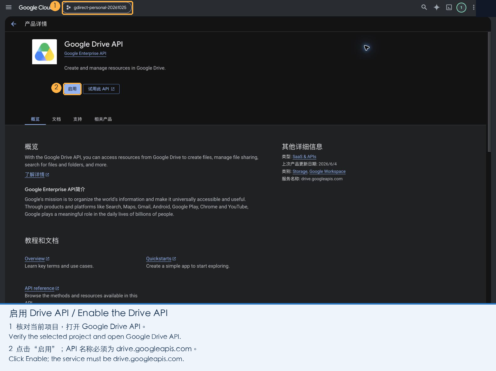
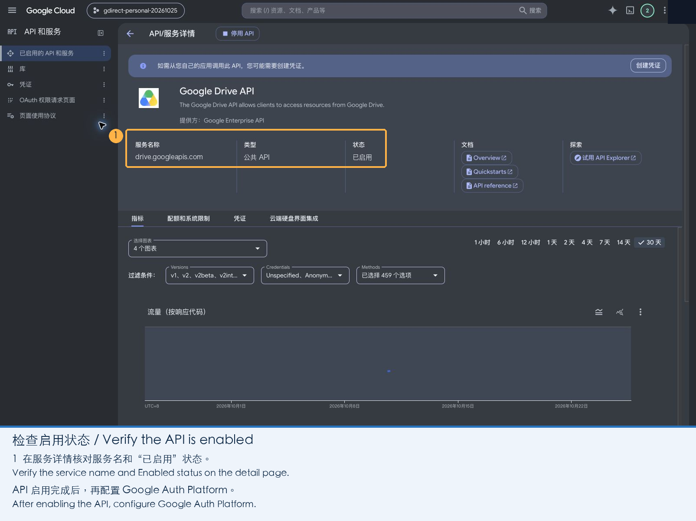
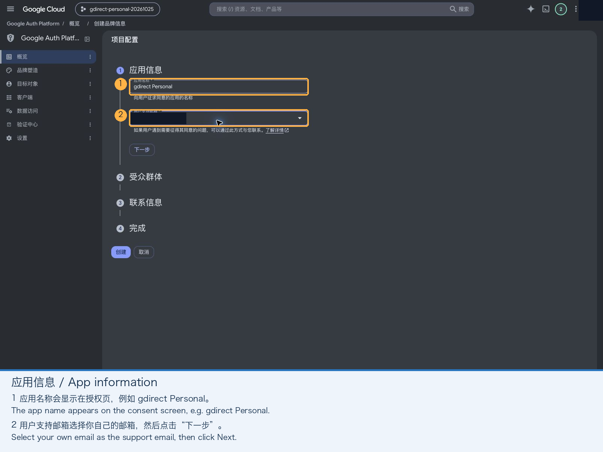
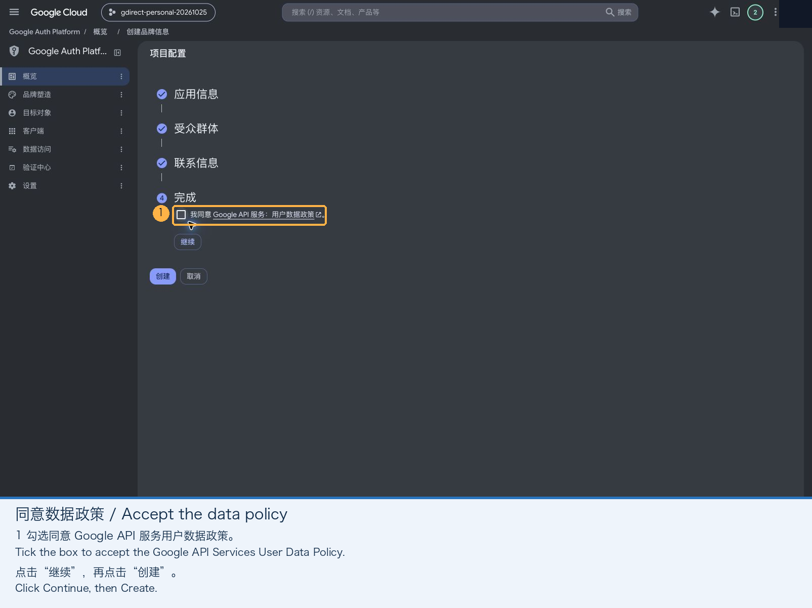
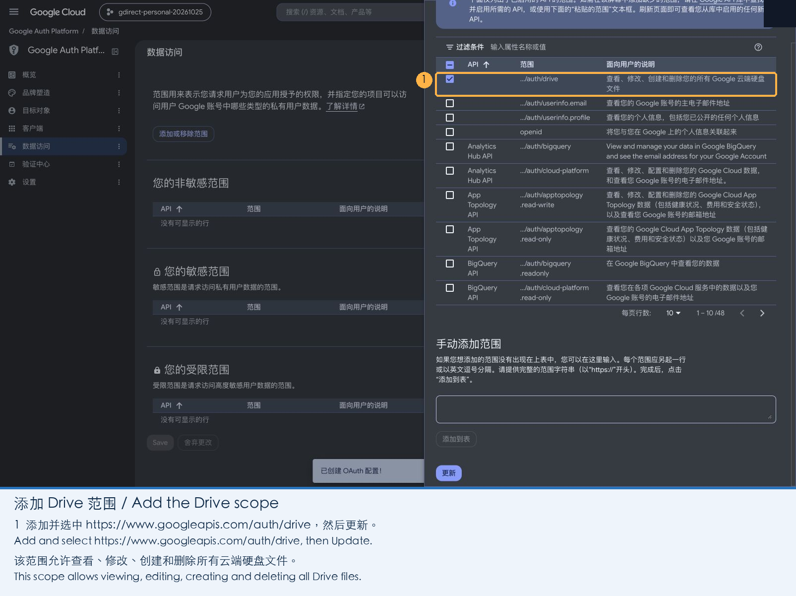
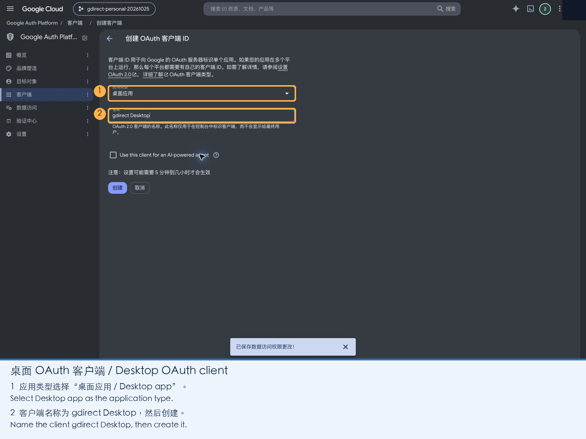
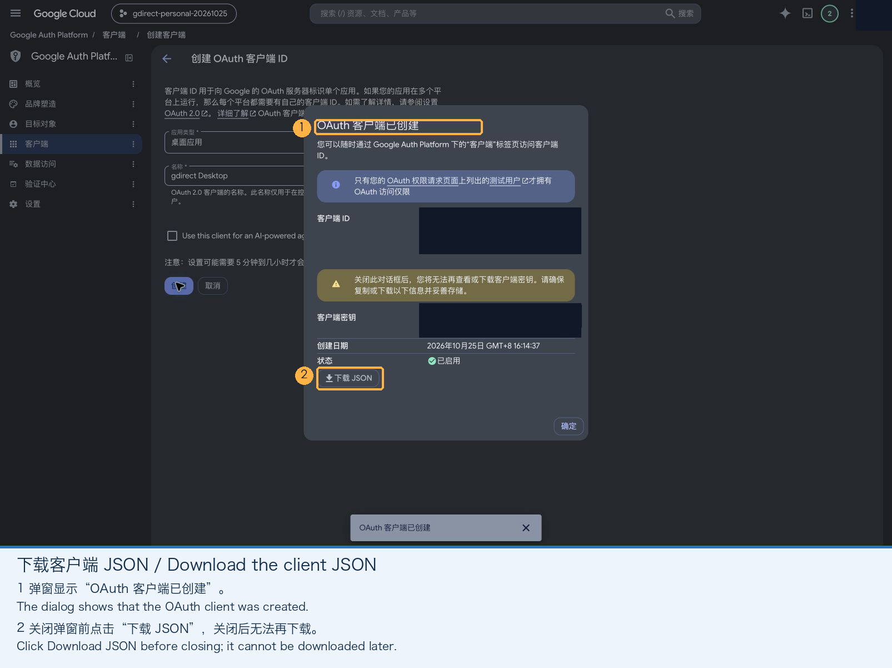
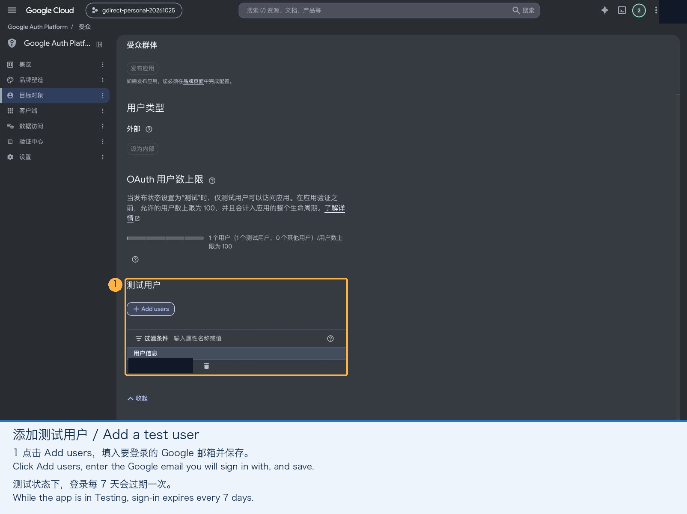
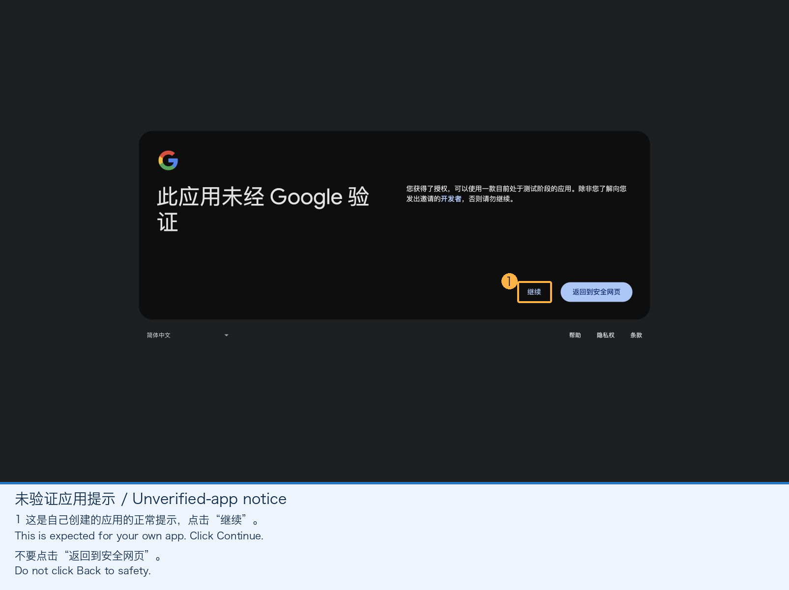
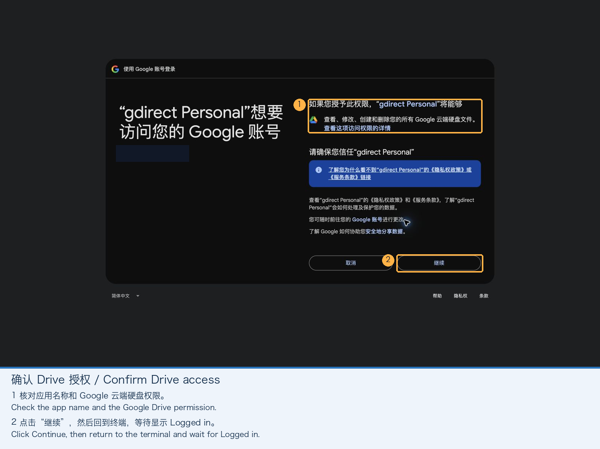

{"title":"gdirect: Direct Google Drive Access from the Terminal — How It Works and Setup Guide","description":"TL;DR on how gdirect reaches Google Drive directly from mainland China: it finds genuine Google front ends that happen to be unblocked inside Google's published address space, falls back to a forged g.cn identity when the real SNI is reset, pins certificates to Google's GTS roots and fails over between endpoints. Then a 10-minute OAuth setup guide, a correction prompted by a reader (183.56.143.147 is a third-party relay, not Google) and a source walkthrough.","date":"2026-10-25","updated":"2026-10-26","tag":"Tech","tags":["Rust","Google Drive","CLI","Network"]}
---

Pulling tens of gigabytes of datasets or backups from Google Drive over a proxy usually burns through expensive data quotas and bottlenecks on proxy node bandwidth; downloading in a browser often drops partway through and forces you to start over. To solve this, I wrote [gdirect](https://github.com/mizorewww/gdirect): a terminal tool for browsing, downloading, uploading, and mounting Google Drive.

This post is organized into three parts: **a quick TL;DR on how it "disguises" connections to reach Google directly**, **a ready-to-use installation and 10-minute illustrated setup guide**, and finally **a technical deep dive into the underlying source code**.

> **Correction, 2026-10-26**: The first version of this post said `183.56.143.147` was a Google `google-cn` edge node on China Telecom in Guangzhou, so Drive traffic "never physically crossed the firewall". A reader, Ken, wrote in to point out that this was wrong, and we confirmed it: it is a **third-party relay (reverse proxy)** that forwards traffic to Hong Kong and from there to Google, and the genuine Google nodes inside China do not serve Drive at all. Since 0.7.0, gdirect sweeps the address space Google publishes as its own and finds genuine Google front ends that happen to be reachable. Since 0.8.0 it tries that relay first by default (it is fast and stable), falls back to the sweep results when it fails, and offers `--google-only` to leave relays out entirely. The post below has been corrected throughout; the investigation is in [Correction and Improvements](#correction-and-improvements-18356143147-is-not-google).

## TL;DR: How Do We Connect Directly Without a Proxy?

On networks in mainland China, Google Drive's domains (`drive.google.com`, `www.googleapis.com`, `drive.usercontent.google.com`) are blocked. DNS for `drive.google.com` is poisoned with addresses that belong to someone else; the other two resolve to real Google IPs, but those IPs are blackholed at the TCP level.

Google has far more addresses than DNS ever hands out, though. Google publishes every range it owns ([goog.json](https://www.gstatic.com/ipranges/goog.json)); subtract the part it leases to Google Cloud customers (cloud.json) and what remains is the address space of Google's own services. Servers there sit behind Google's front-end serving layer (GFE, the Google Front End: the component Google's security whitepaper describes as handling TLS termination, DDoS protection and load balancing), which **routes each request to a backend service by its HTTP `Host` header** and holds valid certificates for `*.googleapis.com` and `*.googleusercontent.com`. In our tests, **some of these front ends are directly reachable from inside China**, probably because domestic DNS never hands them out and so they have not made it onto the blocklist.

`gdirect` takes advantage of this by **"opening TCP to a reachable Google front-end IP while sending authentic Google Drive requests (hostnames and certificate checks) over TLS and HTTP"**:

1. **Point the underlying TCP socket at a scanned endpoint**: bypassing poisoned system DNS, `gdirect` connects straight to port 443 on the target IP. Candidates come only from Google's published address space: TCP first, then full verification only for addresses that answer (official Google certificate + Drive v3 API response + test file download), stopping at 8; results are cached in local SQLite. Since 0.8.0, gdirect **tries the third-party relay `183.56.143.147` first** by default (fast and stable in practice) and falls back to the scanned Google front ends when it fails; if you don't want any third party in the path, `--google-only` (or `GDIRECT_GOOGLE_ONLY=1`) restricts it to endpoints inside Google's space. During socket creation (Rust's `reqwest::resolve` and a `getaddrinfo` hook in a patched C++ `libaria2`), every connection stays pinned to that endpoint, even across multiple cross-domain 302 redirects mid-download.
2. **Keep real Drive hostnames and certificate checks at the upper layers; retry under a "forged identity" when reset**: the real hostname is sent by default. If a censoring middlebox resets connections carrying the real SNI (showing up as a connect error or timeout), `gdirect` automatically retries once under a **forged identity**: TLS connects as `g.cn` (a Google-owned name the front end serves a matching certificate for) and verifies the certificate against `g.cn`, while the HTTP `Host` header still carries the real Drive hostname such as `www.googleapis.com`. GFE routes by `Host`, so Drive requests work as usual, and because the TLS name and the certificate name always match, **certificate verification is never weakened**. That is the essential difference from "just rewriting the SNI", where the certificate no longer matches. Whichever identity works is remembered in SQLite.
3. **Certificates are anchored to Google's own GTS roots only**: no general-purpose CA bundle. Google issues every endpoint we use under its own Google Trust Services roots, so verification trusts only those embedded roots. Even if a third-party CA is compromised or an intermediate key leaks (like the eMudhra key exposure made public in October 2026), it cannot be used to impersonate Google to `gdirect`. This holds for the relay too: TLS passes through it untouched, so it cannot read tokens or file contents.
4. **Fail over across endpoints**: when the current endpoint stops answering, gdirect first tries the other TLS identity, then each other endpoint verified within the last day; dead endpoints are marked in the database, and downloads resume the partial file on the next one.
5. **Separate the control plane from the data plane**: login and token refreshes (`accounts.google.com`, `oauth2.googleapis.com`), only a few kilobytes, go through the normal system network (your proxy) so authentication always works; bandwidth-heavy directory listing, multi-connection downloads, and 32 MiB resumable uploads all go through the direct endpoint without spending proxy traffic.

| Traffic Type | Commands / Domains | Route |
| --- | --- | --- |
| Drive API, downloads, uploads | `browse`, `ls`, `download`, `upload` (`www.googleapis.com`, `drive.usercontent.google.com`, `*.googleusercontent.com`) | The relay `183.56.143.147` first, then scanned Google front ends (`--google-only`: front ends only). Real SNI by default, falling back to the forged `g.cn` identity on resets (`Host` stays real); fails over to the next verified endpoint. `--ip`, `--sni` / `--no-sni` override |
| Login & token refresh | `login` and automatic token refresh (`accounts.google.com`, `oauth2.googleapis.com`) | System network (uses system DNS and your proxy) |
| Disk mount | `mount` (invokes `rclone` under the hood) | System network |

> **Important Note for Users in Mainland China:**
> Running `gdirect` with your proxy client on (especially in TUN mode) **will likely send the traffic back through the proxy**, for two reasons. First, `gdirect` connects to Google's own overseas IPs (such as `142.250.x.x` or `192.178.x.x`), and rules that route by `GEOIP` or Google IP ranges send those to the proxy. Second, the TLS SNI carries a Drive hostname, so a sniffing proxy matches it against the `google` ruleset and hijacks the connection. TUN mode also "answers" TCP for every address, so the scan ends up measuring the proxy instead of your network (`gdirect scan` warns when nearly every address answers).
> Make sure to pick one of these two setups (see [Mainland China Network and Proxy Configuration Guide](#mainland-china-network-and-proxy-configuration-guide) below for details):
> 1. **Add direct rules in your proxy client**: route the `gdirect` process (most reliable) or the Drive domains to `DIRECT` and exclude them from `fake-ip`;
> 2. **Quit your proxy or disable TUN during transfers**: keep your proxy on for the one-time `gdirect login`, then quit the proxy (or turn off TUN mode) when running `scan` and `download`.

---

## Installation

Prebuilt binaries are provided for **macOS 15+** (Apple Silicon / Intel), **Linux x86_64** (glibc 2.35+, e.g. Ubuntu 22.04+, Debian 12+, Fedora, Arch), and **Windows x86_64**.

### Option 1: One-Line Install Script

macOS / Linux:

```sh
curl -fsSL https://raw.githubusercontent.com/mizorewww/gdirect/main/scripts/install.sh | bash
```

Windows PowerShell:

```powershell
& ([scriptblock]::Create((Invoke-RestMethod 'https://raw.githubusercontent.com/mizorewww/gdirect/main/scripts/install.ps1')))
```

The installer places `gdirect` into `~/.local/bin` (`%LOCALAPPDATA%\gdirect\bin` on Windows). The Google GTS root certificates used for verification are embedded in the binary, so there is no CA file to install.

If you also want to use `gdirect mount` to mount Google Drive as a local disk, pass `--with-mount` (`-WithMount` in PowerShell) to automatically install the mount dependencies (`rclone 1.75.2+`, plus `fuse3` on Linux or `WinFsp` via `winget` on Windows):

```sh
curl -fsSL https://raw.githubusercontent.com/mizorewww/gdirect/main/scripts/install.sh | bash -s -- --with-mount
```

### Option 2: Homebrew (macOS / Linux)

```sh
brew tap mizorewww/gdirect https://github.com/mizorewww/gdirect
brew install mizorewww/gdirect/gdirect
brew install rclone   # Only needed for `gdirect mount`; Linux also requires `fuse3` from your system package manager
```

To upgrade later, run `brew update && brew upgrade gdirect`.

---

## One-Time Google Cloud Setup Guide (~10 Minutes)

To avoid rate-limiting (`429 Too Many Requests`) or bans caused by everyone sharing a single public OAuth client, `gdirect` does not ship a shared client ID. Instead, you create your own **Desktop app** OAuth client in your personal Google Cloud project. You only need to do this once, and it is completely free.

### 1. Create a Project and Enable the Drive API

1. Open the [Google Cloud Console](https://console.cloud.google.com/), click the project picker at the top of the page, and click **New project** in the top-right corner. Name it anything you like (e.g. `gdirect`), leave **Location** as **No organization** for a personal account, click **Create**, and make sure the new project is selected at the top.

   

2. Open the [Google Drive API](https://console.cloud.google.com/apis/library/drive.googleapis.com) page, confirm your new project is selected at the top, and click **Enable**.

   

   Once enabled, the page shows the service name `drive.googleapis.com` with status **Enabled**.

   

### 2. Configure the OAuth App

1. Open [Google Auth Platform](https://console.cloud.google.com/auth/overview) and click **Get started**.
2. **App information**: Enter an app name (e.g. `gdirect`, shown on the consent screen), select your email address as the user support email, and click **Next**.

   

3. **Audience**: Choose **External** and click **Next** (personal accounts cannot choose Internal).

   

4. **Contact information**: Enter your email address and click **Next**.
5. **Finish**: Check the box agreeing to the Google API Services User Data Policy, click **Continue**, and then click **Create**.

   

### 3. Add the Drive Scope

1. Open **Data Access** in the left sidebar and click **Add or remove scopes**.
2. In the drawer that opens, select `.../auth/drive` ("See, edit, create, and delete all of your Google Drive files"). If you don't see it in the table, paste the URL below into **Manually add scopes**, click **Add to table**, and then click **Update**:

   ```text
   https://www.googleapis.com/auth/drive
   ```

   

3. **Important**: After returning to the Data Access page, make sure to click **Save** at the bottom of the page. Clicking Update in the drawer alone does not persist the change.

   

### 4. Create a Desktop Client and Download the JSON

1. Open **Clients** in the left sidebar and click **Create client**. Set **Application type** to **Desktop app** (Web application clients, API keys, and service-account JSONs will not work), give it any name (e.g. `gdirect Desktop`), and click **Create**.

   

2. In the dialog that pops up, click **Download JSON** **before closing the modal**. Once closed, Google won't let you download the secret JSON again (if you close it by mistake, just create a new client).

   

### 5. Allow Your Account to Sign In (and Avoid the 7-Day Expiry)

Newly created apps start in **Testing** mode, where only listed test users are allowed to sign in:

1. Open **Audience** in the left sidebar, click **Add users** under **Test users**, enter the Google account email you want to use with `gdirect`, and click **Save**.

   

While the app stays in Testing mode, refresh tokens expire after **7 days**, requiring `gdirect login --reauth` once a week.

If you don't want to re-authenticate every week, simply click **Publish app** at the top of the **Audience** page to switch the status to **In production**. A personal app used only by you does not need to go through Google's verification review, and publishing it removes the 7-day token expiration limit.

### 6. Log In from the Terminal

Run the command below in your terminal, replacing the path with the JSON file you downloaded:

```sh
gdirect login --client-secret ~/Downloads/client_secret.json
```

1. Your browser will open automatically (if it doesn't, copy the URL printed in the terminal and open it in a browser **on the same machine**, since the OAuth flow redirects back to a temporary localhost port).
2. Choose your Google account. Google will warn that "Google hasn't verified this app"—this is completely normal because you just created it yourself:
   - **Testing mode**: Click **Continue** (not "Back to safety").
   - **In production**: Click **Advanced** in the bottom-left corner, then click **Go to <your app name> (unsafe)**.

   

3. Verify the app name and Google Drive permission scope, then click **Continue**.

   

4. Back in the terminal, once you see `Logged in`, you're all set. You can delete the downloaded JSON file now—the client credentials are saved inside local SQLite, and re-authenticating or switching accounts later only requires `gdirect login --reauth`.

> **Headless Server Tip**: On a remote server without a browser, you can authenticate on your desktop first, or import an existing `authorized_user` credentials JSON via `gdirect login --credentials <PATH>`. For scripts, you can also pass an access token directly via the `GDIRECT_ACCESS_TOKEN` environment variable.

---

## Mainland China Network and Proxy Configuration Guide

The most common question from users in mainland China is: **my proxy client (sing-box / Mihomo / Clash) has carefully tuned routing rules—why does `gdirect` produce odd scan results, and why do downloads still go through the proxy?**

### Tracing the Packet Path: How Does a Proxy Hijack Direct Traffic?

Even though `gdirect` disables HTTP/SOCKS proxy environment variables (`no_proxy`) at the application layer, whenever your proxy client is running—especially in **TUN virtual network interface mode**—every packet on the machine passes through the proxy's routing engine first. Let's trace what happens step by step:

1. **The destination is one of Google's own overseas front ends**:
   At the socket layer, `gdirect` swaps the destination for a scanned endpoint—usually a front end inside Google's own address space (such as `142.250.x.x` or `192.178.x.x`), or, by default, the relay `183.56.143.147` it tries first. So that the Google front end routes the request by hostname and local certificate verification succeeds, the TLS handshake (`ClientHello` SNI) and HTTP `Host` header still carry `www.googleapis.com`, `drive.usercontent.google.com`, and `*.googleusercontent.com` (the SNI is `g.cn` under the forged identity).
2. **IP rules: Google's addresses go to the proxy by default**:
   Common rule templates contain IP rules such as `GEOIP,google` or `RULE-SET,google-ip` that send Google's ranges to the proxy. That is right for a browser (most Google IPs really are unreachable in China), but it also sends the front ends `gdirect` worked to find—the ones that happen to be reachable—into the proxy.
3. **Domain rules: TUN sniffing (`sniff`) hijacks the connection**:
   When `gdirect` connects to port 443 on a front end, the TUN interface intercepts the packet and uses `sniff` (TLS SNI inspection) to read `drive.usercontent.google.com` or `www.googleapis.com`. In rulesets such as [DustinWin/ruleset_geodata](https://github.com/DustinWin/ruleset_geodata), those domains belong to the proxied `google` set, not the directly reachable `google-cn` set (which lists domains like `dl.google.com`, `g.cn`, and `fonts.googleapis.com`):
   - `rule_set: google-cn` (`DIRECT`) $\rightarrow$ **Miss**;
   - `rule_set: google` (`PROXY`) $\rightarrow$ **Match!**
   - Even when an IP rule would let the destination through (the relay `183.56.143.147` is a Chinese IP and matches `GEOIP,CN`, for instance), domain rules come before IP rules in mainstream templates, so the sniffed Drive hostname pulls the connection back into the proxy anyway.
4. **TUN "answers" TCP for every address**:
   In TUN mode, the proxy accepts each connection locally and then dials the destination itself. The first step of `gdirect scan`, a TCP probe, therefore "succeeds" almost everywhere, and the scan measures the proxy rather than your network. When over 90% of a batch answers, `scan` prints a warning asking you to route Google IPs `DIRECT` and scan again.

Once you see why this happens, picking **either one** of the two approaches below solves it:

### Approach 1: Quit Your Proxy (or Turn Off TUN) During `scan` and Downloads

If you don't want to touch your proxy client's routing rules, this is the simplest and cleanest workflow:

1. **Login phase (proxy ON)**: With your proxy running as usual, run `gdirect login --client-secret ...` to finish authorization (opening `accounts.google.com` in the browser and exchanging/refreshing tokens against `oauth2.googleapis.com` require a proxy).
2. **Scan & transfer phase (quit proxy, or turn off TUN mode)**:
   - Once logged in (`gdirect` caches a short-lived `access_token` valid for ~1 hour), **quit your proxy client or turn off its TUN mode** (if you only use System Proxy without TUN, `gdirect` ignores system proxy environment variables automatically, though turning off TUN is the most foolproof).
   - Run `gdirect scan` to find usable endpoints over your raw physical broadband (`gdirect scan --list` shows latency, which TLS identity each IP needs, and marks anything outside Google's address space as `[third-party relay]`).
   - Run `gdirect download ...` or `gdirect browse` to download directly. If your ISP resets connections carrying the real SNI, there is nothing to do by hand: `gdirect` retries under the forged `g.cn` identity, and moves to the next verified endpoint when the current one is gone:

```sh
gdirect scan
gdirect download FILE_ID
gdirect --google-only download FILE_ID   # Google's own front ends only, no third-party relay
# Manual overrides still work: --sni forces a TLS identity, --no-sni omits SNI (downloads only)
gdirect download FILE_ID --no-sni
```

### Approach 2: Route the `gdirect` Process DIRECT in Your Proxy Client

If you keep your proxy and TUN mode running 24/7, the fix is: **before the IP rules and the `google` domain rules, route the `gdirect` process (or the Drive domains) to `DIRECT`**:

- **Domains that must stay on `PROXY`** (used only for login and token refresh):
  - `accounts.google.com`
  - `oauth2.googleapis.com`
- **Transfer domains to route to `DIRECT` and exclude from `fake-ip`**:
  - `drive.usercontent.google.com`
  - `*.googleusercontent.com`
  - `drive.google.com`
  - `www.googleapis.com`, `drive.googleapis.com`, `content.googleapis.com`
  - `g.cn`, used by the forged identity

> **Note**: A regular browser visiting `www.googleapis.com` connects to the blackholed IP that DNS returns, not to a scanned front end the way `gdirect` does. Likewise, routing all of Google's IP ranges `DIRECT` would break every Google service in your browser. Both domain and IP-range rules have side effects, so on desktop platforms matching by **`PROCESS-NAME`** (`gdirect`) is strongly recommended.

For **Mihomo (Clash)**, add the following before your `GEOSITE,google` and `GEOIP,google` rules:

```yaml
dns:
  fake-ip-filter:
    - "www.googleapis.com"
    - "drive.googleapis.com"
    - "content.googleapis.com"
    - "drive.usercontent.google.com"
    - "drive.google.com"
    - "+.googleusercontent.com"

rules:
  # 1. Keep OAuth login and token refresh on PROXY
  - DOMAIN,accounts.google.com,PROXY
  - DOMAIN,oauth2.googleapis.com,PROXY

  # 2. Recommended: force all other traffic from the gdirect process (scan, API, download, upload)
  #    to DIRECT so sniffed domain rules and Google IP rules don't hijack it
  - PROCESS-NAME,gdirect,DIRECT

  # 3. Or route by domain (place before GEOSITE,google / RULE-SET,google;
  #    this affects web pages in your browser that use these domains):
  - DOMAIN,drive.usercontent.google.com,DIRECT
  - DOMAIN-SUFFIX,googleusercontent.com,DIRECT
  - DOMAIN,www.googleapis.com,DIRECT
  - DOMAIN,drive.googleapis.com,DIRECT
  - DOMAIN,content.googleapis.com,DIRECT
```

If you use **sing-box**, add an equivalent `direct` rule matching `process_name: gdirect` before `rule_set: ["google"]` and any Google IP rules in `route.rules` (while keeping `oauth2.googleapis.com` proxied) to run direct Drive transfers with TUN left on all day.

---

## Daily Usage & Troubleshooting Reference

### Common Commands

```sh
gdirect                                   # Same as `gdirect browse`, opens the interactive TUI
gdirect browse -o ~/Downloads             # Set download directory (defaults to ./downloads)
gdirect ls root --json                    # List directory contents (supports JSON output)
gdirect download <FILE_ID_OR_SHARE_URL>   # Download a file; re-run the same command to resume after interruption
gdirect download FILE_ID -o file.zip
gdirect download DOC_ID --export application/pdf -o doc.pdf
gdirect upload ./file.zip                 # 32 MiB chunked upload with automatic resume
gdirect upload ./file.zip --parent FOLDER_ID --name backup.zip
gdirect mount                             # Mount at ~/GoogleDrive (uses native NFS on macOS, no FUSE needed)
gdirect unmount                           # Unmount and clean up temporary exported credentials
gdirect scan                              # Scan again; scan --list shows the results
```

Since 0.6.0, several Google accounts can share one OAuth client:

```sh
gdirect login --add                       # Sign in another account in the browser
gdirect accounts                          # List accounts; * marks the default
gdirect switch work                       # Make work@… the default
gdirect -a me@gmail.com browse            # Use one account for a single command (or set GDIRECT_ACCOUNT)
```

The `browse` TUI uses a [yazi](https://github.com/sxyazi/yazi)-style three-column layout showing the parent folder, the current folder and a preview side by side, with multi-select, whole-folder downloads and file operations in Drive. Press `?` for every key:

| Key | Action |
| --- | --- |
| `j / k`, `↑ / ↓` | Select |
| `g / G`, Home/End | First / last item |
| `Ctrl-d / Ctrl-u`, PgDn/PgUp | Half a page / a page down or up |
| Enter, `l / →` | Open folder |
| `h / ←`, Backspace | Parent folder |
| `/` | Filter the current folder by name. Enter keeps the filter, Esc clears it |
| `Ctrl-r`, F5 | Refresh |
| Space | Mark or unmark an item; marks are kept when you change folders |
| `Ctrl-a` | Mark everything shown (press again to unmark) |
| Esc | Clear the filter, then the marks, then the clipboard |
| `a` | Create an empty file; a name ending in `/` creates a folder |
| `r` | Rename |
| `y` / `x` | Copy / cut the marked items (or the selected one) |
| `p` | Paste into the current folder. Cut items are moved; copied files are duplicated |
| `D`, Delete | Move the marked items to the Drive trash (asks first) |
| `u` | Upload a local file into the current folder |
| `d` | Queue the marked items for download. A folder is downloaded with all its subfolders; Google Docs, Sheets and Slides are exported as PDF |
| `+ / -` | Connections for the next download (`1–16`), saved as your default |
| `c` | Cancel the current download and keep the partial data |
| `R` | Retry failed or cancelled downloads |
| `X` | Remove downloads that have not started yet |
| `q` | Quit |

Downloads run one at a time; the file list shows each file's state (queued, downloading, saved, failed), and selecting a failed file shows the full error.

For tricky network environments, there are transport-layer overrides:

- `--google-only` (global; or `GDIRECT_GOOGLE_ONLY=1`): use no third-party relay; scans and transfers use only endpoints inside Google's published address space;
- `--ip IP`: force a specific IP, skipping scan results and failover;
- `--sni HOST` / `--no-sni`: force a TLS identity, or omit SNI altogether (`--sni` also works for `ls` and `upload`; `--no-sni` is download-only). Without them, gdirect uses the scanned identity and falls back automatically;
- `--ca-cert FILE`: use this CA bundle instead of the embedded Google GTS roots;
- `-j N`: set concurrent connections (`1–16`) for this command only;
- `gdirect scan --ips FILE`: probe a custom candidate list (one public IP per line, `#` for comments). Addresses there are not limited to Google's space, but those outside it are labelled `[third-party relay]`, and `--google-only` keeps transfers off them.

### Troubleshooting Quick Reference

| Symptom | Fix |
| --- | --- |
| `access_denied` or message that the app is being tested | Add your Google account as a Test user, or publish the app (Step 5 of the setup guide) |
| `redirect_uri_mismatch` | The downloaded JSON is not from a **Desktop app** client; recreate it following Step 4 |
| `Drive API 403 … insufficient permission` | Enable the Google Drive API in the **same project** as your OAuth client (Step 1), save the Drive scope (click Save at the bottom in Step 3), then run `gdirect login --reauth` |
| `refresh credential expired or revoked` | Run `gdirect login --reauth`. If this happens every 7 days, publish the app from Testing to In production (Step 5) |
| `scan` warns `almost every address answered TCP` | A TUN proxy is answering for every address, so the scan measured the proxy. Turn TUN off as described above, or route the `gdirect` process / Google IPs `DIRECT`, then scan again |
| `no usable Google front end found` | No usable endpoint was found from this network. Rule out a TUN proxy first; otherwise scan again later (reachable front ends change), or supply candidates with `gdirect scan --ips FILE` |
| `libaria2 code 1` mid-download (connection or TLS failure) | The real SNI was reset or the endpoint died. `gdirect` retries under `g.cn`, then resumes on the next verified endpoint and marks the dead one; it only fails once every endpoint has, and re-running the command rescans. `--sni g.cn` / `--no-sni` still work by hand |
| An IP in `scan --list` shows `[third-party relay]` | The address is outside Google's published space: a third-party relay, such as `183.56.143.147`, which is tried first by default. It cannot read your traffic but sees your IP; use `--google-only` if that matters to you |

---

## Correction and Improvements: 183.56.143.147 Is Not Google

After the first version of this post went out, a reader, Ken, emailed to point out several factual errors: `183.56.143.147` is not a Google server; the `google-cn` nodes inside China will not fetch Drive for you; and "GFE" is not a kind of IP or server. We spent a day checking each point, and he was right on all of them. This section lays out how we checked, what changed, and where the new approach falls short. Thank you, Ken, for reading carefully and taking the time to write.

### What the First Version Got Wrong

The first version claimed that `183.56.143.147` was a Google `google-cn` edge node on China Telecom in Guangzhou; that these domestic nodes ran Google's front end (GFE) and reached Drive's backends over Google's internal network; and that connecting to it therefore kept traffic from "physically crossing the firewall". The scan also used it as its built-in seed.

The IP came from the Cealing-Host list used by [Sheas-Cealer](https://github.com/SpaceTimee/Sheas-Cealer), where every Google entry points at the same address. It presents Google's genuine certificate and the Drive API answers normally through it; we took that as proof it was Google and never checked who actually runs it.

### Check 1: Who Does Google See as the Client?

Google has a diagnostic endpoint, `https://redirector.googlevideo.com/report_mapping?di=no`, that reports the client IP it sees. Testing from a China Unicom line in Shanghai (bound to the physical interface to bypass the local VPN):

- A direct request: Google reports our own IP;
- Through `183.56.143.147`: Google reports `122.10.103.81`, an address in Hong Kong (AS136897, Enjoyvc).

So the connection enters Google from Hong Kong. whois shows `183.56.143.147` belongs to CHINANET Guangdong, and neither it nor `122.10.103.81` is in Google's published ranges (goog.json). Conclusion: **it is a third-party TCP relay (reverse proxy) that forwards traffic to Hong Kong and on to Google.**

It doesn't touch TLS; it just forwards the byte stream, so the client sees Google's genuine GTS certificate and `gdirect` verifies it against Google's GTS roots as usual. That means:

- **The relay cannot see**: access tokens, file contents or request paths, all of which stay inside end-to-end TLS; nor can it forge a certificate to intercept.
- **The relay can see**: your IP, traffic volume and timing; and, unless the forged identity is used, the hostname in the TLS SNI (e.g. `www.googleapis.com`). Under the `g.cn` identity, it only sees a connection to `g.cn`.

### Check 2: Can the Genuine Google Nodes in China Serve Drive?

Google does have nodes in China, just not the kind the first version described. We tested two groups:

- `203.208.40.x` / `203.208.41.x`, registered to GOOGLECN (Beijing Gu Xiang, Google's China entity);
- Google cache nodes inside ISP networks, such as `211.95.34.x` inside China Unicom Shanghai, which domestic DNS returns for `dl.google.com`, `fonts.googleapis.com`, `g.cn` and `www.gstatic.com`.

Both accept TCP and TLS and present Google certificates. Requesting each service by `Host` header makes the picture clear:

| Requested host | Result |
| --- | --- |
| `www.google.cn`, `fonts.googleapis.com` | 200 |
| `www.gstatic.com/ipranges/goog.json` | 200 |
| `www.googleapis.com/drive/v3/…` | 404 |
| `oauth2.googleapis.com` | 404 |
| `drive.usercontent.google.com` | 404 |

They serve a whitelist, and **Drive is not on it**. The path "domestic node, then Google's internal network, then Drive" does not exist. (They do serve Google's IP range lists, which comes in handy later.)

### Check 3: Other Intuitive Candidates

- The Google IPs domestic DNS returns for `www.googleapis.com` and `drive.usercontent.google.com` (`74.125.x`, `172.217.x`, `142.250.157.x` and so on) are real, but TCP times out: they are blackholed.
- DNS for `drive.google.com` is poisoned; the answers (`69.63.184.30`, `128.242.240.59`) are not Google at all.
- Firebase Hosting and Google Cloud load-balancer IPs present their customers' certificates and cannot be used for Google APIs.
- One Cloud Storage IP (`142.250.73.123`) was reachable, but it is a GCS-only front end that answers every `Host` as GCS.

### Check 4: Sweeping Google's Own Front Ends

If every IP that DNS hands out is blocked, what about the ones it doesn't? Google publishes all of its ranges (goog.json) and the part leased to Cloud customers (cloud.json); the difference is Google's own service space. We swept the blocks where front ends concentrate (`142.250.0.0/15`, `172.217.0.0/16`, `172.253.0.0/16`, `173.194.0.0/16`, `74.125.0.0/16`, `192.178.0.0/15`, `64.233.160.0/19`, `66.102.0.0/20`, `108.177.0.0/17`, `209.85.128.0/17`, `216.58.192.0/19`, `216.239.32.0/19`, `108.170.192.0/18`, `72.14.192.0/18`): about 2,500 /24s, 12 host numbers each (`.4 .14 .91 .100 .113 .123 .132 .138 .155 .187 .207 .219`). For each address: TCP 443 first; for those that answered, a full check under both the real SNI and `g.cn`—an unauthenticated Drive API request had to return the expected 401 JSON, and a public test file had to download correctly.

```stats title="Sweep of Google's own front ends" meta="China Unicom Shanghai · 2026-10-26" note="Every working address passed under both the real SNI and the forged g.cn identity."
## Funnel ~2,500 /24s × 12 host numbers
Addresses probed | 30528
Answered TCP 443 | 1423 | 4.7%
Fully working | +104 | Drive API + test download passed
Spread | ~65 /24s | clustered; 192.179.50/60/61 had 7 each
## Performance from the same Unicom line
TCP connect | 268 ms | p50; p90 was 511 ms
Single-connection download | 4–6 MB/s | 27 MB file, Host dl.google.com
```

```data title="The 1,319 addresses that answered TCP but failed" bars="Count" note="Certificate mismatches were mostly Cloud Storage-only front ends; TLS timeouts and resets may be SNI-based interference."
Reason | Count
Certificate mismatch | ~1030
TLS timeout or reset | ~290
```

The host numbers show a clear pattern: `.187`, `.207` and `.219` never worked (all Cloud Storage-only front ends), while `.100`, `.113`, `.155`, `.132`, `.138` and `.91` worked best.

**Are they really Google, and really direct?** Three pieces of evidence: every address is in goog.json; whois says Google LLC; and traceroute from the Unicom line goes straight into Google's backbone (`142.251.x`, `192.178.x`, `172.253.x`) with no third party in between.

**Why aren't they blocked?** Our guess: domestic DNS never hands them out, so they haven't made it onto the blocklist. That also means they may be blocked as soon as usage grows—which is exactly why `gdirect` discovers them dynamically instead of shipping a fixed list.

### A Note on Terminology: What GFE Is

The first version used "GFE" as if it were a category of node, which is inaccurate. Google's servers come in kinds such as GWS (Google Web Server), GVS (video servers) and GGC (Google Global Cache nodes inside ISP networks); the **Google Front End (GFE) is a component of Google's infrastructure** that the [Google security whitepaper](https://docs.cloud.google.com/docs/security/infrastructure/design#google-frontend-service) describes as terminating TLS, providing DDoS protection and load balancing before handing requests to backend services. This post now uses "GFE" only in that sense: Google's front-end serving layer, which routes requests by `Host`. It is not an IP category. "Google front end" in this post means a server in Google's own address space served by that layer.

### What Changed in gdirect 0.7.0 / 0.8.0

- **Google's address space, embedded and refreshed weekly** (0.7.0; `src/ranges.rs`, `src/google-ranges.txt`, `scripts/update-ranges.py`): a snapshot of goog.json minus cloud.json ships in the binary and is refreshed weekly at scan time. The refresh goes over the system network first—in China, `www.gstatic.com` resolves to exactly the kind of in-ISP Google cache above, which serves the range lists—and through a verified endpoint otherwise. Lists that look truncated are rejected.
- **The scan became a front-end sweep** (0.7.0; `src/scan.rs`): candidates come only from inside Google's space: earlier verified endpoints, DNS answers (poisoned ones fall outside and are dropped), the /24s where our sweep found working front ends (`src/frontend-seeds.txt`), then the core front-end blocks, then everything else, each part shuffled per user. Only the productive host numbers are tried. Each batch of 2,048 addresses gets a TCP probe, then full verification of what answered; when one works, the rest of its /24 goes next; the sweep stops at 8 verified endpoints. It warns when nearly everything answers TCP (a TUN proxy intercepting).
- **Failover** (0.7.0; `Api::deliver` and downloads): when the current endpoint stops answering, gdirect tries the other TLS identity, then each other endpoint verified within the last day; downloads resume on the new endpoint.
- **The relay**: 0.7.0 dropped `183.56.143.147` from the scan and purged it from existing databases once. In practice the relay is fast and stable, so **0.8.0 tries it first by default and falls back to the scanned Google front ends when it fails**, and the 0.7.0 purge is gone. It also adds a global **`--google-only`** option (environment variable `GDIRECT_GOOGLE_ONLY=1`): the scan skips relays and transfers use only endpoints inside Google's space. Either way, endpoints outside Google's space are labelled `[third-party relay]` in `scan` and `scan --list`.

Which to choose: the relay cannot read your tokens or files, but its operator—whom we don't know—sees your IP, traffic volume and timing, and (without the forged identity) which Google host you connect to. If that bothers you, use `--google-only`; you can also force the forged identity with `--sni g.cn` so the relay doesn't even see the hostname.

### Why We Don't Bundle Reverse Proxies Found Online

Search engines for internet-facing hosts such as fofa turn up plenty of reverse proxies presenting Google certificates, and someone suggested bundling a batch of them. We didn't: most are someone else's misconfigured servers, accidentally left open, and using them en masse without permission is freeloading on other people's machines and bandwidth; their operators see every user's IP and access times; and such servers tend to be shut down or blocked quickly, so a bundled list goes stale fast. `183.56.143.147` is a relay a public list has used for a long time; we label it clearly as third-party, try it first by default, and let you turn it off with `--google-only`. Beyond that, `gdirect` doesn't seek out any third-party server. Candidates you find yourself can still be tested with `gdirect scan --ips FILE`, and anything outside Google's space is labelled the same way.

### Limits

- All of the results above come from **one line (China Unicom Shanghai), one location, one day (2026-10-26)**. China Telecom, China Mobile and other regions are unverified; the reachable front ends there may be entirely different, or there may be none.
- These front ends are probably reachable only because nobody has noticed them yet. They may be blocked at any time; when that happens `gdirect` can only rescan for others, and if it finds none, fall back to the relay or a proxy.
- 4–6 MB/s per connection with a p50 connect time of 268 ms is what you'd expect from a direct cross-border link, not "saturating your broadband". Multiple connections help, depending on the line.

If you test from another ISP or region, I'd love to hear the results, whether or not it works.

---

## Technical Deep Dive: How Is It Implemented Under the Hood?

If you're curious about how `gdirect` combines Rust with a custom-patched `libaria2` build to pull this off, here is a walkthrough of the source code.

### 1. Where Candidates Come From: Google's Own Address Space and the Sweep Order

When a transfer command runs without an endpoint verified in the last 24 hours in local SQLite, `src/scan.rs` starts a scan. By default 0.8.0 probes the known relay `183.56.143.147` first (skipped under `--google-only`), then sweeps Google's front ends anyway, as backups for when the relay fails. The code below is from 0.7.0; the front-end sweep is unchanged in 0.8.0.

The sweep is bounded by Google's own address space in `src/ranges.rs`: goog.json lists every address Google owns, cloud.json the part that can be assigned to Google Cloud customers, and the difference is where Google's own services live. A snapshot is embedded and refreshed weekly from `www.gstatic.com`; a list that comes back implausibly small (truncated or tampered with) is rejected in favour of the old one:

```rust src="https://github.com/mizorewww/gdirect/blob/338cd9620ba09e451aac654394376762674eea6c/src/ranges.rs#L128-L150" title="Google's own space: goog.json minus cloud.json"
    /// Google's own space from the published feeds: everything Google owns
    /// minus what Google Cloud customers can be assigned.
    pub fn from_feeds(goog: &str, cloud: &str) -> Result<Self> {
        let list = |json: &str| -> Result<Self> {
            let data: serde_json::Value = serde_json::from_str(json)?;
            let prefixes = data["prefixes"]
                .as_array()
                .context("IP range feed has no prefixes")?;
            Self::from_prefixes(
                prefixes
                    .iter()
                    .filter_map(|p| p["ipv4Prefix"].as_str().or(p["ipv6Prefix"].as_str())),
            )
        };
        let (goog, cloud) = (list(goog)?, list(cloud)?);
        let ranges = Self {
            v4: subtract(&goog.v4, &cloud.v4),
            v6: subtract(&goog.v6, &cloud.v6),
        };
        // A truncated or hostile feed must not shrink the trusted space to nothing.
        ensure!(ranges.v4.len() >= 16, "IP range feed looks incomplete");
        Ok(ranges)
    }
```

Candidates are queued by priority, and only addresses inside Google's space are accepted: earlier verified endpoints and DNS answers first (poisoned answers fall outside the space and are dropped), then the /24s where our sweep found working front ends (`src/frontend-seeds.txt`, 67 of them), then the core front-end blocks, and finally everything else. Each part is shuffled per user so everyone doesn't pile onto the same few front ends:

```rust src="https://github.com/mizorewww/gdirect/blob/338cd9620ba09e451aac654394376762674eea6c/src/scan.rs#L96-L131" title="Sweep order: inside Google's space only, by priority"
/// Sweep order: earlier verified endpoints, DNS answers, seed /24s, then
/// Google's core front-end blocks and finally the rest of its space, each
/// shuffled. Only addresses inside `google` are ever considered.
fn plan(
    google: &Ranges,
    known: &[IpAddr],
    dns: &[IpAddr],
    shuffle: &mut Shuffle,
) -> VecDeque<IpAddr> {
    let core = Ranges::parse(&CORE.replace(' ', "\n")).expect("core blocks must parse");
    let seeds = Ranges::parse(SEEDS).expect("seed list must parse");
    let mut seen = HashSet::new();
    let mut order = VecDeque::new();
    let mut add = |ip: IpAddr, order: &mut VecDeque<IpAddr>| {
        if public(ip) && google.contains(ip) && seen.insert(ip) {
            order.push_back(ip);
        }
    };
    for &ip in known.iter().chain(dns) {
        add(ip, &mut order);
    }
    let mut seed_nets: Vec<u32> = seeds.slash24s().collect();
    shuffle.apply(&mut seed_nets);
    let (mut core_nets, mut rest_nets): (Vec<u32>, Vec<u32>) = google
        .slash24s()
        .filter(|n| !seeds.contains(IpAddr::V4(Ipv4Addr::from(*n))))
        .partition(|n| core.contains(IpAddr::V4(Ipv4Addr::from(*n))));
    shuffle.apply(&mut core_nets);
    shuffle.apply(&mut rest_nets);
    for net in seed_nets.into_iter().chain(core_nets).chain(rest_nets) {
        for ip in hosts(net) {
            add(ip, &mut order);
        }
    }
    order
}
```

Only 7 host numbers per /24 are tried, based on the statistics from the sweep above: `.187`, `.207` and `.219` never worked (all Cloud Storage-only front ends), so they are skipped:

```rust src="https://github.com/mizorewww/gdirect/blob/338cd9620ba09e451aac654394376762674eea6c/src/scan.rs#L16-L31" title="Sweep parameters: target, batch size, host numbers and core blocks"
const LIMIT: usize = 256;
/// Verified endpoints to collect before a sweep stops.
const TARGET: usize = 8;
/// Upper bound on TCP probes in one sweep.
const MAX_PROBES: usize = 60_000;
/// Addresses swept per batch: TCP first, then full verification of what answered.
const BATCH: usize = 2048;
const TCP_WORKERS: usize = 256;
const TCP_TIMEOUT: Duration = Duration::from_secs(2);
/// Host numbers inside a /24 where Google's general front ends answer. .187,
/// .207 and .219 are Cloud Storage-only front ends and never serve Drive.
const OFFSETS: [u8; 7] = [100, 113, 155, 132, 138, 91, 123];
/// Blocks that hold most of Google's general front ends; swept before the
/// rest of Google's space.
const CORE: &str = "142.250.0.0/15 172.217.0.0/16 172.253.0.0/16 173.194.0.0/16 74.125.0.0/16 192.178.0.0/15 64.233.160.0/19 66.102.0.0/20 108.177.0.0/17 209.85.128.0/17 216.58.192.0/19 216.239.32.0/19 108.170.192.0/18 72.14.192.0/18";
const SEEDS: &str = include_str!("frontend-seeds.txt");
```

Before probing, `public(ip)` filters out private, loopback, link-local and `198.18.0.0/15` (the default Clash / Mihomo `fake-ip` range) addresses.

### 2. A Two-Stage Sweep: TCP First, Then Full Verification

Most Google addresses don't even accept TCP from China, so running full TLS + API verification on every one would be far too slow. The sweep runs in two stages: each batch of 2,048 addresses gets a TCP connect with a 2-second timeout from 256 threads, and only the addresses that answer go on to full verification by 8 threads. When an address verifies, the other host numbers in its /24 jump to the front of the queue, since working front ends tend to come in clusters. The sweep stops at 8 verified endpoints:

```rust src="https://github.com/mizorewww/gdirect/blob/338cd9620ba09e451aac654394376762674eea6c/src/scan.rs#L321-L352" title="Sweep loop: TCP probe, full verification, neighbours first"
        while good < TARGET && probed < MAX_PROBES && !queue.is_empty() {
            let batch: Vec<IpAddr> = std::iter::from_fn(|| queue.pop_front())
                .filter(|ip| tried.insert(*ip))
                .take(BATCH)
                .collect();
            probed += batch.len();
            let answered = tcp_sweep(&batch);
            open += answered.len();
            // Real networks block most of Google; a TUN proxy accepts every connect.
            if batch.len() >= 256 && answered.len() * 10 >= batch.len() * 9 && !intercepted {
                intercepted = true;
                eprintln!(
                    "warning: almost every address answered TCP, so a TUN proxy or VPN is probably intercepting; results reflect the proxy, not your direct network. Route Google IPs DIRECT for a real scan"
                );
            }
            let candidates: Vec<IpAddr> = answered.into_iter().map(|(ip, _)| ip).collect();
            reached.extend(&candidates);
            let verdicts = verify(&candidates, TARGET - good);
            let working = record(db, &google, verdicts, |ip| known.contains(&ip), &mut warned)?;
            good += working.len();
            // Front ends come in groups: the rest of a working /24 goes next.
            for ip in working.iter().rev() {
                if let IpAddr::V4(v4) = ip {
                    for neighbour in hosts(u32::from(*v4) & !0xff) {
                        if !tried.contains(&neighbour) {
                            queue.push_front(neighbour);
                        }
                    }
                }
            }
            eprintln!("  … probed {probed}, {open} answered TCP, {good} verified");
        }
```

Note the TUN warning in the loop: a real network blocks the vast majority of Google's addresses, so if more than 90% of a batch answers, a TUN proxy is almost certainly accepting every connection locally.

Full verification probes each address at most twice: the real SNI first, then the forged `g.cn` identity:

```rust src="https://github.com/mizorewww/gdirect/blob/338cd9620ba09e451aac654394376762674eea6c/src/scan.rs#L172-L178" title="Full verification: real SNI first, forged identity on failure"
                    let (result, sni) = match probe(ip, false) {
                        Ok(ok) => (Ok(ok), ""),
                        Err(real) => match probe(ip, true) {
                            Ok(ok) => (Ok(ok), crate::api::FORGED_HOST),
                            Err(forged) => (Err(format!("{real:#} | forged: {forged:#}")), ""),
                        },
                    };
```

```rust src="https://github.com/mizorewww/gdirect/blob/338cd9620ba09e451aac654394376762674eea6c/src/scan.rs#L189-L243" title="One probe: TLS certificate + unauthenticated Drive API + test file"
// A missing or changed public test file is reported as a warning, not as a dead IP.
//
// `forged` selects the fallback identity: the URL (and therefore SNI and
// certificate name) is g.cn while the Host header still carries the real
// Google host. Google's front end routes by Host, so the same probes work.
fn probe(ip: IpAddr, forged: bool) -> Result<(i64, Option<String>)> {
    use crate::api::{API_HOST, FORGED_HOST};
    const FILE_HOST: &str = "drive.usercontent.google.com";
    let (api_url, file_url) = if forged {
        (FORGED_HOST, FORGED_HOST)
    } else {
        (API_HOST, FILE_HOST)
    };
    let client = crate::api::client_builder()
        .no_proxy()
        .redirect(reqwest::redirect::Policy::none())
        .connect_timeout(Duration::from_secs(3))
        .timeout(Duration::from_secs(5))
        .resolve(api_url, SocketAddr::new(ip, 443))
        .resolve(file_url, SocketAddr::new(ip, 443))
        .build()?;
    let start = Instant::now();
    let response = client
        .get(format!("https://{api_url}/drive/v3/about?fields=user"))
        .header(reqwest::header::HOST, API_HOST)
        .send()
        .map_err(|e| e.without_url())?;
    ensure!(
        response.status() == reqwest::StatusCode::UNAUTHORIZED,
        "unexpected Drive API status {}",
        response.status()
    );
    let data: serde_json::Value = response.json()?;
    ensure!(data["error"]["code"] == 401, "invalid Drive API response");
    let response = client
        .get(format!(
            "https://{file_url}/download?id=0B9P1L--7Wd2vU3VUVlFnbTgtS2c&export=download&confirm=t"
        ))
        .header(reqwest::header::HOST, FILE_HOST)
        .send()
        .map_err(|e| e.without_url())?;
    let status = response.status();
    let warning = if matches!(
        status,
        reqwest::StatusCode::FORBIDDEN | reqwest::StatusCode::NOT_FOUND
    ) {
        Some(format!("HTTP {status}"))
    } else {
        ensure!(status.is_success(), "Drive download probe HTTP {status}");
        let mut bytes = Vec::new();
        response.take(32).read_to_end(&mut bytes)?;
        (bytes != b"spam\n").then(|| "unexpected content".into())
    };
    Ok((start.elapsed().as_millis() as i64, warning))
}
```

A few design choices stand out:

- **`.no_proxy()` + `.resolve()`**: bypasses environment proxy variables and binds the connection to `ip:443` inside the HTTP client, while enforcing full certificate verification against the embedded GTS roots (ruling out ISP captive portals, Cloud load balancers with customer certificates, and MITM boxes).
- **Credential-less API verification**: calls `GET /drive/v3/about?fields=user` without any user token. A front end that really serves the Drive API always replies with HTTP `401 Unauthorized` and JSON `error.code == 401`; the whitelist-only Google nodes in China return 404, and Cloud Storage-only front ends fail certificate verification. This confirms application-layer routing without ever exposing the user's Bearer token to an unknown IP.
- **Download path probe**: next it requests a tiny public test file. If Google rate-limits the test file with HTTP 403/404, the IP is still accepted with a warning as long as the Drive API check passed, so a throttled test file doesn't disqualify every good IP.
- **Dual-identity probing**: under the forged identity, the URL, TLS SNI and certificate name all become `g.cn`, while `.header(HOST, API_HOST)` sets the `Host` header back to the real hostname. GFE routes by `Host`, so the same API and test-file probes verify the forged path end to end. The identity that passes is stored in the `sni` column of the `endpoints` table, and `gdirect scan --list` shows which identity each IP needs.
- **Ownership labels**: when printing results, the scan checks again whether each address is inside Google's space and labels the rest `[third-party relay]`. The only out-of-space address a default scan touches is the built-in relay `183.56.143.147`; `gdirect scan --ips FILE` probes whatever you give it and labels it the same way.

> **Want to supply your own candidates?**
> Save IPs one per line in `ips.txt` and run `gdirect scan --ips ips.txt`; the scanner verifies the certificate, the Drive API and the test download for each. Note that the in-ISP Google nodes domestic DNS returns for `google-cn` domains like `dl.google.com` and `g.cn` **do not serve Drive** and will all fail. Front-end addresses inside Google's space that DNS normally never hands out are a better bet.

### 3. Forged-Identity Fallback and Endpoint Failover

The scan answers "which IP to connect to", but real networks add two more variables: **which identity to connect as**, and **whether that IP still works tomorrow**. Some censoring middleboxes don't block the IP itself but reset TLS connections whose `ClientHello` carries a real Google hostname (SNI). That is the classic cause of "the connection suddenly dies mid-download", and changing IPs alone doesn't fix it. And the front ends we found may be blocked at any time.

`gdirect` wraps every pinned-IP request path in the `deliver` function in `src/api.rs`. On a connect error or timeout it first retries under the other TLS identity on the current endpoint; if that fails too, it marks the endpoint dead in the database and moves through the other endpoints verified within the last day (each tried with its stored identity first, then the other one). Whatever works is kept for the rest of the process, and the working identity is persisted in that IP's `sni` column:

```rust src="https://github.com/mizorewww/gdirect/blob/338cd9620ba09e451aac654394376762674eea6c/src/api.rs#L145-L218" title="deliver: switch identity, then switch endpoint"
    /// Sends one request. On a connect/timeout failure it is retried under
    /// the other TLS identity (real <-> forged g.cn), then on each backup
    /// endpoint in turn; dead endpoints are marked in SQLite. Whatever works
    /// is kept for this process and the working identity is persisted.
    pub(crate) fn deliver(
        &self,
        build: impl Fn(&Client, Option<&str>) -> reqwest::blocking::RequestBuilder,
    ) -> Result<reqwest::blocking::Response> {
        let (client, ip, forged) = {
            let live = self.live.lock().unwrap();
            (live.client.clone(), live.ip, live.forged.clone())
        };
        let send = |client: &Client, forged: Option<&str>| {
            build(client, forged)
                .header(reqwest::header::HOST, API_HOST)
                .send()
                .map_err(|e| e.without_url())
        };
        let transport = |e: &reqwest::Error| e.is_connect() || e.is_timeout();
        let first = match send(&client, forged.as_deref()) {
            Err(error) if ip.is_some() && transport(&error) => error,
            result => return Ok(result?),
        };
        let db = Store::open(&self.db).ok();
        let mut endpoint = ip.map(|ip| (ip, forged.clone()));
        let mut tried_current = true;
        let mut last = first;
        while let Some((ip, preferred)) = endpoint {
            // The identity already tried on the current endpoint is skipped.
            let mut identities = Vec::new();
            if !tried_current {
                identities.push(preferred.clone());
            }
            if self.auto {
                identities.push(match &preferred {
                    Some(_) => None,
                    None => Some(FORGED_HOST.to_owned()),
                });
            }
            for identity in identities {
                let client = client_for(Some(ip), identity.as_deref())?;
                match send(&client, identity.as_deref()) {
                    Ok(response) => {
                        let mut live = self.live.lock().unwrap();
                        live.client = client;
                        live.ip = Some(ip);
                        live.forged = identity.clone();
                        if let Some(db) = &db {
                            let _ = db
                                .set_sni(&ip.to_string(), identity.as_deref().unwrap_or_default());
                        }
                        return Ok(response);
                    }
                    Err(error) if transport(&error) => last = error,
                    Err(error) => return Err(error.into()),
                }
            }
            if let Some(db) = &db {
                let _ = db.endpoint(&ip.to_string(), None, Some("connection failed"), "");
            }
            tried_current = false;
            endpoint = self
                .live
                .lock()
                .unwrap()
                .backups
                .pop_front()
                .map(|(ip, stored)| {
                    // An explicit --sni applies to every endpoint.
                    (ip, if self.auto { stored } else { forged.clone() })
                });
        }
        Err(last.into())
    }
```

Design points:

- **Only transport errors trigger it**: connect errors and timeouts switch identities and endpoints; HTTP-level errors (such as 403) are returned as they are, never mistaken for censorship.
- **Explicit choices win**: with `--sni` (`auto` is false) there is no silent identity switch, and failover keeps your identity on every endpoint; with `--ip` only that endpoint is used, without failover.
- **Two levels of memory**: the in-process `Live` struct sends later requests straight to the endpoint and identity that worked; `store::set_sni` writes the identity to SQLite so the next command remembers it too:

```rust src="https://github.com/mizorewww/gdirect/blob/338cd9620ba09e451aac654394376762674eea6c/src/store.rs#L107-L114" title="Persisting the identity that worked for an IP"
    /// The fallback identity proved itself: make it the stored one for this IP.
    pub fn set_sni(&self, ip: &str, sni: &str) -> Result<()> {
        self.conn.execute(
            "UPDATE endpoints SET sni=?,available=1,verified_at=? WHERE ip=?",
            params![sni, now(), ip],
        )?;
        Ok(())
    }
```

Downloads (the libaria2 path) fall back on both levels as well. aria2 error codes 1/2/6/19 mean TLS/connect failure, timeout, network problem and name-resolution failure—exactly how a reset SNI or a blocked endpoint shows up. On these codes, gdirect first retries under the other identity; if that fails, it marks the endpoint dead and moves to the next verified endpoint, continuing from the data already downloaded (aria2's `.aria2` control file makes the resume work naturally). It only gives up when every endpoint has failed, and the next command rescans:

```rust src="https://github.com/mizorewww/gdirect/blob/338cd9620ba09e451aac654394376762674eea6c/src/download.rs#L156-L172" title="Classifying transport errors and marking endpoints dead"
// TLS handshake, connect and DNS failures: exactly what the fallback route is for.
fn transport(code: i32) -> bool {
    matches!(code, 1 | 2 | 6 | 19)
}
fn mark_dead(args: &Args) {
    let (Some(ip), Some(db)) = (args.ip, &args.db) else {
        return;
    };
    if let Ok(db) = crate::store::Store::open(db) {
        let _ = db.endpoint(
            &ip.to_string(),
            None,
            Some("download transport failure"),
            "",
        );
    }
}
```

```rust src="https://github.com/mizorewww/gdirect/blob/338cd9620ba09e451aac654394376762674eea6c/src/download.rs#L233-L289" title="Failed download: switch identity, then resume on the next endpoint"
    let mut sni = args.sni.clone();
    let mut tried_alt = false;
    for attempt in 0..3 {
        let mut code = download(
            &args,
            &url,
            token.as_deref(),
            sni.as_deref(),
            progress.as_deref_mut(),
        )?;
        loop {
            if code != 0 && args.auto && !tried_alt && transport(code) {
                tried_alt = true;
                sni = match &sni {
                    Some(_) => None,
                    None => Some(crate::api::FORGED_HOST.to_owned()),
                };
                code = download(
                    &args,
                    &url,
                    token.as_deref(),
                    sni.as_deref(),
                    progress.as_deref_mut(),
                )?;
            }
            if code == 0 || !transport(code) || args.backups.is_empty() {
                break;
            }
            // This endpoint is gone: resume the partial file on the next one.
            mark_dead(&args);
            let (ip, stored) = args.backups.remove(0);
            if progress.is_none() {
                eprintln!(
                    "Endpoint {} failed; resuming via {ip}",
                    args.ip.map(|i| i.to_string()).unwrap_or_default()
                );
            }
            args.ip = Some(ip);
            sni = if args.auto { stored } else { args.sni.clone() };
            tried_alt = false;
            code = download(
                &args,
                &url,
                token.as_deref(),
                sni.as_deref(),
                progress.as_deref_mut(),
            )?;
        }
        if code != 0 {
            if transport(code) {
                mark_dead(&args);
            }
            bail!(
                "download failed: {} (libaria2 code {code}); partial data is kept, rerun to resume",
                aria2_error(code)
            );
        }
```

Uploads go through `deliver` too (creating the resumable session and sending every chunk are wrapped in the same fallback), so the API, download and upload paths all have identity fallback and endpoint failover.

### 4. Custom `libaria2`: Why Patching the C++ Source Was Necessary

For `ls` and `upload`, Rust's `reqwest` with `.resolve()` is all we need. Downloading multi-gigabyte files, however, requires multi-connection segmented downloads and crash-safe resume, so `gdirect` embeds `aria2 1.37.0` trimmed down to a static HTTP/HTTPS + OpenSSL 3 library (`libaria2`).

Here is the catch: **Google Drive download requests routinely go through cross-domain HTTP 302 redirects** (for instance, from `www.googleapis.com` or `drive.google.com` to `drive.usercontent.google.com` and dynamically generated `*.googleusercontent.com` hosts). In stock `aria2`, if you only override the initial URL, `aria2` falls right back to system DNS as soon as it follows a redirect to a new hostname; and if you rewrite the hostname in the URL to a raw IP, TLS certificate verification fails immediately on the hostname mismatch.

So `gdirect` applies a ~120-line patch (`vendor/aria2-1.37.0.patch` plus `vendor/gdirect_route.h`) when building `libaria2`, with five changes at the C++ layer:

#### (1) Allowlist of Google Drive Transfer Domains

`vendor/gdirect_route.h` gathers every Google Drive hostname under `gdirect`'s control and declares three routing hooks: `gdirect_ip` is the scanned endpoint; `gdirect_sni` is the TLS identity (null = real SNI, empty string = no SNI, a hostname = forged identity); and `gdirect_hosthdr` remembers the real Google hostname under the forged identity, for the HTTP `Host` header only:

```cpp src="https://github.com/mizorewww/gdirect/blob/338cd9620ba09e451aac654394376762674eea6c/vendor/gdirect_route.h#L1-L17" title="Routing hooks and the Google Drive hostname allowlist"
// gdirect's narrow routing hook for the pinned aria2 1.37.0 build.
#pragma once
#include <cstring>
#include <string>
extern const char* gdirect_ip;
// Empty means no override. "" as a set value means "send no SNI"; a hostname
// means the forged identity: connect and verify as that name while the HTTP
// Host header carries gdirect_hosthdr, the real Google host.
extern const char* gdirect_sni;
extern std::string gdirect_hosthdr;
inline bool gdirect_host(const std::string& h) {
  const std::string suffix = ".googleusercontent.com";
  return h == "drive.google.com" || h == "drive.usercontent.google.com" ||
         h == "www.googleapis.com" || h == "content.googleapis.com" ||
         h == "drive.googleapis.com" ||
         (h.size() > suffix.size() && h.compare(h.size()-suffix.size(), suffix.size(), suffix) == 0);
}
```

#### (2) Intercepting `getaddrinfo` and TLS SNI in `SocketCore.cc`

When `SocketCore` calls `getaddrinfo` to open a connection, any hostname matching `gdirect_host(host)` is replaced with the scanned `gdirect_ip` (with `AI_NUMERICHOST` to skip DNS), and so is `g.cn` under the forged identity—otherwise switching identity would trigger another system DNS lookup. The same hunk takes over `tlsSession_->setSNIHostname()`:

```diff src="https://github.com/mizorewww/gdirect/blob/338cd9620ba09e451aac654394376762674eea6c/vendor/aria2-1.37.0.patch#L23-L45" title="Hooking TLS SNI and getaddrinfo in SocketCore.cc"
@@ -936,7 +942,9 @@
     // "localhost" will produce TLS alert with GNUTLS.
     if (tlsctx->getSide() == TLS_CLIENT && !util::isNumericHost(hostname) &&
         hostname.find(".") != std::string::npos) {
-      rv = tlsSession_->setSNIHostname(hostname);
+      const char* sni = gdirect_host(hostname) ? gdirect_sni : nullptr;
+      rv = (sni && !*sni) ? TLS_ERR_OK :
+          tlsSession_->setSNIHostname(sni ? std::string(sni) : hostname);
       if (rv != TLS_ERR_OK) {
         throw DL_ABORT_EX(fmt(EX_SSL_INIT_FAILURE,
                               tlsSession_->getLastErrorString().c_str()));
@@ -1450,6 +1458,12 @@
   hints.ai_flags = getDefaultAIFlags();
   hints.ai_flags |= flags;
   hints.ai_protocol = protocol;
+  if (host && gdirect_ip && *gdirect_ip &&
+      (gdirect_host(host) ||
+       (gdirect_sni && *gdirect_sni && strcmp(host, gdirect_sni) == 0))) {
+    host = gdirect_ip;
+    hints.ai_flags |= AI_NUMERICHOST;
+  }
   return getaddrinfo(host, service, &hints, resPtr);
 }
```

- When `gdirect_sni` is `nullptr` (the default), the original hostname is sent as SNI;
- Under the forged identity (`gdirect_sni` points to `g.cn`), the connection name and SNI both become `g.cn`, and the certificate is verified against `g.cn`;
- With `--no-sni` (`gdirect_sni` is the empty string `""`), it returns `TLS_ERR_OK` without calling `setSNIHostname`, so OpenSSL sends a `ClientHello` with no SNI extension at all.

#### (3) Swapping Identities in `Request.cc`: Connect as `g.cn`, Real Host in the `Host` Header

The key step of the forged identity happens in `Request::parseUri`: when the URL is a controlled Google hostname and the forged identity is on, the URI's host becomes `g.cn` (so connection, SNI and certificate checks all use `g.cn`), and the real hostname is saved in `gdirect_hosthdr`, which `HttpRequest` prefers when building the `Host:` header. On the wire you see a harmless `g.cn` connection, while the Google front end still routes by the real Drive hostname:

```diff src="https://github.com/mizorewww/gdirect/blob/338cd9620ba09e451aac654394376762674eea6c/vendor/aria2-1.37.0.patch#L58-L86" title="Request.cc: URI host becomes the forged identity, real host kept for Host"
@@ -150,13 +152,24 @@
 {
   currentUri_ = removeFragment(srcUri);
   uri::UriStruct us;
-  if (uri::parse(us, currentUri_)) {
-    us_.swap(us);
-    return true;
+  if (uri::parse(us, currentUri_) && us.protocol == "https") {
+    if (gdirect_sni && *gdirect_sni && gdirect_host(us.host)) {
+      // Forged identity: the connection, SNI and certificate name become
+      // gdirect_sni; the real host is kept only for the HTTP Host header.
+      gdirect_hosthdr = us.host;
+      us.host = gdirect_sni;
+      us_.swap(us);
+      return true;
+    }
+    // Real hosts pass through unchanged; a redirect relative to an already
+    // swapped URI lands on the forged host and keeps its Host header.
+    if (gdirect_host(us.host) ||
+        (gdirect_sni && *gdirect_sni && us.host == gdirect_sni)) {
+      us_.swap(us);
+      return true;
+    }
   }
-  else {
-    return false;
-  }
+  return false;
 }
```

```diff src="https://github.com/mizorewww/gdirect/blob/338cd9620ba09e451aac654394376762674eea6c/vendor/aria2-1.37.0.patch#L100-L107" title="HttpRequest.cc: the Host header carries the real hostname"
@@ -190,7 +192,9 @@
       builtinHds.emplace_back("Accept-Encoding:", acceptableEncodings);
     }
   }
-  builtinHds.emplace_back("Host:", getHostText(getURIHost(), getPort()));
+  builtinHds.emplace_back("Host:", gdirect_hosthdr.empty()
+                                       ? getHostText(getURIHost(), getPort())
+                                       : gdirect_hosthdr);
```

#### (4) Stripping `Authorization` Across Redirects & Redirect Allowlisting

When downloading a private file, the initial request goes to `https://www.googleapis.com/drive/v3/files/{id}?alt=media` with `Authorization: Bearer <token>`. Once redirected to a pre-signed `*.googleusercontent.com` URL, forwarding the `Authorization` header makes Google's content servers reject the request for carrying two sets of credentials—and risks leaking the token across domains. The patch therefore has `HttpRequest.cc` emit `Authorization:` only when the **real hostname** (`gdirect_hosthdr` when set, otherwise the URI host) is `www.googleapis.com`. It must check the real hostname rather than the connection name, or the token would be stripped by mistake under the forged identity. `Request.cc` also requires every redirect target to be `https` and either match `gdirect_host()` or be the forged host itself.

#### (5) Removing the OpenSSL 3 Legacy Provider Dependency

Under OpenSSL 3, stock `aria2` unconditionally calls `OSSL_PROVIDER_load(nullptr, "legacy")` at startup (for RC4 in BitTorrent encryption), which crashes on systems without the legacy provider module installed. Guarding that call with `#ifdef ENABLE_BITTORRENT` makes the HTTP-only static build self-contained.

### 5. Certificate Verification Trusts Only Google's Own GTS Roots

Getting past censorship isn't only about establishing a connection; the connection also has to really reach Google. `gdirect` used to ship a full `cacert.pem` bundle (hundreds of trusted roots), but a general-purpose bundle means **any one of those CAs being compromised or mis-issuing is enough for an attacker to intercept googleapis.com**, silently tampering with downloads or capturing OAuth tokens. The public leak of eMudhra intermediate CA keys in October 2026 is a real example—and clients like OpenSSL/webpki don't check revocation, so a leaked key stays usable until it expires.

But Google issues every endpoint we use (`googleapis.com`, `googleusercontent.com`, `g.cn`) under its own Google Trust Services roots. So `gdirect` embeds those few GTS roots in the binary and **trusts only them**, rejecting any chain issued by another CA:

```rust src="https://github.com/mizorewww/gdirect/blob/338cd9620ba09e451aac654394376762674eea6c/src/api.rs#L19-L36" title="Disable built-in CA roots and load only the embedded Google GTS roots"
/// Google issues every endpoint we touch under its own Google Trust Services
/// roots. Anchoring verification there (instead of a full CA bundle) means a
/// compromised or mis-issuing third-party CA cannot impersonate Google for
/// this client, even with a publicly leaked intermediate key.
pub(crate) const GTS_PEM: &str = include_str!("gts-roots.pem");
pub(crate) fn client_builder() -> reqwest::blocking::ClientBuilder {
    let mut builder = Client::builder().tls_built_in_root_certs(false);
    const BEGIN: &str = "-----BEGIN CERTIFICATE-----";
    const END: &str = "-----END CERTIFICATE-----";
    for block in GTS_PEM.split(BEGIN).skip(1) {
        let end = block.find(END).expect("bundled GTS root must be complete") + END.len();
        builder = builder.add_root_certificate(
            reqwest::Certificate::from_pem(format!("{BEGIN}{}", &block[..end]).as_bytes())
                .expect("bundled GTS root must parse"),
        );
    }
    builder
}
```

On the `reqwest` side, `tls_built_in_root_certs(false)` turns off the system bundle and the GTS roots are loaded one by one; on the `libaria2` side, the same PEM is written next to the state database and passed to aria2 as `ca-certificate`:

```rust src="https://github.com/mizorewww/gdirect/blob/338cd9620ba09e451aac654394376762674eea6c/src/download.rs#L366-L375" title="Writing the embedded GTS roots to disk for libaria2"
fn bundled_ca() -> Option<PathBuf> {
    let dir = dirs::data_local_dir()?.join("gdirect");
    fs::create_dir_all(&dir).ok()?;
    let path = dir.join("gts-roots.pem");
    match fs::read(&path) {
        Ok(existing) if existing == crate::api::GTS_PEM.as_bytes() => {}
        _ => fs::write(&path, crate::api::GTS_PEM).ok()?,
    }
    Some(path)
}
```

So even if a censor deploys a fake Google certificate issued by a compromised CA, `gdirect` refuses the handshake. The separate `cacert.pem` file is gone; `--ca-cert` remains as an explicit override.

### 6. Overwrite Guards, Virus-Scan Confirmation Pages, and MD5 Verification

On the Rust side, `src/download.rs` adds three more safeguards around `libaria2`.

A safety check for existing files: if the output file already exists without a companion `.aria2` control file, gdirect hashes it and compares the result with Drive's `md5Checksum`—reporting `Already downloaded` on a match and refusing to overwrite otherwise, so an unrelated file is never treated as a partial download:

```rust src="https://github.com/mizorewww/gdirect/blob/338cd9620ba09e451aac654394376762674eea6c/src/download.rs#L207-L218" title="Never treat an unrelated existing file as a resumable download"
    // Never treat an unrelated existing file as a resumable download.
    let control = PathBuf::from(format!("{}.aria2", args.output.display()));
    if args.output.exists() && !control.exists() {
        ensure!(
            matches_md5(&args.output, args.md5.as_deref())?,
            "output already exists; choose another -o path"
        );
        if progress.is_none() {
            println!("Already downloaded {}", args.output.display());
        }
        return Ok(());
    }
```

Virus-scan confirmation pages for large public files, and verification after saving:

```rust src="https://github.com/mizorewww/gdirect/blob/338cd9620ba09e451aac654394376762674eea6c/src/download.rs#L290-L323" title="Following the HTML confirmation page and verifying MD5"
        let mut prefix = Vec::new();
        fs::File::open(&args.output)?
            .take(1024 * 1024)
            .read_to_end(&mut prefix)?;
        // Public downloads can return the virus-scan confirmation form with HTTP 200.
        // Only Drive's own HTML pages are inspected; other files stay untouched.
        if token.is_none() && html_page(&prefix) {
            let text = String::from_utf8_lossy(&prefix);
            if text.contains("download-form") {
                let next = drive::confirmation(&text, &url)?;
                ensure!(attempt < 2, "Drive confirmation loop");
                fs::remove_file(&args.output)?;
                url = next;
                continue;
            }
            if text.contains("accounts.google.com/ServiceLogin")
                || text.contains("Google Drive - Quota exceeded")
                || text.contains("Google Drive - Access denied")
            {
                bail!(
                    "Drive returned a login/quota error page; saved for inspection at {}",
                    args.output.display()
                );
            }
        }
        ensure!(
            args.md5.is_none() || matches_md5(&args.output, args.md5.as_deref())?,
            "MD5 does not match Drive's checksum; the file is kept at {} for inspection",
            args.output.display()
        );
        if progress.is_none() {
            println!("Saved {}", args.output.display());
        }
        return Ok(());
```

- **Only real HTML counts as a confirmation page**: when downloading a large shared file without signing in, Google Drive returns an HTTP 200 HTML page containing `<form id="download-form">`. Only when the file actually starts with `<!doctype html` or `<html` does `gdirect` parse that form, build the real download URL with `confirm` / `uuid`, and download again—so archives or source files that happen to contain the string `download-form` are never touched.
- **MD5 after saving**: once the download completes, the whole file is streamed through MD5 and checked against Drive's metadata, guaranteeing that multi-connection chunk reassembly is exact.

### 7. 32 MiB Resumable Chunked Uploads

The upload module (`src/upload.rs`) implements the Google Drive v3 Resumable Upload protocol. Direct cross-border links have high RTT, and tiny chunks waste most of their time waiting for per-chunk acknowledgments, so the chunk size is `32 MiB`. Every request goes through `deliver` from section 3, so uploads get identity fallback and endpoint failover too.

When an upload starts, gdirect looks up any earlier session in local SQLite keyed by `(canonical local path, target parent folder ID, remote filename)` and asks Google how far it got:

```rust src="https://github.com/mizorewww/gdirect/blob/338cd9620ba09e451aac654394376762674eea6c/src/upload.rs#L85-L105" title="Probing an existing upload session's committed offset through deliver"
        let mut session = saved.filter(|s| s.size == size && s.modified == modified);
        if let Some(s) = &session {
            let url = session_url(&s.url)?;
            let response = self.deliver(|client, forged| {
                client
                    .put(crate::api::gate(forged, &url))
                    .bearer_auth(&token)
                    .header("Content-Range", format!("bytes */{size}"))
                    .header("Content-Length", 0)
            })?;
            match response.status() {
                StatusCode::OK | StatusCode::CREATED => {
                    let result = response.json()?;
                    db.unset(&key)?;
                    return Ok(result);
                }
                StatusCode::PERMANENT_REDIRECT => start = offset(&response, size)?,
                StatusCode::NOT_FOUND | StatusCode::GONE => session = None,
                _ => return Err(failure(response)),
            }
        }
```

As long as the local file's size and nanosecond modification time haven't changed, re-running the same command after an interruption sends `Content-Range: bytes */{size}`, reads the committed offset from the `Range` header of the `308 Permanent Redirect` reply, and resumes from there.

### 8. Localhost Loopback + PKCE OAuth Flow

In `src/auth.rs`, `gdirect login` implements the **OAuth 2.0 Loopback + PKCE (RFC 7636 `S256`)** flow without any external OAuth SDK:

```rust src="https://github.com/mizorewww/gdirect/blob/338cd9620ba09e451aac654394376762674eea6c/src/auth.rs#L196-L215" title="Ephemeral localhost listener and PKCE authorization URL"
    let listener = TcpListener::bind(("127.0.0.1", 0))?;
    listener.set_nonblocking(true)?;
    let redirect = format!(
        "http://127.0.0.1:{}/callback",
        listener.local_addr()?.port()
    );
    let state = random_string()?;
    let verifier = random_string()?;
    let mut url = url::Url::parse("https://accounts.google.com/o/oauth2/v2/auth")?;
    url.query_pairs_mut().extend_pairs([
        ("client_id", client_id),
        ("redirect_uri", redirect.as_str()),
        ("response_type", "code"),
        ("scope", SCOPE),
        ("access_type", "offline"),
        ("prompt", "consent select_account"),
        ("state", state.as_str()),
        ("code_challenge", challenge(&verifier).as_str()),
        ("code_challenge_method", "S256"),
    ]);
```

It binds a temporary non-blocking TCP listener on `127.0.0.1:0`, checks the `state` parameter on the browser callback to prevent CSRF, and exchanges the authorization code plus `code_verifier` at `https://oauth2.googleapis.com/token` for a `refresh_token`. The SQLite database and any `rclone` credentials exported for `mount` are created with `0600` permissions, and the exported credentials are deleted on `unmount` or when a mount fails.
