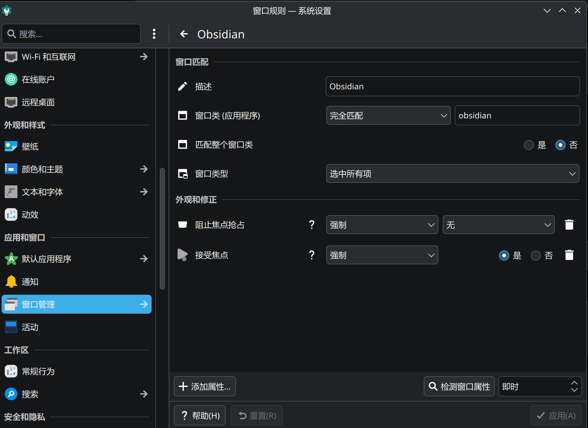

{"title":"解决 KDE Plasma Wayland 下 Obsidian Web Clipper 无法使用的问题","description":"Obsidian 已经打开时，Web Clipper 新建的笔记是空的。原因是 KDE 不让后台的 Obsidian 获得焦点，加一条窗口规则就能解决。","date":"2026-05-10","tag":"折腾","aliases":["/zh/折腾/kde-plasma-obsdian-web-clipper/","/zh/kde-plasma-obsdian-web-clipper/"]}
---
我在 Plasma Wayland 上用 Obsidian 时发现：Obsidian 已经打开的情况下，在 Chrome 里点 **Obsidian Web Clipper** 的“添加到 Obsidian”，创建出来的页面是空的。

只有先完全关闭 Obsidian，再从 Web Clipper 添加，内容才会正常出现。

## 原因

这不是 Web Clipper 没抓到网页内容，而是 KDE 阻止了已经运行中的 Obsidian 正确获得焦点。

Web Clipper 把网页内容传给 Obsidian 时，需要 Obsidian 被正确唤起并读取传入的数据。但在 KDE 的窗口管理规则下，Obsidian 在后台运行时可能无法获得焦点，内容没有被写入，结果就变成了空页面。

## 分析

现象的关键点是：

- Obsidian 关闭时添加内容正常；
- Obsidian 已打开时添加内容为空；
- 说明浏览器插件本身大概率是正常的；
- 问题出在 Obsidian 已运行时，KDE 没有让它正确响应 Web Clipper 的调用。

所以这是 KDE 的窗口焦点和激活权限问题，不是 Obsidian 笔记库、模板或 Chrome 插件的配置错误。

## 解决方案

在 KDE 里给 Obsidian 添加一条窗口规则：打开 `系统设置 → 窗口管理 → 窗口规则`，按下图设置即可。

