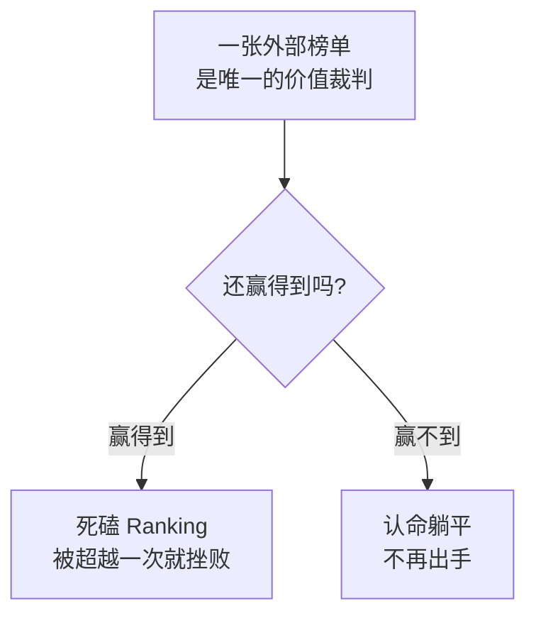

我有一个 [telegram群](https://t.me/+skT95sLJe9xhZDc1)，前几天大家在里面聊人生状态。

有群友很坦诚地剖析自己，说他的人生好像就是为了一个 Ranking（排名），如果有人在他在意的地方超过了他，他就会非常难受。紧接着，另一位群友说，自己有点想要“认命躺平”了。

这两句话挨在一起，我愣了一下。一个在死磕，一个在放弃，表面上是两个极端；可它们背后是同一件事：**外部的一张榜，成了自我价值唯一的裁判。**赢得到的时候，就焦虑地盯着它；发现怎么努力都拿不到以前那种高分了，就干脆不玩了。



那怎么才算“过爽”？我的答案是：既不靠赢下那张榜，也不靠退出游戏，而是换一种玩法。这篇文章就是这条路的完整走法：先看清这张榜为什么永远赢不完，再把自我价值从榜上拿下来，然后重新找回出手的能力，学会开口，让机会进来，让失败变成进步，最后知道什么时候该收束。

每一步我都找了研究来撑。不是为了显得有学问，而是因为这些研究不只告诉我“是什么”，还告诉我“为什么”，而知道了为什么，才知道手该往哪里放。

## 一张永远赢不完的榜

先问一个问题：为什么人会这么在意排名？

### 比较是天性，而且停不下来

1954 年，社会心理学家 Festinger 提出了社会比较理论[@festinger1954]。他的第一条假设是：人有一种评估自己能力和观点的驱力。第二条是：**当没有客观的、非社会的标准可用时，人就会拿自己和别人比。**

为什么会有这种驱力？因为准确地知道自己几斤几两，在进化上是有用的：高估自己会吃亏，甚至致命。问题在于，能力这件事还有一个“向上”的推力，大家都想更好一点。Festinger 由此推出了一个很冷静的结论：**只有当一个人比其他人稍微好一点时，比较的压力才会停下来；可不可能每个人都比其他人好一点，所以在能力的评价上，“社会的平静状态永远不会到来”。**

这对我们的问题意义很大：排名焦虑不是某个人心理脆弱，而是这场游戏的结构本身就赢不完。只要你还在拿别人当尺子，就永远有下一个人站在你前面。

但 Festinger 的理论里也藏着出口。他有一条推论：**当客观的、非社会的评价标准唾手可得时，人就不会拿自己和别人比。**换句话说，比较之所以停不下来，是因为我们手里没有别的尺子。这是整篇文章的第一个方法：**给自己造尺子。**拿上个月的自己、拿一个具体的标准、拿一件做完了能检查的作品当尺子，而不是拿“排第几”当尺子。

### 排名在下面会痛，在上面却不加分

如果比较只是让人有点不舒服，那也就算了。可有一项很漂亮的实验说明，一张公开的榜，在群体层面几乎是净亏损的。

2008 年，加州的一家报纸上线了一个可以查询州政府雇员工资的网站。Card 等人[@card2012]抓住这个机会，在加州大学的三个校区里随机挑了一部分员工，发邮件告诉他们这个网站的存在，另一部分人不告知。几天后，所有人都填了一份工作满意度问卷。收到邮件的人里，去查网站的比例从 19.2% 涨到了 49.4%，新用户里 87% 查了自己部门同事的工资。

结果是这样的：

```data title="知道同事工资之后：中位数以下受伤，中位数以上不加分" note="加州大学三个校区，分析样本 6,411 人，随机告知一部分人可以查询同事工资；按工资在部门内是否低于中位数分组，变化相对于未被告知的对照组。“打算跳槽”指自报很可能去找新工作；“不满且想走”指既不满意、又很可能去找新工作。SD 为标准差；“—”表示无显著变化。来源：Card, Mas, Moretti & Saez（2012），表 4 及正文。"
结果 | 中位数以下 | 中位数以上
工作满意度 | −0.1 SD | —
打算跳槽 | +20% | —
不满且想走 | +40% | —
```

为什么会这样？作者的解释是，人对“低于参照点”的惩罚很敏感，对“高于参照点”的奖励却几乎没有感觉。而且起作用的主要是**排名**，而不是和中位数差了多少钱。

这对我们的论证是一个关键的证据：**一张公开的榜，会让下半区的人难受，却不会让上半区的人更快乐。**一个群体里总有一半人在中位数以下，所以单一排名在整体上一定是亏的。死磕排名的人，即使赢了，也拿不到对等的回报。

这里的方法很朴素：**少接触那些你看了也改变不了什么的排名信息。**不是逃避，而是不给一个只会扣分、不会加分的系统喂注意力。

### 你在哪个池子里，决定了你觉得自己是谁

还有一件更隐蔽的事：排名是相对于一个“池子”而言的，而池子往往是偶然的。

教育心理学里有一个被反复验证的现象，叫“大鱼小池效应”。Marsh 和 Hau[@marsh2003]用 26 个国家、共 103,558 名 15 岁学生的数据发现：**能力相同的学生，所在学校的平均水平越高，他对自己学业能力的评价就越低**，26 个国家无一例外。Seaton 等人[@seaton2009]后来把范围扩大到 41 个国家，结果在每个国家都是负的，其中 38 个国家统计显著，集体主义和个人主义文化、发达和发展中国家都一样。

这种“偶然的排名”还会改变一个人后来的路。Murphy 和 Weinhardt[@murphy2020]用了英格兰 225 万多名学生的行政数据：小学毕业时全国统考分数**完全相同**的两个孩子，只因为所在班级的分数分布不同，一个排得高，一个排得低。等他们升入中学，换了新同学和新老师，没有人知道他们以前排第几，排名高的那个孩子后来的成绩仍然更好，也更可能选这门课：

```data title="分数相同，只是池子不同" note="前两行：控制个人成绩后，学校平均成绩对学业自我概念的效应，池子越强、自我评价越低。Marsh & Hau 为 26 国 103,558 名 15 岁学生；Seaton 等为 41 国 PISA 数据。后两行：Murphy & Weinhardt，英格兰 225 万多名学生，分数相同时小学班级内排名的影响，“班上第一”与“排在中间”相比（工作论文版本）。SD 为标准差。来源：Marsh & Hau（2003）摘要；Seaton, Marsh & Craven（2009）摘要；Murphy & Weinhardt（2020）引言。"
样本 | 发现
26 国学生 | 全为负，β = −0.20
41 国学生 | 全为负，38 国显著
英格兰：排名 +1 SD | 成绩 +0.08 SD
英格兰：班上第一 | 选这门课 +近 20%
```

为什么一个早已没人记得的排名还能起作用？作者检验了两种解释：一种是排名让孩子学到了自己擅长什么，另一种是排名改变了孩子的自信，进而改变了他愿意付出的努力。数据支持后者。

这就是我理解的“被同一套系统训练出来”。如果把我们的成长、我们的应试教育，尤其是高考，借作强化学习的比喻，Reward 总是优先发给单一榜单上成绩高的人；而这些研究说明，这套训练改变的不只是分数，还有我们对“我是谁”的判断，并且会一路带进后来的选择里。**排名有一部分是房间的偶然，却被我们当成了对自己的定义。**

认清这一点，方法也就有了：**自我评价要换一个更大的参照系。**同一份能力，在一个池子里是垫底，在另一个池子里是中坚；你不需要换池子，但你需要知道，那个让你难受的名次，有一部分只是房间的形状。

## 比较可以是地图

看到这里，可能会得出一个结论：那就别比了。但比较是天性，戒不掉；而且研究告诉我们，比较也可以变成燃料。关键在于怎么比。

### 刷手机时，比较默认是一面墙

先看默认情况。McComb 等人的元分析[@mccomb2023]汇总了 48 篇文章、7,679 名参与者、118 个效应量的实验：一组人在社交媒体上看比自己“更好”的人（身材、生活、人缘），另一组看不如自己的人或中性内容，然后测自我评价和情绪。

```data title="刷到比自己好的人，四类结果全部变差" bars="效应量 g" note="Hedges g，与向下比较或对照组相比，负值表示更差；四项均 p < .001，合并效应 g = −0.24。来源：McComb, Vanman & Tobin（2023），摘要。"
结果 | 效应量 g
身体意象 | −0.31
心理健康 | −0.21
自尊 | −0.21
主观幸福感 | −0.19
```

作者的解释是：在社交媒体上，人对向上比较的主导反应是“对比”，也就是“我和他不一样，我不如他”，而不是“同化”，也就是“我和他是一类人，我也可以”。这很好理解：信息流里的人是被挑选过的高光，你看不到他们的过程，只看得到结果；结果和你之间没有路，于是只剩落差。

### 看得见路时，比较是一张地图

那什么时候比较会变成“我也可以”？Lockwood 和 Kunda 在 1997 年做了一组很经典的实验[@lockwood1997]。参与者以为自己在参加一项“新闻写作风格”研究，读了一篇报纸文章，介绍一位学业、领导力、运动样样出色的“超级明星”学生，然后给自己打分。

第一项研究发现，只有当明星和自己在同一个领域时，读完才会影响自我评价：想当会计的人读会计明星，想当老师的人读教师明星。第二、三项研究则找到了决定方向的变量：**这份成功看起来能不能达到。**

```data title="同一个明星，有人被点燃，有人不为所动" note="自我评价为 1–11 分，控制组在读文章之前打分。研究 2：会计专业学生，明星是一位即将毕业的四年级会计学生；研究 3：按对智力的看法（可变或固定）分组，明星与本人同专业。“不显著”指与控制组的差异不显著。来源：Lockwood & Kunda（1997），表 2、表 3。"
组别 | 控制组 | 读完明星之后
一年级（还来得及） | 8.19 | 8.90
四年级（已经来不及） | 8.29 | 7.88（不显著）
相信能力会成长 | 7.61 | 8.66
相信能力是固定的 | 7.82 | 7.52（不显著）
```

一年级学生里，82% 在开放回答里写到自己受到了激励；四年级学生只有 6%。一年级的学生会写“看到他做到的事，我知道自己该往哪儿努力了”。而四年级学生里有一半人开始否定比较本身，写下“任何两个人的成功都没法比”。

作者的解释是：一个榜样能不能变成动力，取决于你能不能从他的位置走到自己的位置。一年级学生还有三年，明星的履历就是一份路线图；四年级学生已经错过了，同样的履历就只剩落差，于是只好贬低比较来保护自己。相信能力可以成长的人，即使是同一时刻读到同一个明星，也更容易把他当成“我将来的样子”。

两项研究放在一起，对我们的论证正好是一个完整的回答：**比较不是问题，问题是你在跟谁比、你相不相信自己会变。**墙和地图之间，差的是一条看得见的路。

方法也就清楚了：

- **挑比你领先一两个阶段的人当参照**，而不是同一时刻已经赢了的人，更不是信息流里被挑选过的高光。
- **把别人的成功拆成步骤来读**：他第一步做了什么，第二步做了什么，哪一步我现在就能做。
- **相信能力会长**，不是作为口号，而是作为一个让地图成立的前提。

这样，“看见更厉害的人”就不再是一张判决书，而是一张下一步的清单。

## 别把整个人押上去

即使比较方式对了，还有一个更深的问题：你把自我价值押在了哪里。

### 押得越重，跌得越疼，赢了也不加分

Jennifer Crocker 和同事们研究了二十多年“自我价值的条件性”：一个人是不是把自己的价值押在某个领域上，比如成绩、外表、别人的认可。

她们做过一项每日追踪研究[@crocker2003]：122 名工科和心理学专业的学生，在三周里每天上网报告当天收到的成绩，以及当天的自尊和情绪。结果是，**越是把自我价值押在学业上的学生，收到比预期差的成绩那天，自尊跌得越厉害；**而这种自尊的大起大落，又预测了三周后抑郁症状的加重，对一开始就比较抑郁的学生尤其如此。

同一个实验室的另一项研究追踪了申请研究生的大四学生：每次收到录取或拒信，他们都要上网报告当天的自尊。押注越重的学生，录取那天升得越高，拒绝那天跌得越低；而在押得最重的学生身上，**拒绝带来的下跌远远大于录取带来的上升。**测了九种押注方式，只有“学业”这一种有这个效应。

Crocker 和 Park 在 2004 年的综述[@crockerpark2004]里把这些发现拼成了一个完整的机制：当自我价值押在一个领域上，那个领域里的每一次成败，就不再只是一次成败，而会**泛化成对整个人的价值判断**。于是人就有了一个新目标：证明自己。而这个目标会带来一连串代价：

- 押注学业的学生自称学得更多，**成绩却并没有更好**；
- 在“学到东西”和“拿到高分”之间被迫二选一时，他们更倾向于选高分；
- 成功带来的释然是暂时的，因为下一次考试总会来，焦虑也就总会回来。她们的原话是：**“自尊的提升会减少焦虑，但追求自尊本身可能会增加焦虑。”**

这一节对我们的论证有决定性的价值，因为它解释了死磕排名为什么让人这么累：**把整个人押在一张榜上，换来的主要是下行风险，上行却封顶。**赢了是“还好没输”，输了是“我不行”。

### 奖励函数要防止单点故障

那怎么办？在 750 名大一新生里，96% 的人至少有一种这样的押注，完全不押注的人很少。Crocker 和 Park 比较了几条出路，她们最推荐的一条很有意思：**押注很难改，但目标可以每时每刻重新选择。**把目标从“证明我够好”换成比自己更大的东西，比如做出一个有用的作品、帮到一个具体的人、和一群人把一件事做成。她们举的例子是一个创业者，从“做一家公司让自己变得有钱有影响力”，换成“和一群同事一起做出一个有用的产品”。

这就是我说的**自己写奖励函数**。自己写奖励函数，不是把目标调低，而是终于愿意为目标负责。用工程的话说：**奖励函数要防止单点故障。**排名可以是一块仪表，但不该是唯一的电源。它一掉，整间屋子就断电，这才是问题。

```sketch title="排名可以是仪表，不该是唯一的电源" note="单一电源：自我价值只接在排名上，排名一掉就全断；多路供电：排名仍然接着，只是不再是唯一的一路。示意。"
<svg viewBox="0 0 704 250">
  <rect class="panel" x="0" y="0" width="344" height="250" rx="12"/>
  <text class="caps" x="24" y="32">单一电源</text>
  <g class="node plain"><rect x="40" y="118" width="72" height="34" rx="4"/><text class="mid" x="76" y="135">排名</text></g>
  <path class="edge hot" d="M112 135 H196" marker-end="url(#arrow)"/>
  <g class="node teal"><rect x="200" y="118" width="100" height="34" rx="4"/><text class="mid" x="250" y="135">自我价值</text></g>
  <text class="small" x="24" y="226">排名一掉，整间屋子断电</text>
  <rect class="panel" x="360" y="0" width="344" height="250" rx="12"/>
  <text class="caps" x="384" y="32">多路供电</text>
  <g class="node plain"><rect x="400" y="60" width="72" height="30" rx="4"/><text class="mid" x="436" y="75">排名</text></g>
  <g class="node plain"><rect x="400" y="100" width="72" height="30" rx="4"/><text class="mid" x="436" y="115">作品</text></g>
  <g class="node plain"><rect x="400" y="140" width="72" height="30" rx="4"/><text class="mid" x="436" y="155">关系</text></g>
  <g class="node plain"><rect x="400" y="180" width="72" height="30" rx="4"/><text class="mid" x="436" y="195">日常</text></g>
  <path class="edge" d="M472 75 H524 V135"/>
  <path class="edge" d="M472 115 H524"/>
  <path class="edge" d="M472 155 H524"/>
  <path class="edge" d="M472 195 H524 V135 H556" marker-end="url(#arrow)"/>
  <g class="node teal"><rect x="560" y="118" width="100" height="34" rx="4"/><text class="mid" x="610" y="135">自我价值</text></g>
  <text class="small" x="384" y="236">一路掉了，灯还亮着</text>
</svg>
<svg viewBox="0 0 340 416">
  <rect class="panel" x="0" y="0" width="340" height="150" rx="12"/>
  <text class="caps" x="16" y="28">单一电源</text>
  <g class="node plain"><rect x="40" y="56" width="72" height="34" rx="4"/><text class="mid" x="76" y="73">排名</text></g>
  <path class="edge hot" d="M112 73 H196" marker-end="url(#arrow)"/>
  <g class="node teal"><rect x="200" y="56" width="100" height="34" rx="4"/><text class="mid" x="250" y="73">自我价值</text></g>
  <text class="small" x="16" y="128">排名一掉，整间屋子断电</text>
  <rect class="panel" x="0" y="166" width="340" height="250" rx="12"/>
  <text class="caps" x="16" y="194">多路供电</text>
  <g class="node plain"><rect x="40" y="214" width="72" height="30" rx="4"/><text class="mid" x="76" y="229">排名</text></g>
  <g class="node plain"><rect x="40" y="254" width="72" height="30" rx="4"/><text class="mid" x="76" y="269">作品</text></g>
  <g class="node plain"><rect x="40" y="294" width="72" height="30" rx="4"/><text class="mid" x="76" y="309">关系</text></g>
  <g class="node plain"><rect x="40" y="334" width="72" height="30" rx="4"/><text class="mid" x="76" y="349">日常</text></g>
  <path class="edge" d="M112 229 H164 V289"/>
  <path class="edge" d="M112 269 H164"/>
  <path class="edge" d="M112 309 H164"/>
  <path class="edge" d="M112 349 H164 V289 H196" marker-end="url(#arrow)"/>
  <g class="node teal"><rect x="200" y="272" width="100" height="34" rx="4"/><text class="mid" x="250" y="289">自我价值</text></g>
  <text class="small" x="16" y="396">一路掉了，灯还亮着</text>
</svg>
```

### 写什么样的奖励，决定了赢了之后爽不爽

奖励函数里写什么，也有研究可循。Niemiec、Ryan 和 Deci[@niemiec2009]追踪了两所美国大学的毕业生：毕业一年后和两年后各测一次，看他们重视什么目标、实现了多少，以及过得怎么样。目标被分成两类：内在目标是个人成长、亲密关系、社区参与、身体健康；外在目标是金钱、名声、形象。

```data title="实现了目标，过得好不好，取决于是什么目标" note="内在目标：个人成长、亲密关系、社区参与、身体健康；外在目标：金钱、名声、形象。毕业两年后，147 名毕业生。β 为结构方程模型中“目标实现程度”到“幸福感”与“不适感”（焦虑、身体症状、负面情绪）的路径系数；外在目标到幸福感的路径不显著。来源：Niemiec, Ryan & Deci（2009），结果部分与图 1。"
实现的目标 | 幸福感 | 不适感
内在目标 | β = .77 | β = −.66
外在目标 | β = .00 | β = .38
```

**实现了外在目标，幸福感没有提高，焦虑和不适反而更多；实现了内在目标，幸福感明显提高。**作者用自我决定理论解释：内在目标的实现满足了人对自主、胜任和归属的基本需要，外在目标不能，有时还会挤占它们。数据里，这三种需要的满足确实解释了一部分效应。

这对我们的论证补上了最后一块：不是说排名、金钱、名声不重要，而是**它们赢到手了也不会让你更爽。**所以在奖励函数里，它们可以是仪表，真正的电源要接在成长、关系和你在乎的事情上。

还有一个可以马上用的小工具，叫价值肯定。Cohen 和 Sherman 的综述[@cohen2014]汇总了很多实验：在一次重要的评价之前，花十来分钟，写一写一个对自己很重要、但和这次评价无关的价值，比如家人、幽默感、对某件事的热爱，写它为什么重要。在一项美国中学的实验里，这个练习让非裔学生第一学期拿 D 和 F 的比例**减半**；在一门大学生物课上，它把第一代大学生和其他学生的成绩差距缩小了一半，继续选修下一门课的比例从 66% 升到 86%；在实验室里，做完这个练习的人面对压力演讲时，皮质醇不再上升。

作者的解释是：人需要的不是“比别人好”，而是“整体上是一个足够好的人”。当你提醒自己，你的价值不只押在眼前这一件事上，这一次的威胁就不再那么可怕，人反而更敢于面对错误、也更愿意学习。他们特别说明，这类练习是“催化剂，不是万能药”：它起作用的前提是你手里本来就有成长的资源。这恰好就是多路供电的意思：**把其他几路电源接上，才敢让排名这一路自然起落。**

还有一本账也要分开记：产出和心理成本。“我更拼了”和“我过得更好了”从来不是同一个指标。一个人可以一边高效运转，一边不断回头看自己是不是还不够好。把两本账分开，才知道自己是在追求想要的生活，还是只是在给那个裁判交税。

## 认命是默认反应，掌控感是学来的

把裁判请下场之后，还有第二个群友的问题：认命。

### 被抛

人越往后走，就越得承认一个冷酷的事实：我们最初拿到的剧本，根本不是自己选的。我喜欢借用海德格尔的“被抛”来形容这种处境：人像是被扔到了一套自己未曾选择的天气和地形里。出生在什么样的家庭，拥有什么样的基因，二十多岁时恰好遇到什么样的时代风口，没有多少道理可讲。有时候用尽了全力，却因为一点偶然满盘皆输；有的人似乎没怎么费力，就站在了你够不到的地方。

承认这一点并不丢人。世界并不总按“一分耕耘一分收获”的公式运行。

### 无助不是学会的，掌控才是

那么，长期处在自己控制不了的处境里，人为什么会放弃？“习得性无助”这个词大家都听过：上世纪六十年代，Seligman 等人发现，经历过无法逃避的电击的动物，后来即使有机会逃，也不逃了。当时的解释是：动物“学会了”无助。

五十年后，Maier 和 Seligman 自己写了一篇综述[@maier2016]，用神经科学的证据把这个理论翻了过来。他们的原话是：**“最初的理论把事情说反了。被动不是学来的，它是面对长期不良事件时默认的、不需要学习的反应。”**长期的不可控刺激会激活大脑深处的中缝背核，产生被动和焦虑；而大脑里真正需要学习的，是前额叶皮层对“我的行动有用”的觉察，一旦觉察到控制，它会自动压住那个默认的被动反应。

为什么这么说？他们的实验有几个很关键的发现：

- 可逃避和不可逃避的电击，对中缝背核的激活**一样强**。大脑里没有一个专门被“失控”打开的开关，只有一个被“掌控”关掉的开关。
- 研究者让大鼠只靠习惯完成逃跑动作，同时关掉负责觉察“行动—结果”关系的脑区。大鼠照样完美地逃掉了电击，**却没有得到任何保护**，后来依然变得被动。光是做到还不够，还得**觉察到**是自己的行动起了作用。
- 一次真正的掌控经历会产生“免疫”：先经历过可逃避电击的大鼠，七天之后在另一层楼、由另一批实验者施加的社交挫败面前，也不再变得被动。

这项研究对我们的论证有两层价值。第一层是去掉羞耻：**认命不是性格软弱，而是哺乳动物面对长期失控时的默认设置。**第二层是给出方向：走出来的办法不是更用力地鼓励自己，而是**积累被自己清楚觉察到的掌控经验。**

作者在文末推测了它对治疗的启示：与其反复追问“为什么会这样”，不如问“接下来去哪”；问题解决、安排活动、角色扮演，这些面向未来的小动作，都是在教人“有些事情是我能做的”。

### 从一碗热汤面开始的掌控

这让我对“做自己人生的主人公”有了一个更具体的理解。萨特说“存在先于本质”：我不必先把某个名次当成自己的本质，我先活着，然后通过行动去定义什么对我有价值。所谓“命”，只是你降落时遇到的天气和地形；“你是谁”，是你在这些处境里做出的每一次选择拼起来的。

无论别人多么耀眼，在你的视角里，他们都只是路过你生活的配角，或者背景板里的一条新闻。他们无法替你感受晚风的凉意，无法替你品尝一顿晚饭的咸淡，更无法替你承担哪怕一秒钟的悲喜。

你可能真的很厉害，但在这个属于我的、具体的世界里，**我是「我」这个人生故事唯一的主人公啊！**

主人公不是一定能逆风翻盘，那是爽文，不是生活。主人公是哪怕知道布景简陋、剧本充满偶然，依然认真对待自己的下一句台词。今天晚上吃什么，读哪一页书，对谁微笑，什么时候离开，什么时候坚持，这些看似微不足道的选择，按 Maier 和 Seligman 的说法，正是一次次“我的行动有用”的觉察。

这里有两个工具可以让掌控感变得可见。

第一个是**记录进展**。Amabile 和 Kramer 收集了 7 家公司、26 个项目团队、238 个人近 12,000 篇工作日记[@amabile2011]，发现人们心情最好的那些日子里，76% 发生了工作上的进展，只有 13% 遇到了挫折；心情最差的日子里，67% 遇到了挫折，只有 25% 有进展；而且 28% 对项目影响很小的事件，对人的感受影响很大。他们把这叫作“进展原则”：在有意义的事情上取得哪怕很小的进展，是最强的日常动力。所以我每天睡前写一行：今天往前挪了什么。这一行字，就是一次被觉察到的掌控。

第二个是**把行动写成“如果……就……”**。Gollwitzer 和 Sheeran 的元分析[@gollwitzer2006]汇总了 94 项检验、8,461 名参与者：把意图写成“如果遇到情境 X，我就做 Y”的人，目标达成明显更好，效应量 d = 0.65；专门针对“克服一开始的不情愿”，效应量也是 0.65。他们引用的另一项研究发现，有意图却没有行动的人，中位比例高达 47%。作者的解释是：提前写好的“如果”让那个情境更容易被注意到，“就”让反应变成自动的，不再需要每次鼓起勇气。

## 开口：别人比你想的更愿意

找回出手的能力之后，第一个、也是最便宜的出手，是**开口**：给仰慕的人发一条消息，申请一个觉得自己高攀不上的机会，把半成品公开发出来，直接问一句“能不能教教我”。

开口之前，我们总会先在心里估计对方会不会答应。而三十年的研究说明，这个估计有系统性的偏差。

### 当面开口：我们低估了一半

Flynn 和 Lake 在 2008 年做了一组很直观的实验[@flynn2008]：在哥伦比亚大学，参与者先估计要当面问多少个陌生人，才能让足够多的人答应一件小事，然后真的走到校园里去问。

```chart bar title="当面请求：获得同意要问多少人？" yfmt="%.0f" note="纵轴单位：人。哥伦比亚大学校园的当面请求。三项任务分别要获得 5、3、1 次同意；n=23、17、12，为各比较对应的完成者样本。来源：Flynn & Lake（2008），研究 1、2。"
任务 | 预计人数 | 实际人数
填问卷 | 20.5 | 10.5
借手机 | 10.1 | 6.2
请陌生人带路 | 7.2 | 2.3
```

请陌生人带路去一个难找的体育馆，参与者以为平均要问 7.2 个人，实际只问了 2.3 个。他们在真实的慈善募捐里也发现了同样的事：志愿者以为要找 210 个人才能凑够目标，实际只找了 122 个；每人的平均捐款也比预想的多。论文摘要的说法是：人们对别人答应直接请求的可能性，**低估了多达 50%**。

他们的第六项研究最有方法论价值。参与者要收回问卷，一半人当面直接请求，一半人只是默默递上一张传单；问卷一半是 1 页，一半是 10 页。结果，请求者的预测只跟问卷长短有关，觉得 10 页的难得多；而实际答应的人数只跟**是否当面直接开口**有关：当面问，平均每 2.28 个人就有一个答应；递传单，要 15.32 个人才有一个。**问卷从 1 页变成 10 页，实际答应率没有变化。**

这告诉我们两件事：我们担心的东西（请求太大）其实没那么要紧，我们忽视的东西（是不是当面直接问）才是关键。

### 为什么低估：对方是真的想帮

Flynn 和 Lake 最初的解释是：开口的人只算了对方答应要付出的时间，没算对方拒绝也有尴尬。十四年后，Zhao 和 Epley 用六项预注册实验、共 2,118 名美国参与者，把原因找得更准了[@zhao2022]。

他们最漂亮的一项实验在植物园里：参与者要请一个陌生人用拍立得帮自己拍张照。研究者在旁边暗中观察，事后分别私下询问请求者和帮忙的人。

```data title="植物园里的一次请求：请求者以为的，和帮忙者实际的" note="实验 3，50 对互不相识的人；0–10 分量表，最后一行为至少部分认为“帮忙是出于不好意思拒绝”的比例。来源：Zhao & Epley（2022）作者接受稿，实验 3 结果。"
项目 | 请求者以为 | 帮忙者实际
愿意帮忙的程度 | 7.45 | 8.87
帮这个忙有多麻烦 | 3.21 | 0.51
帮完之后心情有多好 | 6.80 | 7.87
拒绝的话会有多难受 | 6.74 | 4.78
帮忙是因为不好意思拒绝 | 74% | 2%
```

请求者在每一项上都想得更糟：以为对方不太情愿，以为会很麻烦，以为对方是碍于面子才答应。实际上，帮忙的人几乎不觉得麻烦，心情反而变好了，而且只有 2% 的人觉得自己是被逼的。研究者的现场记录写道：请求者开口很慢，语气常常带着歉意；而被请求的陌生人通常立刻答应，脸上带着看得见的笑。50 次请求里，只有 4 次第一个人没答应，而这 4 次问到的第二个人都答应了。六项实验里，请求者对“对方有多愿意帮忙”的低估无一例外。

作者的解释是：我们把请求理解成了**强加**，而对方把它体验成一个**帮忙的机会**。真正挡住我们开口的，不是对拒绝的估计，而是对别人善意的低估。

这对我们的论证意义很大：认命的人常常把世界想象成一个没人愿意搭把手的地方，而数据说的是相反的事。

### 一个“不”不是终点

Bohns 在 2016 年的综述[@bohns2016]里总结了她和合作者的一系列研究：参与者一共向 14,000 多个陌生人提出过各种请求，**请求者平均把答应率低估了 48%。**还有两个很有用的细节：被拒绝一次之后，请求者以为下一次的答应率会降 16%，实际上反而**升了 10%**；提出付钱能让请求者的预测准一点，但对方免费也同样愿意帮。她也提到，中国参与者在问卷请求上的低估比美国参与者小，因为他们更容易想到对方拒绝时的尴尬。

为什么这么大的偏差，生活里却纠正不过来？她的解释很扎心：我们平时只向那些肯定会答应的人开口，比如好朋友，所以几乎从来没有被“惊喜”过，也就没有机会更新判断。

同样的力量也有另一面。Bohns 等人[@bohns2014]让参与者去请陌生人在一本图书馆的书上用笔写一个单词：请求者以为大约 28% 的人会答应，实际上超过 64% 的人照做了。**开口的力量比你以为的大，所以要用在对双方都好的事情上**，并且给对方一个真正的拒绝出口。

### 当面，或者至少带上你的脸

但这个规律有一个重要的适用条件：渠道。Roghanizad 和 Bohns[@roghanizad2017]让请求者分别当面或用邮件，请 10 个陌生同学填一份问卷：

```chart bar title="当面低估，邮件高估" yfmt="%.0f%%" note="请求者先预测会有几人答应，再真的去问。研究 1（当面 26 人、邮件 19 人）：每人请 10 名陌生同学填一份 44 题的人格问卷；研究 2（每组 30 人）：请已经答应有偿填问卷的 7 人再免费帮忙校对一份文档。人数换算成百分比（研究 1 除以 10，研究 2 除以 7）。来源：Roghanizad & Bohns（2017）作者稿，研究 1、2 结果。"
条件 | 预计答应 | 实际答应
研究1当面 | 50.8 | 71.5
研究1邮件 | 55.3 | 2.1
研究2当面 | 63.3 | 77.6
研究2邮件 | 58.6 | 34.7
```

当面问，10 个人里平均 7.15 个答应；发邮件，只有 0.21 个，相差 34 倍。而请求者对两种方式的预测几乎一样。作者测了原因：收到邮件的人对一个陌生发件人的信任和共情都明显更低，而请求者完全没有预料到这一点。他们给的建议也很实在：用邮件请求陌生人之前，先回想一下自己收到陌生人邮件时的感受。

所以，Flynn 和 Lake 第六项研究里的传单，和这里的邮件，说的是同一件事：**善意需要一张脸来触发。**能当面就当面，不能当面就打电话、开视频，至少在文字里让对方看到你是谁、为什么找他、他能多容易地拒绝你。

### 陌生人也想聊天，而且更喜欢你

开口的偏差不止于请求。Epley 和 Schroeder[@epley2014]在芝加哥的通勤火车上做了一个实验：随机让一部分人和旁边的陌生人聊天，一部分人保持安静，一部分人照常通勤。通勤者事先预测，和陌生人聊天会是最难受的；实际上，聊天组的通勤体验最好，和安静组相比的效应量 d = 0.63，工作效率也没有下降。在出租车上，这个效应量是 0.93。

他们还问了通勤者：你觉得有多少人愿意聊？答案不到一半。而现实是：所有交回问卷的参与者都和自己搭话的人聊上了，**没有一个人报告被拒绝。**作者写道：参与者以为对方愿不愿意聊像是抛硬币，而就他们所见，这更接近一件确定的事。最有意思的是，平时就爱和陌生人聊天的人预测对了，平时不聊的人预测错了。**偏差来自没试过，纠正它的唯一办法就是去试。**

聊完之后，还有一个偏差在等你。Boothby 等人[@boothby2018]让互不相识的人聊几分钟，然后各自评价“我有多喜欢对方”和“我觉得对方有多喜欢我”。几乎在所有研究里，人们都**低估了对方对自己的喜欢**，越害羞的人低估得越多；在大学室友之间，这个差距持续了好几个月。原因是：我们聊完后满脑子都是自己哪句话说得不好，然后把这份自我批评投射到了对方身上；而录像显示，对方其实一直在释放喜欢的信号。

### 开口的方法

把这些研究放在一起，开口就从一件靠勇气的事，变成了一件可以设计的事：

1. **先写下预测**：这一类请求，我觉得几成会答应。然后用小批量去问，记下实际结果。偏差来自没试过，数据会替你纠正它。
2. **当面、直接地问**，别用暗示，别用群发。能见面就见面，不能见面就让对方看到你的脸和你的理由。
3. **别因为害怕而缩小请求**。决定答应与否的往往不是请求的大小，而是你有没有直接开口。
4. **把请求理解成给对方一个帮忙的机会**，而不是强加；同时给对方一个体面、真实的拒绝出口。
5. **一个“不”不是终点**，下一次的答应率不会因此变低。
6. **聊完之后，默认对方比你感觉的更喜欢你。**

这就是“主动开口”在我心里的样子：勇气不是把拒绝率想成零，而是不再拿想象当数据。

## 机会从人群的边缘进来

开口之后，机会从哪里来？社会网络研究给了一个很具体的回答。

### 弱关系：那些你几乎忘了的人

1973 年，Granovetter 发表了社会学史上被引用最多的论文之一，《弱关系的力量》[@granovetter1973]。他的论证很简洁：两个人的关系越强，他们的朋友圈重叠得越多；所以强关系很少能连到一个你不认识的圈子，**能连通不同圈子的“桥”，几乎都是弱关系。**新的信息只能从桥上过来。

他用自己在波士顿郊区做的求职调查来说明这一点：在通过熟人找到工作的人里，那个熟人他们见面的频率是这样的：

```data title="帮你找到工作的人，多半不常见面" bars="占比" note="波士顿郊区近期换工作的专业、技术和管理人员中，通过熟人找到工作的 54 人。经常：每周至少两次；偶尔：一年不止一次、每周不到两次；很少：一年一次或更少。来源：Granovetter（1973），第 1371 页。"
见面频率 | 占比
经常 | 16.7%
偶尔 | 55.6%
很少 | 27.8%
```

超过八成的人，是从不常见面的人那里听到了改变自己的机会。这些人往往是老同学、前同事、以前的老板，通过一次偶遇或共同的朋友重新联系上。Granovetter 写道：**“人们从那些几乎已经忘了其存在的人那里，得到了关键的信息，这很值得注意。”**他的解释是结构性的，而不是动机上的：不常见的人活在和你不同的圈子里，所以知道你不知道的事。

半个世纪后，Rajkumar 等人在《Science》上给这个理论做了一次因果检验[@rajkumar2022]。他们利用了 LinkedIn“你可能认识的人”推荐算法在五年里做过的多轮随机实验：超过 2,000 万用户被随机分到偏向推荐不同强度关系的算法版本，期间产生了 20 亿条新连接和 60 万份新工作。因为分组是随机的，他们可以估计每一种关系对“工作传递”的因果效应。

结果支持弱关系，而且画出了一条更精确的曲线：**中等偏弱的关系最有用。**以共同好友数衡量，新关系的作用先升后降，共同好友超过十个之后，再增加反而降低了工作传递的概率；以互动强度衡量，互动最少的新关系最有用。有一个细节特别能说明随机实验的价值：如果只看普通的相关分析，同一份数据会得出“强关系更有用”的相反结论。作者还发现，弱关系带来了更多的求职申请，这正是“新信息”这条机制的证据；在信息技术、软件密集、适合远程办公的行业里，弱关系的作用更强。

当然，强关系也有它的位置。Bian 在 1988 年的天津调查[@bian1997]里发现，在当时由单位分配工作的环境中，工作更常通过强关系获得：人们动用的是建立在信任和义务上的关系，去影响手里有分配权的人。

把这几项研究放在一起，就是一个清楚的分工：**信息稀缺的地方，弱关系把门指给你；信任稀缺的地方，强关系替你作证；进门之后，作品和能力决定你能做什么。**

### 运气需要入口

为什么这一点这么重要？因为在一个充满偶然的世界里，运气很大程度上取决于你暴露在多少机会面前。Pluchino 等人做过一个计算机模拟[@pluchino2018]：一千个人，才华呈正态分布，在四十年里随机遇到好运和坏运，好运能不能抓住取决于才华。模拟出来的财富分布是典型的“二八分布”，而最成功的那个人，才华只是中等，0.61，平均值是 0.6；才华最高的那个人（0.89），最后几乎一无所有。作者从模型里引出的建议是：**拓宽自己的活动，多产生想法，多和人交流，做一个开放的人，让自己暴露在更多的好运面前，再用才华去抓住它。**

这正好把前面的“被抛”接上了：我们控制不了天气，但能控制自己站在多少扇门前。

所以方法是：

- **定期激活沉睡的关系**：给老同学、前同事发条消息，不为了要什么，只是让桥保持通畅。
- **多认识“有几个共同好友、但不熟”的人**，那是新信息最密集的地方。
- **在需要信任的事情上，经营好那几段深关系**，它们是在关键时刻替你作证的人。

## 失败变成进步，需要三个条件

开口了，敲门了，大多数门不会开。这是这条路上最考验人的地方。

我最想改掉的一句成功学是：“每一次出手，不管成不成，都会留下点什么。”研究告诉我们，失败不会自动变成进步；但在三个条件下，它会。

### 条件一：带着上一次的东西出发

Yin 等人在《Nature》上发表过一项很有意思的研究[@yin2019]。他们收集了三个完全不同领域的“失败史”：三十年里 13.9 万名科学家提交的 77.7 万份美国国立卫生研究院（NIH）基金申请，四十多年里 5.8 万家拿过风险投资的创业公司，以及一个全球恐怖袭击数据库。每一个领域里，都有人屡败屡战最终成功，也有人一直失败、最后放弃。

第一个发现就很反直觉：**最终成功的人和最终放弃的人，失败的次数在统计上没有区别。**作者写道：“最终成功的人，并没有比没成功的人尝试得更多或更少。”

区别在于失败的**动态**。成功的那组人，两次尝试之间的间隔越来越短，每一次的表现都比上一次更好，而且这个区别从第二次尝试就能看出来；没成功的那组人，间隔不缩短，表现也不提高。只用前三次失败的时间间隔，就能以相当的准确度预测一个人最终会不会成功。

为什么？他们建了一个模型：每一次尝试都由很多部件组成，新的一次尝试里，每个部件要么重新做，要么沿用过去几次里最好的那个版本。模型显示存在一个临界点：**参考过去经验的程度低于临界点时，人会陷入停滞**，每次都推倒重来，得不到足够的反馈；高于临界点，失败就会带来持续的、越来越快的进步。而且不需要记住所有的过去，参考最近几次就够了。作者对停滞那一组的描述很精准：**他们并没有更不努力，只是做了更多不必要的改动，把本来已经做对的部分也改掉了。**

这对我们的论证是一个很重要的修正：**多推几扇门本身不够，关键是每次推门都带着上一次的东西。**

方法：

- **每次重来，先列出上一次哪些部分是对的，原样保留，只改最弱的那一块。**
- **看两个指标：两次尝试之间的间隔有没有变短，质量有没有变好。**如果都没有，那不是不够努力，而是在原地打转。

### 条件二：活下来

第二项研究来自同一个团队。Wang、Jones 和 Wang[@wang2019]找了一批刚起步的年轻科学家：他们第一次申请 NIH 的大额基金，评分刚好落在资助线附近。一部分人以极小的差距拿到了，一部分人以极小的差距没拿到。因为差距极小，这两组人在申请之前的各项指标上没有区别，这是一个近乎天然的实验。

```data title="差一点就拿到的人，后来怎样" note="1990–2005 年首次申请 NIH R01 基金的年轻科学家，刚好过线 561 人、差一点 623 人；论文指标只统计之后仍然活跃在 NIH 体系中的人。“爆款论文比例”指之后五年发表的论文中引用量进入前 5% 的比例；“篇均引用”为之后五年每篇论文五年内的平均引用；“十年内离开”指永久离开 NIH 资助体系的概率。来源：Wang, Jones & Wang（2019），摘要、图 2 与正文。"
指标 | 差一点 | 刚好过线
爆款论文比例 | 16.1% | 13.3%
篇均引用 | 32.3 | 27.0
十年内离开 | 多一成以上 | 基准
```

两个结论同时成立。一方面，**一次早期的挫折，让坚持下来的人后来做得更好**：他们的爆款论文比例和平均引用都更高。研究者排除了“只是弱的人被筛掉了”这个解释：即使把对照组里表现最差的人去掉到同样的流失率，差距依然存在。他们的结论是，挫折之后的努力、韧性这类看不见的因素在起作用，“杀不死我的，使我更强大”。

另一方面，**挫折也让一成以上的人永远离开了。**作者特别强调：这不意味着应该给年轻人设置障碍，**因为变强的前提，是先不被杀死。**

这就是“可承受损失”这个原则的意义。Dew 等人[@dew2009]在创业研究里把它表述成一条出手前的预算原则：先想清楚自己能拿出什么、愿意失去什么，再决定是否尝试。它的价值不在于保证成功，而在于**保证你能留在场上，等到失败开始变成进步的那一天。**

方法：

- **每一次出手之前，先给它定一个可承受的上限**：时间、钱、关系、声誉，哪一样都不要押到输不起。
- **低成本要按自己的处境算**，不要用别人的“这有什么大不了”替自己定价。

### 条件三：把自我从失败里拿出来

第三个条件是心理上的。失败最大的问题，不是它没有信息，而是它太疼，疼到人不愿意看它。

Eskreis-Winkler 和 Fishbach 研究了很多年“人为什么不从失败中学习”。她们在 2020 年的一组实验[@eskreis2020]里发现，人们总是倾向于隐藏自己的失败，即使失败里的信息客观上更多。在一项研究里，参与者可以选择分享一次失败的经历，或者一次没有任何反馈的经历：只有 28% 的人选择分享失败。而当研究者在失败旁边加一句提示，“注意，你可以从中学到正确答案”，选择分享失败的人就升到了 76%。人们藏起失败，是因为没意识到里面有东西可学。

她们在 2022 年的综述[@eskreis2022]里把障碍分成两类：一类是情绪上的，失败威胁自我，人会“关机”；一类是认知上的，失败里的信息比成功更间接，更难提取。对应的办法也分成几类：**把自我拿走**，比如从别人的失败里学，或者用第三人称复盘，问“他为什么失败了”而不是“我为什么失败了”；**把自我稳住**，比如给别人提建议；**降低提取的难度**，比如明确写出这次失败教会了什么。

而要稳住自我，有一种方式比“我其实很棒”更有效。Breines 和 Chen[@breines2012]在加州大学伯克利分校做了一个实验：参与者先做一份很难的词汇测试，平均只答对了 4 题（满分 10 题），然后可以不限时地复习，准备第二次测试。考完之后，一组人读到一段自我关怀的话：“如果你觉得刚才的测试很难，你不是一个人，很多学生都会觉得难；如果你对自己的表现感到难过，试着别对自己太苛刻。”另一组读到一段提升自尊的话：“你能考进伯克利，一定很聪明。”第三组什么也没读。

```data title="失败之后，自我关怀的人复习得最久" bars="复习时长（秒）" note="86 名伯克利本科生，在一次很难的测试之后，不限时复习，准备第二次测试。自我关怀组读到“你不是一个人，别对自己太苛刻”，提升自尊组读到“你一定很聪明”，不干预组什么也没读。自我关怀组与不干预组的差异显著，与自尊组的差异接近显著（p = .085）。来源：Breines & Chen（2012），实验 3。"
读到的话 | 复习时长（秒）
自我关怀 | 306.5
提升自尊 | 229.9
不干预 | 203.2
```

在另外几项实验里，自我关怀组也更相信自己的弱点可以改变，更愿意为犯过的错弥补，更愿意去找一个克服过同样弱点的人聊聊，而这正是前面 Lockwood 和 Kunda 说的那种“地图式”的向上比较。作者的解释是：自我关怀提供了一个**安全的、不评判的环境**，让人敢于直面自己的不足；它不像提升自尊那样需要把自己想得更好，所以不会妨碍人看清真实的自己。

这三项研究放在一起，就是一套完整的复盘方法：

1. **失败之后，先对自己说一句自我关怀的话**，而不是“我其实很聪明”。
2. **用第三人称写复盘**：他发了什么，对方怎么回，下次该改什么。把自我从记录里拿出去，信息才进得来。
3. **明确写出这次失败教会了什么**，哪怕只有一句。
4. **把复盘分享给一个信得过的人**，或者反过来给别人提建议。

再加上一条我给自己定的规矩：**一次尝试尽量有两份交付。**向外的一份，是你想要的结果：一封回信、一个用户、一次合作。向内的一份，是不依赖对方、由你自己完成并可以检查的产出：一个 demo、一篇文档、一版更准确的自我介绍、一份复盘。向内那份，就是下一次尝试里可以原样沿用的部件，也就是 Yin 等人说的“带着上一次的东西出发”。

## 探索之后，要收束

最后一个问题是：门要推多少扇？什么时候该停下来，把一扇门后面的东西真正做出来？

### 探索天然会被挤掉

James March 在 1991 年的经典论文[@march1991]里，把学习分成两种：**探索**是搜索、试验、冒险、发现；**利用**是精炼、选择、执行、把已有的做好。只探索，会承担试验的成本，却得不到它的好处，留下一堆没有发展起来的想法，却没有真正的专长；只利用，会被锁在一个次优的稳定状态里。

他的模拟揭示了一个更深的问题：利用的回报是**“正的、近的、可预测的”**，探索的回报是**“不确定的、远的、常常是负的”**。所以任何会根据反馈调整自己的系统，都会天然地越来越偏向利用，“短期有效，长期却可能自我毁灭”。

这对个人的意义是：**探索不会自然发生，要刻意给它留出空间；但探索本身也不是目的。**

### 先发散，再收束

那探索和利用应该怎么排？Liu 等人在 2021 年给出了一个很漂亮的答案[@liu2021]。他们研究了三类职业生涯里的“热手期”，也就是一个人连续产出高影响力作品的那段时间：2,128 位艺术家的 80 多万件作品（用拍卖价衡量），4,337 位导演的 7.9 万部电影（用评分衡量），20,040 位科学家的论文（用十年引用衡量）。他们用深度学习给每件作品的风格或每篇论文的主题编码，测量一个人在一段时间里是在广泛尝试不同风格，还是在专注于一种。

结果在三个领域里惊人地一致：热手期开始之前，人们的探索程度高于预期；热手期之中，人们的专注程度高于预期。更关键的是顺序：

```data title="先探索、再专注，是唯一提高热手期概率的组合" bars="相对基准的提升" note="热手期开始时，“先探索后专注”这一序列相对于随机基准的提升；只探索不专注、只专注不探索的组合都低于基准。来源：Liu, Dehmamy, Chown, Giles & Wang（2021），图 3。"
领域 | 相对基准的提升
艺术家 | 20.5%
科学家 | 19.2%
导演 | 13.8%
```

**只探索、或者只专注，热手期出现的概率都低于基准；只有先探索、后专注，才提高了它。**作者的解释是：探索是一种放大方差的策略，增加了撞上新想法的机会；随后的专注，让人能集中精力，在那个方向上积累能力，把发现真正做出来。还有一个细节：人们最后专注的方向，往往不是自己探索过的里面最新、最热门或引用最多的那个，而是经过选择的那个。

这和 Yin 等人的发现正好接上：探索阶段是在多推几扇门，专注阶段是在一扇门后面反复沿用、精炼。**探索之后一定要收束，收束的时候要认真选。**

### 一次出手的完整流程

把整篇文章的方法串起来，就是我现在出手时走的一条流程：

```mermaid title="一次出手，从估计到收束" note="每隔一段时间收割一次：改变了下一步的，带着保留的部件回到第一步；值得深耕的，转入专注；到了事先约定的上限，就停止。"
flowchart TD
  P[写下预测<br/>几成会答应] --> C[定好可承受的上限<br/>时间、关系、声誉]
  C --> T[当面、直接地出手]
  T --> O[两份交付<br/>向外的结果 + 向内的产出]
  O --> R[自我关怀<br/>再用第三人称复盘]
  R --> K[保留做对的部分<br/>只改最弱的一块]
  K --> Q[定期收割<br/>再出手、专注或停止]
```

每隔一段时间，我会问自己四个问题：

- 哪条反馈真的改变了下一步？
- 哪份产出已经被第二次、第三次复用？
- 哪个方向值得从探索转入专注？
- 哪个方向到了事先约定的上限，应该停止？

## 回到那碗热汤面

回到群里那两句话。

死磕排名的朋友，我想对他说：那张榜在结构上就赢不完，在下面会痛，在上面也不加分；比较可以留着，但要拿它当地图，而不是判决书；把自我价值接到几路电源上，排名就只是其中一块仪表。

想认命的朋友，我想对他说：想放弃不是你软弱，那是长期失控之后的默认反应；走出来的办法不是逼自己更努力，而是一次次小的、被你清楚看见的掌控。开口吧，别人比你想的更愿意帮你，也更喜欢你；机会多半来自那些你几乎忘了的人；失败不会自动变成进步，但带着上一次的东西、活下来、对自己好一点，它会。

这才是我理解的不认命：不是相信自己一定能赢，而是结果不再兼任裁判，尝试不再只靠运气，游戏也不必靠不断加注来证明自己还在场。

如果有人走到了聚光灯下，那很好，我们可以真诚地为他鼓掌。但鼓完掌转过身，推开家门，煮一碗热汤面的时候，你要清楚地知道，镜头一直都在你这里。

---

## 参考资料

### 比较、排名与自我价值

- [@festinger1954] Festinger, L. (1954). [A Theory of Social Comparison Processes](https://doi.org/10.1177/001872675400700202). _Human Relations, 7_(2), 117–140.
- [@card2012] Card, D., Mas, A., Moretti, E., & Saez, E. (2012). [Inequality at Work: The Effect of Peer Salaries on Job Satisfaction](https://doi.org/10.1257/aer.102.6.2981). _American Economic Review, 102_(6), 2981–3003.
- [@marsh2003] Marsh, H. W., & Hau, K.-T. (2003). [Big-Fish-Little-Pond Effect on Academic Self-Concept: A Cross-Cultural (26-Country) Test of the Negative Effects of Academically Selective Schools](https://doi.org/10.1037/0003-066X.58.5.364). _American Psychologist, 58_(5), 364–376.
- [@seaton2009] Seaton, M., Marsh, H. W., & Craven, R. G. (2009). [Earning Its Place as a Pan-Human Theory: Universality of the Big-Fish-Little-Pond Effect Across 41 Culturally and Economically Diverse Countries](https://doi.org/10.1037/a0013838). _Journal of Educational Psychology, 101_(2), 403–419.
- [@murphy2020] Murphy, R., & Weinhardt, F. (2020). [Top of the Class: The Importance of Ordinal Rank](https://doi.org/10.1093/restud/rdaa020). _The Review of Economic Studies, 87_(6), 2777–2826.
- [@mccomb2023] McComb, C. A., Vanman, E. J., & Tobin, S. J. (2023). [A Meta-Analysis of the Effects of Social Media Exposure to Upward Comparison Targets on Self-Evaluations and Emotions](https://doi.org/10.1080/15213269.2023.2180647). _Media Psychology, 26_(5), 612–635.
- [@lockwood1997] Lockwood, P., & Kunda, Z. (1997). [Superstars and Me: Predicting the Impact of Role Models on the Self](https://doi.org/10.1037/0022-3514.73.1.91). _Journal of Personality and Social Psychology, 73_(1), 91–103.
- [@crocker2003] Crocker, J., Karpinski, A., Quinn, D. M., & Chase, S. K. (2003). [When Grades Determine Self-Worth: Consequences of Contingent Self-Worth for Male and Female Engineering and Psychology Majors](https://doi.org/10.1037/0022-3514.85.3.507). _Journal of Personality and Social Psychology, 85_(3), 507–516.
- [@crockerpark2004] Crocker, J., & Park, L. E. (2004). [The Costly Pursuit of Self-Esteem](https://doi.org/10.1037/0033-2909.130.3.392). _Psychological Bulletin, 130_(3), 392–414.
- [@niemiec2009] Niemiec, C. P., Ryan, R. M., & Deci, E. L. (2009). [The Path Taken: Consequences of Attaining Intrinsic and Extrinsic Aspirations in Post-College Life](https://doi.org/10.1016/j.jrp.2008.09.001). _Journal of Research in Personality, 43_(3), 291–306.
- [@cohen2014] Cohen, G. L., & Sherman, D. K. (2014). [The Psychology of Change: Self-Affirmation and Social Psychological Intervention](https://doi.org/10.1146/annurev-psych-010213-115137). _Annual Review of Psychology, 65_, 333–371.

### 掌控感与开口

- [@maier2016] Maier, S. F., & Seligman, M. E. P. (2016). [Learned Helplessness at Fifty: Insights From Neuroscience](https://doi.org/10.1037/rev0000033). _Psychological Review, 123_(4), 349–367.
- [@amabile2011] Amabile, T. M., & Kramer, S. J. (2011). [The Power of Small Wins](https://hbr.org/2011/05/the-power-of-small-wins). _Harvard Business Review, 89_(5).
- [@gollwitzer2006] Gollwitzer, P. M., & Sheeran, P. (2006). [Implementation Intentions and Goal Achievement: A Meta-Analysis of Effects and Processes](https://doi.org/10.1016/S0065-2601(06)38002-1). _Advances in Experimental Social Psychology, 38_, 69–119.
- [@flynn2008] Flynn, F. J., & Lake, V. K. B. (2008). [If You Need Help, Just Ask: Underestimating Compliance With Direct Requests for Help](https://doi.org/10.1037/0022-3514.95.1.128). _Journal of Personality and Social Psychology, 95_(1), 128–143.
- [@zhao2022] Zhao, X., & Epley, N. (2022). [Surprisingly Happy to Have Helped: Underestimating Prosociality Creates a Misplaced Barrier to Asking for Help](https://doi.org/10.1177/09567976221097615). _Psychological Science, 33_(10), 1708–1731.
- [@bohns2016] Bohns, V. K. (2016). [(Mis)Understanding Our Influence Over Others: A Review of the Underestimation-of-Compliance Effect](https://doi.org/10.1177/0963721415628011). _Current Directions in Psychological Science, 25_(2), 119–123.
- [@bohns2014] Bohns, V. K., Roghanizad, M. M., & Xu, A. Z. (2014). [Underestimating Our Influence Over Others’ Unethical Behavior and Decisions](https://doi.org/10.1177/0146167213511825). _Personality and Social Psychology Bulletin, 40_(3), 348–362.
- [@roghanizad2017] Roghanizad, M. M., & Bohns, V. K. (2017). [Ask in Person: You’re Less Persuasive Than You Think Over Email](https://doi.org/10.1016/j.jesp.2016.10.002). _Journal of Experimental Social Psychology, 69_, 223–226.
- [@epley2014] Epley, N., & Schroeder, J. (2014). [Mistakenly Seeking Solitude](https://doi.org/10.1037/a0037323). _Journal of Experimental Psychology: General, 143_(5), 1980–1999.
- [@boothby2018] Boothby, E. J., Cooney, G., Sandstrom, G. M., & Clark, M. S. (2018). [The Liking Gap in Conversations: Do People Like Us More Than We Think?](https://doi.org/10.1177/0956797618783714) _Psychological Science, 29_(11), 1742–1756.

### 机会、失败与收束

- [@granovetter1973] Granovetter, M. S. (1973). [The Strength of Weak Ties](https://doi.org/10.1086/225469). _American Journal of Sociology, 78_(6), 1360–1380.
- [@rajkumar2022] Rajkumar, K., Saint-Jacques, G., Bojinov, I., Brynjolfsson, E., & Aral, S. (2022). [A Causal Test of the Strength of Weak Ties](https://doi.org/10.1126/science.abl4476). _Science, 377_(6612), 1304–1310.
- [@bian1997] Bian, Y. (1997). [Bringing Strong Ties Back In: Indirect Ties, Network Bridges, and Job Searches in China](https://doi.org/10.2307/2657311). _American Sociological Review, 62_(3), 366–385.
- [@pluchino2018] Pluchino, A., Biondo, A. E., & Rapisarda, A. (2018). [Talent Versus Luck: The Role of Randomness in Success and Failure](https://doi.org/10.1142/S0219525918500145). _Advances in Complex Systems, 21_(03n04), 1850014.
- [@yin2019] Yin, Y., Wang, Y., Evans, J. A., & Wang, D. (2019). [Quantifying the Dynamics of Failure Across Science, Startups and Security](https://doi.org/10.1038/s41586-019-1725-y). _Nature, 575_(7781), 190–194.
- [@wang2019] Wang, Y., Jones, B. F., & Wang, D. (2019). [Early-Career Setback and Future Career Impact](https://doi.org/10.1038/s41467-019-12189-3). _Nature Communications, 10_, 4331.
- [@dew2009] Dew, N., Sarasvathy, S., Read, S., & Wiltbank, R. (2009). [Affordable Loss: Behavioral Economic Aspects of the Plunge Decision](https://doi.org/10.1002/sej.66). _Strategic Entrepreneurship Journal, 3_, 105–126.
- [@eskreis2020] Eskreis-Winkler, L., & Fishbach, A. (2020). [Hidden Failures](https://doi.org/10.1016/j.obhdp.2019.11.007). _Organizational Behavior and Human Decision Processes, 157_, 57–67.
- [@eskreis2022] Eskreis-Winkler, L., & Fishbach, A. (2022). [You Think Failure Is Hard? So Is Learning From It](https://doi.org/10.1177/17456916211059817). _Perspectives on Psychological Science, 17_(6), 1511–1524.
- [@breines2012] Breines, J. G., & Chen, S. (2012). [Self-Compassion Increases Self-Improvement Motivation](https://doi.org/10.1177/0146167212445599). _Personality and Social Psychology Bulletin, 38_(9), 1133–1143.
- [@march1991] March, J. G. (1991). [Exploration and Exploitation in Organizational Learning](https://doi.org/10.1287/orsc.2.1.71). _Organization Science, 2_(1), 71–87.
- [@liu2021] Liu, L., Dehmamy, N., Chown, J., Giles, C. L., & Wang, D. (2021). [Understanding the Onset of Hot Streaks Across Artistic, Cultural, and Scientific Careers](https://doi.org/10.1038/s41467-021-25477-8). _Nature Communications, 12_, 5392.
