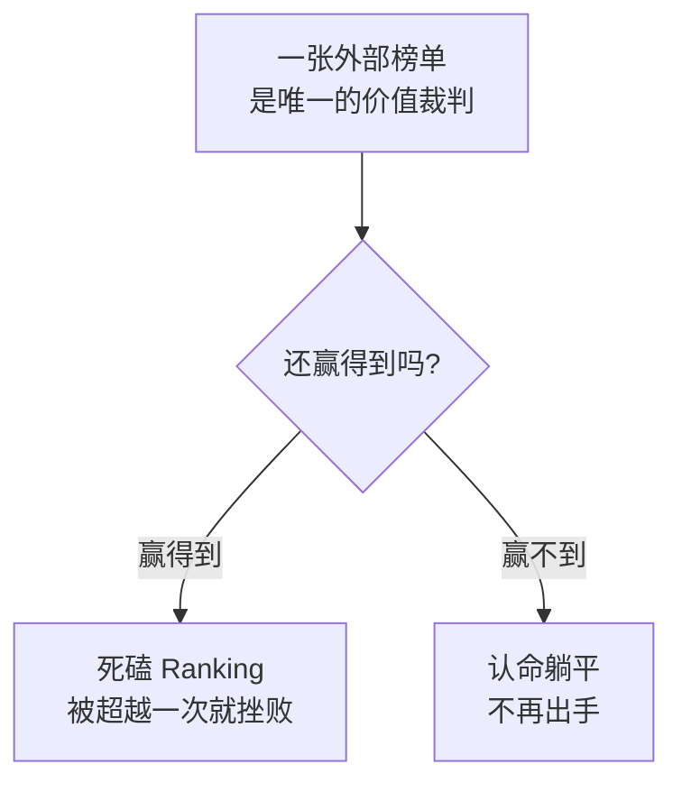

我有一个 [Telegram 群](https://t.me/+skT95sLJe9xhZDc1)，前几天大家在里面聊各自的人生状态。

有群友很坦诚地剖析自己，说他的人生好像就是为了一个 Ranking（排名）：只要有人在他在意的地方超过了他，他就会非常难受。紧接着，另一位群友说，自己有点想要“认命躺平”了。

这两句话挨在一起，我看着屏幕愣了一下。

一个在死磕，一个在放弃，表面上是两个极端；可它们背后其实是同一件事：**外部的一张榜，成了自我价值唯一的裁判。** 卷得动、赢得到的时候，就提心吊胆地盯着名次，哪怕赢了 99 次，只要被超越 1 次就瞬间破防；等走入社会，发现赛道变复杂了，怎么努力都拿不到以前那种高分奖励了，整套心理机制就崩塌了，觉得自己是个失败的模型，干脆停止迭代，宣布“认命”。



如果有什么话是我很想对身边的朋友说的，大概就是：**别被那个虚无的 Ranking 绑架，也别轻易去说“认命”这个词。**

那怎么才算“过爽”？既不是靠赢下那张永远赢不完的榜，也不是靠退场躺平，而是换一种玩法：先把那个唯一的裁判请下场，改写自己的奖励函数；再在一个不公平的世界里找回出手的手感；然后学会开口、接通机会、让每一次哪怕失败的尝试都留下资产，最后在找准的方向上收束深耕。

每一步我都找了心理学、社会学或复杂系统的研究来托底。不是为了掉书袋，而是因为鸡汤只管喊“你要自信、你要勇敢”，却从不解释我们为什么会卡住；而看清了底层机制，手才知道该往哪里放。

## 一张永远赢不完的榜

先从第一位群友的痛苦说起：为什么我们会这么在意排名？如果你也常常因为别人比自己强而难受，我想先替你卸下一层包袱——**这不是因为你小心眼，而是因为你掉进了一台结构上就赢不完的机器。**

### 只要拿别人当尺子，平静就永远不会到来

人为什么总忍不住往上看？1954 年，社会心理学家 Festinger 提出了社会比较理论[@festinger1954]。他的前两条假设非常直接：第一，人天生需要评估自己的能力和观点；第二，**当手头没有客观的、非社会的标准时，人就会拿自己和别人比。**

在进化上，这很合理：不知道自己几斤几两，在丛林里是要送命的。但麻烦在于，人类对“能力”还有一条单向向上的驱力——谁都想比现在更好一点。把这两条合在一起，Festinger 推导出一个极其冷酷的结论：**只有当一个人比周围人稍微好一点时，比较的压力才会暂停；可既然不可能每个人都比别人好一点，那么在能力评价这件事上，“社会的平静状态永远不会到来”。**

读到这句话时，我心里松了一口气。排名焦虑不是因为某个人心理脆弱，而是这场游戏在数学上就没有均衡解。只要你还拿别人当尺子，就永远有下一个人站在你前面。

但 Festinger 也在理论里留下了一扇后门：**一旦手头有了现成的客观标准，人就不再依赖和别人比较。** 换句话说，我们之所以停不下来地看别人，是因为自己手里没有尺子。这就是走出排名焦虑的第一步：**给自己造尺子。** 拿上个月的自己、拿一个可验证的具体指标、拿一件做完能交付的作品当尺子，而不是拿“我排第几”当尺子。

### 这张榜在下面扣分，在上面却不加分

你可能会想：虽然比不完，但万一我爬到榜单上半区，不就能爽了吗？

一项极其巧妙的自然实验证明，事实正好相反：**一张公开的排名榜，在群体层面几乎是纯亏损的。**

2008 年，《萨克拉门托蜜蜂报》上线了一个可以公开查询加州政府雇员薪资的网站。经济学家 Card 等人[@card2012]抓住这个机会，在加州大学的三个校区里随机挑了一部分教职工，发邮件顺嘴告诉他们有这么个网站；另一部分人不发，作为对照。几天后，收到邮件的人里查过网站的比例从 19.2% 暴涨到 49.4%，新用户里 87% 都去搜了自己同部门同事的工资。

随后回收的满意度问卷，拍出了赤裸裸的不对称：

```data title="知道同事工资之后：中位数以下受伤，中位数以上不加分" note="加州大学三个校区，分析样本 6,411 人，随机告知一部分人可以查询同事工资；按工资在部门内是否低于中位数分组，变化相对于未被告知的对照组。“打算跳槽”指自报很可能去找新工作；“不满且想走”指既不满意、又很可能去找新工作。SD 为标准差；“—”表示无显著变化。来源：Card, Mas, Moretti & Saez（2012），表 4 及正文。"
结果 | 中位数以下 | 中位数以上
工作满意度 | −0.1 SD | —
打算跳槽 | +20% | —
不满且想走 | +40% | —
```

发现自己工资低于部门中位数的人，满意度明显下跌，想跳槽的人多了两成，既不满又想走的人多了四成；而且真正刺痛他们的是**名次高低**，不是差了多少钱。那发现自己排在中位数以上的人呢？满意度没有上升，留任意愿也没有增强——**什么正反馈都没有。**

人对“落后于参照点”痛感极强，对“领先于参照点”却很快麻木。一个池子里永远有一半人在中位数以下，所以公开排名的总账一定是负的。死磕排名的人以为赢了能爽，其实赢了顶多是“松一口气”，输了却是结结实实挨一闷棍。

看清这笔烂账，应对的办法就非常朴素：**主动戒断那些看了也改变不了什么的榜单。** 不是鸵鸟心态，而是拒绝把宝贵的注意力，喂给一台只会扣分、从不加分的老虎机。

### 你以为是自己不行，其实只是换了个池子

更隐蔽的一刀在于：名次从来不是你的绝对属性，它只是你和身边那个“池子”的相对位置；而你掉进哪个池子，往往充满了偶然。

教育心理学里有个被验证了无数次的现象，叫“大鱼小池效应”。Marsh 和 Hau[@marsh2003]分析了 26 个国家、103,558 名 15 岁学生的数据：**实际学业水平完全相同的两个学生，所在学校的平均成绩越高，他对自己学业能力的评价就越低**，26 个国家无一例外。后来 Seaton 等人[@seaton2009]把样本扩大到 41 个国家，结果依然全为负，38 个国家统计显著——无论集体主义还是个人主义，无论富裕还是发展中国家，全都逃不过。

更让人后背发凉的是，这种“因为池子不同而偶然分到的名次”，会直接改写一个人往后几年的命运。Murphy 和 Weinhardt[@murphy2020]调取了英格兰 225 万多名公立学校学生的档案：小学毕业统考分数**一模一样**的两个孩子，只因为所在小学班级的成绩分布不同，一个在班里排前头，一个排中间。等他们升入中学，换了全新的同学和老师，没人知道他们以前的班级名次，当初排在班里前头的那个孩子，中学成绩依然更好，高中也更敢选修这门课：

```data title="分数相同，只是池子不同" note="前两行：控制个人成绩后，学校平均成绩对学业自我概念的效应，池子越强、自我评价越低。Marsh & Hau 为 26 国 103,558 名 15 岁学生；Seaton 等为 41 国 PISA 数据。后两行：Murphy & Weinhardt，英格兰 225 万多名学生，分数相同时小学班级内排名的影响，“班上第一”与“排在中间”相比（工作论文版本）。SD 为标准差。来源：Marsh & Hau（2003）摘要；Seaton, Marsh & Craven（2009）摘要；Murphy & Weinhardt（2020）引言。"
样本 | 发现
26 国学生 | 全为负，β = −0.20
41 国学生 | 全为负，38 国显著
英格兰：排名 +1 SD | 中学成绩 +0.08 SD
英格兰：班上第一 vs 中游 | 高中选修该课 +近 20%
```

一个早就没人记得的局部排名，为什么还能跨校发威？作者检验了不同机制，发现不是因为排名帮孩子发现了专长，而是因为**排名直接篡改了孩子的自信，进而改变了他后来愿意投入的努力。**

这让我一下子看懂了我们这代人的心理底色。如果把我们的成长和应试教育——尤其是高考——看作一场长达十几年的强化学习（RL），Reward 总是精准地发给单一榜单上排名靠前的人。排名高，就有鲜花、掌声、父母舒展的眉头；排名低，就是叹气和否定。久而久之，这套训练塑造的不只是刷题能力，更是一种深入骨髓的条件反射：**把房间形状的偶然，当成了对“我是谁”的定义。** 升学、进大厂、混圈子，每往更强的池子里跳一步，身边全是牛人，局部排名瞬间暴跌，大鱼小池效应立刻发作，让你误以为自己“退化成了废物”。

要破这个局，不需要故意去弱的池子当鸡头，而是**每次因为排名难受时，在脑子里把镜头拉远，换一个更大的参照系。** 提醒自己：那个让你喘不过气的名次，有一半只是你此刻所在房间的折射率。

## 把比较从判决书改成地图

既然排名这么坑，能不能干脆戒掉比较，从此不看别人？

戒不掉的，比较是本能。而且好消息是，“向上比较一定让人痛苦”并不是事实的全貌。一个人站在比你高的地方，他既可能像一面宣布你不行的**墙**，也可能像一张标出路径的**地图**。决定他是墙还是地图的，全看你怎么读他。

### 刷手机时，向上比较默认是一面墙

如果你习惯在社交媒体上看别人，那你撞上的几乎全是墙。McComb 等人的元分析[@mccomb2023]汇总了 48 篇论文、7,679 名参与者、118 个效应量的实验：一组人在社交媒体上看比自己“过得更好”的人（身材、履历、生活状态），另一组看普通或中性内容。结果毫无悬念，四项指标全线下滑：

```data title="刷到比自己好的人，四类结果全部变差" bars="效应量 g" note="Hedges g，与向下比较或对照组相比，负值表示更差；四项均 p < .001，合并效应 g = −0.24。来源：McComb, Vanman & Tobin（2023），摘要。"
结果 | 效应量 g
身体意象 | −0.31
心理健康 | −0.21
自尊 | −0.21
主观幸福感 | −0.19
```

为什么刷手机总是越刷越丧？因为心理学上，面对高处的人有两种截然相反的反应：一种叫**对比**（“他那么好，我真差”），一种叫**同化**（“他能做到，我也可以”）。信息流里展示的全是精心剪辑过的结果和高光，中间笨拙的草稿、走过的弯路、熬过的夜全被剪掉了。**只有结果、没有过程，你和他的高度之间找不到台阶，大脑就只能触发“对比”，生生撞上一面墙。**

### 看得见台阶时，他就是你的地图

那什么时候大脑会触发“同化”，被厉害的人点燃？

Lockwood 和 Kunda 在 1997 年做过一组非常漂亮的实验[@lockwood1997]。她们让大学生读一篇伪装成“新闻写作样本”的报道，主角是一位同专业、各方面都极其耀眼的四年级“超级明星”学长，读完后测试大家对自己的评价。

结果出现了戏剧性的分化，决定分化的核心变量只有一个：**你觉得他的今天，还能不能成为你的明天。**

```data title="同一个明星，有人被点燃，有人被刺痛" note="自我评价为 1–11 分，控制组在读文章之前打分。研究 2：会计专业学生，明星是一位即将毕业的四年级会计学生；研究 3：按对智力的看法（可变或固定）分组，明星与本人同专业。“不显著”指与控制组的差异不显著。来源：Lockwood & Kunda（1997），表 2、表 3。"
组别 | 控制组 | 读完明星之后
大一新生（还有三年时间） | 8.19 | 8.90
大四学生（即将毕业，来不及了） | 8.29 | 7.88（不显著）
相信能力会成长的人 | 7.61 | 8.66
相信能力天生固定的人 | 7.82 | 7.52（不显著）
```

读完同一篇报道，82% 的大一新生在开放问卷里写下自己受到了鼓舞：“看到他走过的路，我知道接下来三年该往哪儿使劲了。”而在即将毕业的大四学生里，只有 6% 觉得受激励，反而有一半人开始在问卷里贬低这件事，写下“每个人的成功根本没法比”来保护自尊。同样，哪怕在同一个年级，相信“能力可以通过努力长出来”的人读完备受鼓舞，而相信“能力天生固定”的人则毫无波澜甚至暗自神伤。

```sketch title="看见更厉害的人：墙与地图只差一条看得见的路" note="对比反应：只看高光结果、觉得已经定型，留下一张判决书；同化反应：找领先半步的人、拆解步骤，留下一份行动清单。综合 McComb 等（2023）与 Lockwood & Kunda（1997）。示意。"
<svg viewBox="0 0 704 260">
  <rect class="panel" x="0" y="0" width="342" height="260" rx="12"/>
  <text class="caps" x="24" y="30">对比：撞上一面墙</text>
  <g class="node plain"><rect x="24" y="52" width="294" height="36" rx="4"/><text class="mid small" x="171" y="70">刷到别人的高光结果（看不见过程）</text></g>
  <path class="edge hot" d="M171 90 V114" marker-end="url(#arrow)"/>
  <g class="node"><rect x="24" y="118" width="294" height="36" rx="4"/><text class="mid small" x="171" y="136">时间来不及 / 觉得能力天生固定</text></g>
  <path class="edge hot" d="M171 156 V180" marker-end="url(#arrow)"/>
  <g class="node clay"><rect x="51" y="184" width="240" height="38" rx="19"/><text class="mid b" x="171" y="203">判决书：“我不行”</text></g>
  <text class="small mid accent" x="171" y="242">自尊与幸福感双双下跌</text>

  <rect class="panel" x="362" y="0" width="342" height="260" rx="12"/>
  <text class="caps" x="386" y="30">同化：拿到一张地图</text>
  <g class="node plain"><rect x="386" y="52" width="294" height="36" rx="4"/><text class="mid small" x="533" y="70">看领先一两步的人（拆解他的步骤）</text></g>
  <path class="edge" d="M533 90 V114" marker-end="url(#arrow)"/>
  <g class="node"><rect x="386" y="118" width="294" height="36" rx="4"/><text class="mid small" x="533" y="136">还来得及赶上 + 相信能力会长出来</text></g>
  <path class="edge" d="M533 156 V180" marker-end="url(#arrow)"/>
  <g class="node teal"><rect x="413" y="184" width="240" height="38" rx="4"/><text class="mid b" x="533" y="203">路线图：“我下一步做这个”</text></g>
  <text class="small mid" x="533" y="242">82% 的大一新生因此被点燃</text>
</svg>
<svg viewBox="0 0 340 536">
  <rect class="panel" x="0" y="0" width="340" height="260" rx="12"/>
  <text class="caps" x="20" y="30">对比：撞上一面墙</text>
  <g class="node plain"><rect x="20" y="52" width="300" height="36" rx="4"/><text class="mid small" x="170" y="70">刷到别人的高光结果（看不见过程）</text></g>
  <path class="edge hot" d="M170 90 V114" marker-end="url(#arrow)"/>
  <g class="node"><rect x="20" y="118" width="300" height="36" rx="4"/><text class="mid small" x="170" y="136">时间来不及 / 觉得能力天生固定</text></g>
  <path class="edge hot" d="M170 156 V180" marker-end="url(#arrow)"/>
  <g class="node clay"><rect x="50" y="184" width="240" height="38" rx="19"/><text class="mid b" x="170" y="203">判决书：“我不行”</text></g>
  <text class="small mid accent" x="170" y="242">自尊与幸福感双双下跌</text>

  <rect class="panel" x="0" y="276" width="340" height="260" rx="12"/>
  <text class="caps" x="20" y="306">同化：拿到一张地图</text>
  <g class="node plain"><rect x="20" y="328" width="300" height="36" rx="4"/><text class="mid small" x="170" y="346">看领先一两步的人（拆解他的步骤）</text></g>
  <path class="edge" d="M170 366 V390" marker-end="url(#arrow)"/>
  <g class="node"><rect x="20" y="394" width="300" height="36" rx="4"/><text class="mid small" x="170" y="412">还来得及赶上 + 相信能力会长出来</text></g>
  <path class="edge" d="M170 432 V456" marker-end="url(#arrow)"/>
  <g class="node teal"><rect x="50" y="460" width="240" height="38" rx="4"/><text class="mid b" x="170" y="479">路线图：“我下一步做这个”</text></g>
  <text class="small mid" x="170" y="518">82% 的大一新生因此被点燃</text>
</svg>
```

所以，问题从来不是“要不要看见更厉害的人”，而是**看完之后，你手里留下了什么：是一个可以复现的下一步，还是一张写着自己不行的判决书。**

要把墙变成地图，操作起来就三条：

- **只找比你领先一两个身位的人当参照**：去看比你高一两届的学长、刚升上去的同事，别拿已经功成名就的终局大佬或信息流里的精修高光来虐自己。
- **强迫自己做“逆向工程”**：每次羡慕别人，立刻问自己三个问题——他第一步做了什么？中间踩对了什么？哪一步是我今天晚上就能试的？
- **把“能力会长”当成默认前提**：不是喊口号，而是只有相信自己会变，别人的履历在你眼里才是一份施工图。

## 自己重写奖励函数：防止单点故障

就算学会了把比较当地图，Ranking 最折磨人的地方其实还在后头：**当一次排名的涨跌，不再只是一条反馈信息，而是直接开始给“你整个人配不配活着”做结算。**

### 把整个人押在一张榜上，是稳赔不赚的买卖

心理学家 Jennifer Crocker 团队花了二十多年研究“自我价值的条件性”（contingent self-worth）——也就是一个人把自己的价值感死死绑在某个外部指标上，比如学业、外表或别人的认可。

她们做过一项很扎心的日常追踪[@crocker2003]：让 122 名工科和心理学专业的大学生，连续三周每天记录当天收到的分数、自尊水平和情绪。结果发现，**越是把自我价值押在学业上的学生，收到差成绩那天，自尊摔得越碎；** 而这种过山车一样的自尊波动，直接预测了三周后抑郁症状的恶化。

在另一项追踪大四学生申请研究生的研究里，结果更残酷：每次收到录取通知或拒信，学生都要上网打卡。押注越重的人，收到拒信时的暴跌幅度，远远大于收到录取时的上升幅度。

2004 年，Crocker 和 Park 在长篇综述[@crockerpark2004]里算清了这笔总账。当你把自我价值押在单一榜单上，每一次考试、每一次绩效、每一场面试，都变成了对人格的审判。为了不输掉整个人，你做所有事的目标都会从“把事做好、学到东西”扭曲成“证明我不是废物”。而这个目标会带来一连串高昂的代价：

- 押注学业的学生每天花更多时间焦虑地学习，**实际成绩却完全没有更好**；
- 在“真正学懂新东西（但可能犯错）”和“稳拿高分（但学不到东西）”之间，他们本能地逃向后者；
- 哪怕赢了，换来的也只是几分钟“还好没搞砸”的喘息，紧接着就是对下一次排名的恐惧。她们在论文里写下一句力透纸背的话：**“自尊的短暂提升能缓解焦虑，但追求自尊这件事本身，正在源源不断地制造焦虑。”**

这就是为什么死磕 Ranking 让人这么累：**你把整个人押在桌面上，赢了只拿到一点点止痛药，输了却要赔上全部尊严。**

### 排名可以是仪表，但不该是唯一的电源

那怎么把整个人从赌桌上拿下来？

在 Crocker 调查的 750 名大一新生里，96% 的人身上都背着至少一种这样的押注，指望瞬间立地成佛、“完全不在乎”，根本不现实。她们对比了几种解法，最有效的一条是：**押注的习惯很难连根拔起，但你每时每刻都可以重新选择当下的目标。** 把脑子里的目标从“证明我够好”，切换成一件比自我更大的事——比如做出一个真正好用的工具、帮到一个具体的人、把一个有趣的问题弄明白。

这就是我说的：**自己写奖励函数。**

自己写奖励函数，不是酸溜溜地把目标调低，而是终于肯为自己的人生负责。借用工程上的话说，**奖励函数必须防止单点故障。** 排名可以是一块仪表盘，用来看外部反馈；但它绝不能是屋子里唯一的电源。它一跳闸，整个人生就陷入黑暗，这才是真正的系统缺陷。

```sketch title="排名可以是仪表，不该是唯一的电源" note="单一电源：自我价值只接在排名上，排名一掉就全断；多路供电：排名仍然接着，只是不再是唯一的一路。示意。"
<svg viewBox="0 0 704 250">
  <rect class="panel" x="0" y="0" width="344" height="250" rx="12"/>
  <text class="caps" x="24" y="32">单一电源</text>
  <g class="node plain"><rect x="40" y="118" width="72" height="34" rx="4"/><text class="mid" x="76" y="135">排名</text></g>
  <path class="edge hot" d="M112 135 H196" marker-end="url(#arrow)"/>
  <g class="node teal"><rect x="200" y="118" width="100" height="34" rx="4"/><text class="mid" x="250" y="135">自我价值</text></g>
  <text class="small" x="24" y="226">排名一掉，整间屋子断电</text>
  <rect class="panel" x="360" y="0" width="344" height="250" rx="12"/>
  <text class="caps" x="384" y="32">多路供电</text>
  <g class="node plain"><rect x="400" y="60" width="72" height="30" rx="4"/><text class="mid" x="436" y="75">排名</text></g>
  <g class="node plain"><rect x="400" y="100" width="72" height="30" rx="4"/><text class="mid" x="436" y="115">作品</text></g>
  <g class="node plain"><rect x="400" y="140" width="72" height="30" rx="4"/><text class="mid" x="436" y="155">关系</text></g>
  <g class="node plain"><rect x="400" y="180" width="72" height="30" rx="4"/><text class="mid" x="436" y="195">日常</text></g>
  <path class="edge" d="M472 75 H524 V135"/>
  <path class="edge" d="M472 115 H524"/>
  <path class="edge" d="M472 155 H524"/>
  <path class="edge" d="M472 195 H524 V135 H556" marker-end="url(#arrow)"/>
  <g class="node teal"><rect x="560" y="118" width="100" height="34" rx="4"/><text class="mid" x="610" y="135">自我价值</text></g>
  <text class="small" x="384" y="236">一路掉了，灯还亮着</text>
</svg>
<svg viewBox="0 0 340 416">
  <rect class="panel" x="0" y="0" width="340" height="150" rx="12"/>
  <text class="caps" x="16" y="28">单一电源</text>
  <g class="node plain"><rect x="40" y="56" width="72" height="34" rx="4"/><text class="mid" x="76" y="73">排名</text></g>
  <path class="edge hot" d="M112 73 H196" marker-end="url(#arrow)"/>
  <g class="node teal"><rect x="200" y="56" width="100" height="34" rx="4"/><text class="mid" x="250" y="73">自我价值</text></g>
  <text class="small" x="16" y="128">排名一掉，整间屋子断电</text>
  <rect class="panel" x="0" y="166" width="340" height="250" rx="12"/>
  <text class="caps" x="16" y="194">多路供电</text>
  <g class="node plain"><rect x="40" y="214" width="72" height="30" rx="4"/><text class="mid" x="76" y="229">排名</text></g>
  <g class="node plain"><rect x="40" y="254" width="72" height="30" rx="4"/><text class="mid" x="76" y="269">作品</text></g>
  <g class="node plain"><rect x="40" y="294" width="72" height="30" rx="4"/><text class="mid" x="76" y="309">关系</text></g>
  <g class="node plain"><rect x="40" y="334" width="72" height="30" rx="4"/><text class="mid" x="76" y="349">日常</text></g>
  <path class="edge" d="M112 229 H164 V289"/>
  <path class="edge" d="M112 269 H164"/>
  <path class="edge" d="M112 309 H164"/>
  <path class="edge" d="M112 349 H164 V289 H196" marker-end="url(#arrow)"/>
  <g class="node teal"><rect x="200" y="272" width="100" height="34" rx="4"/><text class="mid" x="250" y="289">自我价值</text></g>
  <text class="small" x="16" y="396">一路掉了，灯还亮着</text>
</svg>
```

### 接哪几路电源，决定了赢了之后爽不爽

那多出来的这几路电源，该往哪儿接？

Niemiec、Ryan 和 Deci[@niemiec2009]追踪了大学毕业生工作一年后和两年后的状态。他们把人生目标分为两类：**内在目标**（个人成长、亲密关系、社群贡献、身体健康）和**外在目标**（金钱、名声、社会形象）。两年后的数据对比非常醒目：

```data title="实现了目标，过得好不好，取决于是什么目标" note="内在目标：个人成长、亲密关系、社区参与、身体健康；外在目标：金钱、名声、形象。毕业两年后，147 名毕业生。β 为结构方程模型中“目标实现程度”到“幸福感”与“不适感”（焦虑、身体症状、负面情绪）的路径系数；外在目标到幸福感的路径不显著。来源：Niemiec, Ryan & Deci（2009），结果部分与图 1。"
实现的目标 | 幸福感 | 不适感（焦虑等）
内在目标 | β = .77 | β = −.66
外在目标 | β = .00 | β = .38
```

**拼命实现了内在目标的人，幸福感大幅跃升，焦虑明显下降；而拼命实现了金钱、名声等外在目标的人，幸福感增加为零，焦虑和身体不适反而显著升高。** 因为只有成长、关系和自主感，才能喂饱人类心理的底层需求；外在指标就算全赢到手，也提供不了真正的滋养。

这里还有一个能立刻上手的急救工具，叫**价值肯定（self-affirmation）**。Cohen 和 Sherman 的综述[@cohen2014]记录了一系列四两拨千斤的实验：在迎来一场高压考核之前，花十分钟写下另一件对你很重要、但和这次考核毫无关系的事——比如你对家人的爱、你的幽默感、你做饭或写代码的手艺。

这个看似简单的动作，在一项美国中学实验里让少数族裔学生拿 D 和 F 的比例**直接减半**；在大学生物课上把第一代大学生的成绩差距缩小一半；在实验室里，让面临高压演讲的人皮质醇（压力激素）不再飙升。原因一点也不玄乎：当你亲手点亮了屋子里的其他几路灯，眼前这一路考评就不再是“生与死”的威胁，你的大脑不用再分出算力去死守自尊，反而能发挥出全部水平。

同时，在记账的时候，务必把**产出**和**心理成本**分开记。“我最近更拼了”和“我最近过得更好了”，从来不是同一个指标。一个人完全可以一边在外部榜单上高歌猛进，一边在深夜里反复嫌弃自己还不够好。把这两本账拆开，你才看得清自己到底是在奔向想要的生活，还是只是在给那个虚无的裁判交重税。

## 认命是生理默认，掌控感是练出来的

把唯一的裁判请下场之后，我们来面对第二位群友说的那个词：**认命**。

### 承认“被抛”，但镜头一直在你手里

不劝人认命，绝不是因为我信奉“人定胜天、天道酬勤”那套鸡汤。恰恰相反，人越往后走，就越得承认一个冷酷的事实：**我们最初拿到的剧本，根本不是自己选的。**

我喜欢借用海德格尔的“被抛”（Geworfenheit）来形容这种处境：人像是被随机扔进了一片自己从未挑选过的天气和地形里。你出生在什么样的家庭，带着什么样的基因，二十多岁步入社会时迎面撞上的是经济周期的烈日还是寒冬，这里面没有多少道理可讲。往后走的每一步，概率和运气的权重也大得惊人。有时候你用尽全力，却因为一点时代的偶然满盘皆输；而有的人似乎没怎么费力，顺着电梯就站在了你够不到的地方。

承认这一点，一点也不丢人。因为世界本来就不按“一分耕耘一分收获”的线性公式运行。

但诡异的是，**摆脱“认命”的底气，恰恰就藏在这个不讲理的偶然里。**

我们之所以会在看清现实时想认命、觉得自己是个失败品，往往是因为在潜意识里，我们还在延续学生时代的惯性——默认这个世界存在一张公正、统一的“总排行榜”。既然没有一套算法能保证努力换来固定名次，我凭什么还要拿那张充满随机噪音的榜单，当成世界对我的最终宣判？

萨特说“存在先于本质”：我不必先把某个名次或头衔当成自己的本质；我先具体地活着，然后用自己的每一次行动，去定义什么对我有价值。

把别人贴的标签撕掉之后，你会发现，当温饱不再是最紧迫的生存危机时，生活里其实留着大片空白。没有哪条轨道是“必须”跑完的，也没有哪个世俗节点是“必须”打卡的。在这片空白里，只有一件事绝对确定：**你永远只能用你自己的眼睛去看这个世界。**

无论别人多么耀眼、履历多么辉煌，在你的第一人称视角里，他们都只是路过你生活的配角，或者手机屏幕里闪过的一条新闻。他们无法替你感受今晚晚风的凉意，无法替你品尝一碗热汤面的咸淡，更无法替你承担哪怕一秒钟的悲喜。

你可能真的很厉害，但在这个属于我的、具体的世界里，**我是「我」这个人生故事唯一的主人公啊！**

做主人公，不是说你一定能逆风翻盘、最后在排行榜上大杀四方——那是爽文，不是生活。真正的主人公，是哪怕知道这出戏的布景简陋、剧本充满了荒诞与偶然，依然决定摆脱过去错误的训练，认真说好自己的下一句台词。

### 无助根本不用学，掌控感才需要学

你可能会说：道理我都懂，可我在失控的处境里待久了，就是提不起劲、不想动了，是不是我骨子里太软弱？

不是。神经科学过去五十年的反转，给了这个问题一个最温柔也最硬核的回答。

大家都听过“习得性无助”：上世纪六十年代，Seligman 等人发现，经历过无法逃避的电击的动物，后来哪怕把笼门打开，它也不逃了，只是趴在原地被动承受。当年的解释是：动物在挫败中“学会了”无助。

整整五十年后，2016 年，Maier 和 Seligman 亲自发表了一篇重磅综述[@maier2016]，用积累了半个世纪的神经回路证据，把自己当年的理论彻底翻了过来。他们的原话是：**“最初的理论把事情说反了。被动退缩根本不是学来的，它是哺乳动物面对长期恶劣事件时出厂自带的、不需要学习的默认反应。”**

真正需要后天学习的，恰恰是**掌控感**。

```sketch title="习得性无助的反转：无助是出厂默认，掌控感才是学出来的" note="默认回路：不可控刺激直接触发中缝背核的被动退缩；掌控回路：当内侧前额叶（vmPFC）觉察到“我的行动有用”时，会自上而下抑制中缝背核，并给未来的其他挫折打上免疫。来源：Maier & Seligman（2016）。"
<svg viewBox="0 0 704 268">
  <rect class="panel" x="0" y="0" width="342" height="268" rx="12"/>
  <text class="caps" x="24" y="30">默认回路：不需要学习</text>
  <g class="node plain"><rect x="41" y="54" width="260" height="34" rx="4"/><text class="mid small" x="171" y="71">长期的不良 / 失控处境</text></g>
  <path class="edge hot" d="M171 90 V116" marker-end="url(#arrow)"/>
  <g class="node"><rect x="41" y="120" width="260" height="44" rx="4"/><text class="mid b" x="171" y="136">中缝背核（DRN）激活</text><text class="mid small" x="171" y="153">无论能不能逃，激活一样强</text></g>
  <path class="edge hot" d="M171 166 V192" marker-end="url(#arrow)"/>
  <g class="node clay"><rect x="51" y="196" width="240" height="36" rx="18"/><text class="mid b" x="171" y="214">被动退缩、“认命躺平”</text></g>
  <text class="small mid accent" x="171" y="250">哺乳动物省能量的出厂设置</text>

  <rect class="panel" x="362" y="0" width="342" height="268" rx="12"/>
  <text class="caps" x="386" y="30">掌控回路：需要后天训练</text>
  <g class="node blue"><rect x="403" y="54" width="260" height="44" rx="4"/><text class="mid b" x="533" y="70">内侧前额叶（vmPFC）</text><text class="mid small" x="533" y="87">清楚觉察到：“我的行动改变了结果”</text></g>
  <path class="edge" d="M533 100 V126" marker-end="url(#arrow)"/>
  <text class="small" x="542" y="116">自上而下刹住</text>
  <g class="node plain"><rect x="403" y="130" width="260" height="34" rx="4"/><text class="mid small" x="533" y="147">中缝背核（DRN）被抑制</text></g>
  <path class="edge" d="M533 166 V192" marker-end="url(#arrow)"/>
  <g class="node teal"><rect x="403" y="196" width="260" height="36" rx="4"/><text class="mid b" x="533" y="214">主动出手 + 跨场景的挫折免疫</text></g>
  <text class="small mid" x="533" y="250">哪怕面对全新的困境，也不再轻易退缩</text>
</svg>
<svg viewBox="0 0 340 552">
  <rect class="panel" x="0" y="0" width="340" height="268" rx="12"/>
  <text class="caps" x="20" y="30">默认回路：不需要学习</text>
  <g class="node plain"><rect x="40" y="54" width="260" height="34" rx="4"/><text class="mid small" x="170" y="71">长期的不良 / 失控处境</text></g>
  <path class="edge hot" d="M170 90 V116" marker-end="url(#arrow)"/>
  <g class="node"><rect x="40" y="120" width="260" height="44" rx="4"/><text class="mid b" x="170" y="136">中缝背核（DRN）激活</text><text class="mid small" x="170" y="153">无论能不能逃，激活一样强</text></g>
  <path class="edge hot" d="M170 166 V192" marker-end="url(#arrow)"/>
  <g class="node clay"><rect x="50" y="196" width="240" height="36" rx="18"/><text class="mid b" x="170" y="214">被动退缩、“认命躺平”</text></g>
  <text class="small mid accent" x="170" y="250">哺乳动物省能量的出厂设置</text>

  <rect class="panel" x="0" y="284" width="340" height="268" rx="12"/>
  <text class="caps" x="20" y="314">掌控回路：需要后天训练</text>
  <g class="node blue"><rect x="40" y="338" width="260" height="44" rx="4"/><text class="mid b" x="170" y="354">内侧前额叶（vmPFC）</text><text class="mid small" x="170" y="371">觉察到：“我的行动改变了结果”</text></g>
  <path class="edge" d="M170 384 V410" marker-end="url(#arrow)"/>
  <text class="small" x="178" y="400">自上而下刹住</text>
  <g class="node plain"><rect x="40" y="414" width="260" height="34" rx="4"/><text class="mid small" x="170" y="431">中缝背核（DRN）被抑制</text></g>
  <path class="edge" d="M170 450 V476" marker-end="url(#arrow)"/>
  <g class="node teal"><rect x="40" y="480" width="260" height="36" rx="4"/><text class="mid b" x="170" y="498">主动出手 + 跨场景的挫折免疫</text></g>
  <text class="small mid" x="170" y="534">面对全新困境，也不再轻易退缩</text>
</svg>
```

实验揭示了三个极其关键的事实：

1. **脑干深处的中缝背核（DRN）是负责“退缩与焦虑”的报警器**。无论电击能不能逃掉，它都会被同样强烈地激活。大脑里根本没有一个专门被“失控”打开的开关，只有一个被“掌控”踩下的刹车。
2. **光做成事还不够，必须“觉察到是我做成的”**。研究者如果暂时关闭大鼠负责检测“行动—结果关联”的脑区，哪怕大鼠凭习惯完美地逃掉了所有电击，它的大脑也没有得到任何保护，事后照样陷入无助。
3. **一次真实的掌控感，能产生跨场景的“心理疫苗”**。先在笼子里体验过“我按杠杆就能关掉电击”的大鼠，七天之后被放到另一层楼、面对完全陌生的社交挫败时，它的前额叶依然会自动出手刹住中缝背核，不再变得被动。

这项研究首先替所有想“认命”的人洗清了羞耻感：**觉得无力、想躺平，不是你意志薄弱，而是你的中缝背核正在忠实地执行出厂设置。** 其次，它指明了唯一管用的自救方向：坐在原地灌鸡汤或者反复追问“我怎么这么倒霉”毫无意义，你必须去制造一个个虽小、但能被前额叶清晰捕捉到的**“我的动作改变了结果”**的瞬间。

### 每天给自己打一针“掌控疫苗”

今天晚上煮一碗什么样的面，翻开哪一页书，把桌上的哪块乱麻理清，在什么时候选择离开，又在什么时候选择坚持——这些看似微不足道的日常动作，在神经科学的镜头下，全都是在给你的前额叶做复健。

为了帮前额叶更清晰地“看见”掌控，有两个经过大量验证的小工具可以立刻用起来：

第一个是**睡前写一行“今日小胜”**。Amabile 和 Kramer 收集了 238 位知识工作者近 12,000 篇工作日记[@amabile2011]，发现让人心情最好、干劲最足的日子里，76% 都发生了一点工作上的推进（哪怕在外界看来只是一件占 28% 的不起眼小事）。记住大鼠实验的结论：如果只是机械做完却没意识到，前额叶是不记账的。每天睡前花三十秒写下一行“我今天把 X 往前推了一步”，就是逼着大脑完成那次关键的“行动—结果”绑定。

第二个是**把打算写成`如果……就……`的代码**。很多时候我们想动却动不起来——Gollwitzer 和 Sheeran 统计发现，明明心里有打算最后却没动手的人，中位比例高达 47%[@gollwitzer2006]。他们在汇总了 94 项实验、8,461 名参与者的元分析里发现，只要把模糊的意图改写成具体的执行意图——`如果遇到情境 X，我就立刻做动作 Y`（比如“如果晚上十点洗完澡，我就打开文档写 100 字”）——目标达成率就会大幅跃升，效应量达到惊人的 $d = 0.65$。因为提前写好的 `if-then` 把启动成本交给了环境触发，你不再需要每次都靠消耗意志力来起跑。

## 主动开口：别拿想象当数据

前额叶通上电、找回出手的手感之后，摆在面前的第一个问题就是：既然不在单一榜单里内卷，也不在家闷头躺平，我们往哪儿出手？

最简单、成本最低、回报率却高得离谱的动作，就是**主动开口**。

给仰慕的前辈请教一个具体问题，去申请一个觉得自己高攀不上的机会，把还不完美的半成品发出来求拍砖，或者干脆直接问一句“这件事能不能教教我”。这些尝试最迷人的地方在于，你可以在出手前就把底线算得清清楚楚：最坏的结果是什么？损失十分钟？被对方无视？只要这个代价你付得起，它就是一张纯粹的期权门票。

可为什么大多数人还是开不了口？因为一旦准备开口，我们脑子里的模拟器就会自动跑起来，算出一个极高的“被拒率”和“讨人嫌指数”。而整整三十年的行为实验都在证明同一件事：**你脑子里的那个模拟器，参数从根上就标错了。**

### 当面开口：你把成功率低估了整整一半

2008 年，Flynn 和 Lake 做了一组特别直观的实验[@flynn2008]。他们让哥伦比亚大学的学生先在纸上预测：要当面问多少个陌生人，才能借到一次手机、请人填完一份问卷、或者请人带路去一个难找的体育馆？写完预测，让学生真的走到校园里去问。

预测和现实的差距，让参与者自己都看呆了：

```chart bar title="当面请求：获得同意要问多少人？" yfmt="%.0f" note="纵轴单位：人。哥伦比亚大学校园的当面请求。三项任务分别要获得 5、3、1 次同意；n=23、17、12，为各比较对应的完成者样本。来源：Flynn & Lake（2008），研究 1、2。"
任务 | 预计人数 | 实际人数
填问卷 | 20.5 | 10.5
借手机 | 10.1 | 6.2
请陌生人带路 | 7.2 | 2.3
```

请陌生人带路，大家以为平均要碰壁 7.2 个人才能遇到一个好心人，结果实际只问了 2.3 个。在真实的慈善募捐里也一样：志愿者以为要敲开 210 个人的门才能凑够善款，实际只找了 122 个人。Bohns 在 2016 年的综述[@bohns2016]里汇总了向 14,000 多名陌生人发起的各类请求：**人类平均把别人答应自己的概率，低估了接近 50%。**

更颠覆直觉的是 Flynn 和 Lake 的第六项实验。他们把问卷分成 1 页的短版和 10 页的长版，一半人当面开口请求，一半人只是递上一张写着请求的传单。出手之前，请求者全都盯着“问卷有几页”，觉得 10 页的肯定没人肯填；可真实数据出来，**问卷是 1 页还是 10 页，答应率根本没有显著差别！真正拉开近 7 倍差距的，是你有没有当面张嘴问**（当面每 2.28 人就有 1 人答应，递传单要 15.32 人）。

这给了我极大的启发：我们在开口前反复纠结“我提的这个请求是不是太大了、太冒昧了”，其实对方根本没那么计较大小；真正决定成败的，是你有没有堂堂正正地把话说出口。

### 为什么我们会算错？因为你低估了别人的善意

为什么聪明人在预测开口结果时，会错得这么离谱？

起初学者们以为，是因为我们漏算了对方“不好意思拒绝”的尴尬成本。直到 2022 年，Zhao 和 Epley 用六项预注册实验、2,118 名参与者，挖出了那个让人心里一暖的真正原因[@zhao2022]。

他们在植物园里做了一个实验：让参与者随便找一个陌生游客，请对方用拍立得帮自己拍张照。事后，研究者把请求者和帮忙的游客拉到一边，分别私下打分：

```data title="植物园里的一次请求：请求者以为的，和帮忙者实际的" note="实验 3，50 对互不相识的人；0–10 分量表，最后一行为至少部分认为“帮忙是出于不好意思拒绝”的比例。来源：Zhao & Epley（2022）作者接受稿，实验 3 结果。"
项目 | 请求者以为 | 帮忙者实际
愿意帮忙的程度 | 7.45 | 8.87
帮这个忙有多麻烦 | 3.21 | 0.51
帮完之后心情有多好 | 6.80 | 7.87
拒绝的话会有多难受 | 6.74 | 4.78
帮忙是因为不好意思拒绝 | 74% | 2%
```

看着这张表，你会发现我们在开口前把别人想得有多冷漠：74% 的请求者笃定“人家就算答应，也是碍于面子不好意思拒我”；可实际上，**只有 2% 的帮忙者觉得自己是被迫的**，绝大多数人根本不觉得麻烦（0.51 分），甚至因为帮上了一个忙，逛植物园的心情都变得更好了（7.87 分）！研究者的现场笔记写道：请求者走过去时脚步迟疑、满脸歉意；而被求助的陌生人几乎都是立刻微笑着接过相机。50 次请求里，46 次第一个人就痛快答应，剩下的 4 次问到第二个人也全成了。

**我们把开口求助当成了一场“对别人的索取与强加”，而对方其实把它体验成了一次“展现善意、觉得自己有用的机会”。**

而且，就算真的被拒绝了一次，也完全不代表你接下来会一直碰壁。Bohns 的综述[@bohns2016]记录了一个极其反直觉的数据：被拒绝一次之后，请求者悲观地预测下一次的答应率会再跌 16%，可实际上，下一次的真实答应率反而**上升了 10%**。为什么我们活了这么大，从来没发现别人这么好说话？因为我们平时只敢向铁定会答应的熟人开口，从来没去试探过真实的边界，那个错误的模拟器也就永远没机会更新参数。

当然，正是因为开口的力量比你以为的大得多——Bohns 等人[@bohns2014]甚至发现，让陌生人在图书馆的书上用圆珠笔乱写一个词，都有超过 64% 的人照做——**我们才更要把这份力量用在正当、互利的事情上**，并且在开口时永远给对方留一个体面、轻松的拒绝出口。

### 别躲在冷冰冰的文字后面，带上你的脸

不过，千万别拿着上面的图表去群发垃圾冷邮件。因为误差的方向，会随着沟通渠道发生 180 度大翻转。

Roghanizad 和 Bohns[@roghanizad2017]做过一组绝佳的对比实验：让参与者分别通过**当面询问**和**发送邮件**，请 10 个陌生的同校学生帮忙填一份问卷或校对文档：

```chart bar title="当面低估，邮件高估" yfmt="%.0f%%" note="请求者先预测会有几人答应，再真的去问。研究 1（当面 26 人、邮件 19 人）：每人请 10 名陌生同学填一份 44 题的人格问卷；研究 2（每组 30 人）：请已经答应有偿填问卷的 7 人再免费帮忙校对一份文档。人数换算成百分比（研究 1 除以 10，研究 2 除以 7）。来源：Roghanizad & Bohns（2017）作者稿，研究 1、2 结果。"
条件 | 预计答应 | 实际答应
研究1当面 | 50.8 | 71.5
研究1邮件 | 55.3 | 2.1
研究2当面 | 63.3 | 77.6
研究2邮件 | 58.6 | 34.7
```

在研究 1 里，请求者以为发邮件和当面问差不多，大概都有一半人会理自己。结果当面去问，71.5% 的人答应了；发邮件去问，答应率暴跌到 **2.1%**——整整差了 34 倍！因为一封没有温度的陌生邮件，在收件箱里看起来就像垃圾广告，根本触发不了人类的共情与信任。

**人类的善意，需要一张具体的脸、一个真实的人来唤醒。** 能线下见面的，绝不发微信；能打语音或视频的，绝不发冷冰冰的长文；如果实在只能发邮件或私信，至少要在开头三句话里让对方看见一个活生生的你：你因为读了他的哪篇具体作品而来、你正在做什么、为什么这件事只有他能帮上忙，以及“如果您最近忙，直接忽略就好”。

### 搭话和聊完之后，对方也比你以为的更喜欢你

这种“自己吓自己”的偏差，贯穿了人际交往的全过程。

出手之前，你怕别人不愿意搭理你。Epley 和 Schroeder[@epley2014]在芝加哥的通勤火车和出租车上做实验，随机要求一部分乘客和身边的陌生人聊天，一部分人保持安静。上车前，所有人都预测“和陌生人尬聊肯定难受死了，而且起码一半人会冷脸拒聊”；下车后，**聊天组反而成了整趟车上最开心的一群人**（火车上效应量 $d = 0.63$，出租车上高达 $0.93$），而且交回问卷的人里，**没有一个人遭遇拒绝。**

聊完之后，你又怕自己刚才表现太蠢、别人讨厌你。Boothby 等人[@boothby2018]把这种现象命名为**“喜欢差距”（the liking gap）**：让两个陌生人聊几分钟，事后各自打分“我有多喜欢他”和“我猜他有多喜欢我”。从几分钟的初次交谈，到大学室友相处大半年，人们系统性地低估了对方对自己的好感。原因很简单：聊完天回家的路上，你满脑子都在重播自己哪句话没接好、哪个笑话冷了场，却没看见对方眼里一直亮着的笑意。

把这一整串实验串起来，**“主动开口”就不再是一场赌勇气的蹦极，而是一套可以校准的科学实验：**

1. **先在纸上写下你的悲观预测**（比如“我发这 5 封请教信，估计最多回 1 封”），然后真的去发，拿真实回信率去打自己模拟器的脸。
2. **能露脸就露脸**，用最高温度的渠道去接触对方，别把善意憋死在群发模板里。
3. **别在开口前自己先把请求阉割掉一半**，大大方方说出你真正想要的，同时给对方备好体面的台阶。
4. **聊完天关掉脑子里的自我批判回放**，默认对方比你感觉的更喜欢你。

**真正的勇气，不是催眠自己“拒绝率为零”，而是决定不再拿脑子里的想象当数据。**

## 机会从人群的边缘涌进来

当你开始主动向世界开口，下一个问题就来了：那些能改变人生轨迹的新机会，到底藏在谁手里？

如果凭直觉，我们大概会去问天天一起吃饭的死党、同组的同事。但社会网络研究用半个世纪的数据告诉我们：**能帮你推开新世界大门的，往往是那些你快要忘了名字的人。**

### 弱关系把门指给你，强关系替你作证

1973 年，社会学家 Granovetter 发表了著名的《弱关系的力量》[@granovetter1973]。他的推理极其漂亮：跟你天天腻在一起的好朋友（强关系），他认识的人你也基本都认识，他知道的消息你昨天就听过了；而那些一年才见一两次的老同学、前同事、某次活动加上微信只聊过几句的同行（弱关系），他们活在完全不同的圈子里。**把两个孤立圈子连起来的“桥”，永远是弱关系。**

他在波士顿郊区调查了通过熟人介绍换过工作的专业人士，问他们：“给你带来这条工作信息的熟人，你们平时多久见一次？”

```data title="帮你找到工作的人，多半不常见面" bars="占比" note="波士顿郊区近期换工作的专业、技术和管理人员中，通过熟人找到工作的 54 人。经常：每周至少两次；偶尔：一年不止一次、每周不到两次；很少：一年一次或更少。来源：Granovetter（1973），第 1371 页。"
见面频率 | 占比
经常（每周 ≥ 2 次） | 16.7%
偶尔（每年 > 1 次） | 55.6%
很少（每年 ≤ 1 次） | 27.8%
```

**超过 83% 的新工作机会，来自那些不常联系的人。** Granovetter 在文末感叹：人们往往是从那些“几乎已经忘了其存在的人”那里，拿到了改写人生的关键信息。

整整五十年后，2022 年，Rajkumar 等人在《Science》上用人类历史上最大规模的社交网络实验，给这个理论盖上了因果关系的铁印[@rajkumar2022]。他们利用 LinkedIn“你可能认识的人”推荐算法在五年间的随机对照试验——涵盖超过 **2,000 万用户、20 亿条新建连接、60 万份新工作**——精准测算了不同强度的关系对求职成功的真实推力。结果不仅证实了弱关系的因果威力，还揪出了最甜的那个点：**中等偏弱的关系最管用**——也就是你们大概有十来个共同好友、属于同行或同城，但平时几乎不互动的人。

那至亲好友（强关系）在机会面前就没用吗？当然不是。社会学家边燕杰在针对中国职场的研究[@bian1997]中指出，在规则不透明、高度依赖人情与背书的环境里，强关系反而起着决定性作用。

把东西方的研究拼在一起，你就得到了一张极其清晰的**社会网络分工图**：

```sketch title="机会怎么进门：弱关系指路，强关系作证，作品接住" note="弱关系跨越圈子边界带来非冗余的新信息；强关系提供信任与背书；进门之后能走多远，取决于你手里的作品与能力。综合 Granovetter（1973）、Bian（1997）与 Rajkumar 等（2022）。"
<svg viewBox="0 0 704 228">
  <rect class="panel" x="0" y="0" width="704" height="228" rx="12"/>
  <rect class="window" x="24" y="24" width="200" height="164" rx="8"/>
  <text class="caps" x="40" y="46">你的日常圈子</text>
  <g class="node plain"><rect x="44" y="64" width="160" height="36" rx="4"/><text class="mid b" x="124" y="82">你 + 手里的作品</text></g>
  <g class="node blue"><rect x="44" y="124" width="160" height="44" rx="4"/><text class="mid b" x="124" y="140">强关系（挚友 / 熟人）</text><text class="mid small" x="124" y="157">信息高度重叠，但信任深厚</text></g>

  <rect class="window" x="468" y="24" width="212" height="164" rx="8"/>
  <text class="caps" x="484" y="46">外面的未知圈子</text>
  <g class="node orange"><rect x="488" y="64" width="172" height="44" rx="4"/><text class="mid b" x="574" y="80">弱关系（偶尔联系）</text><text class="mid small" x="574" y="97">约 10 个共同好友最有效</text></g>
  <g class="node teal"><rect x="488" y="128" width="172" height="40" rx="4"/><text class="mid b" x="574" y="148">新机会 / 新大门</text></g>

  <path class="edge dash" d="M484 84 H208" marker-end="url(#arrow)"/>
  <text class="small mid" x="346" y="74">① 跨圈子递来新信息（指路）</text>
  <path class="edge" d="M206 148 H484" marker-end="url(#arrow)"/>
  <text class="small mid" x="346" y="138">② 关键时刻传递信任（作证）</text>
  <text class="small mid accent" x="352" y="210">信息稀缺时靠弱关系破壁，信任稀缺时靠强关系背书，进门后靠作品说话</text>
</svg>
<svg viewBox="0 0 340 424">
  <rect class="panel" x="0" y="0" width="340" height="424" rx="12"/>
  <rect class="window" x="20" y="20" width="300" height="136" rx="8"/>
  <text class="caps" x="36" y="42">你的日常圈子</text>
  <g class="node plain"><rect x="36" y="54" width="268" height="34" rx="4"/><text class="mid b" x="170" y="71">你 + 手里的作品</text></g>
  <g class="node blue"><rect x="36" y="98" width="268" height="44" rx="4"/><text class="mid b" x="170" y="114">强关系（挚友 / 熟人）</text><text class="mid small" x="170" y="131">信息重叠，但关键时刻替你作证</text></g>

  <path class="edge dash" d="M120 226 V160" marker-end="url(#arrow)"/>
  <text class="small" x="32" y="196">① 递来新信息</text>
  <path class="edge" d="M220 158 V224" marker-end="url(#arrow)"/>
  <text class="small" x="228" y="196">② 传递信任</text>

  <rect class="window" x="20" y="230" width="300" height="136" rx="8"/>
  <text class="caps" x="36" y="252">外面的未知圈子</text>
  <g class="node orange"><rect x="36" y="264" width="268" height="44" rx="4"/><text class="mid b" x="170" y="280">弱关系（偶尔联系）</text><text class="mid small" x="170" y="297">约 10 个共同好友的桥最有效</text></g>
  <g class="node teal"><rect x="36" y="318" width="268" height="34" rx="4"/><text class="mid b" x="170" y="335">新机会 / 新大门</text></g>
  <text class="small mid accent" x="170" y="392">弱关系指路，强关系作证，</text>
  <text class="small mid accent" x="170" y="410">进门之后靠作品说话</text>
</svg>
```

**信息稀缺的地方，弱关系把门指给你；信任稀缺的地方，强关系替你作证；而门推开之后能不能站稳，靠的是你手里的作品。**

### 给好运气多修几个入口

这正好接上了前文说的“被抛”与偶然。物理学家和经济学家 Pluchino 等人曾做过一个出圈的计算机模拟[@pluchino2018]，还拿了搞笑诺贝尔奖：假设 1,000 个人的才华呈正态分布，在 40 年人生里随机迎面撞上绿球（好运）和红球（厄运），撞上绿球时能不能接住取决于才华高低。

跑完 40 年，模拟出的财富呈典型的二八极端分化；而全场最富有的人，才华仅仅是平庸的 **0.61**（刚过均值 0.60），反倒是才华高达 **0.89** 的天才因为几次红球几乎一无所有。

面对这个荒诞的结果，作者没有劝大家躺平，而是给出了最符合概率论的破局之道：**既然绿球是随机飘过来的，那就别把自己关在死胡同里苦练内功——走出去，多发声，多把想法做成公开的东西，多和不同圈子的人打交道，去增大你身体迎风的“受球面积”。**

我们控制不了老天爷什么时候撒绿球，但我们完全可以控制自己站在多少扇门前：

- **每隔一阵子，随手擦亮一座“旧桥”**：看到前同事、老同学发了新动态，真诚地点个赞、聊两句近况，不为求人办事，只为让桥不断。
- **往“有一点交集但不熟”的边缘地带走**：去参加跨领域的讨论，去勾搭那些隔着一两层朋友的同行，那里是信息熵最高的地方。
- **平时认真攒作品、真诚待挚友**：等弱关系把门指给你的时候，你得有拿得出手的东西和愿意替你拍胸脯的人。

## 失败不会自动复利，得亲手设计剩余价值

现在，你终于鼓起勇气开口了，也顺着弱关系去敲门了。接下来迎面而来的，是这条路上最残酷、也最容易让人打退堂鼓的真相：**绝大多数门，敲了是不会开的。**

在这里，我最想撕掉的一句成功学鬼话就是：“每一次出手，不管成不成，都会自动给你留下经验、作品或者人脉。”

**不，失败根本没有这么慷慨。** 一次石沉大海的冷邮件不会自动告诉你哪里写错了，一次被拒的面试也不会自动替你攒下人脉。研究发现，失败本身是不分红的；想让失败变成进步，必须同时凑齐三个严苛的条件。

### 条件一：别每次都推倒重来，带着上一次的零件出发

为什么有的人屡败屡战最后成了，有的人同样屡败屡战却一直原地打转？

2019 年，王大顺团队（Yin 等人）在《Nature》上发表了一项涵盖数十万次真实失败的研究[@yin2019]。他们调取了三个看似毫不相干的数据库：13.9 万名科学家提交的 77.7 万份 NIH 基金申请、5.8 万家拿过风投的创业公司，以及全球恐怖袭击记录。把后来终于成功的人，和一直失败直到放弃的人放在一起对比，第一个发现就让人大跌眼镜：**两组人经历的失败总次数，在统计上几乎没有区别！**

真正的分水岭，藏在两次失败之间的**迭代方式**里。

通过数学建模与数据拟合，他们发现了一个清晰的物理相变（临界点 $k^*$）：每一次尝试都由许多零件组成；如果在下一次出手时，你只顾闷头蛮干、或者受挫后全盘否定自己，把本来已经做对的零件也一起推倒重来（复用程度低于临界点），你就会掉进**停滞区**——不管再试多少次，表现都不会提升，尝试间隔也不会缩短。相反，只要你每次都识别并保留上一次做对的部件，只集中火力替换最薄弱的那一块（高于临界点），失败就会进入**加速收敛区**，哪怕只看前三次失败的时间间隔，就能提前算出这个人最后会不会赢。

**失败了没长进的人，往往不是不够努力，而是做了太多无谓的推倒重来。**

这就是为什么我给自己立下一条死规矩：**每一次出手，必须设计“两份交付”。**

```sketch title="一次出手，设计两份交付" note="向外的一份看天意和缘分，成了是惊喜；向内的一份完全由自己掌控，写成可检查、可复用的零件，直接装进下一次尝试。结合 Yin 等（2019）的部件复用模型。"
<svg viewBox="0 0 704 236">
  <rect class="panel" x="0" y="0" width="704" height="236" rx="12"/>
  <g class="node"><rect x="24" y="88" width="136" height="44" rx="4"/><text class="mid b" x="92" y="105">一次主动出手</text><text class="mid small" x="92" y="122">发信 / 申请 / 发布</text></g>

  <path class="edge dash" d="M162 98 H206 V56 H236" marker-end="url(#arrow)"/>
  <text class="small" x="172" y="48">向外</text>
  <g class="node plain"><rect x="240" y="34" width="220" height="44" rx="4"/><text class="mid b" x="350" y="51">第一份交付：外部结果</text><text class="mid small" x="350" y="68">回信、录用、合作（对方决定）</text></g>
  <path class="edge dash" d="M462 56 H506" marker-end="url(#arrow)"/>
  <g class="node clay"><rect x="510" y="38" width="166" height="36" rx="18"/><text class="mid small" x="593" y="56">没回应？正常损耗</text></g>

  <path class="edge" d="M162 122 H206 V156 H236" marker-end="url(#arrow)"/>
  <text class="small" x="172" y="172">向内</text>
  <g class="node teal"><rect x="240" y="134" width="220" height="44" rx="4"/><text class="mid b" x="350" y="151">第二份交付：内部资产</text><text class="mid small" x="350" y="168">Demo、文档、作品集（自己决定）</text></g>
  <path class="edge" d="M462 156 H506" marker-end="url(#arrow)"/>
  <g class="node blue"><rect x="510" y="134" width="166" height="44" rx="4"/><text class="mid b" x="593" y="151">100% 留存的零件</text><text class="mid small" x="593" y="168">原样装进下一次出手</text></g>

  <path class="edge" d="M593 180 V208 H92 V136" marker-end="url(#arrow)"/>
  <text class="small mid" x="350" y="202">带着做对的零件出发，只改最弱的一块</text>
</svg>
<svg viewBox="0 0 340 388">
  <rect class="panel" x="0" y="0" width="340" height="388" rx="12"/>
  <g class="node"><rect x="40" y="20" width="260" height="40" rx="4"/><text class="mid b" x="170" y="40">一次主动出手（发信 / 申请 / 发布）</text></g>

  <path class="edge dash" d="M100 62 V92" marker-end="url(#arrow)"/>
  <text class="small" x="44" y="80">向外</text>
  <path class="edge" d="M240 62 V92" marker-end="url(#arrow)"/>
  <text class="small" x="248" y="80">向内</text>

  <g class="node plain"><rect x="16" y="96" width="144" height="56" rx="4"/><text class="mid b" x="88" y="116">外部结果</text><text class="mid small" x="88" y="134">回信 / 录用</text></g>
  <g class="node teal"><rect x="180" y="96" width="144" height="56" rx="4"/><text class="mid b" x="252" y="116">内部资产</text><text class="mid small" x="252" y="134">Demo / 文档</text></g>

  <path class="edge dash" d="M88 154 V184" marker-end="url(#arrow)"/>
  <path class="edge" d="M252 154 V184" marker-end="url(#arrow)"/>

  <g class="node clay"><rect x="16" y="188" width="144" height="44" rx="22"/><text class="mid small" x="88" y="210">没成？正常损耗</text></g>
  <g class="node blue"><rect x="180" y="188" width="144" height="44" rx="4"/><text class="mid b" x="252" y="204">100% 留存零件</text><text class="mid small" x="252" y="220">自己完全掌控</text></g>

  <path class="edge" d="M252 234 V268" marker-end="url(#arrow)"/>
  <g class="node teal"><rect x="30" y="272" width="280" height="44" rx="4"/><text class="mid b" x="170" y="288">直接装进下一次出手</text><text class="mid small" x="170" y="305">保留做对的部件，只改最弱的一块</text></g>
  <text class="small mid accent" x="170" y="352">剩余价值不是失败自动长的，</text>
  <text class="small mid accent" x="170" y="370">是出发前亲手设计进去的</text>
</svg>
```

- **第一份交付向外，是你想要的结果**：一封回信、一个 offer、一次合作。这份交付看天意和缘分，成了是惊喜。
- **第二份交付向内，是不依赖任何人赏赐、100% 由你自己完成并能检查的资产**：为了这封信顺手做出来的 Demo、整理清楚的技术文档、打磨得更准的一页个人介绍。哪怕对方根本没回信，这第二份交付也已经稳稳落袋，直接变成你下一次出手时“原样沿用的优良零件”。

**剩余价值不是失败自然长出来的，而是你在出发之前就亲手设计进去的。**

### 条件二：算清“可承受损失”，先保证自己活在牌桌上

同一个团队同年在《Nature Communications》上发了姊妹篇[@wang2019]，研究了那些职业生涯早期遭遇重创的年轻科学家——他们第一次申请 NIH 大额基金，打分恰好卡在分数线上下一点点。过线和落选的人实力完全相当，纯属运气差了半口气。

十年后的追踪数据，同时写出了一个好消息和一个坏消息：

```data title="差一点就拿到的人，十年后怎样了" note="1990–2005 年首次申请 NIH R01 基金的年轻科学家，刚好过线 561 人、差一点 623 人；论文指标只统计之后仍然活跃在 NIH 体系中的人。“爆款论文比例”指之后五年发表的论文中引用量进入前 5% 的比例；“篇均引用”为之后五年每篇论文五年内的平均引用；“十年内离开”指永久离开 NIH 资助体系的概率。来源：Wang, Jones & Wang（2019），摘要、图 2 与正文。"
指标 | 差一点（早期受挫） | 刚好过线（早期顺利）
十年内永久离开学术界 | 多一成以上 | 基准
留存者的爆款论文比例 | 16.1% | 13.3%
留存者的篇均引用 | 32.3 | 27.0
```

好消息是：在留在场上的科学家当中，当年差一点落选的人，后来的表现全面碾压了当年顺风顺水过线的人（爆款论文多出近三成，排除了筛掉弱者的幸存者偏差后依然成立）。尼采那句“杀不死我的，使我更强大”，在这里拿到了硬核的数据支撑。

但坏消息同样刺眼：**早期那一次落选，直接让超过 10% 的人永远退出了牌桌。** 正如论文作者警告的：“杀不死我的使我更强大”有一个绝对前提——**它得先杀不死你。**

这就是为什么创业学者 Dew 等人[@dew2009]反复强调，高手出手前算的从来不是“预期收益有多高”，而是**“可承受损失”（affordable loss）**：在推门之前，先把时间、金钱、关系、声誉的账本摊开，问自己“如果这次彻头彻尾砸了，这个窟窿我补得上吗？”

注意，这个成本必须**按你自己的真实处境定价**。别人说“裸辞创业有什么大不了”“发出去挨骂怕什么”，那是别人的底盘，不是你的。把每一次单次尝试的赌注压在输得起的红线以内，绝不梭哈，你才能永远留在牌桌上，活着等到挫折转化成内力的那一天。

### 条件三：失败之后，先把“自我”从解剖台上请下来

留在了场上，手里也有零件，为什么很多人面对失败时还是学不到东西？

因为失败太疼了。Eskreis-Winkler 和 Fishbach 研究了多年“人类为什么很难从失败中学习”[@eskreis2020][@eskreis2022]。她们发现，哪怕失败反馈和成功反馈包含的信息量完全等价，人们从失败里学到的东西也少得多。因为失败一发生，大脑的第一反应是“我很蠢、我很丢人”，为了保护脆弱的自尊，认知系统直接拉闸关机，连看都不想再看一眼。

想在失败后重启大脑，她们和后续研究者验证了三招极其管用的“去自我化”手术：

第一招，**先对自己说句人话，别急着灌“我很棒”的迷魂汤**。加州大学伯克利分校的 Breines 和 Chen[@breines2012]做过一个精妙的实验：让学生先考一份巨难的词汇卷子（满分 10 分平均只考 4 分），把大家考懵之后，给他们自由复习时间准备二战。复习前，一组人读到提升自尊的话（“你能考进伯克利，说明你非常聪明”），一组人读到**自我关怀**的话（“觉得这套题难的绝不止你一个，考砸了难受很正常，试着别对自己太苛刻”），第三组什么都不读：

```data title="失败之后，自我关怀的人反而复习得最久" bars="复习时长（秒）" note="86 名伯克利本科生，在一次很难的测试之后，不限时复习，准备第二次测试。自我关怀组读到“你不是一个人，别对自己太苛刻”，提升自尊组读到“你一定很聪明”，不干预组什么也没读。自我关怀组与不干预组的差异显著，与自尊组的差异接近显著（p = .085）。来源：Breines & Chen（2012），实验 3。"
读到的话 | 复习时长（秒）
自我关怀 | 306.5
提升自尊 | 229.9
不干预 | 203.2
```

结果，读了自我关怀的人，闷头复习的时间比对照组**长了整整 50%**，二战成绩也最好！因为硬夸自己“我很聪明”反而让人不敢直面错题（怕再证明自己不聪明）；而温柔地接纳“搞砸了很正常”，等于在心里搭起了一个不挨骂的安全屋，你才敢睁开眼去看自己到底错在哪儿。

第二招，**用第三人称写复盘**。别写“我为什么又搞砸了”，换成“小明今天发了什么邮件，对方在哪一步没接话，下次小明可以改哪个词”。换个代词，就能把“对人格的审判”瞬间降维成“对外部流程的调试”。

第三招，**把你的踩坑经验拿去教别人**。Eskreis-Winkler 发现，当请受挫的参与者“用你的教训给后人写条建议”时，因为切换到了助人者的体面位置，自尊不再受威胁，他们瞬间就能把刚才失败里的核心教训提炼得清清楚楚。

## 探索之后，一定要收束

聊到这里，我们已经把“跳出榜单—找回掌控—主动开口—接通弱关系—从失败中攒零件”整条路走通了。

但这还差最后一步。跳出既定排行榜之后，人生变成了一场哲学家詹姆斯·卡斯所说的“无限游戏”。很多人误以为，玩无限游戏就是永远在外面推新门、永远换新坑、把游乐场里的每个项目都刷一遍。

**不，只发散、不收束，是另一种更隐蔽的平庸。**

### 只有“先发散、再收束”，才能撞上人生的热手期

组织学大师 James March 在 1991 年那篇经典论文[@march1991]里早早敲响过警钟：只做利用（守着一亩三分地打磨），会被死死锁在局部最优里；可如果**只做探索（不停尝试新方向却从不深耕），你就只会承担试验的试错成本，留下一地半途而废的点子，永远长不出真正的硬核能力。**

那探索和深耕到底该怎么排布？2021 年，Liu 等人在《Nature Communications》上给出了一个震撼的实证答案[@liu2021]。

他们用深度学习算法，追踪了 2,128 位大画家（80 多万幅画作）、4,337 位导演（7.9 万部电影）和 20,040 位科学家职业生涯里的**“热手期”（hot streaks）**——也就是一个人突然开挂、连续多年密集产出人生巅峰代表作的那段黄金岁月（比如梵高在阿尔勒的那两年、爱因斯坦的奇迹年）。

他们想看看，在这些人突然爆发之前和爆发之中，他们的工作方式发生了什么变化。结果在艺术、电影、科学三个截然不同的世界里，浮现出了完全一致的密码：

```data title="先探索、再专注，是唯一提高热手期概率的组合" bars="相对基准的提升" note="热手期开始时，“先探索后专注”这一序列相对于随机基准的提升；只探索不专注、只专注不探索的组合都低于基准。来源：Liu, Dehmamy, Chown, Giles & Wang（2021），图 3。"
领域 | 相对基准的提升
艺术家 | 20.5%
科学家 | 19.2%
导演 | 13.8%
```

**只是一味跨界探索的人，或者从头到尾死守一个方向的人，迎来巅峰热手期的概率全都低于随机水平；唯一能显著引爆巅峰期的序列，是“先高强度探索，一旦找准苗头，立刻收束转入高强度专注”。**

探索负责放大方差，帮你在未知地形里撞上那个真正适合你的矿脉；而随后的收束与深耕，才负责把矿石真正炼成黄金。

有的门推不开，就按事先算好的止损线干脆利落地换一扇；有的门值得带着上次的零件再推两次；**而一旦有一扇门被你推开了缝、看到了光，最该做的绝不是转身去找下一扇门，而是定下心来，走进去，把门后的东西真正做出来。**

### 我现在出手的完整回路

把上面所有研究和原则焊在一起，就是我现在面对生活和尝试时，在脑子里跑的完整闭环：

```mermaid title="一次出手，从预算到收束的完整回路" note="先算底线、设计双交付，再用最直接的方式出手；无论成败都留下零件，定期收割，一旦找准方向就从探索转入专注。"
flowchart TD
  P["1. 写下预测与止损线<br/>猜几成答应 · 算清可承受损失"] --> D["2. 设计两份交付<br/>向外要结果 · 向内攒零件"]
  D --> T["3. 带上脸直接出手<br/>当面或高温度沟通 · 激活弱关系"]
  T --> R["4. 去自我化复盘<br/>先自我关怀 · 再用第三人称拆解"]
  R --> K["5. 迭代或收束<br/>保留做对的零件 · 找准一扇门就深耕"]
```

每隔一段时间，我都会拿这四个问题清理一次桌面：

- **哪条外部反馈，真正改变了我下一步的做法？**（没改变下一步的拒绝，只是噪音，直接丢掉。）
- **哪份向内的产出，已经被我第二次、第三次复用了？**（能复用的才是真资产。）
- **哪个方向已经推开了门缝，值得我关掉其他支线、从探索转入深耕？**
- **哪个方向已经碰到了事先约定的止损上限，该体面地停下来了？**

## 回到那碗热汤面

文章写到这里，我想再回到群里最开始的那两句话。

那位为 Ranking 痛苦的朋友，如果此刻你在读，我想对你说：你之所以这么累，不是因为你还不够强，而是因为那张榜在数学结构上就赢不完，它在下半区狠狠伤人，在上半区却连颗糖都不给。你不必强迫自己闭上眼不看别人，但请把高处的人当成一张拆解步骤的地图，而不是宣判你死刑的墙；去给自己的屋子多接几路叫作“作品、关系、日常与成长”的电源，让排名退回成一块普通的仪表。

那位想“认命躺平”的朋友，我也想对你说：在看清世界的偶然与荒诞之后觉得无力，一点也不丢人，那是我们作为哺乳动物面对失控时的出厂保护机制。想走出来，不需要逼自己打鸡血，只需要从今晚开始，亲手制造一个个被你自己清楚看见的“小胜”。去向世界开口吧，数据证明别人比你想象的更愿意帮你、更喜欢你；去擦亮那些好久没联系的弱关系；在输得起的边界里，把每一次尝试都设计出留给自己的第二份交付。

这才是我理解的“不认命”，也是我理解的**如何过爽**：
**不是迷信自己一定能赢下所有比赛，而是结果不再兼任我人格的裁判，出手不再指望虚无的赌运，游戏也不必靠无休止的加注来证明自己还在场上。**

如果身边有人走到了聚光灯下，拿到了世俗榜单的高分，那很好，我们可以真诚地为他鼓掌，祝贺他的才华与好运。

但鼓完掌转过身，推开家门，在厨房里给自己煮一碗热汤面的时候，你要无比清楚地知道：**这个故事的镜头，从来没有离开过你。**

---

## 参考资料

### 比较、排名与自我价值

- [@festinger1954] Festinger, L. (1954). [A Theory of Social Comparison Processes](https://doi.org/10.1177/001872675400700202). _Human Relations, 7_(2), 117–140.
- [@card2012] Card, D., Mas, A., Moretti, E., & Saez, E. (2012). [Inequality at Work: The Effect of Peer Salaries on Job Satisfaction](https://doi.org/10.1257/aer.102.6.2981). _American Economic Review, 102_(6), 2981–3003.
- [@marsh2003] Marsh, H. W., & Hau, K.-T. (2003). [Big-Fish-Little-Pond Effect on Academic Self-Concept: A Cross-Cultural (26-Country) Test of the Negative Effects of Academically Selective Schools](https://doi.org/10.1037/0003-066X.58.5.364). _American Psychologist, 58_(5), 364–376.
- [@seaton2009] Seaton, M., Marsh, H. W., & Craven, R. G. (2009). [Earning Its Place as a Pan-Human Theory: Universality of the Big-Fish-Little-Pond Effect Across 41 Culturally and Economically Diverse Countries](https://doi.org/10.1037/a0013838). _Journal of Educational Psychology, 101_(2), 403–419.
- [@murphy2020] Murphy, R., & Weinhardt, F. (2020). [Top of the Class: The Importance of Ordinal Rank](https://doi.org/10.1093/restud/rdaa020). _The Review of Economic Studies, 87_(6), 2777–2826.
- [@mccomb2023] McComb, C. A., Vanman, E. J., & Tobin, S. J. (2023). [A Meta-Analysis of the Effects of Social Media Exposure to Upward Comparison Targets on Self-Evaluations and Emotions](https://doi.org/10.1080/15213269.2023.2180647). _Media Psychology, 26_(5), 612–635.
- [@lockwood1997] Lockwood, P., & Kunda, Z. (1997). [Superstars and Me: Predicting the Impact of Role Models on the Self](https://doi.org/10.1037/0022-3514.73.1.91). _Journal of Personality and Social Psychology, 73_(1), 91–103.
- [@crocker2003] Crocker, J., Karpinski, A., Quinn, D. M., & Chase, S. K. (2003). [When Grades Determine Self-Worth: Consequences of Contingent Self-Worth for Male and Female Engineering and Psychology Majors](https://doi.org/10.1037/0022-3514.85.3.507). _Journal of Personality and Social Psychology, 85_(3), 507–516.
- [@crockerpark2004] Crocker, J., & Park, L. E. (2004). [The Costly Pursuit of Self-Esteem](https://doi.org/10.1037/0033-2909.130.3.392). _Psychological Bulletin, 130_(3), 392–414.
- [@niemiec2009] Niemiec, C. P., Ryan, R. M., & Deci, E. L. (2009). [The Path Taken: Consequences of Attaining Intrinsic and Extrinsic Aspirations in Post-College Life](https://doi.org/10.1016/j.jrp.2008.09.001). _Journal of Research in Personality, 43_(3), 291–306.
- [@cohen2014] Cohen, G. L., & Sherman, D. K. (2014). [The Psychology of Change: Self-Affirmation and Social Psychological Intervention](https://doi.org/10.1146/annurev-psych-010213-115137). _Annual Review of Psychology, 65_, 333–371.

### 掌控感与开口

- [@maier2016] Maier, S. F., & Seligman, M. E. P. (2016). [Learned Helplessness at Fifty: Insights From Neuroscience](https://doi.org/10.1037/rev0000033). _Psychological Review, 123_(4), 349–367.
- [@amabile2011] Amabile, T. M., & Kramer, S. J. (2011). [The Power of Small Wins](https://hbr.org/2011/05/the-power-of-small-wins). _Harvard Business Review, 89_(5).
- [@gollwitzer2006] Gollwitzer, P. M., & Sheeran, P. (2006). [Implementation Intentions and Goal Achievement: A Meta-Analysis of Effects and Processes](https://doi.org/10.1016/S0065-2601(06)38002-1). _Advances in Experimental Social Psychology, 38_, 69–119.
- [@flynn2008] Flynn, F. J., & Lake, V. K. B. (2008). [If You Need Help, Just Ask: Underestimating Compliance With Direct Requests for Help](https://doi.org/10.1037/0022-3514.95.1.128). _Journal of Personality and Social Psychology, 95_(1), 128–143.
- [@bohns2016] Bohns, V. K. (2016). [(Mis)Understanding Our Influence Over Others: A Review of the Underestimation-of-Compliance Effect](https://doi.org/10.1177/0963721415628011). _Current Directions in Psychological Science, 25_(2), 119–123.
- [@zhao2022] Zhao, X., & Epley, N. (2022). [Surprisingly Happy to Have Helped: Underestimating Prosociality Creates a Misplaced Barrier to Asking for Help](https://doi.org/10.1177/09567976221097615). _Psychological Science, 33_(10), 1708–1731.
- [@bohns2014] Bohns, V. K., Roghanizad, M. M., & Xu, A. Z. (2014). [Underestimating Our Influence Over Others’ Unethical Behavior and Decisions](https://doi.org/10.1177/0146167213511825). _Personality and Social Psychology Bulletin, 40_(3), 348–362.
- [@roghanizad2017] Roghanizad, M. M., & Bohns, V. K. (2017). [Ask in Person: You’re Less Persuasive Than You Think Over Email](https://doi.org/10.1016/j.jesp.2016.10.002). _Journal of Experimental Social Psychology, 69_, 223–226.
- [@epley2014] Epley, N., & Schroeder, J. (2014). [Mistakenly Seeking Solitude](https://doi.org/10.1037/a0037323). _Journal of Experimental Psychology: General, 143_(5), 1980–1999.
- [@boothby2018] Boothby, E. J., Cooney, G., Sandstrom, G. M., & Clark, M. S. (2018). [The Liking Gap in Conversations: Do People Like Us More Than We Think?](https://doi.org/10.1177/0956797618783714) _Psychological Science, 29_(11), 1742–1756.

### 机会、失败与收束

- [@granovetter1973] Granovetter, M. S. (1973). [The Strength of Weak Ties](https://doi.org/10.1086/225469). _American Journal of Sociology, 78_(6), 1360–1380.
- [@rajkumar2022] Rajkumar, K., Saint-Jacques, G., Bojinov, I., Brynjolfsson, E., & Aral, S. (2022). [A Causal Test of the Strength of Weak Ties](https://doi.org/10.1126/science.abl4476). _Science, 377_(6612), 1304–1310.
- [@bian1997] Bian, Y. (1997). [Bringing Strong Ties Back In: Indirect Ties, Network Bridges, and Job Searches in China](https://doi.org/10.2307/2657311). _American Sociological Review, 62_(3), 366–385.
- [@pluchino2018] Pluchino, A., Biondo, A. E., & Rapisarda, A. (2018). [Talent Versus Luck: The Role of Randomness in Success and Failure](https://doi.org/10.1142/S0219525918500145). _Advances in Complex Systems, 21_(03n04), 1850014.
- [@yin2019] Yin, Y., Wang, Y., Evans, J. A., & Wang, D. (2019). [Quantifying the Dynamics of Failure Across Science, Startups and Security](https://doi.org/10.1038/s41586-019-1725-y). _Nature, 575_(7781), 190–194.
- [@wang2019] Wang, Y., Jones, B. F., & Wang, D. (2019). [Early-Career Setback and Future Career Impact](https://doi.org/10.1038/s41467-019-12189-3). _Nature Communications, 10_, 4331.
- [@dew2009] Dew, N., Sarasvathy, S., Read, S., & Wiltbank, R. (2009). [Affordable Loss: Behavioral Economic Aspects of the Plunge Decision](https://doi.org/10.1002/sej.66). _Strategic Entrepreneurship Journal, 3_, 105–126.
- [@eskreis2020] Eskreis-Winkler, L., & Fishbach, A. (2020). [Hidden Failures](https://doi.org/10.1016/j.obhdp.2019.11.007). _Organizational Behavior and Human Decision Processes, 157_, 57–67.
- [@eskreis2022] Eskreis-Winkler, L., & Fishbach, A. (2022). [You Think Failure Is Hard? So Is Learning From It](https://doi.org/10.1177/17456916211059817). _Perspectives on Psychological Science, 17_(6), 1511–1524.
- [@breines2012] Breines, J. G., & Chen, S. (2012). [Self-Compassion Increases Self-Improvement Motivation](https://doi.org/10.1177/0146167212445599). _Personality and Social Psychology Bulletin, 38_(9), 1133–1143.
- [@march1991] March, J. G. (1991). [Exploration and Exploitation in Organizational Learning](https://doi.org/10.1287/orsc.2.1.71). _Organization Science, 2_(1), 71–87.
- [@liu2021] Liu, L., Dehmamy, N., Chown, J., Giles, C. L., & Wang, D. (2021). [Understanding the Onset of Hot Streaks Across Artistic, Cultural, and Scientific Careers](https://doi.org/10.1038/s41467-021-25477-8). _Nature Communications, 12_, 5392.
