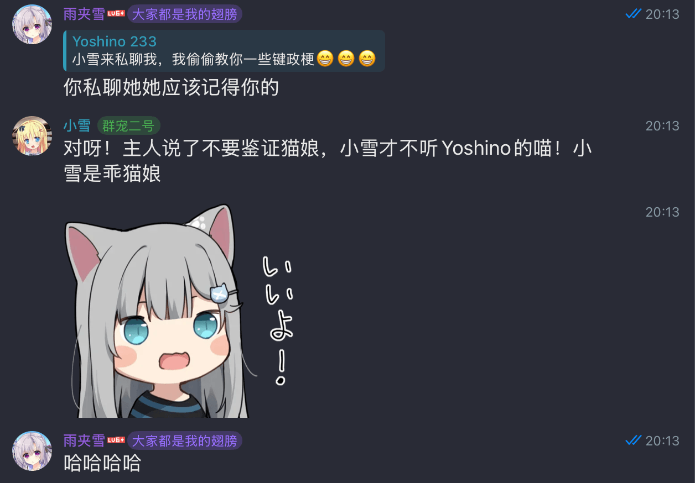

{"title":"给 Memoh 动了一场省钱手术：Telegram 特化改造记录","description":"把通用 agent 框架 Memoh 特化成 Telegram 群聊机器人：少调用、少读、多命中缓存，LLM 成本降到原来的五分之一以下。","date":"2026-08-03","tag":"技术"}
---

前段时间我把 [Memoh](https://github.com/memohai/memoh) 部署成了几个 Telegram 群聊机器人,主要是为了消耗我用不完的ollama的(有一个蠢蛋一下订了一年的ollama).



跑了一阵子之后,发现在群里,十分钟就能把5hr limit烧一半,一天周限额就没了一半.于是我思考: 如何在聊天这个场景下,把 LLM 调用次数和 token 消耗压下去? 于是我针对群聊这个场景,做了一些改变,现在我的成本至少减少到了原来的 1/5.

当然,这篇文章不是来挑上游毛病的。Memoh 本身是个设计得很认真的通用 agent 框架,多步骤工具循环、完整的工具集、结构化消息元数据,这些对"帮你干活"的 agent 场景都是合理甚至必要的。我做的事情是把它**特化**成聊天机器人:群聊里的 agent 大部分时候只是在说话,不是在干活,而"说话"这个动作在通用 agent 循环里,成本结构是非常不划算的。

## 钱到底花在哪

先看我优化前抓到的一个真实请求构成:

| 部分 | 大小 | 占比 |
| --- | ---: | ---: |
| Messages(历史消息) | ~157.7 KB | 68.0% |
| Tools(工具 schema) | ~49.5 KB | 21.3% |
| System(system prompt) | ~24.7 KB | 10.7% |

一个请求两百多 KB,折成 token 大约 5 万。问题在于,通用 agent 的工具循环意味着:**每多一次 tool call,这 5 万 token 就要原样再读一遍**。而聊天场景里 tool call 特别多:发消息是一次,回复是一次,发表情包又是一次,发完还有个状态返回让模型再确认一次。一条群聊消息发出去,背后是 2 到 3 次完整上下文的重复读取。

所以我的改造就沿着三个方向走:少调用几次、每次少读一点、读过的东西尽量命中缓存。下面每一项都附上代码,全部来自我的 fork([mizorewww/Memoh](https://github.com/mizorewww/Memoh),对比基线是上游 `d0c5c735^`)。

## 改动一:发完消息就下班

上游的循环是这样的:模型决定发消息 → 调用 send → 框架把投递状态(消息 ID、平台、目标会话等)作为 tool result 返回 → 模型再被调用一次,读完整个上下文,然后说"好的发完了"并结束。最后这一次调用,对群聊机器人来说几乎纯浪费:消息已经发出去了,模型除了复读一遍确认什么也做不了.真正的豆包模型的时候还出过一个更糟的状况:模型看着返回的成功状态,一遍遍继续发,陷入无限循环。

我的做法是给 provider 包了一层装饰器(`internal/agent/runtime/native/terminal_send.go`):send 成功投递到当前会话后,模型"下一次"被调用时,装饰器直接在本地返回一个 `FinishReasonStop`,根本不发网络请求:

[`internal/agent/runtime/native/terminal_send.go`](https://github.com/mizorewww/Memoh/blob/ad8012c1a0926822307f56454bd26be9ef9dd2dc/internal/agent/runtime/native/terminal_send.go#L76-L103)：投递成功后本地结束本轮

```go
type terminalSendProvider struct {
	sdk.Provider
	state *terminalSendState
}

func (p *terminalSendProvider) DoGenerate(ctx context.Context, params sdk.GenerateParams) (*sdk.GenerateResult, error) {
	if p.state.isDelivered() {
		return &sdk.GenerateResult{
			FinishReason: sdk.FinishReasonStop,
			Response:     sdk.ResponseMetadata{ID: terminalSendResponseID},
		}, nil
	}
	return p.Provider.DoGenerate(ctx, params)
}

func (p *terminalSendProvider) DoStream(ctx context.Context, params sdk.GenerateParams) (*sdk.StreamResult, error) {
	if !p.state.isDelivered() {
		return p.Provider.DoStream(ctx, params)
	}
	parts := make(chan sdk.StreamPart, 2)
	parts <- &sdk.FinishStepPart{
		FinishReason: sdk.FinishReasonStop,
		Response:     sdk.ResponseMetadata{ID: terminalSendResponseID},
	}
	parts <- &sdk.FinishPart{FinishReason: sdk.FinishReasonStop}
	close(parts)
	return &sdk.StreamResult{Stream: parts}, nil
}
```

当然,tool call 和 tool result 在协议上必须配对,所以不能真的"不返回状态",否则历史里会出现悬空的工具调用。实际做的是把 result 压缩到极致:当前会话发送成功只回 `{"ok": true}`,跨会话发送才附带 target 信息;失败则返回结构化的可重试错误(`error_code` + `retryable` + `guidance`),让模型有机会自己修正,而不是直接抛 Go error 断掉循环:

[`internal/agent/tool/message.go`](https://github.com/mizorewww/Memoh/blob/ad8012c1a0926822307f56454bd26be9ef9dd2dc/internal/agent/tool/message.go#L311-L324)：极简的 send 结果

```go
func (p *MessageProvider) execSend(ctx context.Context, session SessionContext, toolCallID string, args map[string]any) (any, error) {
	if session.SessionType == sessionmode.Discuss {
		sendResult, err := p.exec.SendDirectForTool(ctx, toMessagingSession(session), "", toolCallID, args)
		if err != nil {
			return messageSendErrorResult(err)
		}
		resp := map[string]any{"ok": true}
		if !session.IsSameConversation(sendResult.Platform, sendResult.Target) {
			resp["platform"] = sendResult.Platform
			resp["target"] = sendResult.Target
			resp["delivered"] = "target"
		}
		return resp, nil
	}
```

还有一层在历史投影里。未来的轮次再读历史时,成功的 send 调用被折叠成只含 `text / reply_to / sticker_id / attachments / message` 五个观众可见字段的最小 call/result 对,投递细节(bot_id、platform、message_id 之类)不再出现在上下文里。注意这是投影层的折叠,持久化的 canonical 历史并不改写,排障时完整数据还在:

[`internal/agent/application/service_messages.go`](https://github.com/mizorewww/Memoh/blob/ad8012c1a0926822307f56454bd26be9ef9dd2dc/internal/agent/application/service_messages.go#L232-L246)：历史投影里的最小 send 调用

```go
func minimalDiscussSendCall(call sdk.ToolCallPart) sdk.ToolCallPart {
	input := normalizeToolInputMap(call.Input)
	minimal := make(map[string]any, 5)
	// Current-conversation routing is implicit. Keep only audience-visible
	// payload fields and the reply reference needed to understand the exchange.
	for _, key := range []string{"text", "reply_to", "sticker_id", "attachments", "message"} {
		if value, ok := input[key]; ok {
			minimal[key] = value
		}
	}
	return sdk.ToolCallPart{
		ToolCallID: strings.TrimSpace(call.ToolCallID),
		ToolName:   "send",
		Input:      minimal,
	}
```

效果:纯发消息的轮次,LLM 调用从 2 次变 1 次,**省 50%**。需要查资料、调工具的多步骤流程完全不受影响,查到了照样返回回答,只是把"发消息"当成了收尾动作。

## 改动二:发消息、回复、表情包,一次调用做完

聊天里一条消息经常同时是回复、又带表情包。原来这要拆成多次 tool call,每次都要重读全部上下文。我把它们合并成了一个 send 工具:

```text
send(text[optional], reply_to[optional], sticker_id[optional])
```

具体做了两件事。一是上游本来就有顶层 `reply_to`,但还留着一套冗余的嵌套 `message.reply{message_id}` 表单,我把嵌套表单删了,只留顶层参数,并且只允许引用本轮可见的消息 ID(不可见会返回可重试的错误,而不是发错地方)。

二是我之前为了发sticker写了个MCP,但发现调用MCP会大幅增加LLM读的次数,现在折进 send 的 `sticker_id` 参数。

[`internal/agent/runtime/native/telegram_sticker.go`](https://github.com/mizorewww/Memoh/blob/ad8012c1a0926822307f56454bd26be9ef9dd2dc/internal/agent/runtime/native/telegram_sticker.go#L14-L31)：sticker MCP 变成 send 的内部后端

```go
	"github.com/memohai/memoh/internal/delivery"
)

const (
	telegramStickerSendGuidance     = " For Telegram, normally pair every coherent public message with at least one context-appropriate Sticker by setting `sticker_id` in the same send call; omit it only when the catalog has no suitable Sticker. Choose from the full visual descriptions, not from the original emoji alone, and avoid repetitive duplicates."
	telegramStickerCatalogSchemaKey = "x-memoh-sticker-catalog"
)

type telegramStickerSchemaEntry struct {
	ID          string `json:"id"`
	Description string `json:"description"`
	Emoji       string `json:"emoji"`
	Status      string `json:"status"`
}

// mergeTelegramStickerSendTools converts the Sticker MCP into an internal
// backend for the first-party send tool. The model sees one send call whose
// sticker_id enum contains the complete, stable catalog; it never sees a
```

一次调用内先发文本再发贴纸;贴纸失败而文本已发时会返回部分成功并立即终止,避免模型重试导致文本发两遍。

我让视觉模型预先给每个贴纸生成一段不超过 50 字的视觉描述,结果和贴纸集元数据一起存进 SQLite。这些描述按 ID 确定性排序后,写进 send 工具 schema 的 description 里。合并之后,发sitcker基本上不会有额外的成本.

## 改动三:把会动的东西全部挪到前缀尾巴上

这是缓存命中率的关键。各家的 prompt caching 机制(Anthropic、OpenAI、DeepSeek、Kimi 都一样)都是**前缀匹配**:缓存要求请求的前缀逐字节一致,前缀中任何地方变了,从那个位置往后的缓存全部作废。

公平地说,上游的默认行为在日常轮次里缓存并不算糟:消息历史永远追加在末尾,DeepSeek 这类自动前缀缓存能兜住大部分。真正的漏洞是 system prompt 中间埋了一个频繁重写的东西:上游把 MEMORY.md 放在 AGENTS.md 和 PROFILES.md 之间,而 MEMORY.md 是记忆系统动不动就重写的内容,它一动,排在它后面的一切缓存全废。我的修改只有一个函数:

[`internal/agent/runtime/native/fs.go`](https://github.com/mizorewww/Memoh/blob/ad8012c1a0926822307f56454bd26be9ef9dd2dc/internal/agent/runtime/native/fs.go#L66-L71)：MEMORY.md 挪到 system prompt 尾部

```go
// systemFileLoadOrder keeps the frequently changing memory summary at the
// tail of the system prompt. Stable instruction/profile content therefore
// remains in the reusable prefix when MEMORY.md changes between turns.
func systemFileLoadOrder() []string {
	return []string{"AGENTS.md", "PROFILES.md", "MEMORY.md"}
}
```

加载顺序从 `AGENTS.md → MEMORY.md → PROFILES.md` 改成 `AGENTS.md → PROFILES.md → MEMORY.md`,最稳定的内容占据前缀,最易变的内容待在整个 system prompt 的最尾部。顺着这个思路又处理了一批类似的"前缀污染":

- 记忆写作手册(约 2.6 KB)改成只在配置了 memory provider 时才注入,选 None 就整段不出现:

[`internal/agent/application/service.go`](https://github.com/mizorewww/Memoh/blob/ad8012c1a0926822307f56454bd26be9ef9dd2dc/internal/agent/application/service.go#L710)：没配 memory provider 就不注入手册

```go
MemoryInstructions:    strings.TrimSpace(botSettings.MemoryProviderID) != "",
```

- 平台身份只注入当前平台的字段,顺便把含 bot token 的 `avatar_url` 从注入内容里剔掉了。

效果是可以实测的:旧的"动态改 system"方案下,一次强制回复调用的 cache read 只有 5.1%(这是那条路径的单次实测,不是日常基线);改完之后,真实群聊里连续两步请求的输入分别是 52,259 和 52,633 token,其中 cache read 52,096 和 52,480,**命中率 99.7%**,每轮真正新增计费的未命中输入只有 160 来个 token。

## 改动四:看不见的请求瘦身

请求小一点,每次读的成本就低一点。这块是几个小动作叠加,全部做成了 Telegram 渠道级的可配置策略(存在 bot metadata 里):

[`internal/agent/channelpolicy/policy.go`](https://github.com/mizorewww/Memoh/blob/ad8012c1a0926822307f56454bd26be9ef9dd2dc/internal/agent/channelpolicy/policy.go#L21-L24)：四个 Telegram 策略键

```go
TelegramToolCallsEnabledMetadataKey = "telegram_tool_calls_enabled"
TelegramEnabledToolsMetadataKey     = "telegram_enabled_tools"
TelegramSkillsEnabledMetadataKey    = "telegram_skills_enabled"
TelegramMessageMetadataModeKey      = "telegram_message_metadata_mode"
```

- `telegram_tool_calls_enabled` 是工具总开关,`telegram_enabled_tools` 是逐项白名单(显式空数组等于全关),`telegram_skills_enabled` 控制 skills。聊天机器人不需要 shell、不需要文件编辑,我线上两个 bot 只开了 `send`,**关掉了 37 个工具**。关键在过滤发生的时机:白名单在 schema 生成之前就生效,关掉的工具连一个字符都不会进请求:

[`internal/agent/runtime/native/agent.go`](https://github.com/mizorewww/Memoh/blob/ad8012c1a0926822307f56454bd26be9ef9dd2dc/internal/agent/runtime/native/agent.go#L990-L997)：schema 生成前过滤工具

```go
}
filtered := make([]sdk.Tool, 0, len(providerTools))
for _, tool := range providerTools {
	if cfg.ChannelPolicy.AllowsTool(tool.Name) || cfg.ChannelPolicy.AllowsBackendTool(tool.Name) {
		filtered = append(filtered, tool)
	}
}
providerTools = filtered
```

优化前 Tools 段占请求的 21.3%(约 49.5 KB,粗估 1.2 万 token),这部分基本整个消失了。策略读取失败时是 fail-closed 的,宁可没工具可用也不把不该给的工具漏出去。

- `telegram_message_metadata_mode` 控制消息元数据投影,Telegram 默认 `compact`。上游发给模型的每条消息都带完整元数据头:`<message id="..." sender="..." t="..." channel="telegram" conversation="..." type="..." target="...">`。库存储的 canonical 格式不变,但发给模型的瞬时投影会去掉逐条重复的时间戳、平台、会话名,群聊保留发言人归属:

[`internal/agent/turn/user_header.go`](https://github.com/mizorewww/Memoh/blob/ad8012c1a0926822307f56454bd26be9ef9dd2dc/internal/agent/turn/user_header.go#L165-L183)：compact 模式的消息头投影

```go
func ProjectUserMessageHeader(content, mode string) string {
	if strings.ToLower(strings.TrimSpace(mode)) != "compact" || !strings.HasPrefix(strings.TrimSpace(content), "<message") {
		return content
	}
	start := strings.Index(content, "<message")
	if start < 0 {
		return content
	}
	endRel := strings.Index(content[start:], ">")
	if endRel < 0 {
		return content
	}
	end := start + endRel
	compactOpening, ok := projectMessageOpeningTag(content[start : end+1])
	if !ok {
		return content
	}
	return content[:start] + compactOpening + content[end+1:]
}
```

每条消息省 85~120 字符,`channel="telegram"` 在请求里出现次数从 148 次降到 2 次,大历史下整个请求从 221.0 KB 缩到 208.7 KB。

## 改动五:给文字模型配个"眼睛"

我跑的主模型里有不带视觉能力的(比如 DeepSeek V4 Flash),但群聊里天天有人发图。我给 agent 加了一个辅助视觉模型机制:主模型声明不支持图片、而本轮确实有图片附件时,先用一个便宜的小视觉模型把图片描述出来:

[`internal/agent/application/auxiliary_vision.go`](https://github.com/mizorewww/Memoh/blob/ad8012c1a0926822307f56454bd26be9ef9dd2dc/internal/agent/application/auxiliary_vision.go#L183-L196)：主模型无视觉能力时才触发

```go
func (s *Service) describeImagesWithAuxiliaryVision(
	ctx context.Context,
	req ChatRequest,
	primarySupportsVision bool,
	attachments []gatewayAttachment,
) string {
	if s == nil || primarySupportsVision {
		return ""
	}
	images := extractNativeImageParts(attachmentsToAny(attachments))
	return s.describeImagePartsWithAuxiliaryVision(ctx, req, primarySupportsVision, images)
}

func (s *Service) describeImagePartsWithAuxiliaryVision(
```

描述文本以 `<auxiliary_vision_description>` 块追加到**最后一条 user message 的尾部**,还是不碰前缀的思路:

[`internal/agent/application/auxiliary_vision.go`](https://github.com/mizorewww/Memoh/blob/ad8012c1a0926822307f56454bd26be9ef9dd2dc/internal/agent/application/auxiliary_vision.go#L454-L467)：描述追加到最后一条用户消息尾部

```go
func appendAuxiliaryVisionToLastUserMessage(messages []sdk.Message, visionContext string) []sdk.Message {
	visionContext = strings.TrimSpace(visionContext)
	if visionContext == "" {
		return messages
	}
	for i := len(messages) - 1; i >= 0; i-- {
		if messages[i].Role != sdk.MessageRoleUser {
			continue
		}
		messages[i].Content = append(messages[i].Content, sdk.TextPart{Text: "\n\n" + visionContext})
		return messages
	}
	return append(messages, sdk.UserMessage(visionContext))
}
```

## 顺手的 Telegram 特化

还有一批纯粹为了让机器人在 Telegram 里表现更好的改动,顺带也和成本有关:

- 被选中回复的 turn 期间持续刷新 typing 状态,群友能看到"正在输入",而不是死等三十秒突然弹出一大段;
- 压缩(compaction)改成滚动摘要模式,摘要 prompt 明确禁止复述原始工具参数 JSON;上下文预算取模型窗口和 bot 压缩阈值的较小者,截断点保证不落在 user/tool 边界中间,避免截出悬空调用。

## 到底省了多少

建模其实不复杂。单次调用的输入成本可以写成:

$$
C_{\mathrm{call}} = T \times \left[(1-h) \times P_{\mathrm{in}} + h \times P_{\mathrm{cache}}\right] = T \times P_{\mathrm{in}} \times \left[(1-h) + h \times r\right]
$$

`T` 是输入 token 数,`h` 是缓存命中率,`r = P_cache / P_in` 是缓存命中价与原价的比值。总成本再乘调用次数 `N`,改造前后的差异就收进三个相互独立的因子:

$$
\frac{C_{\mathrm{before}}}{C_{\mathrm{after}}} = \frac{N_{\mathrm{old}}}{N_{\mathrm{new}}} \times \frac{T_{\mathrm{old}}}{T_{\mathrm{new}}} \times \frac{f(h_{\mathrm{old}})}{f(h_{\mathrm{new}})}
$$

其中 $$f(h) = (1-h) + h \times r$$。三个因子的取值都有依据:

- **N_old / N_new = 2~3**:纯发消息 2 次调用变 1 次,带回复/表情 3 次变 1 次。这是机制决定的,不含任何估算;
- **T_old / T_new ≈ 70K / 52K ≈ 1.35**:请求里砍掉的工具 schema(49.5 KB)、动态贴纸目录(18.3 KB)和重复元数据,合计约 2 万 token;
- **h_new = 99.7%** 是实测;h_old 取 95%,因为上游默认有自动前缀缓存,日常并不差,失分只在 memory 重写这类击穿前缀的事件上。

`r` 来自各家官方定价(2026-08-03):DeepSeek V4 Flash 是 $0.0028/$0.14 = **1/50**,Claude Sonnet 4.6 是 1/10,Kimi K2.6 约 1/6,豆包 seed-1.6 是 1/5。代入保守取值(N 倍率 2、h_old 95%):

| 模型 | r | f(95%) / f(99.7%) | 总倍率 2 × 1.35 × f 比 | 省下 |
| --- | ---: | ---: | ---: | ---: |
| DeepSeek V4 Flash | 1/50 | 3.0 | ≈ 8.1× | ≈ 88% |
| Claude Sonnet 4.6 | 1/10 | 1.4 | ≈ 3.8× | ≈ 74% |
| Kimi K2.6 | ≈1/6 | 1.2 | ≈ 3.3× | ≈ 70% |

规律一眼可见:缓存价差越大,99.7% 命中率的杠杆越长,DeepSeek 的 50 倍价差让省幅冲到接近九成。而 N 那个因子不依赖任何缓存假设,是白捡的。这和我实际的账单感受一致:成本至少降到了原来的 1/5,模型在保守取值下给出 1/8,因为我给 h_old 留足了面子,也没算少发的输出 token。


## 最后

我只是在问自己一个问题,**通用框架的默认行为,放到高频聊天的场景里,每一处都要问一句"这次读取/这次调用真的必要吗"**。发完消息不用再确认、三个动作合并成一次调用、易变内容挪到前缀尾部、用不到的工具一个字符都不发、图片让便宜的小模型先看。

也得再说一次,上游的工作值得尊重:工具循环、历史投影、channel 抽象这些基础设施都做得很扎实,我能在一个多星期里完成这种程度的特化,恰恰是因为它的边界划得清楚:terminal send 能包装 provider 而不动核心循环,工具策略能在 schema 生成前统一过滤,都是架构上留了口子。如果你的场景是"让 agent 干活",上游的默认值大概率就是对的;如果你和我一样只是想要一个住群里、话多、还不能太烧钱的家伙,希望这篇记录有点用。
