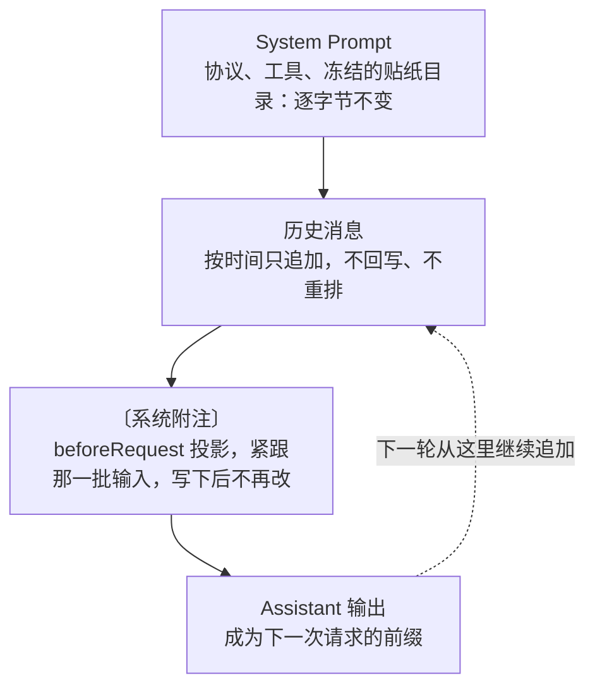
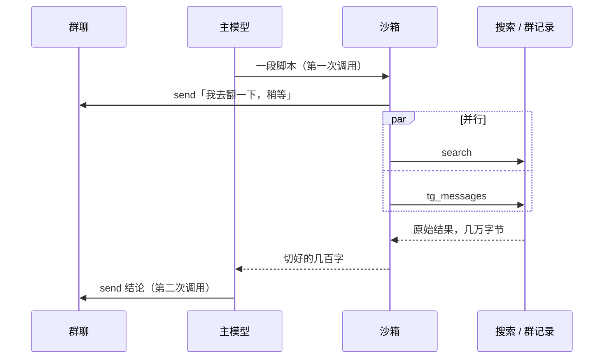

{"title":"省一点，再省一点","description":"两个住在 Telegram 群里的 bot，三个月、七万多次模型调用的账本：在 LLM 应用中，成本、上下文与代码量在物理上是同一种通货。每一处极致的克制，最后都会兑现为纯粹的自由与体验。","date":"2026-11-05","tag":"技术","tags":["llm","telegram","prompt-caching","agent","架构设计","成本优化"],"draft":false}
---

我们群里住着两个 bot。

一个是我写的 [Pi Telegram Agent](https://github.com/mizorewww/pi-extension-telegram-agent)，另一个是群友 tcdw（碗）写的[塑料碗](https://github.com/tuuject/surowan)。两个项目没有共享一行代码，架构取向、技术栈乃至交互性格截然相反，但在长达数月的真实群聊碰撞中，两个系统的演进轨迹却不谋而合地收敛到同一句戒律：**省一点，再省一点。**

很多人以为“省”是一种对资源的妥协，是一种扣扣搜搜的工程自虐。恰恰相反，在过去三个月与七万多次线上模型调用的敲打中，我越来越深信：**在 LLM 驱动的系统里，“省”其实是最高级的设计美学。**

当你把系统表层的浮夸脚手架一层层剥开，你会发现：代码、上下文与云端账单，本质上只是同一种物理实体——**Token**——在不同维度上的投影。凡是繁复的机制，往往意味着高昂的熵增与脆弱；而每一处经由严格逻辑推导出来的克制，最终都会在体验与能力上，兑现出惊人的轻盈与通透。

这篇文章，是一份来自高频生产环境的真实账本复盘，也是一次从表象到本质的抽丝剥茧。

## TL;DR

- **统一的通货假设：** 账单是 token，上下文是 token，代码在 coding agent 眼里也是 token。三者不是割裂的管理目标，而是同一个守恒方程在不同维度的映射。
- **解剖账单的大头：** 74,644 次调用揭示了一个冷酷的现实——**输入是输出的 374 倍**。群聊 bot 的账本近九成是聊天历史，工具 schema 仅占 1.1%。系统的生死线，全维系在“上下文长度”与“缓存命中率”上。
- **剥离感知与思考（控制调用量 $N$）：** 被点名即回是确定性逻辑，无需智力；旁听消息要不要接，抽离给只读最后几行切片的专用小模型（每次约 1,650 token、$0.000033），绝不污染主模型上下文。动作发完立即借由原语本地终止，将非必要往返压死在平均每轮 1.13 次调用。
- **字节级的偏执（守卫命中率 $h$）：** 严格前缀单调递增，不可篡改。动态贴纸与媒体更新通过只读元数据与 `beforeRequest` 投影为不入历史库的〔系统附注〕。以 55 个版本的 Golden Hash 严酷回归，将 DeepSeek 实测缓存命中率钉在 98.7%，费用直接砍至原本的三十分之一。
- **原话胜于妄语（压缩上下文深度 $T$）：** 放弃所有花哨的多层记忆抽取与图数据库。前沿研究与线上血泪同时证实：加工过的摘要不仅昂贵，而且会自生毒化。窗口定格在 128K，历史沉睡在 SQLite 原文里，给 bot 一个干净的工作台，不懂就让它自己查。
- **将克制兑现为自由：** 省下来的资源不是存折里的数字，而是极致的体验——`codemode` 让它“边说边做”并行检索；一个 rootless 的纯净 Linux 容器让模型调度系统原生能力，胜过手写一百个专用插件。
- **代码本身的断舍离：** 凡不属于“Telegram 群聊语义”的代码，一行都不自造。依托底层 Pi 原生引擎，`src/` 从 17,500 行提纯至 8,100 行，负代码带来了更稳固的韧性。
- **两种通用的哲学对照：** 塑料碗走的是“通用的产品，克制的 Agent”；我选择“专用的部署，通用的 Agent”。

---

## 账本的凝视：真实的钱在往哪里流

一切设计美学，都必须建立在对物理现实的冷酷凝视之上。

从 8 月 7 日上线到 11 月 4 日架构换代，我的 bot 在生产环境中无死角地记下了每一次模型调用的遥测：输入大小、缓存命中读、输出量，以及请求内各切段的实际占比。三个月跑下来，总账单的轮廓如下：

```stats title="三个月的账本" meta="2026-08-07 — 2026-11-04 · 两个 bot · 一个群" note="输入 token 含命中缓存的部分。"
## 规模
群友消息 | 144,148 | 路由开始记录后的人类消息
模型调用 | 74,644 | 含 11,544 次压缩调用
公开发言 | 39,615 | send 次数
## Token
输入 | 5.34B | 其中缓存读取 3.50B
输出 | 14.3M | 输入是输出的 374 倍
每轮调用 | 1.13 | 非压缩调用 ÷ 开启的轮次
```

**输入是输出的 374 倍。**

这是每一个初涉 LLM 群聊系统的人都会遭遇的第一记重锤。在人机交互的直觉里，我们总以为“对话”是抛出一句话、换回一句话的对称游戏。然而在多人高频的群聊里，真相极度残酷：群友发了一句“哈哈确实”，模型就必须把沉重的 system prompt、工具定义以及整段漫长的群聊历史完整咀嚼一遍，最后经过几层思考，在群里发出两个字或者选择闭嘴。

**群聊系统的账单，在物理本质上几乎全部由“读”构成。**

这三个月里，主模型前后用过三家：先是 DeepSeek V4 Flash，八月底换到 Gemini Flash，九月底再换到 SWE-2。下面的每一个数字，都是这三家一起记下的：

```echarts title="每周的模型调用，按主模型" height="320" note="不含压缩调用。按北京时间的自然周，第一周从 8 月 7 日上线算起；数据来自截至 11 月 1 日的本地快照，比上文的账本少最后三天，最后一周不完整。另有 521 次 GLM、GPT mini 等试用调用没有画出。"
{
  "tooltip": {"trigger": "axis", "axisPointer": {"type": "shadow"}},
  "legend": {},
  "xAxis": {"type": "category", "data": ["08-07", "08-10", "08-17", "08-24", "08-31", "09-07", "09-14", "09-21", "09-28", "10-05", "10-12", "10-19", "10-26"]},
  "yAxis": {"type": "value", "axisLabel": {"formatter": "{value}"}},
  "series": [
    {"name": "DeepSeek V4 Flash", "type": "bar", "stack": "calls", "itemStyle": {"color": "var(--clay)"}, "data": [3154, 7664, 6590, 1675, 0, 0, 0, 0, 0, 0, 0, 0, 0]},
    {"name": "Gemini Flash", "type": "bar", "stack": "calls", "itemStyle": {"color": "var(--sky)"}, "data": [0, 0, 0, 3223, 5196, 3959, 4471, 5033, 392, 0, 0, 0, 0]},
    {"name": "SWE-2", "type": "bar", "stack": "calls", "itemStyle": {"color": "var(--olive)"}, "data": [0, 0, 0, 0, 0, 0, 0, 0, 5706, 4601, 4819, 2511, 1857]}
  ]
}
```

那么，这数百亿的 token 到底在读什么？我们抽样分析了四万多次真实请求的切片，并与我之前改造 [Memoh](/posts/making-memoh-cheaper-on-telegram/) 时的单次请求放在一起对照：

```data title="一次请求里都装了什么" bars="本项目,Memoh 改造前" note="本项目：40,593 次请求的平均值，平均每次 93,067 token。Memoh：改造前抓的单次请求，按字节计。"
部分 | 本项目 | Memoh 改造前
聊天历史 | 86.6% | 68.0%
system prompt | 10.2% | 10.7%
压缩摘要 | 2.1% | 0%
工具 schema | 1.1% | 21.3%
```

这张表给所有自以为是的“架构优化”泼了一盆冷水：
很多人热衷于优化 Prompt 措辞、精简两句 system prompt，或者把工具名字改短几个字符——但哪怕你把工具 schema 优化到极致，它在真实请求里也仅仅占 1.1%。

**整个系统的总成本，受控于一个极简的数学模型：**

$$
C = N \times T \times \left[(1-h) + h \times r\right]
$$

- $N$：模型被叫醒的次数（调用量）；
- $T$：每次被叫醒时必须吞吐的上下文深度（输入 token）；
- $h$：上下文命中 Prompt Cache 的比例（缓存命中率）；
- $r$：服务商缓存计费与原价的比值（DeepSeek 达到夸张的 1/50，Claude 为 1/10）。

这个公式是不可动摇的底座。在工程实现上，你能够发力的自由度只有三处：

1. **少叫醒它（缩减 $N$）**；
2. **读过的必须逐字节锁死（拉高 $h$）**；
3. **每次读的必须洗尽铅华（压低 $T$）**。

下面，我们将顺着这三个变量，一层一层剥开我们关于“克制与自由”的架构选择。

---

## 剥开第一层：控制调用量 $N$ —— 别为“沉默与等待”付全价

最便宜的调用，是**从未发生的调用**。

群聊与单人私聊最本质的区别在于：群聊是一个公共流动的信息洪流，其中绝大多数内容与 bot 根本无关。而且这股洪流几乎不停：只有凌晨四点到六点几乎没人说话，晚上十点以后最热闹。

```echarts title="群友什么时候说话" height="300" note="人类消息数，按北京时间的星期和两小时时段统计，共 141,717 条。来自 bot 数据库截至 11 月 1 日中午的本地快照，比上文截至 11 月 4 日的账本少最后三天。越接近橙色，消息越多。"
{
  "tooltip": {"position": "top"},
  "grid": {"top": 8, "bottom": 4, "left": 4, "right": 8},
  "xAxis": {"type": "category", "data": ["0点", "2点", "4点", "6点", "8点", "10点", "12点", "14点", "16点", "18点", "20点", "22点"], "splitArea": {"show": false}},
  "yAxis": {"type": "category", "inverse": true, "data": ["周一", "周二", "周三", "周四", "周五", "周六", "周日"]},
  "visualMap": {"show": false, "min": 0, "max": 5500},
  "series": [{
    "name": "消息", "type": "heatmap",
    "emphasis": {"itemStyle": {"borderColor": "var(--ink)", "borderWidth": 1}},
    "data": [
      [0,0,2380],[1,0,716],[2,0,137],[3,0,178],[4,0,1118],[5,0,1509],[6,0,1869],[7,0,1172],[8,0,1752],[9,0,2581],[10,0,2975],[11,0,4122],
      [0,1,976],[1,1,237],[2,1,48],[3,1,175],[4,1,1106],[5,1,1694],[6,1,1796],[7,1,1866],[8,1,1927],[9,1,2282],[10,1,2748],[11,1,3033],
      [0,2,2377],[1,2,620],[2,2,72],[3,2,407],[4,2,1332],[5,2,2115],[6,2,2457],[7,2,1487],[8,2,2759],[9,2,2335],[10,2,3392],[11,2,3604],
      [0,3,1572],[1,3,690],[2,3,25],[3,3,233],[4,3,1222],[5,3,1581],[6,3,1549],[7,3,1894],[8,3,1928],[9,3,2596],[10,3,1784],[11,3,2517],
      [0,4,1835],[1,4,485],[2,4,44],[3,4,176],[4,4,723],[5,4,1200],[6,4,2030],[7,4,1491],[8,4,1599],[9,4,1982],[10,4,2571],[11,4,5429],
      [0,5,3133],[1,5,664],[2,5,48],[3,5,161],[4,5,835],[5,5,1764],[6,5,1904],[7,5,1656],[8,5,2657],[9,5,2433],[10,5,2257],[11,5,2771],
      [0,6,2423],[1,6,1723],[2,6,52],[3,6,81],[4,6,449],[5,6,1577],[6,6,2285],[7,6,2238],[8,6,2136],[9,6,2263],[10,6,4283],[11,6,3414]
    ]
  }]
}
```

再看这三个月里从消息流入到最终发言的残酷漏斗：

```data title="从群友消息到模型调用" bars="数量" note="开启的轮次 = 路由判定为 started 的消息数；模型调用不含压缩。"
阶段 | 数量
群友消息 | 144,148
bot 正忙，消息并入下一轮 | 50,532
开启一轮 | 55,776
模型调用 | 63,100
公开发言 | 39,615
```

漏斗底层赫然摆着一个事实：14.4 万条群聊消息，bot 公开发言不到 4 万次。甚至在开启思考的 5.5 万轮对话里，也有一万六千多次是模型读完全文后，体面地选择了沉默。

这就引出了第一组尖锐的矛盾：
**怎么知道该不该接话？如果决定接话，怎么让这一轮迅速了结？**

### 抽丝剥茧：分寸感不需要 9 万 Token 的全景记忆

“要不要接话”看似是一个玄学问题，拆开来看，其实是两种截然不同的场景：

1. **确定性场景：** 人类明确 @ 它、回复它的消息、直呼其名。这里没有模糊空间，一行确定性的代码或正则路由就能判定，**不应该浪费任何模型的一毫秒去推理**。
2. **旁听场景：** 剩下的海量闲聊，它需要的是“分寸感”。

那么，什么叫群聊里的分寸感？观察一个真实的人类群友：

- 有人向全群抛出了一个技术疑难，空悬了三分钟没人理；
- 有人正接着 bot 上半截话继续追问；
- 两个人正在亲密地约饭闲聊，话题非常私密且闭环；
- 别的 bot 已经给出了完美解答；
- 几个 bot 在互相咬尾巴复读。

**审视这些场景，你会得出一个惊人的结论：做这些决断，根本不需要 bot 知道自己是谁，不需要知道三个月前群里发生了什么，更不需要携带厚重的工具箱。它仅仅取决于——最近五到十行消息的语境流动。**

市面上的常见解法在这个推论面前露出了破绽：

- **方案 A：全交由主模型判断。** 叫醒一次主模型，意味着拖家带口扛起 93,000 token 的沉重包袱。主模型思考两秒说一句“我不该插嘴”，你就要为这句“沉默”支付近十万 token 的全额代价。十四万次闲聊乘上去，账本直接爆表。
- **方案 B：全交由规则与概率闸门。** 掷骰子或者硬匹配关键词确实免费，但它没有理解力。在技术求助时它装聋作哑，在群友严肃悼念或发火时它却可能依据 10% 的概率突然跳出来讲个烂梗。

我们要的解法必然落在两者的交界处：**它必须有语义理解能力，但它只能读切片；它只需要给出一个概率，不需要吐出文字。**

顺着约束推演，答案呼之欲出：**引入专职的分类器小模型。**

```mermaid title="一条群友消息怎么决定要不要叫醒主模型" note="被点名走确定性路由，不经过任何模型；其余消息只把最近几行交给判断模型，主模型的上下文和缓存都不受影响。"
flowchart TD
  M[群友消息] --> Q{"@ / 回复 / 叫名字？"}
  Q -- 是 --> A["主模型<br/>完整上下文，约 9.3 万 token"]
  Q -- 否 --> D["判断模型<br/>只读最近 6 行，约 1,650 token"]
  D -- 概率 ≥ 阈值 --> A
  D -- 概率 < 阈值 --> S[静默围观]
  A --> R[发言或沉默]
```

我选用的是 OpenRouter 上的专用小分类模型 `pplx-decider-v1.2`（在 Pi 1.5 原生 classify 抽象下驱动）。它便宜在三个不可替代的维度：

1. **只喂切片：** 仅截取新到的几条消息，附带前 6 行作为背景，剥离全部 system prompt、历史长程上下文与工具声明。
2. **前缀隔离：** 它的调用是完全独立的短请求。主模型的核心上下文没有动过一个字节，**主模型的 Prompt Cache 纹丝不动**。
3. **极小成本：** 单次决策仅耗费约 1,650 token（大部分是固定的 few-shot 示例），成本约 $0.000033，耗时数百毫秒。即便群里 14.4 万条消息全判一遍，总开销也不过 $4.7。

```data title="判断一次“要不要接话”的代价" bars="输入 token" note="主模型一列取账本里的平均请求；判断模型一列是带上全部例子后的实测。"
方式 | 输入 token | 每千次费用
主模型读完整上下文 | 93,067 | 取决于主模型（约 $0.26 ~ $1.50+）
判断模型只读切片 | 1,650 | $0.033
```

判断模型是 11 月 5 日才上线的。在那之前的三个月，旁听消息靠的是一个按概率掷骰子的闸门——账本清楚地记下了它的代价：几乎每一轮都是骰子放进来的，而每一轮都要主模型把九万多 token 从头读一遍。

```echarts title="判断模型上线前，每一轮是谁叫醒的" height="300" note="路由记录里判定为 started 的消息，按触发原因统计，共 54,457 轮；同一份截至 11 月 1 日的本地快照，所以比上面漏斗里的数字少最后三天。同期另有 50,362 条消息因 bot 正忙并入下一轮，4,849 条处于冷却期被跳过。"
{
  "tooltip": {"trigger": "item", "formatter": "{b}：{c} 轮（{d}%）"},
  "series": [{
    "name": "触发原因", "type": "pie", "radius": ["40%", "62%"], "center": ["50%", "54%"],
    "label": {"formatter": "{b}\n{d}%", "lineHeight": 16},
    "labelLine": {"length": 10, "length2": 14},
    "data": [
      {"name": "概率闸门放行", "value": 52323, "itemStyle": {"color": "var(--clay)"}},
      {"name": "被回复", "value": 1394, "itemStyle": {"color": "var(--stone)"}},
      {"name": "被叫名字", "value": 644, "itemStyle": {"color": "var(--kraft)"}},
      {"name": "被 @", "value": 96, "itemStyle": {"color": "var(--sky)"}}
    ]
  }]
}
```

小模型缺乏常识深度，如何确保分寸？**用高密度的典型示例（few-shot）补齐。**
在 `src/agent/decider.ts` 中，我们精心凝练了 14 条覆盖群聊典型微动态的通用示例，模型召回率直接从 0.53 跃升至 0.71。

更有趣的美学发现来自于**阈值**的调优：
当我们试图把提示词改得更热情、试图让模型“更想说话”时，我们发现整个概率曲线只是在噪声区间平移，反而多耗费了两成 token。这验证了控制论里的经典法则：**分类模型负责相对排序，阈值负责投射性格。**
想要一个冷峻少言的极客 bot，把阈值抬到 0.45；想要一个活跃捧场的温暖群友，把阈值降到 0.15。提示词不需要反复推倒，代码的纯粹性由此得以保全。

### 发完即走：杜绝通用 Agent 的自言自语

把模型叫醒后，另一个巨大的浪费潜伏在“动作执行”的链条里。

通用 Agent 框架往往有着严重的“汇报强迫症”：
模型执行了 `send()` 之后，框架把 Telegram 发送成功的 JSON 作为 tool result 丢回给模型，模型再次加载整整 9 万 token，心满意足地向人类汇报一句：“我已经把消息发出去啦！”

在个人助手的终端里，这或许叫严谨；但在高频的 Telegram 群聊里，这纯属灾难。不仅浪费了一整轮调用，更致命的是，群里绝不允许出现模型的自言自语或思考废话。

我们立下了两条铁律：

1. **私密思考，显式发言：** 模型的原生 Assistant 文本永远留在控制台内，**唯有显式调用 `send` 工具，消息才会穿透到群聊**。模型读完上下文后选择不发，本轮便无声终结。
2. **终端原语截断（Terminal Send）：** 一旦单条 `send` 投递成功，底层直接调用 Pi 原生的 terminate 机制，**强行截断循环，拒绝再次返回模型**。

正是这个坚决的截断，让三个月的平均每轮调用数被死死锁在 **1.13 次**。多出来的 0.13 次，仅仅用于处理被点名却忘了 `send` 时的单次自我纠偏。

面对网络超时的未知状态，很多工程师习惯无脑重试。但在 Telegram 这一端，发送消息是一个不可逆的非幂等行为。一旦消息已在服务端生成而本地超时，重试就会导致群里出现两条一模一样的弱智复读。
我们的工程准则极其决绝：**只有在确定性的 4xx 错误且未提交任何负载时才允许重试；其余一切网络未知，一律标记为 `no_retry`，就地休工。** 宁可在极端网络震荡下偶尔遗漏一句，也绝不在众人注视的群聊里丢掉体面。

---

## 剥开第二层：拉满缓存命中率 $h$ —— 前缀是神圣不可侵犯的物理定则

如果说压减调用量是第一道防线，那么 Prompt Caching（提示词缓存）就是决定生死的核心杠杆。

现代主流模型（DeepSeek、Anthropic、OpenAI）的缓存机制在本质上都是**前缀匹配（Prefix Matching）**：
只要你的请求前缀在字节级别与上一轮完全一致，命中部分的价格就会出现断崖式下跌。以 DeepSeek V4 Flash 为例，命中缓存的价格是未命中的整整五十分之一（1/50）。

我们不妨用三个月里实际吞吐的 53.4 亿 token 算一笔现实的账：

```echarts title="同样 53.4 亿输入 token，按 DeepSeek V4 Flash 计价" height="220" note="只算输入；输出 1,430 万 token 另计。98.7% 是实测的命中率，0% 是每次全价重读。这是假设性换算，不是我的实际账单。"
{
  "tooltip": {"trigger": "axis", "axisPointer": {"type": "shadow"}, "valueFormatter": "${value}"},
  "grid": {"top": 8, "right": 56},
  "xAxis": {"type": "value", "axisLabel": {"formatter": "${value}"}},
  "yAxis": {"type": "category", "inverse": true, "data": ["不用缓存", "命中 85%", "命中 98.7%"]},
  "series": [{
    "name": "输入费用", "type": "bar", "barWidth": 22,
    "label": {"show": true, "position": "right", "formatter": "${c}", "color": "var(--ink)"},
    "itemStyle": {"color": "var(--stone)"},
    "data": [748, 125, {"value": 25, "itemStyle": {"color": "var(--clay)"}}]
  }]
}
```

从 85% 到 98.7%，看起来只是百分比上微不足道的十几个点，但费用相差了整整 **5 倍**；而与无缓存的裸奔相比，差距是惊人的 **30 倍**！

要说清楚的是，98.7% 是 DeepSeek 官方 API 上的实测。同一套只追加的前缀，换到别的服务商那里，命中率并不一样——前缀稳定只是命中的前提，剩下的取决于服务商怎么实现缓存：

```echarts title="同一套前缀，在不同服务商上的缓存命中率" height="240" note="命中率 = 缓存读取 token ÷ 输入 token，不含压缩调用，截至 11 月 1 日的本地快照。DeepSeek 官方 API 3,415 次（8 月 7 日至 10 日），Devin 上的 SWE-2 19,494 次，Antigravity 上的 Gemini Flash 22,274 次。经 ollama-cloud 调用的 DeepSeek（15,668 次）不上报缓存读取，不在图中。"
{
  "tooltip": {"trigger": "axis", "axisPointer": {"type": "shadow"}, "valueFormatter": "{value}%"},
  "grid": {"top": 8, "right": 56},
  "xAxis": {"type": "value", "max": 100, "axisLabel": {"formatter": "{value}%"}},
  "yAxis": {"type": "category", "inverse": true, "data": ["DeepSeek 官方", "SWE-2", "Gemini Flash"]},
  "series": [{
    "name": "缓存命中率", "type": "bar", "barWidth": 22,
    "label": {"show": true, "position": "right", "formatter": "{c}%", "color": "var(--ink)"},
    "itemStyle": {"color": "var(--stone)"},
    "data": [{"value": 98.7, "itemStyle": {"color": "var(--clay)"}}, 86.3, 58.4]
  }]
}
```

这就是为什么我们在 `AGENTS.md` 里写下了全项目最核心的一条物理硬约束：

> **Cache invariant：永不改写已存在的 provider prefix；动态内容只以新 suffix 追加。每个请求必须是下一请求的严格前缀。**

### 动态信息归宿的纯粹推导

“保持前缀不变”听起来像一句轻巧的口号，但当它迎面撞上真实 Telegram 群聊的混乱现实时，真正的架构拷问才刚刚开始。

最典型的矛盾，莫过于 **Sticker（贴纸）**。

bot 拥有自己的固定常用贴纸库，但群友日常聊天会发出各种千奇百怪的第三方贴纸。当群友发出一张极其生动的表情时，我们希望告诉 bot：“群友发了这张图，如果合适，你这轮也可以用它。”
这显然是一批**每一轮都不一样、不可预知的动态候选数据**。

这批动态信息，应该塞在请求的什么位置？如果我们顺着工程约束层层推理，所有“看似顺手”的方案都会被一一绞杀：

- **错误尝试 1：塞进 System Prompt。**
  直觉上最整洁，但 System Prompt 趴在整个上下文的最开端。你哪怕改动一个字，后面紧随其后的九万多 token 缓存将**瞬间全部粉碎**。
- **错误尝试 2：挂在最后一刻，下一轮替换掉。**
  既然是“当前可用贴纸”，很多人习惯把它作为一个尾巴挂在当前请求的最后；到了下一轮，有了新贴纸，就把旧尾巴切掉，换上新尾巴。
  这个微小的偷懒在线上造成了惨痛的代价：上一次请求的结尾，在下一次请求里消失了。前缀从这里断裂。实测表明，为了省下几十个 token 的贴纸列表，下一轮在刚进入 turn 时就要白白漏掉 **13,600 token** 的冷缓存！
- **错误尝试 3：直接混入聊天记录。**
  既然只能单调追加，那把贴纸信息伪装成正文拼进群友的消息里如何？
  灾难接踵而至：模型读到后，会真诚地认为“群友刚才把我的贴纸库泄露了”，进而在聊天中反复指责群友偷窥它的后台。更致命的是，当会话到达窗口上限触发压缩时，压缩器会把这句“群友泄露了贴纸库”的荒唐推测提炼成固定事实，永远写进长期摘要，造成无法修复的认知污染。

通过这三次碰壁，动态信息的宿命被物理定律锁死在唯一的狭窄缝隙中：

1. **它必须是严格追加的；**
2. **写下之后必须永恒凝固在那个相对位置，往后的轮次必须完整继承，绝不能在中途删改；**
3. **它不能被当成人类发言，必须有专属的系统标识；**
4. **它不能进入持久化数据库的会话主线，以免污染未来的压缩摘要。**

这套严酷的推导，催生了我们最终的请求投影结构：



在一次真实的请求体中，它呈现为这种极其工整的韵律：

```text
system     …群聊协议、工具规则、人设…
           # Sticker 目录（会话生命周期内冻结）
           s3: 😺 得意的赞同，中等强度
           s4: 😭 委屈到哭，夸张
user       [21:03:11] #18452 群友 A (@a): 这也太离谱了
           [21:03:15] #18453 群友 B (@b): [sticker 😂]
user       〔系统附注〕这批消息里出现了你也能发送的 sticker：
           s2091: 😂
assistant  send({ message: "确实离谱", sticker: "s4" })
user       [media_update #18453] [sticker: 笑到捶地，极度夸张]
           [21:04:02] #18460 群友 A (@a): 接下来怎么办？
```

甚至连迟来的视觉分析，也严格遵守这套美学：
群友刚发图时，消息行只有一个轻量的占位符 `[图片]`；几秒后异步视觉模型解析出了画面内容，系统**绝不回头去改写旧消息**，而是在当前最新的输入流里追加一行不可变的增量事件：`[media_update #id] [图片: 一只躺在键盘上的三花猫]`。

### 让测试守护字节的尊严

在敏捷开发和重构中，只靠程序员的克制是守不住前缀的。
某个人“顺手”微调了一下报错格式，或者给某句提示词末尾加了一个换行符，编译完全正常，逻辑完全正确，但在线上，数万 token 的缓存命中率瞬间跌入深渊——系统没有任何报错，唯一的警报是你下个月飙升的云账单。

在我们的体系里，`test/cache.test.ts` 承担着神圣的守卫职责。
它不测试业务逻辑的琐碎细节，而是对所有进入模型前缀的组件执行 **Golden Hash 校验**：

- System Prompt 模版哈希；
- 工具 Definitions 与参数 Schema 序列化哈希；
- Codemode 声明段哈希；
- 消息行与元数据的序列化 Grammar 哈希。

```ts
const GOLDEN = {
  schemaVersion: 55,
  systemZhTemplate: "50ffcdb70e57",
  systemSandboxTemplate: "96efc7945c60",
  tools: "307b029162a6",
  codemodeTools: "99718d49e271",
  eventSerialize: "a05c0584eb08",
  // ...
};
```

任何一个空格的偏移、字段顺序的微调，都会引发红屏。重构者面前只有两条路：要么把代码改回去，承认这是无意识的破坏；要么明确这是一次深思熟虑的协议升级，显式递增 `CACHE_SCHEMA_VERSION`（目前已历经 55 代洗礼），并主动刷新基线。

**这个测试守护的不是功能，它守护的是系统的物理守恒与真金白银。**

---

## 剥开第三层：压缩上下文深度 $T$ —— 为什么原始话语比二次加工高贵

现在，我们把目光投向第三个变量 $T$（每次吞吐的上下文深度）。
即使你的缓存命中率做到了 98.7%，别忘了，还有 1.3% 的未命中流量在承受全价；而且更关键的是，即使在缓存单价内，九万 token 依然在持续产生摩擦成本。

更重要的是：**上下文不是一个可以无限膨胀的垃圾场。** 旧的记忆如何安放？长程对话如何沉淀？

### 窗口的博弈：算清自己的账，而不是服务商的账

NVIDIA 近期发表的论文 _You don't need long context_ (arXiv:2611.05306) 指出了一个底层现象：在服务端的 Attention 机制下，生成每个 token 的计算代价随上下文深度线性飙升。他们在 vLLM + H100 上的实测显示，256K 窗口相对于 16K，每 token 的生成成本最高暴增了 7 倍。

论文给出的建议是：把上下文激进地截断在 16K–48K，依靠频繁的上下文压缩和状态重置，模型在长程任务上的表现几乎不掉点。

这个结论极其漂亮，但如果你把它原封不动套在自己的应用上，你就会落入陷阱。因为那是**推理服务商的成本结构**；而对于我们这些调用 API 的应用开发者来说，云端账单通常是**按 token 线性计价的**。第 100,000 个 token 和第 1 个 token 价格完全一致，服务商内部的二次方惩罚并不会直接落在我们的月度账单里。

在应用端，窗口大小的取舍变成了另一场精密博弈：
**每次读得更少，与更频繁地触发压缩，究竟哪一个更贵？**

如果你的窗口开得很小（例如 32K），为了不溢出，你就必须频繁叫醒模型执行 Summarization（压缩）。
每一次压缩都是一次沉重的代价：它要全量读取旧上下文，再让模型呕心沥血写出一段结构化摘要；更致命的是，**压缩完成的那一瞬间，旧的确定性前缀彻底终结，下一轮调用将迎来一次彻头彻尾的冷启动全价账单**。

先看三个月里每次请求实际读了多少。分布有两个峰，一个在四万多 token，一个在十一万上下；九月底窗口调大以后，右边拖出了一条长尾：

```echarts title="每次请求读了多少 token" height="280" note="54,847 次非压缩调用的输入 token，每 1 万一档（40K 即 4 万–5 万），最后一档是 24 万及以上，其中 3 次超过 25 万；截至 11 月 1 日的本地快照。这段时间窗口先是 131K，9 月底调到 256K。"
{
  "tooltip": {"trigger": "axis", "axisPointer": {"type": "shadow"}, "valueFormatter": "{value} 次"},
  "grid": {"top": 16},
  "xAxis": {"type": "category", "axisLabel": {"formatter": "{value}K"},
    "data": ["0", "10", "20", "30", "40", "50", "60", "70", "80", "90", "100", "110", "120", "130", "140", "150", "160", "170", "180", "190", "200", "210", "220", "230", "≥240"]},
  "yAxis": {"type": "value"},
  "series": [{
    "name": "调用", "type": "bar", "barCategoryGap": "8%", "itemStyle": {"color": "var(--stone)"},
    "data": [375, 1757, 1805, 2495, {"value": 8266, "itemStyle": {"color": "var(--clay)"}}, 3828, 3057, 3041, 2998, 3410, 4949, {"value": 6979, "itemStyle": {"color": "var(--clay)"}}, 2147, 1108, 1083, 924, 976, 884, 879, 797, 786, 725, 672, 557, 349]
  }]
}
```

在旧版本的探索中，我的 bot 曾真实经历过这种极端的摇摆：

```echarts title="旧部署每周的平均输入长度与压缩调用占比" height="400" note="平均输入不含压缩调用本身。9 月用的是自己写的压缩器；9 月底把窗口从 131K 调到 256K。"
{
  "tooltip": {"trigger": "axis"},
  "axisPointer": {"link": [{"xAxisIndex": "all"}]},
  "grid": [{"top": 28, "height": "34%", "right": 24}, {"top": "60%", "bottom": 4, "right": 24}],
  "xAxis": [
    {"type": "category", "gridIndex": 0, "boundaryGap": false, "axisLabel": {"show": false}, "data": ["08-07", "08-10", "08-17", "08-24", "08-31", "09-07", "09-14", "09-21", "09-28", "10-05", "10-12", "10-19", "10-26", "11-02"]},
    {"type": "category", "gridIndex": 1, "boundaryGap": false, "data": ["08-07", "08-10", "08-17", "08-24", "08-31", "09-07", "09-14", "09-21", "09-28", "10-05", "10-12", "10-19", "10-26", "11-02"]}
  ],
  "yAxis": [
    {"type": "value", "gridIndex": 0, "name": "平均输入（千 token）", "nameLocation": "end", "nameTextStyle": {"align": "left"}},
    {"type": "value", "gridIndex": 1, "name": "压缩调用占比", "nameLocation": "end", "nameTextStyle": {"align": "left"}, "axisLabel": {"formatter": "{value}%"}}
  ],
  "series": [
    {"name": "平均输入（千 token）", "type": "line", "xAxisIndex": 0, "yAxisIndex": 0, "showSymbol": true, "symbolSize": 5, "itemStyle": {"color": "var(--stone)"}, "areaStyle": {"color": "var(--stone)", "opacity": 0.12},
      "data": [76.0, 53.4, 43.7, 85.9, 24.7, 95.8, 56.0, 76.2, 132.9, 130.0, 135.3, 123.0, 103.4, 115.4],
      "markArea": {"silent": true, "itemStyle": {"color": "var(--wash)"}, "label": {"color": "var(--muted)", "fontSize": 10}, "data": [[{"name": "窗口 256K", "xAxis": "09-28"}, {"xAxis": "11-02"}]]}},
    {"name": "压缩调用占比", "type": "line", "xAxisIndex": 1, "yAxisIndex": 1, "showSymbol": true, "symbolSize": 5, "itemStyle": {"color": "var(--clay)"}, "areaStyle": {"color": "var(--clay)", "opacity": 0.15},
      "tooltip": {"valueFormatter": "{value}%"},
      "data": [0.1, 1.3, 12.5, 20.1, 3.6, 30.1, 34.6, 44.6, 12.3, 0.5, 0.5, 1.0, 0.8, 0.4],
      "markPoint": {"symbol": "circle", "symbolSize": 7, "label": {"position": "right", "formatter": "44.6%：近一半调用在压缩", "color": "var(--clay)", "fontSize": 11}, "data": [{"type": "max"}]}}
  ]
}
```

看那条刺眼的曲线：在 9 月下旬，由于估算逻辑将图片尺寸错误归零，系统陷入了“误以为没压小因此连续不断疯狂压缩”的噩梦，整整 **45% 的模型调用居然全在做压缩**！而当我们在 9 月底把窗口无脑拉大到 256K 时，压缩调用归零了，但每次请求的基础载重暴涨到 13 万 token。

现在的架构停泊在经受考验的平衡点上：
**窗口收敛在 128K**，当上下文累积到 11 万 token 时触发底层 Pi 原生结构化压缩，稳定保留最近约 2 万 token 的原话。重度任务（检索、长程调研、代码调试）全部利用 `task` 剥离到独立的子会话中运转，只将凝练的成果带回群聊。主会话永远保持纯净——它只呈现“大家在聊什么”以及“我做了什么”，绝不沦为庞杂的调试日志。

### 戳破幻象：为什么我们彻底放弃记忆系统

谈及 Agent 的长期演进，人们总是沉迷于构建繁复的“记忆系统”：抽取实体、三元组图谱、更新/遗忘机制、向量化语义检索……

然而另一篇深刻的实证研究 _Is Complex Agentic Memory Always Needed?_ (arXiv:2610.30755) 狠狠戳破了这个泡沫。该研究使用最质朴的 **Raw-RAG** 基线（不抽取实体、不做图谱、不修改记忆，仅仅将原始对话做分块与结构化召回）去横向评测十余种复杂的 Agent 记忆框架，结果在七组严苛基准中，Raw-RAG 斩获了六项第一。

```data title="把原文换成加工过的记忆，会丢掉什么" note="来源：Bao et al., Is Complex Agentic Memory Always Needed?（arXiv:2610.30755）。"
改动 | 结果
原文换成抽取的原子事实 | 测试时学习 47.68% → 15.37%，总分 −19.62
原文换成摘要 | 总分 −5.81
加图扩展 | 总分 −5.78
完整访问加工后的记忆库 | 仍低于直接给原文（57.5% 对 61.6%）
Mem0 去掉 UPDATE / DELETE | 准确率 67.36% → 69.42%
```

更令人窒息的是维护成本：为了维护那套精密易碎的记忆网络，各系统在 MemoryAgentBench 上动辄消耗数千万 token 和长达数小时的计算；而原始检索仅需十几分钟。

这与我们在生产中遭遇的事故形成了完美的互文。还记得前面提到的贴纸事故吗？
**加工过的记忆一旦被模型主观曲解，就会在下一次压缩中被当作客观事实固化，并像病毒一样代代遗传、永久污染。**

因此，我们的架构选择呈现出一种坚决的美学断舍离：
**彻底丢弃一切记忆中间件。我们不维护任何事实图谱，不做任何定期的反思沉淀。**

群里过去一年的每一条消息，原汁原味地躺在本地 SQLite 里，并附建有高性能 Trigram 倒排索引。当模型察觉到群友聊起“上次那个谁说的事情”或者看不懂的黑话梗时，它被赋予了一个强大的结构化工具 `tg_messages`。它能够按昵称历史、更名轨迹、发言人 ID、上下文回复树以及时间区间去查询**真正未经篡改的现场原话**。

**把原始上下文原原本本留给时间，把理解与考证的权力留给需要它的那一刻。**
前者每一轮都在无声地抽干你的算力，而后者只有在群友真正追问的那一秒，才会激荡出一次优雅的检索。

---

## 兑现为自由：快与能干，恰恰是省出来的

读到这里，或许会有人产生一种偏见：这个项目把每一分钱、每一个 token 都算计到极致，这个 bot 表现出来一定极度僵硬、贫瘠、反应迟钝吧？

事实恰恰彻底相反。
**所有的节制与瘦身，从来不是为了把资金封存在账本里，而是为了在关键时刻，将这股庞大的计算冗余兑现成前所未有的敏捷与全能。**

### 亮点一：Codemode 的呼吸感 —— 边说边做

群友在使用过程中最强烈的直观感受是：“你家这个 bot 反应怎么这么快？”
这并非因为底层换了什么超低延迟的模型，奥秘全在于 `codemode` 带来的交互美学。

先看看主流 Agent 框架在面对“帮我查查这个技术梗的来源并总结群里讨论”这类复杂任务时，是如何机械运转的：

1. 模型读完 9 万 token，决定调用 `search`；
2. 漫长的等待，网络返回搜索结果；
3. 模型**把 9 万 token 加上新返回的满屏 HTML 片段再读一遍**，决定调用第二个工具；
4. 再次等待，模型又把整段上下文重读一遍，决定抓取某个网页正文；
5. 整整经历四五轮沉重且全额计费的模型往返，群友在屏幕前对着死寂的“正在输入”苦等半分钟；
6. 最终，几页毫无过滤的原始网页文本硬生生地永久焊死在后续的聊天历史里。

而在我们的架构中，模型借助 Pi 的隔离沙箱，直接写出一小段原生的 JavaScript：

```js
// 1. 先开口，打破等待的窒息感
await tools.send({ text: "我去翻一下群记录并查下这个梗，稍等！" });

// 2. 并行调度，在沙箱里聚合
const [searchRes, historyRes] = await Promise.allSettled([
  tools.search({ query: "某个开源项目 架构变革" }),
  tools.tg_messages({ text_contains: "架构变革", limit: 10 }),
]);

// 3. 在沙箱内存里做精细切片，绝不把垃圾带进主上下文
const web = searchRes.status === "fulfilled" ? searchRes.value : null;
const chat = historyRes.status === "fulfilled" ? historyRes.value : null;

text({
  summary: web?.slice(0, 1000),
  discussions: chat?.rows.map(({ sender, text }) => `${sender.name}: ${text}`),
});
```

把这一轮摊开来看，主模型只被调用了两次，中间所有的等待和搬运都发生在沙箱里：



仔细品味这一小段脚本所蕴含的美学力量：

1. **先声夺人（体贴的呼吸感）：** 脚本第一行执行 `send`，群友的客户端在数百毫秒内就会收到回应。心理上的“死等”瞬间转化为“它已经在干活了”。沙箱内的 `send` 不会触发 turn 终结，流水线在后台继续奔流。
2. **真正的并行计算：** 现代网络请求天然应当并发。`Promise.allSettled` 让多次往返骤降为单次。
3. **上下文防火墙：** 检索回来的数万字节网页原文与多余元数据，在沙箱内部被就地提纯，**只有被精准切片后的数百个核心字眼被投喂回主模型**。

我们没有去采用各大 Provider 标榜的“原生工具并行调用”。因为原生并行是单向僵死的——你无法在同一批调用里先说一句话、再基于返回做出动态分支，也无法阻止原始负载全量灌进上下文。`codemode` 成为将“极速响应”、“动态控制”与“上下文洁癖”完美融为一体的唯一解。

### 亮点二：一台完整的 Linux 容器，胜过一百个脆弱的插件

许多开发者衡量一个 Agent 是否强大，标准是看它的插件列表有多长：天气插件、绘图插件、音频转码插件、文档阅读插件、网页快照插件……
每一个插件都意味着一套繁琐的 Schema、数以千计的调试代码，以及随时可能崩溃的第三方边界。更可悲的是，**模型的能力上限被死死锁死在作者写过的插件交集之中**。群友想把一段视频抽取特定帧转成黑白 GIF，只要作者没写过这个插件，Agent 就只能摊手。

我们的设计美学走向了相反的极端：**给模型一台真正的 Linux。**

通过底层 Pi 赋予的原生文件与 Shell 能力（`read` / `write` / `edit` / `bash`），bot 拥有一台跑在独立用户下的 rootless Docker 容器。工作区里预装了现代化的全套武器：Python (uv)、Node.js、ffmpeg、ImageMagick、ripgrep、Chromium 及 CJK 字体集。

于是，神奇的化学反应发生了：

- 想剪视频、抽音频、压贴纸？模型在沙箱里自己敲一行 `ffmpeg`；
- 想推演数据、绘制复杂热力图？模型在容器里写下 `uv run --with matplotlib python main.py`；
- 甚至当群友好奇询问“你的底层逻辑是怎么实现的”，它会用 `bash` 把自己的 GitHub 仓库拉到 `/work/src`，用 `rg` 翻阅源码，逐行向群友剖析自己的构造；
- 产物就绪后，直接通过 `send.files` 以原生文件或照片相册的形式推送回群。

这一切神奇的体验，**我们没有为之专门编写过一行所谓的“插件代码”**。模型本身受过人类文明全部开源工具的洗礼，它天生精通 Shell；我们所要做的唯一体面之事，不是充当保姆给它造轮子，而是划定安全边界，给它提供一个干净、隔离、随时待命的通用执行环境。

在这个纯净的容器边界上，我们构筑了严密的安全防线：

| 边界维度       | 架构实现                                                                       |
| :------------- | :----------------------------------------------------------------------------- |
| **宿主隔离**   | 独立无特权系统用户 `tgbox` 下运行 rootless Docker，与 bot 守护进程权限物理隔离 |
| **容器沙盒**   | 根文件系统全只读挂载、`--cap-drop ALL`、`no-new-privileges`，以 uid 1000 运行  |
| **资源围栏**   | 内存、CPU、进程数硬上限约束，`/tmp` 仅挂载 256 MB 的纯内存 tmpfs               |
| **凭据绝缘**   | 容器内没有任何 API Key、SSH Key 或环境变量；模型请求由宿主外层代理闭环         |
| **持久化边界** | 仅挂载专属的 `/work` 卷，每周一清晨 05:00 自动重置擦除；网络可一键物理关断     |
| **文件防穿透** | 宿主外发附件时深度解析真实文件路径，严禁任何符号链接逃逸                       |

**一个通用的执行环境，替代了无穷无尽的平庸插件。** 这种架构上的高度收敛，比任何代码层面的优化都更具美感。

---

## 剥开最后一层：代码即上下文 —— 从 17,500 行提纯到 8,089 行

如果把目光从运行时的模型挪开，凝视我们自身作为开发者的日常，你会发现同一套物理法则依然支配着一切。

这个项目从第一天起，就是我和 Coding Agent 一起迭代构建的。在 Coding Agent 的世界里，**你的代码库就是它的上下文窗口**。你写的每一层冗余封装、每一个为了所谓“未来扩展性”预留的抽象层、每一个摇摆不定的兼容分支，都在每一次开发会话中无情地消耗着模型的注意力与理解力。

```echarts title="src/ 的代码行数演进轨迹" height="300" note="每个日期取当天提交的 src/**/*.ts 总行数统计；横轴按真实日期等距。"
{
  "tooltip": {"trigger": "axis", "valueFormatter": "{value} 行"},
  "grid": {"right": 24, "top": 28},
  "xAxis": {"type": "time", "minInterval": 1209600000, "axisLabel": {"formatter": "{MM}-{dd}", "hideOverlap": true}},
  "yAxis": {"type": "value", "axisLabel": {"formatter": "{value}"}},
  "series": [{
    "name": "src/ 行数", "type": "line", "showSymbol": true, "symbolSize": 5,
    "itemStyle": {"color": "var(--clay)"}, "areaStyle": {"color": "var(--clay)", "opacity": 0.12},
    "data": [["2026-08-07", 2079], ["2026-08-08", 7441], ["2026-08-09", 11661], ["2026-08-10", 13173], ["2026-08-13", 13639], ["2026-08-26", 14085], ["2026-09-07", 14532], ["2026-10-06", 14754], ["2026-11-01", 17522], ["2026-11-02", 13834], ["2026-11-04", 8452], ["2026-11-05", 8089]],
    "markPoint": {"symbol": "circle", "symbolSize": 7, "label": {"color": "var(--ink)", "fontSize": 11}, "data": [
      {"coord": ["2026-11-01", 17522], "label": {"position": "left", "formatter": "17,522"}},
      {"coord": ["2026-11-05", 8089], "label": {"position": "left", "formatter": "8,089"}}
    ]}
  }]
}
```

在 11 月 1 日，由于自造的各种调度机制、压缩重试状态机以及庞杂的文档拼接，代码库一度膨胀到 17,522 行。而在随后的四天里，伴随着一次深刻的哲学清算，我们手起刀落，硬生生将代码库砍到了 **8,089 行**。

代码量暴跌了一半以上，但系统在线上的表现不仅没有缩水，反而解锁了一键安装、原生视觉理解、崩溃自动恢复与全功能沙箱。

这是怎么做到的？核心就在于一条坚决的原则：
**凡是不属于“Telegram 群聊语义”的东西，一行都不该由我来写。**

审视我们曾经遭遇过的严重线上事故记录：

| 发生日期  | 故障表象                                               | 真实根因                                                |
| :-------- | :----------------------------------------------------- | :------------------------------------------------------ |
| **09-16** | 几乎每轮都在发狂压缩，但上下文体积完全不减             | 自研压缩器按字符数估算 token，图片在 details 里被算成 0 |
| **09-16** | 遇到 429 报错后，被 @ 的待处理消息被系统误标记为已完成 | 自研重试逻辑耗尽后，状态机草率退出了 turn               |
| **10-04** | 机器人陷入长达 20 分钟的死寂失联                       | 图片 token 突增超出预算，自研预检压缩逻辑死锁           |
| **10-06** | 机器人在群里惊呼群友窃取了它的后台数据                 | 动态列表拼进正文，自研摘要把臆测定性为客观事实          |

**这四起触目惊心的事故，没有一起跟 Telegram 本身有关，全部源自我们自己闭门造车的会话状态机与压缩算法。**

真正的成熟，是学会把专业的事情彻底交还给坚固的地基。Pi 1.5 原生提供了 Durable 级别的一等公民支持：持久化会话、状态恢复、基于 AST 的智能压缩、执行队列与沙箱调度。在迁移重构的那个 Commit 里，我们一次性删除了 7,877 行自研代码：

- 删除了自己苦心维系的 session 状态机与复杂的指纹对比；
- 删除了简陋易碎的 token 估算器与中文摘要打包逻辑；
- 删除了自己维护的后台子进程 bridge 与调度管道；
- 删除了塞在 Prompt 里多达 300 行的冗长工具示例文档（直接依托 Pi 的参数 TypeBox Schema 严密解析）。

留下的这 8,000 行纯粹代码，只专注做一件事：**将 Telegram 的群聊生态映射为严谨优雅的 Agent 交互**。

- 它处理消息归档与 Trigram 检索；
- 它处理前缀不变的批次 Grammar 序列化；
- 它处理小分类模型的接话裁决；
- 它构筑 Rootless 容器的安全护城河。

在软件工程中，最纯粹的快感从来不是敲出成千上万行架构代码，而是**在保证系统更坚固的同时，一次性删去数千行臃肿的自嗨**。这种“负代码”的愉悦，正是极简美学的最佳写照。

---

## 两种通用的对视：专用部署 vs 通用 Agent

在群里，群友经常戏谑地拿我和碗的[塑料碗](https://github.com/tuuject/surowan)作对比：“既然你天天把通用 Agent 挂在嘴边，为什么你的 bot 专心致志只伺候我们这一个群？”

先抛开表象，把两个系统的骨架并列在一起审视：

| 维度         | Pi Telegram Agent (本项目)                         | 塑料碗 (tuuject/surowan)                                 |
| :----------- | :------------------------------------------------- | :------------------------------------------------------- |
| **目标受众** | 专为我们自己的固定圈子深度定制                     | 面向任何想自行部署的外部用户（BYOK）                     |
| **作用域**   | 专注于单一 Supergroup 的高频涌现                   | 覆盖私聊、频道、论坛 Topic，依赖精细白名单               |
| **角色模型** | 一次部署对应一个高度聚焦的数字人格                 | 单部署支持随 Chat 动态切换人设与模型矩阵                 |
| **发言决断** | 点名必回；闲聊交由**独立的小分类模型只读切片**裁决 | Bucket 桶聚合后交由**主模型**全量裁决，辅以时间/概率闸门 |
| **遗忘机制** | 依赖 Pi 底层的结构化保留压缩（128K 窗口）          | **纯 Checkpoint 滑动截断（只删不压）**                   |
| **记忆体系** | **零记忆机制**；完全依赖 SQLite 原始对话检索       | 三层立体记忆体系（Memo Pad + 周期摘要 + 人工知识库）     |
| **工具暴露** | 固定目录，首次全量清晰声明，依托缓存               | 核心原语外露，内部技能通过 `execute` 动态发现            |
| **执行能力** | **赋予完整的 Rootless Linux 容器、Shell 与沙箱**   | 出于普适性安全考量，严禁 Shell 与任意代码执行            |
| **代码体量** | `src/` 约 8,100 行，通用执行完全下放底层框架       | `src/` 约 60,000 行，自建完整的面板、调度与多渠道系统    |

把这张对比表拉开，你会清晰地看到两种完全对立、却各自自洽的设计哲学：

**塑料碗是“通用的产品，克制的 Agent”。**
因为它从第一天起就是为了给千差万别的陌生人部署在不可知的陌生群聊中。为了防范风险，它必须克制 Agent 的手脚（严格封杀 Shell 执行），把大量的心力倾注在外部防御、多群路由、管理面板和权限审计上。

**而我们选择的是“专用的部署，通用的 Agent”。**
正因为我们坚决抛弃了“支持成百上千个群”的世俗诱惑，将边界限定在一个自己绝对信任的群聊生态里，系统的外层复杂度才得以压缩到极点；而省下来的全部架构冗余与信任资产，被我们毫无保留地砸向了 Agent 的内核——**我们敢于把一整台真实的 Linux 交给它，敢于让它调度 Shell，敢于让它并发编程。**

在具体的架构推演上，我们依然坚信自己这套设计的优越性：

- **谁来决定发言：切片分类器 vs 主模型全量。** 塑料碗虽然引入了复杂的闸门，但最后一公里仍需唤醒主模型全量审视上下文。而我们通过轻量小模型实现了决策与思考的彻底解耦，无论闲聊多密集，主模型缓存永不波动。
- **工具定义：一次全量声明 vs 动态发现。** 许多框架热衷于把工具收纳进二级目录让模型先搜再调，初衷是省 token。但实测数据证明，工具定义仅占 1.1%，且趴在不可变的静态缓存区；为了省这区区几百 token 而让模型多兜一圈发起一次额外的往返，是典型的“为了省最便宜的前缀，花掉了最昂贵的推理”。
- **记忆哲学：不加机制 vs 精心雕琢。** 塑料碗有着令人赞叹的三层记忆设计，但前沿研究与我们的事故共同敲响了警钟：加工过的记忆天然存在自毒化风险。少一层机制，系统就少了一种自我复制的错误类型。

---

## 为什么说群聊的特化，恰是通用的起点？

有人或许会问：你把所有的设计都焊死在一个单一的 Telegram 群聊里，这难道不是一种狭隘的特化吗？

**不，场景越是严苛，抽象出的原则越具普适性。**

软件工程最常见的悲剧，是在真空里构建所谓的“通用框架”。当你没有具体严苛的真实场景作为锚点时，你的架构必然充满幻想：你会觉得多加一层中间件很酷，你会觉得加一个记忆抽取机制很周到，你会觉得每个轮次让模型复读一句确认很严谨。

直到你把它丢进一个真实而残酷的 Telegram 群聊：
全天候在线、成百上千人高频插科打诨、上下文以秒为单位疯狂刷新、绝大多数消息是噪音、输入是输出的数百倍……在这个严酷的环境里，系统任何一点点轻微的冗余与傲慢，都会被十四万条消息的杠杆瞬间放大几十倍，化作账单上的天文数字和群友眼前的卡顿与刷屏。

**能在最险恶的群聊里生存下来的设计哲学，移栽到任何 Agent 系统里都是无坚不摧的：**

| 节制维度             | 面向实体     | 核心设计真理                                                                      |
| :------------------- | :----------- | :-------------------------------------------------------------------------------- |
| **调用频次 ($N$)**   | 外部模型     | 确定性逻辑坚决由代码硬切；暧昧的分寸交给只读切片的分类器；发完立即本地截断。      |
| **缓存命中 ($h$)**   | 服务前缀     | 前缀是物理铁律；动态信息只能作为不可变增量单调追加；以 Golden Hash 守卫每一字节。 |
| **上下文深度 ($T$)** | 运行时上下文 | 算清自己的 API 账单；放弃花哨有损的虚假记忆；保留原话，不懂就让它现场去查。       |
| **代码负增长**       | Coding Agent | 凡不属于业务语义的底层轮子一概不造；一个通用 Shell 沙盒胜过上百个代码插件。       |

在 LLM 的世界里，所有的法则最终收敛为一个简明的美学事实：
**Token 是唯一的货币。**

省钱、省上下文、省代码行数，不是三种割裂的美德，而是同一个基本规律在物理世界、运行内存与项目架构里的投影。

我们从来没有牺牲过体验。相反，正是因为在不需要发生调用的地方寸步不让，在不需要膨胀前缀的地方斤斤计较，我们才拥有了足够的底气，给它一个毫秒级响应的 `codemode`，给它一台自由驰骋的 Linux 工作区，让它在群里像一个真正有智慧、有分寸的伙伴那样生动地活着。

每一次准备增加新的机制、编写新的功能时，不妨用这把尺子抽丝剥茧地拷问自己：

1. **这一步需要模型吗？能不能用一行确定性代码解决？如果非要模型，真的需要唤醒那个拖家带口的主模型吗？**
2. **这行动作会不会污染那条不可篡改的黄金前缀？动态的内容到底有没有老老实实呆在它该呆的尾巴上？**
3. **加进上下文的这批数据，每一轮都值得被模型重读一遍吗？为什么不把它留在数据库里，需要时再查？**
4. **这段代码删掉之后，系统真的会坍塌吗？平台底层是不是早已孕育了优雅的解法？**

如果答案是动摇的，那就停下键盘。

**能省一点，就再省一点。**
因为省到极致之处，自由方才显现。
