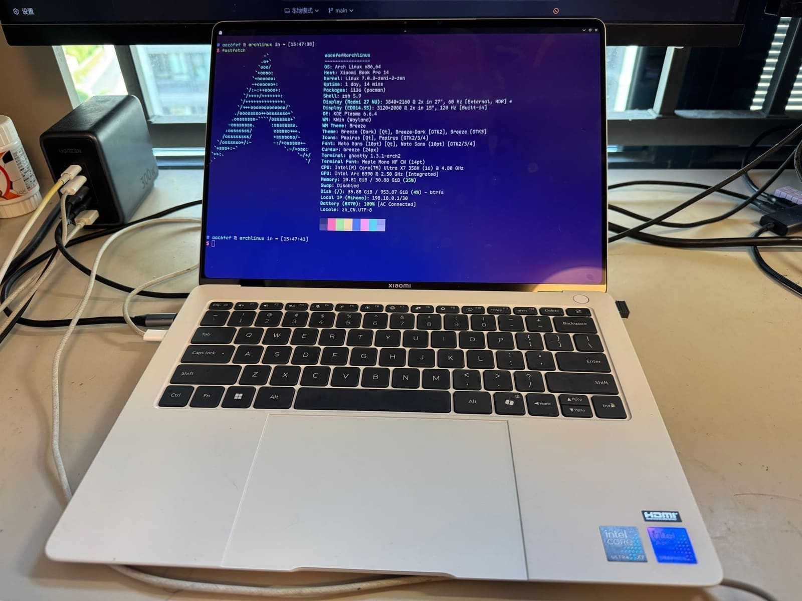

入手这台 Xiaomi Book Pro 14 的理由其实挺简单：我已经有一台 MacBook Pro 了，日常用着很顺手，但总有些事是 Mac 干不了、或者干起来别扭的。我需要一台 x86 的轻薄本，来补上那些“只有 x86 才好办”的活儿。

作为一个不折腾不舒服的人，拿到新机器的第一件事，自然是给它装上 Arch Linux。过程中踩了几个坑，也把指纹这个我从没用过的功能认真折腾了一遍，现在整理出来，给自己留个记录，也给遇到类似问题的人一个参考。

我这台的配置先放在这儿：

- SoC：Intel Ultra X7 358H
- 内存：32GB LPDDR5x 9600MT/s（板载）
- GPU：Intel Arc B390



## 问题一：屏幕花屏

刚装好系统就发现屏幕会花。查了一圈，原因是 Intel 的 Panel Self Refresh 技术。

解决方法也很直接，在内核参数里加上这一行就行：

```
xe.enable_psr=0
```

## 问题二：键盘不识别

这个问题更诡异一点：在 BIOS 和 GRUB 里面键盘明明能用，一进入系统，键盘就完全没反应了。装系统的时候卡在这一步会非常难受。

解决方案同样是加内核参数：

```
i8042.nopnp=1 i8042.dumbkbd=1
```

屏幕和键盘搞定之后，系统基本就可用了。接下来是我花时间最多的部分——指纹。

## 指纹：这次折腾的重头戏

坦白说，我之前从没用过带指纹的设备，所以这一块我摸索得比较细，也踩了不少坑，值得单独写一写。

### 为什么 `sudo` 不能像 macOS 那样弹出指纹 GUI？

这是这次折腾里最让我不爽的地方。macOS 上 `sudo` 可以用 Touch ID，为什么 Linux 就不行？

不是“没人想过”，而是架构本身就不一样。

`sudo` 和 KDE 图形指纹认证弹窗走的是两条完全独立的认证链路：

```sketch title="sudo 和 KDE 指纹弹窗走的是两条认证链路" note="PAM 只负责认证逻辑，自己不会弹窗口；漂亮的指纹弹窗来自 KDE Polkit Agent，sudo 接不进去。"
<svg viewBox="0 0 704 224">
  <rect class="panel" x="0" y="0" width="704" height="224" rx="12"/>
  <text class="caps" x="24" y="28">终端提权路径 (SUDO)</text>
  <g class="node clay"><rect x="24" y="44" width="92" height="34" rx="17"/><text class="mid mono" x="70" y="61">sudo</text></g>
  <path class="edge" d="M116 61 H146" marker-end="url(#arrow)"/>
  <g class="node blue"><rect x="150" y="44" width="96" height="34" rx="4"/><text class="mid" x="198" y="61">PAM</text></g>
  <path class="edge" d="M246 61 H276" marker-end="url(#arrow)"/>
  <g class="node plain"><rect x="280" y="44" width="196" height="34" rx="4"/><text class="mid" x="378" y="61">终端会话 / askpass</text></g>
  <path class="edge hot" d="M476 61 H506" marker-end="url(#arrow)"/>
  <g class="node orange"><rect x="510" y="44" width="170" height="34" rx="4"/><text class="mid" x="595" y="61">无指纹 GUI 弹窗</text></g>

  <line x1="24" y1="102" x2="680" y2="102" stroke="var(--line)"/>

  <text class="caps" x="24" y="128">图形提权路径 (POLKIT GUI)</text>
  <g class="node clay"><rect x="24" y="144" width="92" height="34" rx="17"/><text class="mid" x="70" y="161">图形应用</text></g>
  <path class="edge" d="M116 161 H138" marker-end="url(#arrow)"/>
  <g class="node plain"><rect x="142" y="144" width="88" height="34" rx="4"/><text class="mid" x="186" y="161">Polkit</text></g>
  <path class="edge" d="M230 161 H252" marker-end="url(#arrow)"/>
  <g class="node teal"><rect x="256" y="144" width="164" height="34" rx="4"/><text class="mid b" x="338" y="161">KDE Polkit Agent</text></g>
  <text class="small mid" x="338" y="196">由它负责弹出指纹认证窗口</text>
  <path class="edge" d="M420 161 H442" marker-end="url(#arrow)"/>
  <g class="node blue"><rect x="446" y="144" width="88" height="34" rx="4"/><text class="mid" x="490" y="161">PAM</text></g>
  <path class="edge" d="M534 161 H556" marker-end="url(#arrow)"/>
  <g class="node teal"><rect x="560" y="144" width="120" height="34" rx="4"/><text class="mid mono" x="620" y="161">fprintd</text></g>
</svg>
<svg viewBox="0 0 340 448">
  <rect class="panel" x="0" y="0" width="340" height="190" rx="12"/>
  <text class="caps" x="20" y="26">终端提权路径 (SUDO)</text>
  <g class="node clay"><rect x="20" y="42" width="128" height="32" rx="16"/><text class="mid mono" x="84" y="58">sudo</text></g>
  <path class="edge" d="M148 58 H176" marker-end="url(#arrow)"/>
  <g class="node blue"><rect x="180" y="42" width="140" height="32" rx="4"/><text class="mid" x="250" y="58">PAM</text></g>
  <path class="edge" d="M250 74 V86 H170 V96" marker-end="url(#arrow)"/>
  <g class="node plain"><rect x="40" y="100" width="260" height="32" rx="4"/><text class="mid" x="170" y="116">终端会话 / askpass</text></g>
  <text class="small mid accent" x="170" y="162">只走终端或密码框，没有指纹弹窗</text>

  <rect class="panel" x="0" y="204" width="340" height="244" rx="12"/>
  <text class="caps" x="20" y="230">图形提权路径 (POLKIT GUI)</text>
  <g class="node clay"><rect x="20" y="246" width="128" height="32" rx="16"/><text class="mid" x="84" y="262">图形应用</text></g>
  <path class="edge" d="M148 262 H176" marker-end="url(#arrow)"/>
  <g class="node plain"><rect x="180" y="246" width="140" height="32" rx="4"/><text class="mid" x="250" y="262">Polkit</text></g>
  <path class="edge" d="M250 278 V290 H170 V300" marker-end="url(#arrow)"/>
  <g class="node teal"><rect x="40" y="304" width="260" height="34" rx="4"/><text class="mid b" x="170" y="321">KDE Polkit Agent</text></g>
  <path class="edge" d="M170 338 V350 H84 V360" marker-end="url(#arrow)"/>
  <g class="node blue"><rect x="20" y="364" width="128" height="32" rx="4"/><text class="mid" x="84" y="380">PAM</text></g>
  <path class="edge" d="M148 380 H176" marker-end="url(#arrow)"/>
  <g class="node teal"><rect x="180" y="364" width="140" height="32" rx="4"/><text class="mid mono" x="250" y="380">fprintd</text></g>
  <text class="small mid" x="170" y="424">KDE Polkit Agent 才是弹出指纹窗口的组件</text>
</svg>
```

那个 GUI 是 Polkit agent 提供的，不是 PAM 自己弹出来的，也不是 `sudo` 自带的。PAM 模块只能参与认证流程，没法凭空把终端里的 `sudo` 变成一个 KDE 风格的身份验证弹窗。

`sudo -A` 配合 `SUDO_ASKPASS` 确实能弹出图形密码框，但那依然是 sudo 自己的 askpass 路径，跟 KDE Polkit agent 不是一回事。所以它顶多让“输密码”这一步变成 GUI，指纹那套体验是带不进来的。

macOS 能做到，是因为 Apple 把 `sudo`、PAM、Touch ID、Secure Enclave、LocalAuthentication 这些组件从系统层面就集成到了一起。Linux 这边，这些组件分属不同项目，天然就不会有一致的体验。

### `pam_fprintd` 的关键限制：PAM 栈是串行的

`pam_fprintd` 还有一个很根本的限制：在普通的 PAM 栈里，它和密码认证是串行执行的。

我一开始理想中的体验是这样的：

> 同一个 sudo 提示下，同时等我输密码和按指纹，哪个先完成就用哪个。

但实际上做不到。登录管理器可以用更复杂的方式启多条 PAM 会话来模拟并行，但普通的 `sudo` 并不会这么干。

所以现实选择只能在下面几种体验里挑：

- 方案 A：先指纹，失败后密码
- 方案 B：先密码，空回车后指纹
- 方案 C：只用 Polkit GUI，不在 sudo 上强求指纹
- 方案 D：用第三方 hack 模块（不推荐，别拿 root 认证开玩笑）

我最后选的是方案 B，但方案 A 也试过，先说说它为什么翻车了。

### 方案 A：先指纹，失败后密码（翻车记录）

一开始的直觉配置是这样的，`/etc/pam.d/sudo`：

```
#%PAM-1.0

auth        sufficient  pam_fprintd.so max-tries=3 timeout=8
auth        include     system-auth
account     include     system-auth
session     include     system-auth
```

逻辑上看起来没毛病：先试指纹，成功就直接过，失败再让你输密码。

但实际用起来就出问题了。我故意让指纹识别失败，然后输入正确的密码，`sudo` 还是过不去。日志里出现了这样的东西：

```
pam_unix(sudo:auth): conversation failed
pam_unix(sudo:auth): auth could not identify password for [...]
pam_faillock(sudo:auth): Consecutive login failures ... account temporarily locked
```

同时 `fprintd` 那边也在报：

```
Device was already claimed
Verification was in progress, stopping it
```

看起来是 `sudo`、终端 PAM conversation、`pam_fprintd` 和后续的密码栈之间交互状态乱了。指纹失败之后，密码 fallback 并没有干净利落地接上，还顺手触发了 `faillock` 的失败计数，导致账号被暂时锁定。

这类问题最危险的地方在于，你改的是 root 提权入口。如果把 `/etc/pam.d/sudo` 改坏了，又没有别的 root 通道，就很容易把自己锁在外面。

我当时恢复的方法，是走还能用的 Polkit：

```bash
pkexec sh -c 'cat > /etc/pam.d/sudo <<EOF
#%PAM-1.0
auth        include     system-auth
account     include     system-auth
session     include     system-auth
EOF
faillock --user 用户名 --reset
systemctl restart fprintd
'
```

这个回滚思路建议记一下：先把 sudo 恢复到 Arch 默认的密码路径，再清理 `faillock`，最后重启 `fprintd` 释放可能残留的设备占用。关键时刻能救命。

### 方案 B：先密码，空回车后指纹（目前采用的方案）

后来换了一种思路：正常情况就是普通的 sudo 密码提示，如果直接按 Enter 提交空密码，再进入指纹验证。

当前的 `/etc/pam.d/sudo` 配置：

```
#%PAM-1.0

# 先提示输密码，按 Enter 空密码则尝试指纹
auth        sufficient  pam_unix.so try_first_pass likeauth nullok

# 避免在非 tty 的后台 sudo 里弹指纹
auth        [success=1 default=ignore] pam_succeed_if.so service in sudo:su:su-l tty in :unknown
-auth       sufficient  pam_fprintd.so max-tries=3 timeout=8

# Arch 默认的 fallback
auth        include     system-auth
account     include     system-auth
session     include     system-auth
```

交互效果是这样的：

```
[sudo] password for user:
```

想输密码就直接输，想用指纹就空回车，这时候会变成：

```
Place your right index finger on the fingerprint reader
```

这个方案比“先指纹后密码”更符合终端里的直觉，但它也有自己的小毛病。

### 方案 B 的坑：空回车可能留下失败记录

空回车这一步，本质上是先经过了 `pam_unix.so`。从 `pam_unix` 的视角看，空密码不是正确密码，所以它会先产生一次认证失败记录，然后 PAM 流程才走到 `pam_fprintd`。

实际检查 `faillock` 的时候能看到类似这样的记录：

```
user:
When                Type  Source       Valid
2026-05-08 ...      TTY   /dev/pts/1   V
```

也就是说，即使后面指纹认证通过了，空回车这一步也可能被当成一次失败尝试记下来。

所以用这个方案的话，有几点要注意：

1. `faillock` 的失败阈值别设太低。
2. 调试 PAM 的时候一定留一个可用的 root 后门，比如当前还能用的 `pkexec`。
3. 连续失败之后记得检查：

```bash
faillock --user "$USER"
```

必要的时候手动重置：

```bash
faillock --user "$USER" --reset
```

另外说一句，如果追求最稳的图形提权体验，日常还是优先用 Polkit，不用把所有事情都压在 `sudo` 上。

### KWallet：为什么不能用指纹直接解锁

这是另一个容易误解的地方。

`kwallet-pam` 的作用是，在你用密码登录的时候，把登录密码传给 KWallet，用同一个密码自动解锁钱包。

日志里有这样一句：

```
pam_kwallet5(plasmalogin-autologin:auth): Empty or missing password, doing nothing
```

这句话已经把问题说清楚了：自动登录或者指纹登录，都没有提供“用户密码”这个明文材料，KWallet 拿不到它需要的密钥。

指纹认证只回答一个问题：

> 这个人是不是这个用户？

KWallet 解密需要的是另一个问题的答案：

> 用来打开钱包的密钥或密码是什么？

指纹设备不会把用户的登录密码吐出来，它只告诉系统认证是否成功。所以，KWallet 没有办法单靠指纹解锁。

可选的解决思路有几个：

1. 关掉自动登录，用密码登录，并且让 KWallet 密码和登录密码保持一致。
2. 接受现实，首次进桌面后手动输一次 KWallet 密码。
3. 降低钱包安全性，比如用空密码钱包——但这绝对不建议，尤其是存重要密钥的时候。

所以这里不是 KDE 没接好，而是“认证”和“解密”在性质上就是两回事。

### `fprintd` 设备占用问题

折腾过程中还遇到过这种报错：

```
Device was already claimed
Verification was in progress, stopping it
```

这通常说明上一次验证没干净结束，或者好几个认证请求同时在抢同一个指纹设备。

处理方法也不复杂：

```bash
systemctl restart fprintd
```

如果普通用户权限不够，用确认可用的 Polkit 来操作：

```bash
pkexec systemctl restart fprintd
```

这也是为什么我不建议把太多认证入口都配置成自动去抢指纹。指纹设备一次只能服务一个验证请求，多个 PAM 或 Polkit 请求搅在一起的时候，体验会变得非常诡异。

## 最终状态整理

折腾完一圈，现在这台机器的指纹和认证相关配置是这样的：

```data title="指纹与认证组件最终状态"
组件 | 当前配置与状态
fprintd | 正常识别 Goodix 指纹设备，已录入右手食指
KDE 用户设置 | 通过 kcm_users 管理指纹
Polkit | 优先指纹，失败后回退密码
kio-admin | 已安装，可通过 admin:// 做图形化 root 文件操作
sudo | 先密码，空回车后指纹（最多尝试 3 次）
登录管理器 | Plasma Login Manager 的 PAM 已接入指纹，但自动登录会绕过
KWallet | 不能单靠指纹解锁（缺少解密密钥）
```

## 总结

这台小米 Book Pro 14 的 Linux 兼容性比我想象中好很多，几个问题都有清晰的原因和解决路径，整体用下来挺顺手。

还有一个感受是，现在调系统比以前快太多了。以前遇到问题要翻一堆 ArchWiki 和 man 文档，现在可以直接问 ChatGPT“xxx 问题怎么解决”，效率完全不一样。这次连 OpenAI Codex 也用上了，整体调试过程比过去顺畅了不止一个量级。
